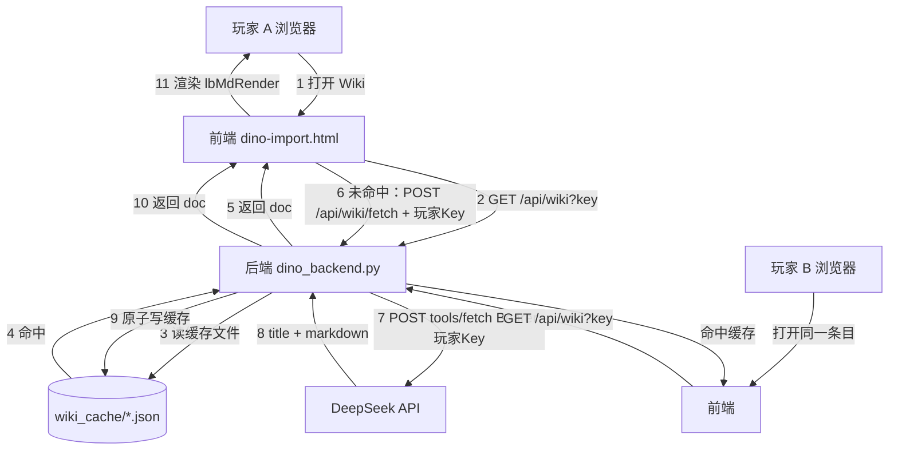

# 物种 / 物品 Wiki 查看与翻译 — 实施方案 v1

| 项 | 内容 |
|---|---|
| 文档版本 | v1 |
| 日期 | 2026-10-28 |
| 状态 | 待评审（未开工） |
| 需求来源 | 用户 2026-10-28 口头需求（6 条） |
| 涉及项目 | 前端 `dino-import.html`（CF Workers 静态）＋ 后端 `独立后端\dino_backend.py`（物理服务器 `192.168.199.3:8080`，经 Tunnel `data.whiterober.ccwu.cc`） |
| 关键外部依赖 | DeepSeek `POST /v1/tools/fetch`（网页正文 Markdown 抓取）＋ `POST /chat/completions`（翻译） |

---

## 1. 需求原文与拆解

用户原文（逐条）：

1. 每个物种、物品 都要有个入口样式和操作一样的 功能：Wiki
2. 显示对应物种、物品 的 Wiki 页翻译（原文）
3. 抓取的或翻译后的数据，最大化重用机制，所有玩家共用
4. 打开某个物种、物品 默认自动抓取原文（一旦抓取，全体玩家就无需再次抓取了，直接显示）
5. Wiki 页面要有 翻译按钮（一旦翻译，该页面打开就自动是翻译后的，全体玩家通用）
6. Wiki 页面还要有 更新按钮（和翻译按钮同层级）；可以重新抓取最新的当前物种物品 Wiki；如果已经翻译就再走一步自动重新翻译

补充决策（同日确认）：

- **抓取只用 DeepSeek `tools/fetch`，不做 MediaWiki API / Search 兜底**
- **谁点击抓取/翻译，就消耗谁的 DeepSeek token**（玩家自带 Key，服务端不保存 Key）
- 方案文档位置：`计划\计划_物种物品Wiki查看与翻译_v1_20261028.md`

### 1.1 验收标准（可测）

| # | 验收项 | 判据 |
|---|---|---|
| V1 | 入口存在 | 选中物种或器械时，功能条出现 Wiki 方框按钮（与「操作」同尺寸 35×35、圆角 8、虚线/实心规则同款） |
| V2 | 首次自动抓取 | 首次打开某条目 Wiki 面板，无缓存时自动抓取并显示原文，耗时 ≤ 10s（超时给明确错误） |
| V3 | 跨玩家共享 | A 玩家抓取后，B 玩家（不同浏览器/账号）打开同一条目：命中后端缓存，≤ 500ms 出内容，且**不产生第 2 次抓取** |
| V4 | 翻译共享 | 任一玩家点「翻译」成功后，所有玩家再次打开默认显示**译文**；可切换看原文 |
| V5 | 更新按钮 | 「更新」重新抓取；若该条目已有译文，抓取成功后**自动重译**并覆盖 |
| V6 | 无 Key 只读 | 未配置 DeepSeek Key 的玩家：能读已缓存内容；缓存缺失时提示「需要配置 AI Key 才能抓取」，不报错刷屏 |

---

## 2. 现状调研（已核实）

### 2.1 为什么「流程 AI」能顺利抓到 wiki 信息

结论：**它并不自己抓网页，而是调用 DeepSeek 官方 Search API，由 DeepSeek 服务端去抓。**

代码位置：`dino-import.html`

- `lbAiWikiQuery(inp)`：L35174~35218 — 构造**中文**查询词（`中英名 + " 方舟生存飞升 ARK 采集 流程 攻略 wiki dododex"`）
- `lbAiFetchRefs(inp)`：L35219~35270 — `POST https://api.deepseek.com/v1/tools/search`，参数 `{query, count:5, ori_question}`，8s 超时；结果按 `rerank_score + 站点偏好（ark.wiki.gg +3 / dododex.com +2.5 / 含 wiki +1.5 / authority≥3 +1）` 排序，取前 3 条拼成「【标题】摘要」喂模型
- 使用位置：`lbHfAiGen()` L35837 起（生成前先取网络参考资料，失败静默降级）

局限（本方案要解决的）：

1. 只取 `summary`（600~800 字摘要），**拿不到整页正文**
2. 每次生成都现抓，**无任何持久缓存**，同一物种反复消耗额度
3. 用的是**当前玩家**的 Key，结果只进当前玩家上下文，**无法共享**
4. 请求在浏览器直连 `api.deepseek.com`（当前项目已验证可用）

### 2.2 为什么不能"后端自己抓 wiki"

- 2026-10-15 实测（`v4683/v4684`）：`ark.wiki.gg` 对脚本 HTTP 请求**一律 403**（批量 `api.php` query / 改 UA / 单页 `action=parse` 全灭）
- 唯一曾成功的降级路线是"内置浏览器读 DOM"，但那是**本机 agent 手工操作**，后端常驻服务无法复用
- ⇒ 抓取必须借道第三方抓取服务（本方案：DeepSeek `tools/fetch`）

### 2.3 DeepSeek Fetch 能力（官方文档要点，2026-10 现行）

| 项 | 值 |
|---|---|
| 端点 | `POST https://api.deepseek.com/v1/tools/fetch` |
| 鉴权 | `Authorization: Bearer <DeepSeek API Key>` |
| 请求 | `{ "url": "https://ark.wiki.gg/wiki/Rex" }`（url ≤ 8192，须含 host，不能带账号密码） |
| 响应 | `{ "title": "...", "content": "# Markdown 正文" }` |
| 错误 | 400 参数错 / 401 Key 无效 / 402 余额不足 / **403 被安全策略拒绝** / 404 无法获取可用内容 / 429 超限 / 5xx |
| 限速 | 账号级 25 QPS（另按目标域名限 QPS） |
| 计费 | **每 1000 次成功请求 5 元**；失败/无正文不计费 |

> 说明：`tools/search` 在本方案中**不启用**（用户明确"不用兜底"）。若日后 fetch 命中率不足，可在附录 A 的备选方案里启用 `search(need_content:true)`。

### 2.4 可复用的现有能力（不新造轮子）

| 能力 | 位置 | 复用方式 |
|---|---|---|
| 后端落盘 + 公开读 + 白名单写 | `dino_backend.py` 的 `BB_NOTES_*`（`/api/bb_notes`） | 照抄结构做 `WIKI_*` / `/api/wiki` |
| 原子写（tmp + `os.replace`） | `_bb_notes_write()` | 直接复用写法 |
| 抓取进度/长任务状态机 | `_CFG_JOB` + `/api/cfg_rules/refresh_status` | 抓取任务状态复用同思路 |
| 前端 Markdown 渲染 | `lbMdRender` / `lbMdInline`（含 `==高亮==`、`%%变色%%`、标题/列表/代码块/链接） | Wiki 正文直接用，不再写第二套渲染 |
| 浮窗样式 | `.lb-picker-overlay` + `.lb-picker-panel` + `#lbCfgBody` 滚动区 | Wiki 面板沿用 |
| 加载提示 / Toast | `lbToast` / 面板内 ⏳ 文案 | 统一交互 |
| 入口按钮样式 | `#lbSpeciesOpsBtn`（35×35、圆角 8、`border-radius:8px`） | Wiki 按钮完全同款 |
| 物种/物品英文名解析 | `findSpeciesByClass()`（ASB `name`）、`lbItemMeta()`、`LB_ICON_BY_NAME`、`lbStripPrefix()`、`lbCanonBase()` | 用于推导 wiki 页面名 |
| AI Key 存取 | `lbAiCfgGet()`（localStorage `dinoAi`：`{base, token, model}`） | 取玩家 Key |

---

## 3. 设计决策（拍板项）

| # | 决策 | 理由 |
|---|---|---|
| D1 | 抓取**只走** `tools/fetch`，直接请求 `https://ark.wiki.gg/wiki/<PageName>` | 用户确认；路径最短、成本最低（无二次调用） |
| D2 | 抓取/翻译**由操作玩家出 token**，后端**只做中转**（透传 Authorization），**不保存 Key** | 用户确认；成本归操作者 |
| D3 | 抓取/翻译结果**存后端磁盘**，所有玩家**公开只读** | 满足"最大化重用 / 全体共用" |
| D4 | 缓存粒度 = **一个条目一个文件**（不是单大文件） | 避免并发互覆（先例：DinoData 单文件被 10 台服整文件覆盖的血泪教训） |
| D5 | 前端**先读缓存再决定是否抓取**；自动抓取仅在"缓存缺失"时触发 | 满足需求 4，且避免重复花钱 |
| D6 | 译文与原文用 `src_hash` 指纹绑定；原文变了译文自动标脏 | 满足需求 6 的"自动重译" |

---

## 4. 总体架构



要点：

- **只有"缓存缺失/强制更新"才产生 DeepSeek 调用**；其余全是本地磁盘读
- 后端**不持有任何 Key**，`token` 仅在该次请求内存中使用（用完即丢，不写日志/不落盘）
- 分享给全体玩家的是**内容**，不是 Key

---

## 5. 数据模型

### 5.1 缓存目录

```
<DINO_DATA 父目录>\wiki_cache\
  index.json                 ← 轻量索引（全部条目的元信息，供列表/统计/预热检查）
  d\<KeyHash>.json           ← 物种条目（如 d\Rex.json）
  i\<KeyHash>.json           ← 物品条目（如 i\TekHelmet.json）
  _tmp\                      ← 写临时文件目录（os.replace 前）
  _logs\fetch.log            ← 抓取/翻译审计日志（不含 Key）
```

- `KeyHash`：对 `key` 做 `re.sub(r'[^A-Za-z0-9_.-]','_', key)`（Windows 文件名安全），过长时追加 `sha1(key)[:8]`
- 与 `bb_notes.json` 同层级（都在后端程序目录），便于统一备份

### 5.2 缓存键规范

| 类型 | key 形态 | 示例 |
|---|---|---|
| 物种 | `d:<类名去后缀>`（保留变体前缀） | `d:Rex`、`d:AberrantRex`、`d:CorruptedRex` |
| 物品/器械 | `i:<lbCanonBase 名>` | `i:TekHelmet`、`i:GrapplingHook`、`i:GooGun` |

> 键**必须**与"当前选中的物种/器械"一一对应，且与 `lbSpeciesOpsHas()` 使用的键系**同一套**（`LB.curClass` / `LB.pickItem.base`），避免出现"操作有键、Wiki 找不到"的错位。

### 5.3 条目文档结构

```json
{
  "ver": 1,
  "key": "d:Rex",
  "kind": "dino",
  "name_en": "Rex",
  "name_zh": "霸王龙",
  "page": "Rex",
  "source_url": "https://ark.wiki.gg/wiki/Rex",
  "title": "Rex - ARK: Survival Ascended Wiki",
  "raw_md": "## 概述\n...",          
  "raw_len": 18342,
  "src_hash": "sha1:9f2c...",       
  "fetched_at": 1761600000,
  "fetched_by": "whiterober",
  "fetch_ms": 3120,
  "fetch_ver": "deepseek-fetch-1",

  "trans": {
    "md": "## 概述\n...",          
    "lang": "zh-CN",
    "model": "deepseek-chat",
    "src_hash": "sha1:9f2c...",     
    "at": 1761600100,
    "by": "whiterober",
    "ms": 18400,
    "chunks": 6,
    "partial": false                
  },

  "errors": [
    { "at": 1761600200, "stage": "fetch", "code": 403, "msg": "safety policy" }
  ],
  "fail_count": 0
}
```

字段说明：

- `src_hash`：`sha1(raw_md)`，用于判断译文是否过期（`trans.src_hash != src_hash` ⇒ 译文标脏）
- `trans.partial`：分块翻译中断（部分成功），前端提示"译文不完整，可点更新重试"
- `errors` / `fail_count`：连续失败 N 次（默认 3）后进入**冷却**（24h 内不自动重抓，需手动点更新），防"每次打开都花一次钱还是失败"

### 5.4 索引结构（`index.json`，仅供统计/预热，不作真理源）

```json
{
  "ver": 1,
  "updated": 1761600000,
  "items": {
    "d:Rex": { "page": "Rex", "fetched_at": 1761600000, "raw_len": 18342, "has_trans": true, "trans_at": 1761600100, "fail_count": 0 },
    "i:TekHelmet": { "page": "Tek_Helmet", "fetched_at": 1761500000, "raw_len": 9210, "has_trans": false, "fail_count": 0 }
  }
}
```

> 索引**可随时由缓存文件重建**（`GET /api/wiki/stats` 内置 rebuild 兜底），避免索引损坏导致不可用。

---

## 6. 后端接口契约

统一前缀 `/api/wiki`，CORS 复用现有实现（`_cors()`），`Content-Type: application/json; charset=utf-8`。

### 6.1 `GET /api/wiki?key=d:Rex`

读取缓存（公开，无需登录/无需 Key）。

- 200 命中：`{ ok: true, doc: {...}, cached: true }`
- 404 未缓存：`{ ok: false, error: "not_cached", key: "d:Rex" }`
- 400 参数缺失：`{ ok: false, error: "bad_key" }`

ETag：`"w<fetched_at>-<raw_len>"`，命中 `If-None-Match` 返回 304（降低流量）。

### 6.2 `POST /api/wiki/fetch`

抓取/更新原文。**必须携带玩家 DeepSeek Key**（透传，不落盘）。

请求：

```json
{ "key": "d:Rex", "page": "Rex", "url": "https://ark.wiki.gg/wiki/Rex", "token": "sk-***", "force": false }
```

- `page` / `url`：前端按 §7.1 规则推导后传入；`url` 优先（便于前端覆盖特殊页）
- `force`：`true` 时忽略缓存直接重抓（"更新"按钮）
- `token`：玩家 Key；后端仅在本次请求内使用

响应 200：`{ ok: true, doc: {...}, fetched: true, ms: 3120 }`
（`force=false` 且已有缓存 → 直接返回 `{ ok:true, doc, fetched:false }`，不消耗额度）

错误：

| code | 含义 | 前端表现 |
|---|---|---|
| 400 | 参数缺失 / url 非 http(s) / 域名不在白名单 | 提示"参数错误" |
| 401 | 玩家未配置 Key | 提示"需要先在设置里配置 DeepSeek Key" |
| 402 | DeepSeek 余额不足 | 提示"AI 余额不足" |
| 403 | DeepSeek 安全策略拒绝 | 提示"该页面被目标站点拦截" + 记录 `errors` |
| 404 | 未取到可用内容（多半页面名不对） | 提示"未找到该 Wiki 页面" + 给"在 wiki 搜索该词"外链 |
| 409 | 同 key 正在抓取中 | 返回 `{ ok:false, error:"in_progress" }`，前端 1.5s 后重试（最多 3 次） |
| 429 | 触发本机限流（见 §11） | 提示"操作太频繁，请稍后再试" |
| 502/504 | DeepSeek 超时/5xx | 提示"抓取超时，可点更新重试" |

### 6.3 `POST /api/wiki/translate`

翻译原文（`force=false` 且译文未过期则直接返回）。

```json
{ "key": "d:Rex", "token": "sk-***", "force": false, "lang": "zh-CN" }
```

响应：`{ ok: true, doc: {...}, translated: true, ms: 18400, reused: false }`

- 译文已存在且 `trans.src_hash == src_hash` 且 `!force` → `{ ok:true, doc, translated:false, reused:true }`（不花钱）
- 原文缺失 → 404 `{ ok:false, error:"not_cached" }`（前端先 fetch 再 translate）

### 6.4 `GET /api/wiki/stats`

```json
{ "ok": true, "total": 312, "dinosaurs": 268, "items": 44, "translated": 97,
  "total_bytes": 12839421, "last_fetch_at": 1761600000, "last_translate_at": 1761600100 }
```

公开只读；管理端（`CFG_OWNERS`）额外可得 `errors` 明细与 `per_day` 统计。

### 6.5 （P3，可选）`GET /api/wiki/img?u=<encoded>`

图片代理：仅允许 `ark.wiki.gg` / `static.wikia.nocookie.net` 域，带 30 天本地文件缓存。
目的：wiki 正文里的图片直连可能被 CF 拦或跨域失败。

---

## 7. 抓取器设计（后端）

### 7.1 页面名解析（前端负责推导，后端只做校验）

| 类型 | 解析链 |
|---|---|
| 物种 | ① `findSpeciesByClass(cls).name`（ASB 英文名，如 `Rex`）→ ② 若有变体前缀（`Aberrant` / `Corrupted` / `Tek` / `X-` / `R-`），拼成 ASB 完整名（`Aberrant Rex`）→ ③ 空格替 `_` → ④ `https://ark.wiki.gg/wiki/<Name>` |
| 物品/器械 | ① `LB_ICON_BY_NAME` 里该物品的 `name`（图标名≈wiki 页面名，如 `Tek_Helmet` / `Rex_Saddle`）→ ② 退 `lbItemMeta(key).en` → ③ 退 `lbSaddleLabel`/`lbCanonBase` 去前后缀 → 空格替 `_` |
| 兜底 | `wiki_alias.json`（前端静态表，人工维护常见别名）：`{ "d:Rex": "Rex", "i:TekHelmet": "Tek_Helmet", "d:DungBeetle": "Dung_Beetle" }` |

> 页面名解析是**本功能命中率的关键**。P0 阶段必须先跑一次"全物种页面名 dry-run 校验"（脚本：`tmp\_wiki_page_probe.py`，只对 5~10 个重点物种调 Fetch 验证 200），再铺开。

### 7.2 抓取流程（后端函数 `_wiki_fetch_one`）

```
1. 校验 key / url 白名单（host ∈ {ark.wiki.gg}）
2. 获取 per-key 锁（§11）；拿不到 → 409 in_progress
3. 若 !force 且缓存存在 → 直接返回
4. 组请求：POST https://api.deepseek.com/v1/tools/fetch  {url}，Authorization: Bearer <本次 token>
   - 超时 25s；超时按 504 记错
5. 200 → 取 {title, content}
   - content 为空或 len < 200 → 视为 404 无有效内容
6. 清洗（§7.3）→ 计算 src_hash
7. 原子写缓存（先写 _tmp 再 os.replace）
8. 更新 index.json（加锁重读-改-写，或直接由缓存文件重建）
9. 记审计日志（不含 token）
10. 若该条目已有 trans 且新的 src_hash 不同 → 标记 stale（不自动翻译，除非请求带 auto_retrans，见 §8.4）
```

### 7.3 正文清洗规则（Fetch 返回已是 Markdown）

目标：给玩家看的内容干净、给翻译模型的输入不含噪声。

| 噪声 | 处理 |
|---|---|
| 页首"跳转到内容/导航/语言选择" | 丢弃首个 `##` 之前的全部内容 |
| "Advertisement"、"Cookie" 段 | 正则整段删除 |
| 目录（`- [Overview](#overview)` 列表块） | 若某列表项**全部**为页内锚点，整块删除 |
| 相邻空行 | 压成最多 1 个空行 |
| wiki 相对链接 `(/wiki/Xxx)` | 补全为 `https://ark.wiki.gg/wiki/Xxx` |
| 模板残渣 `{{...}}` / `[[...]]` | 出现时保留原文但整段加 `> ` 引用标记（便于人工判断），**不猜内容** |
| 超长（> 60000 字符） | 截断并在末尾追加 `\n\n> （内容过长，已截断；可点「更新」或查看源页面）` |

### 7.4 失败与冷却

- 每次失败：`errors` 追加一条（最多保留 10 条）、`fail_count += 1`
- `fail_count >= 3` → 该条目进入**冷却**：`GET` 返回 `doc.meta.cooldown_until`，前端不自动重抓，只显示"上次抓取失败（原因），可手动点更新"
- 任何一次成功 → `fail_count = 0`，清 `errors` 中的连续失败段

---

## 8. 翻译器设计（后端）

### 8.1 模型与提示词

- 模型：`deepseek-chat`（可用 `LB_AI` 配置的 `model` 覆盖；翻译用低温度 `temperature: 0.2`）
- 系统提示（草稿）：

```
你是 ARK: Survival Ascended 中文 Wiki 翻译。把给定的英文 Markdown 翻译成简体中文。
硬性要求：
1. 保留 Markdown 结构（#/##/###、列表、表格、代码块、链接、行内代码）与顺序，不增不删章节；
2. 术语必须优先使用【术语表】给出的译名；表中没有的生物名/物品名，沿用游戏内官方中文（无把握则英文原名后加中文括注）；
3. 不翻译：代码、命令、类名、数值单位、URL；
4. 不要添加任何解释、前言、结语；不要输出代码块包裹整篇；
5. 只输出译文 Markdown 本身。
```

- 术语表（每块都附带，控制在 ≤ 800 字）：从 `汉化\item_zh.json`、`汉化\cfg_zh.json`、`item_zh.json` 里挑**本篇出现过的** en→zh 词条（后端按 raw_md 里是否出现英文名筛选）

### 8.2 分块策略

1. 以 `^## ` 为界切分章节；单章 > 3500 字符时按 `^### ` 或段落再切
2. 每块 ≤ 3500 字符、≤ 约 1500 token 输出预算
3. **逐块串行**翻译（避免触发并发限流），每块完成即累加到内存缓冲
4. 全部完成才一次写盘（`partial:false`）；中途失败 → 保留已译部分，`partial:true` + `trans.md` 写已译内容 + `stale_chunks:[...]` 记录未完成块

### 8.3 译文写入规则

- `trans.src_hash` = 本次翻译所用的 `raw_md` 指纹
- `trans.at` / `trans.by`（玩家名）/ `trans.model` / `trans.chunks`
- 若翻译期间原文被"更新"覆盖（`src_hash` 变化）→ 本次译文作废（写入前再比一次指纹，不一致丢弃并返回 409 `src_changed`）

### 8.4 自动重译（需求 6）

`POST /api/wiki/fetch`（`force=true`）成功后：

- 若该条目 `trans` 存在 → 后端在**同一请求内**继续调用翻译（`auto_retrans=true`，仍用**发起者**的 token）
- 翻译失败不影响抓取结果（抓取成功照常返回，`trans_stale=true` 提示"译文待更新"）
- 前端"更新"按钮文案：有译文时显示「更新并重译」，无译文时显示「更新」

---

## 9. 前端设计

### 9.1 入口按钮（需求 1）

- 位置：`lbRenderBreedBar()` 内，紧跟 `#lbSpeciesOpsBtn` 之后插入 `#lbWikiBtn`
- 样式：**与操作按钮完全一致**（35×35、`border-radius:8px`、只图标无文字）
  - 图标：`mdi-book-open-page-variant`
  - 「有缓存」= 实心（青绿 `#22c55e` 或主题紫，待视觉定稿）；「无缓存且非拥有者」= 隐藏
  - 「无缓存但拥有者/有 Key」= 虚线方框（同操作按钮的虚线逻辑），提示可抓取
- 显示条件：`show && (LB.curClass || lbSpeciesOpsItemOk())`
- 小角标（P2）：右上角小圆点表示"已有译文"（紫）/ "仅原文"（灰）

> 与操作按钮一致的"虚线 = 未配置 / 实心 = 已就绪"语义，降低学习成本。

### 9.2 Wiki 面板

结构（复用现有浮窗）：

```
.lb-picker-overlay
  .lb-picker-panel (max-width:820px)
    header : [图标] 霸王龙 · Wiki            [翻译] [更新] [关闭]
    meta行 : 来源 ark.wiki.gg/wiki/Rex · 抓取于 3 天前 · 译文 1 天前
    body#lbWikiBody (overflow-y:auto)
        ⏳ 加载中… / 正文（lbMdRender）/ 错误块
```

- 按钮层级（需求 5、6）：`翻译` 与 `更新` **同级**（同一行、同尺寸 chip），`关闭` 在最右
- 「翻译」按钮状态机：
  - 无译文 → `翻译`（点击 → 调 translate）
  - 有译文且在显示译文 → `看原文`（切换视图，不调接口）
  - 有译文但 `src_hash` 过期 → `重新翻译`（提示"原文已更新"）
- 「更新」按钮：调 `fetch(force=true)`；若有译文 → 文案「更新并重译」

### 9.3 加载与渲染

1. `lbWikiOpen(key, name)` → 面板先显示 ⏳
2. `GET /api/wiki?key` → 命中：直接渲染（译文优先，见下）；未命中：若玩家有 Key 且非冷却 → 自动 `POST /fetch`
3. 渲染：`lbMdRender(doc.trans?.md || doc.raw_md)`（**需求 5：有译文默认显示译文**）
4. 顶部显示"显示：译文 / 原文"小切换（保留用户上次选择到 localStorage `lbWikiPref`）
5. 图片（P3）：`` → 统一走 `/api/wiki/img?u=`；未启用时代理时直接渲染原 URL，失败显示占位

### 9.4 无 Key 玩家路径

- 有缓存：正常读，`翻译`/`更新` 按钮置灰 + 提示"需要配置 AI Key 才能抓取/翻译"
- 无缓存：显示空态卡片「本条目还没有共享内容；配好 AI Key 后可抓取（抓取结果所有人共用）」

---

## 10. 并发与一致性

| 场景 | 处理 |
|---|---|
| 两个玩家同时点同一条目抓取 | 后端 per-key 锁：后者得 409，前端 1.5s 后重试（最多 3 次，通常第 1 次重试就命中缓存） |
| 抓取与翻译同时进行 | `translate` 前先校验 `doc` 存在；翻译写入前再校验 `src_hash` 未变 |
| 写盘冲突 | 一律"写 `_tmp` 临时文件 → `os.replace` 原子替换"；索引更新加全局 `WIKI_INDEX_LOCK` |
| 进程崩溃 | 缓存单条原子写，不会出现半截 JSON；索引损坏可由缓存目录重建 |
| 多实例/多进程 | 当前后端单进程；若未来多开，用文件锁（`msvcrt.locking` 或锁文件）——方案预留，不在 P0 做 |

---

## 11. 成本与限额

| 项 | 单价 | 说明 |
|---|---|---|
| DeepSeek Fetch | 5 元 / 1000 次 = **0.005 元/次** | 失败/无正文不计费 |
| 翻译（deepseek-chat） | 按 token（约 0.001 元/千输入 token） | 一页 3000 字英文 ≈ 4k token 输入 + 3k 输出 ≈ **0.01~0.03 元/页** |

估算：**全服 268 个物种 + 44 类器械全抓一遍 ≈ 1.6 元**；全翻译一遍 ≈ 5~8 元。一次性成本可接受。

限额（后端内存计数，重启清零）：

- 单玩家：10 分钟内最多 **10 次 fetch + 6 次 translate**
- 全局：同时进行中的 fetch ≤ **3**，translate ≤ **2**
- 同 key：1.5 秒内重复请求直接回缓存（防连点）

---

## 12. 安全

| 面 | 措施 |
|---|---|
| 玩家 Key | 仅在单次请求内存中使用；**不写日志、不落盘、不回显**；日志中若有 `sk-` 一律脱敏为 `sk-***` |
| SSRF | `url` 必须 `https` 且 host **严格等于 `ark.wiki.gg`**（白名单），不接受任意 URL |
| XSS | 渲染走 `lbMdRender`（首步 `lbMdEsc` 全转义，只放行白名单内联格式）；不 `innerHTML` 裸插原文 |
| 外链 | markdown 链接统一 `target="_blank" rel="noopener noreferrer"`（现有实现已带） |
| 刷额度 | §11 限流 + `force` 需登录玩家（有 Key 才能调） |
| 版权 | 面板固定显示来源链接（`来源：ark.wiki.gg/wiki/Xxx`）与"内容来自 ARK Wiki（CC BY-NC-SA），仅供本服玩家查阅" |

---

## 13. 可观测与运维

- **审计日志** `_logs/fetch.log`：`ts | by | key | stage(fetch/translate) | status | ms | bytes`（无 Key）
- **`GET /api/wiki/stats`**：总量/已译数/总字节/最近活动/失败榜（管理端）
- **前端 meta 行**：`来源 · 抓取于 X 天前 · 译文 Y 天前`（超过 90 天显示 ⚠️ 可能过期）
- **预热脚本**（P3）`tmp\_wiki_warm.py`：按物种列表批量调 `POST /api/wiki/fetch`（**需在请求头带管理员 Key**），串行 + 2s 间隔，输出 CSV 报告（成功/404/403）
- **清理**：单条目上限 `raw_md` 60KB；`wiki_cache` 总量 > 200MB 时按 `fetched_at` 最旧 LRU 清理（保留有译文的）

---

## 14. 实施分期

### P0 — 最小可用（原文 + 共享）≈ 1 版部署

改动：

- 后端 `独立后端\dino_backend.py`：新增 `WIKI_DIR` / `_wiki_read` / `_wiki_write` / `_wiki_fetch_one` / `_wiki_clean` / 路由 `GET /api/wiki` + `POST /api/wiki/fetch` + `GET /api/wiki/stats`
- 前端 `dino-import.html`：`#lbWikiBtn` 入口 + `lbWikiOpen/lbWikiRender/lbWikiFetch` + 面板骨架（仅原文）
- 页面名解析：`lbWikiPageOf(key)` + `wiki_alias.json`（先覆盖 20 个高频条目）

验收：V1、V2、V3、V6

### P1 — 稳健性

- per-key 锁 + 409 重试、失败冷却、ETag/304、索引重建、审计日志
- 前端 meta 行（抓取时间/来源）、错误态分型（403/404/429/超时 各有文案）

验收：并发场景 2 人同时点不产生 2 次抓取；失败后 24h 内不再自动重抓

### P2 — 翻译

- 后端 `POST /api/wiki/translate`（分块 + 术语表 + 指纹）
- 前端「翻译」按钮 + 译文优先 + 原文/译文切换 + stale 提示

验收：V4

### P3 — 更新与增强

- 「更新并重译」（`force` + `auto_retrans`）
- 图片代理 `/api/wiki/img`
- 预热脚本 + stats 管理视图 + 90 天过期提示

验收：V5

---

## 15. 风险与对策

| 风险 | 概率 | 影响 | 对策 |
|---|---|---|---|
| wiki 页面名推导错误（产物 404） | 高 | 抓不到内容 | P0 先做 20 条样本 dry-run；维护 `wiki_alias.json`；面板给出"在 wiki 搜索该词"外链 |
| DeepSeek Fetch 对 ark.wiki.gg 返回 403 | 中 | 抓不到 | 记录并提示；不启用 Search 兜底（用户决策）；必要时再评估 `search(need_content:true)` |
| 玩家 Key 无效/没余额 | 中 | 单次失败 | 明确文案（401→配置引导，402→余额提示），不自动重试刷屏 |
| 首次批量抓取成本失控 | 低 | 花钱 | 不默认预抓全量；仅在玩家打开时抓；预热脚本需管理员手动跑 |
| 译文质量差（游戏术语错） | 中 | 可读性 | 术语表强制约束 + 低温度 + 「看原文」一键切换 |
| 长页面翻译超上下文 | 中 | 译文截断 | 分块 + `partial` 标记 + 可重复点更新补齐 |
| 缓存文件损坏 | 低 | 单条不可用 | 原子写 + 读到坏 JSON 视为未缓存并自动重抓一次 |
| 并发写同一 key | 低 | 内容互覆 | per-key 锁 + 原子替换 |
| 原文清洗过度（丢内容） | 中 | 信息缺失 | 清洗规则逐条可回滚；保留 `raw_md` 原样字段供对比 |

---

## 16. 待定问题（开工前需拍板）

1. **入口按钮配色**：与操作按钮同为橙 `#f59e0b`，还是 Wiki 用青色/紫色区分？（现文案按"同款尺寸、不同色"设计）
2. **「有缓存」是否对非拥有者显示实心按钮**：需求说"所有玩家共用"，倾向：任何玩家只要有缓存就能看 → 实心可见
3. **检索不到条目时**是否给"用 AI 生成简介"降级？（当前方案：不给，避免幻觉内容混入 Wiki）
4. **物品范围**：只做"器械 4 类（armor/attachment/weapon/ammo）"还是包含全部物品（材料/消耗品）？后者页面名映射成本高（~3000 物品）
5. **预热策略**：是否上线后由管理员一次性抓 50 个最热条目（≈0.25 元）以保证首日体验

---

## 附录 A：备选抓取路径（当前不启用）

| 方案 | 说明 | 何时启用 |
|---|---|---|
| `tools/search` + `need_content:true` | 一次拿到 URL + 正文，可解决"页面名猜错" | 若 fetch 的 404 比例 > 20% |
| 后端直抓 `api.php`（wikitext） | 免费、结构化最好 | 若 wiki 取消对脚本的 403（可用 1 次探测脚本验证，探测成本 0） |
| 内置浏览器人工抓取 | 已验证可过 CF | 仅用于离线补数据（`tmp\` 脚本），不作线上链路 |

## 附录 B：现有代码索引（实施时对照）

| 用途 | 位置 |
|---|---|
| DeepSeek Search 调用样例 | `dino-import.html` L35219~35270 `lbAiFetchRefs()` |
| AI Key 读取 | `dino-import.html` `lbAiCfgGet()`（localStorage `dinoAi`） |
| 入口按钮样式参照 | `#lbSpeciesOpsBtn`（`lbRenderBreedBar()` 内，v5552/v5555 改造） |
| 面板/滚动区样式 | `.lb-picker-overlay` / `.lb-picker-panel` / `#lbCfgBody` |
| Markdown 渲染 | `lbMdRender` / `lbMdInline`（v5545~v5549 增强） |
| 后端 JSON 落盘范式 | `dino_backend.py` `_bb_notes_read/_write/_norm` |
| 后端长任务状态 | `_CFG_JOB` + `/api/cfg_rules/refresh_status` |
| 原子写 | `_bb_notes_write()`：写 `_tmp` → `os.replace` |
| 页面名素材 | `汉化\item_zh.json`、`汉化\cfg_zh.json`、`icon_zh_map.json`、`LB_ICON_BY_NAME`、`findSpeciesByClass()`、`lbCanonBase()` |
