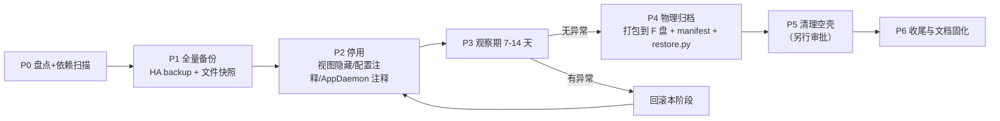
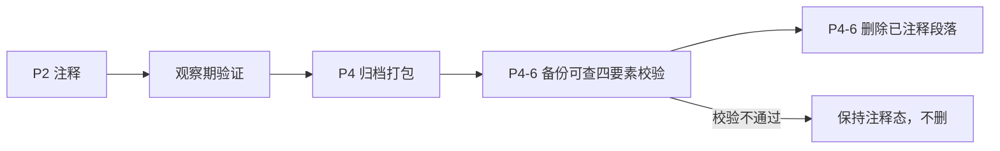

# HA 中「粑粑方舟」残留功能 清理归档方案

- 版本：v1.0
- 日期：2026-11-04
- 项目：Hass ASA Server Monitor
- 归档根目录：`F:\归档\HASS-粑粑方舟`
- 状态：方案待批准（未执行任何改动）

---

## 1. 目标与硬约束

### 1.1 目标

1. 把 HA 中「粑粑方舟」专属功能（看板视图、模板传感器、输入实体、脚本、自动化、shell_command、AppDaemon 应用、静态数据文件）从日常运行面撤出。
2. 撤出后 HA 更轻、更少报错、更少定时任务。
3. **任何一步都可原样恢复**，恢复后与清理前功能等价。

### 1.2 硬约束（不可妥协）

| 编号 | 约束 | 说明 |
|---|---|---|
| C1 | 不影响非方舟功能 | 家 / 电视遥控器 / 工作室 等视图、其他 AppDaemon 应用、其他自动化与脚本、其他 addon、其他 www 资源一律不动 |
| C2 | 全程可恢复 | 三级护栏：全量备份 → 停用（可逆开关）→ 归档包（一键还原脚本） |
| C3 | 不删原始数据 | 清理以「移出 + 打包」为主；YAML 段落默认**先注释**，归档校验与还原演练通过后才允许**真删**；任何删除必须先满足「备份可查四要素」（见 §8.1） |
| C4 | 先禁用后删除 | 停用后必须经过观察期，无异常才进入物理归档 |
| C5 | lovelace **单向**同步 | **唯一权威 = `.storage/lovelace.lovelace`**（HA 运行时读它）。`/config/lovelace` / `/config/lovelace.lovelace` / `/config/.storage/lovelace` 只是项目侧镜像；改完必须 **.storage → 镜像** 单向回灌，**禁止反向**（详见 §4.0） |
| C6 | 每阶段独立回滚点 | 每阶段结束打一个快照点，任一步失败可单独回退该步 |
| C7 | 依赖先查后动 | 任何实体/文件在被停用前，必须先完成引用扫描；有非方舟引用者直接排除 |
| C8 | **零依赖闸门优先** | 必须先证明搞事系统对 HA 是 0 依赖（见 §5.5），**6 条链路全部通过前禁止进入 P1**；任一链路不通过，对应 HA 资产直接进「保留区」 |

### 1.3 明确非目标

- 不优化方舟功能、不修 bug、不重构、不改外观。
- 不迁移数据到搞事系统（主体迁移已完成，本方案只做 HA 侧收尾）；
  资讯广场及其生产端 `discord_patch_bot` 的迁移也**已完成并上线**（2026-11-04 验收，见 §4.6.3），本方案直接将其纳入清理，不再展开迁移实施。
- 不清理 HA 自身的历史记录、日志、request-dumps 等（另立项）。

---

## 2. 现状前提

1. 粑粑方舟**主体能力**（服务器管理 / 生物速查 / 聚落 / 物品 / Wiki / 天气等）已迁到「搞事系统」（CF Workers 纯 Assets + `data.whiterober.ccwu.cc` 数据后端）。
2. **资讯广场（`ark_patch`）+ 生产端 `discord_patch_bot` 的迁移已完成并上线**（2026-11-04 实测验收通过）：
   - 后端：`dino_backend.py` v5926 起「后端直抓 Discord」→ `/api/news/*` / `/api/news/imgfix` / `/api/news/zh`
   - 前端：搞事系统 `#lbNews` 浮窗（`lbSheetBuild` 动态生成）+ 5 一级 / 7 叶子 Tab
   - 用户口径（2026-11-04）：`discord_patch_bot` **也属方舟相关**，纳入本轮清理；前置已解除，**可直接停用**（见 §4.6.3）
3. 因此 HA 里的方舟功能（**含资讯链路**）均属**冗余运行面**，撤离后不再承担业务。
4. 存在**混合依赖风险**：搞事系统可能仍在拉 HA 上的静态数据（图标、词典、`asa-data` 目录等），这些文件**不能跟着一起归档**。
5. 上一轮（2026-11-02）已完成第一波归档：asa-admin 编辑器 HTML、46 个遗留随机名页、157 个 .bak、12 个后端 py、`asa-data/thumbs`；
   归档包在 `B:\项目\ASA 后台管理\_archive_20261102_140825\`（带 `restore.py`）。本轮是在此基础上的**第二波（运行面）**。

---

## 3. 非方舟功能白名单（绝对禁止触碰）

> 下表任何一项，只要被清理流程碰到，即视为事故。执行前打印本表逐项人工核验。

### 3.1 视图（Lovelace）

| 视图 | path | 归属 |
|---|---|---|
| 家 | `/lovelace/0` | 非方舟 |
| 电视遥控器 | `/lovelace/1` | 非方舟 |
| 工作室 | `/lovelace/2` | 非方舟 |
| 其余所有非方舟视图 | 非 `ASA_BUILD_PATHS`、非方舟 path 白名单 | 非方舟 |

### 3.2 系统层

| 类别 | 保护范围 |
|---|---|
| AppDaemon | 除 `asa_server_monitor_reliable` 外的全部 app 与 `apps.yaml` 其他条目 |
| automations.yaml | 除方舟相关自动化外的全部自动化 |
| scripts.yaml | 除方舟相关脚本外的全部脚本 |
| configuration.yaml | 除方舟段落外的全部配置（含 `homeassistant:` `http:` `mqtt:` `var:` 等公共段） |
| addons | 全部 addon 的安装状态、端口、自启设置 |
| 前端资源 | HACS 组件（button-card / card-mod 等）、主题、`/config/www` 中非方舟目录 |
| 其他 | 用户、认证、备份配置、网络、TTS、语音助手等 |

### 3.3 搞事系统仍可能引用的 HA 静态资源（默认保护，需扫描确认）

> 这些文件**在搞事系统改造完成前不得归档**。必须逐一用「线上抓包 / 页面 network 记录」确认搞事系统已不再请求后才能列入清理范围。

- `/local/asa-data/icons2.json`
- `/local/asa-data/icon_zh_map.json`
- `/local/asa-data/icon_thumbs.js`、`icon_thumbs_meta*`
- `/local/asa-data/facility_zh.json`、`item_zh`、`dino_colors`、`dino_prefix_zh`、`gene_traits_zh`、`icon_anti_color.json`
- `/local/asa-data/itemstats*`
- `/local/asa-data/icons`（icon 图目录）
- `list_icons.py` / `list_icons.sh`（图标清单生成工具）
- `/local/dino-import.html`（HA 侧旧副本，若搞事系统已完全独立可归档；需先确认 Lovelace iframe 是否还指向它）

---

## 4. 残留资产盘点清单

> 状态列：`已确认` = 有历史记录佐证；`待核实` = 必须在 P0 阶段实机扫描后填入准确路径/实体名。

### 4.0 Lovelace 文件拓扑与权威判定（2026-11-04 实测，**P2-1 前必读**）

#### 4.0.1 四路径实测

| 路径 | 字节 | mtime | md5(前12) | 角色 |
|---|---|---|---|---|
| `/config/lovelace` | 3,303,902 | 2026-10-28 00:55 | `6ff864e4d891` | 项目镜像（XFtp 同步源） |
| `/config/lovelace.lovelace` | 3,303,902 | 2026-10-28 00:55 | `6ff864e4d891` | 项目镜像（副本） |
| `/config/.storage/lovelace` | 3,303,902 | 2026-10-28 00:55 | `6ff864e4d891` | 旧格式存储位（当前与镜像同源） |
| `/homeassistant/.storage/lovelace` | 同上（同一文件，宿主路径） | | `6ff864e4d891` | 同上 |
| **`/config/.storage/lovelace.lovelace`** | **3,073,753** | **2026-11-03 22:18** | **`64af8c5fcc1e`** | **HA 运行时权威** |
| `/homeassistant/.storage/lovelace.lovelace` | 同上（同一文件，宿主路径） | | `64af8c5fcc1e` | 同上 |

#### 4.0.2 差异到底在哪（逐视图体积对比）

| 视图 | `/config/lovelace`（旧镜像） | `.storage/lovelace.lovelace`（运行时） | 差值 |
|---|---|---|---|
| 家 | 7,478 | 7,478 | 0 |
| 电视遥控器 | 12,157 | 12,157 | 0 |
| 工作室 | 3,215 | 3,215 | 0 |
| 方舟 | 46,194 | 45,828 | −366 |
| 服务器操作 | 15,222 | 15,222 | 0 |
| 资讯广场 | 48,298 | 48,298 | 0 |
| 快捷输入 | 18,461 | 18,461 | 0 |
| 部落运维速查（原版） | 86,766 | 86,766 | 0 |
| 基地速查（原版） | 498,795 | 498,795 | 0 |
| 服务器规则 | 883,281 | 805,057 | −78,224 |
| 部落运维速查 | 1,135,359 | 1,022,381 | −112,978 |
| 孤岛基地速查 | 331,488 | 293,231 | −38,257 |
| 其余 10 个基地速查 | 144~146 | 144~146 | 0 |

**关键结论：**

1. **非方舟视图（家 / 电视遥控器 / 工作室）逐字节一致（delta=0）** ⇒ 双份漂移**没有污染非方舟内容**，清理期间不用担心误伤。
2. 漂移只发生在 **4 个 ASA 视图**（方舟 / 服务器规则 / 部落运维速查 / 孤岛基地速查），且都是 **`.storage` 比镜像小** ⇒ 说明 2026-11-03 22:18 有人（或某次编辑）在 UI 里**做过删减**，而镜像停在 10-28 的快照。
3. **`.storage/lovelace.lovelace` 才是 HA 真正读取的配置**（UI 改动只写它）⇒ 改 `/config/lovelace` 对页面**无效**。

#### 4.0.3 为什么会产生漂移（项目历史依据）

| 依据 | 内容 |
|---|---|
| 模式提示词「Lovelace 编辑流程」 | 正常链路：改本地 `lovelace` → 复制到 `lovelace.lovelace` → ASA 后台「💾 保存Tab」→ `build_lovelace` 写 `.storage` → 最后 MD5 四路径一致 |
| 模式提示词「跨会话铁律」 | ASA 页面改完必须 SSH 跑 `build_lovelace.py`；**它负责自动同步 `.storage/lovelace.lovelace`** |
| `流程/sftp_config.md` | XFtp 实时同步：`A:\...\lovelace` ↔ `/config/lovelace`；`lovelace.lovelace` ↔ `/config/lovelace.lovelace` |
| `计划/editor_live_sync_plan.md` L42 | 另有映射把本地 `lovelace` 同步到 `/config/.storage/lovelace`（旧格式位）⇒ 所以那个文件也停在 10-28 |
| 进度 2026-07-07 | 曾因「apply 时用旧 `.storage` 覆盖新 `/config/lovelace`」造成回退，已把 sync 改到 saveJSON 之前 |
| **本轮变更（2026-11-02）** | `build_lovelace.py` 已被**归档下线** ⇒ 同步链条断了，UI 改动不再回灌镜像 ⇒ 漂移必然发生且会持续扩大 |

#### 4.0.4 处理口径（写进 P2-1）

1. **只改 `.storage/lovelace.lovelace`**（或直接走 UI），绝不改 `/config/*` 镜像当作品。
2. 改完**立即回灌镜像**（`.storage/lovelace.lovelace` → `/config/lovelace` + `/config/lovelace.lovelace` + `/config/.storage/lovelace`），使四路径一致，便于人工核对。
3. **禁止反向**：不得用 10-28 镜像覆盖 `.storage`（会删掉 11-03 的编辑）。
4. 回灌前先把 `.storage/lovelace.lovelace` 完整备份（归档包 `lovelace/lovelace.before.json`）。

---

### 4.1 Lovelace 视图（方舟侧）

| # | 视图 title | path | 管理者 | 状态 |
|---|---|---|---|---|
| 1 | 方舟 | `/lovelace/3` | ASA 后台写入（非 build） | 已确认 |
| 2 | 服务器操作 | `asa-server-ops` | ASA 后台写入 | 已确认 |
| 3 | 资讯广场 | `ark_patch` | ASA 后台写入 | 已确认 |
| 4 | 快捷输入 | `asa-quick-input`（subview） | 手动 + build | 已确认 |
| 5 | 服务器规则 | `asa-server-rules` | build_lovelace | 已确认 |
| 6 | 部落运维速查 | `info_whiterober` | build_lovelace | 已确认 |
| 7 | 基地速查 ×11 | `base_isl` … `base_bob` | build_lovelace | 已确认 |
| 8 | 生物速查 | `latest-dinos`（panel iframe） | 手动 | 待核实 iframe 目标 |
| 9 | 旧版残留 | `info_whiterober_old` / `base_whiterober_old` | 手动 | 待核实是否仍存在 |

### 4.2 configuration.yaml 片段

| 类别 | 内容 | 状态 |
|---|---|---|
| template sensor | `asa_server_details` / `asa_server_themes` / `asa_server_status` | 已确认 |
| template sensor | `dialog_server_status` / `dialog_server_version` / `dialog_server_players` / `dialog_server_ingame_time` / `dialog_server_combined` | 已确认 |
| template sensor | `official_server_version` / `profile_port` / `ingame_time_cache` / `safe_point_coords` | 已确认 |
| template sensor | `asa_server_rules_html` / `asa_tribe_ops_html` / `asa_base_quick_ref_html`（读 3 个 yaml） | 已确认（Phase 2 挂起项） |
| template sensor | `patch_cache` / `patch_channel_cache` / `news_cache` / `tieba_cache` / `adm_cache` / `asb_cache` / `patch_description*` / `news_patch_description` / `tieba_lz_summary` / `adm_preview_summary` / `asb_summary` / `latest_summary_sensor` | **方舟（资讯链路）** —— 产线已被后端 `/api/news/*` 取代（已验收，见 §4.6.3），可停用 |
| input 实体 | `input_select.selected_server` / `selected_action`、`input_text.current_operator`、`input_button.select_server_*` / `execute_server_action`、`sb_1..50_label`、`info_tribe_tab` | 已确认 |
| shell_command | 11 条（`save_asa_data` / `build_lovelace` / `render_asa` / `sync_lovelace_base` 等，部分指向已归档 py） | 已确认 |
| 其他 | `var:` 段（`rcon_message` / `game_text_input` 等）、`mqtt:` 相关方舟用法 | 待核实 |

### 4.3 scripts.yaml / automations.yaml

| 文件 | 条目 | 状态 |
|---|---|---|
| scripts.yaml | `set_selected_server` / `execute_server_action` / `execute_server_action_with_selection` / `set_rcon_command` / `player_pos` / `get_dino` / `track_dino` / `stop_track_dino` / `search_wild` / `refresh_tamed` 等 | 待核实（P0 精确列出） |
| automations.yaml | `load_sb_labels_on_start` / `save_sb_labels_on_change` | 已确认 |
| automations.yaml | 其他方舟相关（主题刷新、断线重连等） | 待核实 |

### 4.4 AppDaemon

| 路径 | 内容 | 状态 |
|---|---|---|
| `/addon_configs/a0d7b954_appdaemon/apps/asa_server_monitor_reliable.py` | 10 服 RCON 轮询主应用 | 已确认 |
| `/addon_configs/a0d7b954_appdaemon/apps/discord_patch_bot.py` | **Discord 6 频道抓取 + Coze 翻译 + `create_cards_from_content()` 调用源**，写 `sensor.*_cache` | **已确认（方舟资讯链路）** |
| `/addon_configs/a0d7b954_appdaemon/apps/apps.yaml` | `asa_server_monitor_reliable:` / `discord_patch_bot:` 条目 | 已确认 |

### 4.5 服务器端脚本与数据

| 路径 | 内容 | 状态 |
|---|---|---|
| `/config/*.py`（方舟相关） | `load_sb_labels.py` / `save_sb_labels.py` | 已确认 |
| `/config/*.yaml` | `server_rules.yaml` / `tribe_ops.yaml` / `base_quick_ref.yaml`（供 3 个 html sensor） | 已确认 |
| `/config/www/asa-data/*.json` | `server_rules.json` / `tribe_ops.json` / `asa_base_quick_ref.json` / `server_colors.json` | 已确认 |
| `/config/www/preview_tab.html` | 预览产物 | 待核实 |
| `/config/asa-admin-v*.html`（若仍有） | 上一轮残留 | 待核实 |

### 4.6 资讯链路（Discord → sensor → 资讯广场视图）

> **归属改判（2026-11-04 用户口径）：`discord_patch_bot` 属方舟相关，纳入本轮清理范围。**
> 此前曾按「独立能力」保留，现改为**纳入**，但受前置依赖约束（见 §4.6.3）。

#### 4.6.1 链路全貌

```
Discord 6 个频道
   ↓ discord.py 常驻
【A】discord_patch_bot.py          ← 抓取 + 提取图片/embed + Coze 翻译 + strip_markdown
   ↓ set_state
【B】sensor.patch_cache / patch_channel_cache / news_cache / tieba_cache / adm_cache / asb_cache
   ↓
【C】asa_server_monitor_reliable.py: create_cards_from_content()（约 L1515）
   ↓ set_state(attributes={cards, full_content, last_update})
【D】sensor.patch_description_full / patch_channel_patch_info / news_patch_channel_info /
     tieba_lz_full / adm_preview_full / asb_full
   ↓
【E】lovelace ark_patch（资讯广场，6 Tab：input_select.info_square_tab）
```

#### 4.6.2 盘点清单

| 层 | 资产 | 位置 | 备注 |
|---|---|---|---|
| A | `discord_patch_bot.py` | `/addon_configs/a0d7b954_appdaemon/apps/` | AppDaemon app；Coze 翻译为现役 |
| A | `apps.yaml` 的 `discord_patch_bot:` 块 | 同上 | 含 6 个频道 ID 配置 |
| B | 6 个 `*_cache` sensor | configuration.yaml / AppDaemon set_state | 原始缓存 |
| C | `create_cards_from_content()` | `asa_server_monitor_reliable.py` | **与 RCON 主应用同文件**，删除需按函数粒度 |
| D | 6 个 `*.cards` sensor + 6 个摘要 sensor | configuration.yaml / AppDaemon | Tab 数据 + 角标 |
| E | 资讯广场视图 `ark_patch` | lovelace | 含 `input_select.info_square_tab` + `input_button.refresh_server_status` |

#### 4.6.3 ✅ 前置依赖：已解除（2026-11-04 实测验收通过）

原计划要求「迁移完成后才能归档」。**迁移已完成并上线，本阻塞已解除**，`discord_patch_bot` 可直接进入停用清单。

**在线验收记录（搞事系统 `v20261102-6028`，逐 Tab 实测）**

| 一级 Tab | 叶子 id | 实测结果 |
|---|---|---|
| PC版本 | `patch_pc` | 20 条，已全部译好 |
| 新闻 | `news` | 社区周报 530 正文正常 |
| ADM → 版本 | `patch_channel` | 18 条，已全部译好 |
| ADM → 预告 | `adm` | 版本 3.7.3.0 最终发布说明 |
| 汉化 | `tieba` | 汉化修复补丁 v10.0 |
| API → 版本 | `api_ver` | 1 条（官方公告无正文，属源数据如此） |
| API → 缓存 | `api_cache` | 1 条（同上） |

**与 HA 旧版的差异（已知且可接受）**

| HA `ark_patch` | 搞事系统 | 说明 |
|---|---|---|
| 6 个平铺 Tab（含 `ASB版本`） | 5 个一级 / 7 个叶子（`ASB版本` 拆/替为 `API版本` + `API缓存`） | 产品形态升级，非功能缺失 |
| 底部链接用 HA 签名图片（会过期） | 改用 MDI 字体图标 | 修好了旧缺陷 |

**剩余待办（低风险，不阻塞停用）**

- `ADM预告` / `API版本` / `API缓存` 目前均仅 1 条，需确认是「Discord 频道本身内容少」而非抓取出错（建议停用前抽一次原始频道比对）。

#### 4.6.4 与主链路的关系

- `create_cards_from_content()` 位于 `asa_server_monitor_reliable.py` 内 → **不能整文件归档**，需 P0 确认无其他调用方后随文件一并归档。
- 资讯数据渲染职责已由后端 `_news_cards()` / `_news_extract()` 接管，HA 侧该函数的产出（`sensor.*_full.cards`）已无消费方（资讯广场视图下线后）。

---

### 4.7 P0 盘点结果 · 精确行号坐标（2026-11-04 实测，P2 直接引用）

> 数据来源：`yaml.compose` 解析服务器实文件（只读），全文见 `tmp/_p0_inventory_out.txt`。

#### 4.7.1 configuration.yaml（1099 行）顶层结构

| 块 | 行区间 | 归属 |
|---|---|---|
| `frontend` / `http` / `mqtt` | L5–L34 | 非方舟 |
| **`template`** | **L44–L400** | **⚠️ 混装，见 4.7.2** |
| `input_boolean` | L401–L406 | 方舟（`rcon_commands_expanded`） |
| `input_button` | L407–L424 | 方舟（5 个） |
| `var` | L425–L472 | 方舟（7 个） |
| `input_select` | L473–L558 | 方舟（8 个） |
| `input_text` | L559–L975 | 方舟（`current_operator`…`sb_50_value`） |
| `timer` | L976–L984 | 待核实 |
| `logger` / `tts` / `switch` | L985–L1073 | 非方舟 |
| `homeassistant` | L1074–L1076 | 非方舟（**禁止触碰**） |
| `shell_command` | L1077–L1096 | 混装，见 4.7.4 |

#### 4.7.2 🔴 `template:` 混装警告（最高风险点）

| 行 | 条目 | 归属 |
|---|---|---|
| L45 | `123pan_jump_tile` | **方舟**（用户口径 2026-11-04 更正） |
| L49–L260 | 资讯类 + 服务器类 sensor（`patch_description*` / `news_*` / `tieba_*` / `adm_*` / `asb_*` / `official_server_version` / `dialog_server_*` / `profile_port` / `safe_point_coords` / `latest_summary_sensor` 等） | 方舟 |
| **L272–L377** | **`switch:` 模板：客厅制冷 / 工作室制冷 / 客厅制热 / 工作室制热 / GAME主机集成** | **非方舟（禁止触碰）** |
| L379–L399 | `ASA 服务器规则 HTML` / `ASA 部落运维速查 HTML` / `ASA 部落基地速查 HTML`（`!include` 三个 yaml） | 方舟 |

> ⛔ **结论：绝不能整块注释/删除 `template:` 键**。块内**唯一非方舟部分是 L272–L377 的 5 个 `switch:` 模板**（空调制冷/制热 + GAME主机集成），必须原样保留。
> 处理粒度：列表项（`- sensor:` / `- switch:` 节点）级，P2-2 必须逐项核验行号后再动手。

#### 4.7.3 方舟块精确区间（configuration.yaml）

| 类别 | 行区间 | 备注 |
|---|---|---|
| `input_boolean.rcon_commands_expanded` | L401–L406 | RCON 展开状态 |
| `input_button`（5 个） | L407–L424 | `refresh_server_status` / `execute_server_action` / `quan_tu_cun_dang_hou_zhong_zhi` / `quan_tu_qing_li_kong_long` / `execute_player_action` |
| `var`（7 个） | L425–L472 | `rcon_message` / `game_text_input` / `player_action_*` / `asa_server_rules` / `asa_tribe_ops_ref` / `asa_base_quick_ref` |
| `input_select`（8 个） | L473–L558 | `selected_action` / `info_square_tab` / `info_tribe_tab` / `info_server_rules_tab` / `selected_server` / `dialog_server_name` / `rcon_quick_commands` / `player_action_type` |
| `input_text` | L559–L975 | `current_operator`(L560) / `game_text`(L565) / `asa_selected_blocks`(L570) / `sb_N_label`+`sb_N_value` ×50（L576–L975） |

#### 4.7.4 shell_command（L1077–L1089，共 13 条）分类

| 条目 | 行 | 判定 |
|---|---|---|
| `save_asa_data` / `render_asa` / `save_data_chunk` / `save_data_copy` / `build_lovelace` / `sync_lovelace_base` / `preview_tab` | L1081–L1087 | **方舟（ASA 后台链路）** |
| `load_sb_labels` / `save_sb_labels` | L1088–L1089 | **方舟（快捷输入持久化）** |
| `save_r2_config` / `gen_icon_thumbs` / `command_timeout` / `list_r2_icons` | L1077–L1080 | **待核实**（图标/R2 相关，搞事系统可能仍用 → 默认**不删**） |

#### 4.7.5 automations.yaml（1002 行）：方舟相关自动化

| 行区间 | id | 别名 |
|---|---|---|
| L741–L756 | `1753691219437` | ASA Server Status Event Handler |
| L756–L776 | `1753720496429` | ASA RCON快捷命令选择 |
| L776–L799 | `1753776379299` | 关闭服务器弹窗时重置选择 |
| L799–L813 | `1753776403798` | RCON快捷命令选择 |
| L813–L825 | `1753786377880` | 清空RCON消息当选择自定义命令 |
| L825–L920 | `ark_server_theme_switcher` | ARK服务器主题切换器 |
| L920–L930 | `refresh_ark_theme` | 刷新ARK主题 |
| L930–L941 | `load_sb_labels_on_start` | 启动时加载快捷输入标签 |
| L941–L976 | `save_sb_labels_on_change` | 快捷输入标签变化时保存 |
| L976–L989 | `refresh_tamed_webhook` | 刷新tamed Webhook |
| L989–L1003 | `search_wild_webhook` | 搜野生 Webhook |

> 其余约 60 条为**电视遥控器**等非方舟自动化（L1–L740），**禁止触碰**。

#### 4.7.6 scripts.yaml（739 行）：方舟脚本分区

| 行区间 | 内容 | 判定 |
|---|---|---|
| L1–L39 | 3 条数字 id 脚本（`1615614179858` / `1650176234822` / `1677578002000`） | 待核实/疑似旧遗留 |
| L39–L190 | `execute_server_action` / `execute_server_action_with_selection` / `set_selected_server` / `set_rcon_command` / `set_dialog_server_name` / `kick_player` / `fill_rcon_for_player` / `set_player_action_message` / `execute_player_action_with_message` / `set_rcon_command_safe_point` | 方舟 |
| L190–L203 | `test_localstorage_write` | 待核实（疑似调试残留） |
| L196–L631 | `send_to_game` / `search_*`（含 `search_dyn_1..50`） | 方舟 |
| L632–L739 | `send_game_text` / `refresh_tamed` / `search_wild_dinos` / `track_dino` / `stop_track_dino` / `get_dino` / `player_pos` | 方舟 |

---

## 5. 依赖矩阵（谁引用谁）

> 目的：确认「停用某资产会不会牵连非方舟」。矩阵在 P0 阶段用脚本生成实机版本，此处给出**结构与判据**。

| 资产 | 被谁引用 | 迁移后是否仍需要 | 处理策略 |
|---|---|---|---|
| `sensor.asa_server_details` | 方舟视图、服务器操作视图、AppDaemon 写、搞事系统？（待确认是否走 HA API） | 否（若搞事系统独立取数） | 停用 |
| `sensor.asa_server_themes` | 方舟视图主题 | 否 | 停用 |
| `sensor.patch_*` / `news_*` / `asb_*` / `adm_*` / `tieba_*` | 资讯广场视图、`discord_patch_bot`（生产端） | **否**（已由后端 `/api/news/*` 取代，2026-11-04 验收通过） | 直接停用（见 §4.6.3） |
| `input_select.info_tribe_tab` | 部落速查 + 11 个基地速查页（共用） | 否 | 停用 |
| `input_text.sb_*_label` | 快捷输入视图、label 持久化脚本、自动化 | 否 | 停用 |
| `script.*`（方舟） | 各自视图 / AppDaemon | 否 | 停用 |
| `shell_command.*`（方舟） | ASA 后台残留调用（部分已失效） | 否 | 停用 |
| `asa_server_monitor_reliable` | 方舟视图数据源、`sensor.player_pos_status` / `get_dino_status` | 否（搞事系统用自己的后端） | 停用 |
| `asa-data/icons2.json` 等 | 搞事系统前端（待实测） | **可能需要** | **先实测网络请求，仍被引用则保留** |

依赖判定方法（P0 执行）：

1. `grep -rn` 全 `/config` 扫实体 ID 与 path（排除 `.storage` 里的历史状态）。
2. HA REST API `/api/states` 取当前全部实体，与 `grep` 结果交叉。
3. 搞事系统侧：浏览器打开 `https://dino.whiterober.ccwu.cc`，记录 `performance.getEntriesByType('resource')` 中的全部 `hass.whiterober.com` 域名请求，形成「HA 依赖清单」。**该清单上的资源一律不归档**。
4. 反向核对：断开（模拟）某资源后，搞事系统功能是否仍正常。

---
## 5.5 · P0-A 前置闸门：搞事系统零依赖 HA 评估

> **这是整个清理工程的第一道闸门，比 P0 盘点更早、且具一票否决权。**
> 理由：搞事系统虽已迁到 CF，但源码里仍保留旧架构分支、静态资源历史上取自 HA `/local/asa-data`、HA 侧还留着 iframe 入口。
> 只要有一条链路还在调 HA，清理就会**直接打断线上功能**。所以必须先证「0 依赖」，再谈清理。

### 5.5.1 六条依赖链（必须全绿）

| # | 链路 | 检查对象 | 通过判据 | 当前结论（2026-11-04） | 状态 |
|---|---|---|---|---|---|
| L1 | 前端网络层 | `dino-import.html` 运行期全部资源请求 | 请求 host 集合中**无任何 HA 域名**（`hass.whiterober.com` 等） | 实测 227 个请求：`dino.whiterober.ccwu.cc` 158 + `data.whiterober.ccwu.cc` 68 + Cloudflare Insights 1，**HA 命中 0** | 已通过（基础页） |
| L2 | 前端身份层 | 登录 / 账号识别 | 不连 HA WebSocket、不读 `hassTokens`、不依赖 `hassConnection` 父框架桥 | 新架构 `LB_ARCH==='new'` 分支走 `localStorage.dinoAuth` + `/api/login`；`hassTokens` / `hassConnection` / `/api/websocket` 代码仅在 `old` 分支执行 | 已通过（源码级） |
| L3 | 数据后端 | `data.whiterober.ccwu.cc` → `192.168.199.3:8080` `dino_backend.py` | 不调用 HA REST、不读 `/config`、不依赖 supervisor token；RCON 直连游戏服 | 源码 grep `hass` / `8123` / `supervisor` / `hassio` / `/config` **零命中**；`/asa-data/*` 由后端自身目录提供。⚠️ **本地副本已过期**（`NEWS_TABS` 仍含 `asb`，线上已为 `api_ver`/`api_cache`）⇒ 线上副本必须比对 | 已通过（源码级，**线上比对升为必做**） |
| L4 | 静态资源层 | `icons2.json` / `icon_zh_map.json` / `facility_zh.json` / `item_zh` / `dino_colors` / `icon_thumbs*` / 图标图 / 地图 | 全部落在 CF 双域（`*.ccwu.cc`），不取 HA `/local/asa-data` | 源码 `https://` 字面量 host 仅：`dino.whiterober.ccwu.cc`、`data.whiterober.ccwu.cc`、`cdn.jsdelivr.net`（MDI 回退）、`api.deepseek.com`；旧架构分支保留 `wiim.whiterober.com` / `img.whiterober.ccwu.cc`（新架构不执行）；后端自带 `/asa-data/*` | 已通过（懒加载模块待补齐） |
| L5 | HA 侧入口 | Lovelace「生物速查」iframe 卡片 | iframe 指向 CF 地址（或该视图将随清理一并下线） | 历史配置为 `/local/dino-import.html?v=N`（HA 本地）。属 **HA→搞事 的反向入口**，不影响搞事系统自身运行。本次因工具限制（SSH FS 大单行 JSON grep 无果、浏览器 HEAD 报协议错）**未能取到确定值** | **待核实（不阻塞闸门）** |
| L6 | PWA / Service Worker | `pwa/sw.js`、`pwa/manifest.webmanifest` | 缓存清单与 start_url 均为 CF 域，无 HA 路径 | `manifest.webmanifest` `start_url: "/"`；`sw.js` 仅 `caches.open()` 同源缓存，**无 hass 域名、无 `/local/` 引用** | 已通过（源码级） |

> L1 的 227 个请求是**打开首页**时的采集。懒加载模块（物品 / 天气 / 聚落 / 服务器控制 / AI / 设置 / 灾变）必须逐个点开后再采一次，才能认定 L1 真正通过。

### 5.5.2 实测方法（只读，可直接执行）

**L1 前端网络层（含懒加载补齐）**

1. 在内置浏览器打开 `https://dino.whiterober.ccwu.cc/?t=<时间戳>`。
2. 依次点开主要功能入口：生物速查 → 物品 → 地图/聚落 → 天气 → 服务器控制 → 维护列表 → 待制作 → 关注未成年 → 自助配置 → AI。
3. 每轮结束后执行聚合：
   ```js
   const h = {};
   performance.getEntriesByType('resource').forEach(e => {
     try { const u = new URL(e.name).host; h[u] = (h[u] || 0) + 1; } catch (x) {}
   });
   return { hosts: h, bad: Object.keys(h).filter(x => x.indexOf('whiterober.com') >= 0 && x.indexOf('ccwu.cc') < 0) };
   ```
4. 判据：`bad` 为空数组。
5. 补充：查看 console 是否有 `ERR_NAME_NOT_RESOLVED` 等失败请求（当前首页已有 1 条，需定位到具体 URL 并确认是否 HA 遗留）。

**L2 前端身份层**

- 源码 grep：`hassTokens` / `hassConnection` / `/api/websocket` / `lbHaTokenRefresh`，逐处确认外层有 `LB_ARCH === 'new'` 提前 return。
- 行为验证：清空 `localStorage.dinoAuth` → 刷新 → 应弹独立登录表单（而非跳 HA）。

**L3 数据后端**

- 读 `独立后端/dino_backend.py`（本地副本）+ 线上部署副本，grep：`hass` / `8123` / `supervisor` / `hassio` / `/config` / `local/asa-data`。
- 检查其对外依赖：RCON 端口、NAS/DinoData 路径、CF Tunnel。
- 判据：无任何 HA 服务调用。

**L4 静态资源层**

- 抓 `dino-import.html` 中全部 `https://` 字面量，按 host 归类。
- 结合 L1 的运行时请求清单交叉验证（源码有、运行期未出现 = 非活跃链路，可标「可弃用」但不必阻塞）。
- 判据：活跃请求全部落在 CF 双域。

**L5 HA 侧入口**

- `grep -o '"url":"[^"]*dino-import[^"]*"' /homeassistant/.storage/lovelace.lovelace`
- 判据：若指向 `/local/` ⇒ 记录为「HA 本地入口」，清理该视图时一并下线；若指向 CF ⇒ 该视图可保留为纯书签，不阻塞。

**L6 PWA / SW**

- 读 `pwa/sw.js` 的 `CACHE` 列表与 `manifest.webmanifest` 的 `start_url` / `scope`。
- 判据：无 `hass.whiterober.com`、无 `/local/`。

### 5.5.3 通过标准

| 结论 | 条件 | 后续动作 |
|---|---|---|
| **全量零依赖（6/6）** | L1-L6 全部通过 | 允许进入 P0 盘点 → P1 备份 → P2 停用 |
| **部分依赖（1-2 条不通过）** | 例：L4 仍有资源取 HA | 该链路对应资产进「保留区」，其余照常清理；清理范围收窄 |
| **核心依赖（L3 或 L1 不通过）** | 后端或前端仍调 HA | **整轮清理挂起**，先改造搞事系统解除依赖，再重启本方案 |

### 5.5.4 一票否决项的落地写法

评估结论必须落成一张「保留区追加表」，直接合入 §3.3：

| 如果 | 则保留 | 不得进入归档 |
|---|---|---|
| L4 有资源仍取 HA | `/config/www/asa-data/<对应文件>` | 该文件及其目录 |
| L3 后端仍调 HA | 对应 HA 服务 / sensor / 脚本 | 相关 YAML 段 |
| L2 身份仍依赖 HA | `hassTokens` 相关链路所依赖的配置 | 相关配置段 |
| L5 iframe 指 HA | `/config/www/dino-import.html` + 生物速查视图 | 二者 |

### 5.5.5 当前小结（截至 2026-11-04）

| 链路 | 结论 | 证据强度 |
|---|---|---|
| L1 前端网络层 | 通过（基础页） | 运行期实测 227 请求，HA 命中 0 |
| L2 前端身份层 | 通过 | 源码分支隔离 + 页面已正常显示用户「板板」 |
| L3 数据后端 | 通过 | 源码 grep 零 HA 引用 |
| L4 静态资源层 | 通过 | 源码字面量 + 运行期请求双证 |
| L5 HA 侧入口 | **待核实** | 工具受限未取到确切值 |
| L6 PWA / SW | 通过 | 源码无 HA 引用 |

**综合结论**：**5 / 6 已通过，1 项待核实且不阻塞**。

- 判定：搞事系统在**运行链路**上已实质脱离 HA（前端 + 后端 + 静态资源 + 身份全部自给）。
- L5 只是「HA 上还留着一个指向旧地址的入口」，属 HA 侧残留，**恰好是本轮要归档的东西**，不影响搞事系统。
- 仍需补齐的两项取证（**L3 升为必做**；L1 建议做）：
  1. **L3 线上副本比对（必做）**：本地 `独立后端/dino_backend.py` 已证实过期（`NEWS_TABS` 仍含 `asb`，线上已改为 `api_ver`/`api_cache`）⇒ **本地干净不代表线上干净**，必须拉线上副本重跑一遍 grep。
  2. **L1 懒加载补齐（建议）**：逐个点开物品 / 天气 / 聚落 / 服务器控制 / AI / 设置，再采一次 host 聚合（防某个懒加载模块偷调 HA）。

> 闸门判定：允许进入 P0，但 **P1 之前必须完成上述两项补齐取证**。

---
## 6. 归档总体设计（三级可恢复）



### 6.1 三级护栏

| 级别 | 形式 | 恢复成本 | 恢复粒度 |
|---|---|---|---|
| L1 全量备份 | HA 备份（`ha backups new`）+ `/config` 关键子集 tar | 分钟级（整机还原） | 全系统 |
| L2 停用 | 视图移入归档 JSON、YAML 段落注释、apps.yaml 注释 | 分钟级（改回配置 + 重启） | 单类资产 |
| L3 归档包 | `F:\归档\HASS-粑粑方舟\<批次>\` + `restore.py` | 分钟级（脚本一键） | 按清单 |

### 6.2 为什么先「停用」而不是直接打包

- 停用可只看不删，观察期发现问题立即改回，**不需要动归档包**。
- 观察期内 HA 仍持有全部原文件，排查方便。

---

## 7. 归档目录结构与命名规范

```
F:\归档\HASS-粑粑方舟\
├── 2026XXXX_HHMMSS_<批次名>\          # 每批次一个目录
│   ├── manifest.json                  # 清单：路径/哈希/大小/来源阶段/恢复动作
│   ├── restore.py                     # 一键还原（含 --dry 预览模式）
│   ├── verify.py                      # 还原后校验
│   ├── README.md                      # 本批次做了什么、怎么回滚
│   ├── lovelace\
│   │   ├── lovelace.before.json       # 原始 /config/lovelace
│   │   ├── lovelace.after.json        # 清理后
│   │   ├── asa_views_extracted.json   # 被摘出的视图（含完整原 JSON）
│   │   └── md5.txt
│   ├── config_yaml\
│   │   ├── configuration.yaml.before
│   │   ├── automations.yaml.before
│   │   ├── scripts.yaml.before
│   │   ├── configuration.yaml.after      # 注释/删除后的版本（供对照）
│   │   ├── asa_fragments\              # 摘出的方舟 YAML 段落（带源文件行号区间）
│   │   │   ├── configuration.asa.yaml  # 原字节副本（未加工）
│   │   │   └── index.json              # 每段：源文件/起止行/sha256/字节数
│   │   └── diff\                       # 删除前后逐行对照报告
│   │       ├── configuration.diff
│   │       ├── automations.diff
│   │       └── scripts.diff
│   ├── appdaemon\
│   │   ├── asa_server_monitor_reliable.py
│   │   ├── apps.yaml.before
│   │   └── apps.yaml.asa_block.yaml
│   ├── www\
│   │   ├── asa-data\                  # 仅归档「确认无引用」的数据文件
│   │   └── ...
│   └── logs\
│       ├── grep_report.txt            # 依赖扫描原始输出
│       ├── ha_core_check.txt          # 清理后 ha core check 结果
│       └── resource_404.txt           # 页面 404 统计
└── 2026XXXX_... 后续批次
```

**命名规范**

- 批次名：`<日期>_<阶段>`，例如 `20261110_P2停用`、`20261125_P4归档`。
- 所有 `*.before` 文件为**原始字节副本**，禁止再加工。
- `manifest.json` 每条记录必须含：`src`（HA 原路径）、`dst`（归档路径）、`sha256`、`bytes`、`phase`、`restore_to`（还原目标路径）、`restore_mode`（`replace` / `append` / `uncomment` / `insert_fragment`）、`lines`（源文件起止行区间，YAML 段必填）。

---

## 8. 分阶段实施步骤

### 8.1 · YAML 方舟段落处理双轨策略（注释 → 归档 → 删除）

> 用户口径（2026-11-04）：「先注释，完成归档后验证无误后，再删」。
> 即：**注释是过渡态，删除是终点**，但删除必须先把「备份可查」四要素凑齐。

#### 8.1.1 总体流程（注释 → 观察 → 归档 → 删除）



| 阶段 | 动作 | 产物 | 可否逆 |
|---|---|---|---|
| ① 注释 | 在 YAML 中把方舟段整体 `#` 注释，首尾加 `ASA-ARCHIVE-START/END` 标记 | `*.yaml.before` + `diff/*.diff` | 取消注释即恢复 |
| ② 归档 | 原字节副本 + 段落索引 + 哈希 | `asa_fragments/` + `manifest.json` | 不需恢复 |
| ③ 删除 | 删除已注释的整段（含标记行） | `*.yaml.after` | 靠 `restore.py --mode insert_fragment` 恢复 |

#### 8.1.2 「备份可查」四要素（缺一不可，强制）

| # | 要素 | 形式 | 验证方式 |
|---|---|---|---|
| E1 | **manifest 索引 + sha256** | `asa_fragments/index.json` 每段：源文件路径 / 起止行区间 / sha256 / 字节数 | 重新哈希归档副本，与索引一致 |
| E2 | **删除前后逐行对照报告** | `diff/configuration.diff`（unified diff，带行号） | 人工可逐行核对到底删了什么 |
| E3 | **原始 YAML 字节副本** | `asa_fragments/*.yaml`（**未经任何加工**，非注释版） | 字节数与 sha256 与源文件一致 |
| E4 | **可按段还原能力** | `restore.py --mode insert_fragment --id <段ID>` | `--dry` 能打印完整待插入内容与目标行号 |

#### 8.1.3 删除的前置条件（全部满足才允许删）

1. 归档包内 E1-E4 四要素齐备且校验通过。
2. P4 还原演练已成功一次（证明归档包可信）。
3. 观察期（P3）无异常，且已产生 `*.yaml.after` 预期版本。
4. `ha core check` 通过。
5. 弹窗获得用户单项批准。

#### 8.1.4 两种方式的适用场景

| 场景 | 建议 |
|---|---|
| 大段（template 群、shell_command 群、`asa_server_*_html`） | 注释优先；确认后整段删除 |
| 小段（single input、2 条 automation） | 可直接注释；确认后删除 |
| 需长期保留只读能力的 | **只注释，永不删**（进白名单） |
| 含非方舟共用节点的 | 只摘出方舟子节点，父节点保留；**禁止整段删** |

---

### P0-A · 搞事系统零依赖 HA 评估（只读，**前置闸门**）

**目的**：先证「搞事系统对 HA 0 依赖」，不通过则整轮清理挂起。

**操作**：按 §5.5.2 逐条跑 L1-L6，产出 `zero_dependency_report.md`。

**产出**：`zero_dependency_report.md`（六条链路逐条结论 + 证据截图/请求清单 + 保留区追加表）。

**验证**：6/6 全绿；或明确列出「部分依赖」清单并写入 §3.3。

**回滚点**：无改动。

**审批**：只读，可直接执行。

> ⛔ 闸门规则：L1 或 L3 不通过 ⇒ 整轮清理挂起；L4/L5/L6 不通过 ⇒ 收窄范围后继续。

---

### P0 · 盘点与依赖扫描（只读，零风险）

**目的**：把第 4 章所有「待核实」变成确定值，产出真实依赖矩阵。

**操作**

1. 导出 lovelace 当前视图清单（title / path / index / 卡片数）。
2. 导出 configuration.yaml / automations.yaml / scripts.yaml 中的方舟段落（带行号区间）。
3. 全量 grep 实体 ID 与 path 引用。
4. 抓搞事系统对 HA 的资源请求，形成「HA 依赖清单」。
5. 导出 AppDaemon `apps.yaml` 全文。

**产出**：`logs/grep_report.txt`、`inventory.md`（回填第 4 章）、`dependency_matrix.md`。

**验证**：清单项数量与实机一致；每条「待核实」都有明确结论。

**回滚点**：无改动，无需回滚。

**审批**：只读，可直接执行。

---

### P1 · 全量备份（第一道护栏）

**目的**：建立整机还原点。

**操作**

1. HA 备份：`ha backups new --name "pre-asa-cleanup-<日期>"`（走 supervisor，UI 可见）。
2. 文件快照（tar.gz，直接写到 F 盘）：
   - `/config/lovelace`
   - `/homeassistant/.storage/lovelace.lovelace`
   - `/config/configuration.yaml`
   - `/config/automations.yaml`
   - `/config/scripts.yaml`
   - `/config/*.yaml`（方舟 3 个）
   - `/config/www/asa-data/`（全量，先全备后择优）
   - `/addon_configs/a0d7b954_appdaemon/apps/`
3. 计算并记录全部 sha256。

**产出**：`F:\归档\HASS-粑粑方舟\<批次>\` 下完整备份 + `md5.txt` / `sha256.txt`。

**验证**

- 备份文件可解压（`tar -tzf` 列出前 20 条）。
- 归档包字节数与源文件字节数一致。
- HA 备份出现在「设置 → 系统 → 备份」列表。

**回滚点**：本阶段无改动。若备份失败则**停止**，不得进入 P2。

**审批**：需弹窗确认（HA 备份属平台级操作）。

---

### P2 · 停用（可逆开关）

> 原则：**只「移出运行面」，不删文件**。每类资产单独一步，每步单独验证 + 单独回滚。

#### P2-1 视图停用

**做法（推荐：走 UI，避免直接改 JSON）**

0. **前置（必做）**：按 §4.0 确认权威文件为 `.storage/lovelace.lovelace`，先备份它；禁止用 `/config/lovelace` 镜像覆盖它。改完再用 `.storage` 回灌三份镜像使其一致。
1. HA → 编辑仪表板 → 逐个把方舟侧视图设为「对侧栏隐藏」（隐藏 ≠ 删除，可一键恢复）。
2. 对确实不需要保留在侧栏的（服务器规则 / 部落速查 / 基地速查 ×11 / 快捷输入），先「隐藏」，观察期后再考虑移除。
3. `/config/lovelace` 与 `.storage/lovelace.lovelace` 在操作后**立即比对 MD5**，不一致则停止并回退。

**备选（脚本方式，风险更高）**

- 用 Python 从 `.storage/lovelace.lovelace` 中按 `path` 摘出视图 → 写入 `asa_views_extracted.json` → 保存回去。
- 严格按 path 匹配，**禁止按索引**（索引会随删除位移，误删非方舟视图）。
- 操作前先做 `lovelace.before.json`。

**验证**

- 非方舟 3 个主视图（家 / 电视遥控器 / 工作室）可正常打开、卡片无缺失。
- 方舟侧视图从侧栏消失。
- 页面 `performance.getEntriesByType('resource')` 中 404 数为 0。

**回滚**：UI 重新显示；或从 `lovelace.before.json` 覆盖 + 重启 HA。

#### P2-2 模板传感器 / input 实体 / shell_command 停用

> **本阶段只做注释，不做删除**。删除统一放在 P4-6（见 §8.1）。

**做法**

1. 先记录注释前快照：`configuration.yaml.before` + 行号区间（供后续 diff 与按段还原）。
2. 在 `configuration.yaml` 中把方舟相关块**整体注释**（不用删行），并在块首加标记：
   ```yaml
   # ===== ASA-ARCHIVE-START (2026-11-XX) 归档批次 XXXX =====
   # 恢复方式：见 F:\归档\HASS-粑粑方舟\<批次>\restore.py
   # template:
   #   - sensor:
   #       - name: ASA Server Details
   #         ...
   # ===== ASA-ARCHIVE-END =====
   ```
3. 用 `python -c "import yaml,sys; yaml.safe_load(open(...))"` 之外的方式验证：**必须先 `ha core check`**。
4. `shell_command` 中指向已归档 py 的 11 条一并注释。
5. 生成 `diff/configuration.diff`（注释前后逐行对照），存入归档包。
**验证**

- `ha core check` 无 error。
- 重启后 `开发工具 → 状态` 中相关实体已消失。
- 非方舟实体数量与清理前一致（对比清单）。

**回滚**：取消注释 → 重启 HA。

**审批**：需弹窗确认（改 configuration.yaml + 重启 HA）。

#### P2-3 脚本与自动化停用

> 同样**只注释不删**；小文件（`scripts.yaml` / `automations.yaml`）注释后立即生成 diff。

**做法**

1. `scripts.yaml`：方舟条目整段注释（或移入 `scripts_asa_archive.yaml` 并从 include 移除）。
2. `automations.yaml`：`load_sb_labels_on_start` / `save_sb_labels_on_change` 停用（先在 UI 关闭开关，再注释）。
3. 检查是否有非方舟自动化引用了这些脚本（依赖矩阵确认）。
4. 生成 `diff/scripts.diff`、`diff/automations.diff`。

**验证**：`ha core check` 通过；非方舟自动化列表与之前一致；对相关脚本的调用不再出现 404 日志。

**回滚**：取消注释 → 重启。

#### P2-4 AppDaemon 应用停用

**做法**

1. 备份 `apps.yaml`。
2. 注释 `asa_server_monitor_reliable:` 整块（**只注释这一块**）。
3. 重启 AppDaemon addon。
4. 若 AppDaemon 里还有其他方舟相关 app（**含 `discord_patch_bot`**），逐条确认后同样注释。
   - ✅ 资讯迁移已验收通过（§4.6.3），`discord_patch_bot` **可直接停用**，无前置阻塞。
5. 注释前先确认 `create_cards_from_content()`（资讯渲染，位于 `asa_server_monitor_reliable.py`）是否已被迁移替代；已由后端 `_news_cards()` 取代，P0 确认无调用方即可整体归档。

**验证**

- AppDaemon 日志中 `asa_server_monitor_reliable` 初始化消失，其他 app 初始化正常。
- 其他 app 的定时任务/回调仍在运行（看日志心跳）。
- 非方舟功能（如其他自动化依赖的 app）无异常。

**回滚**：取消注释 → 重启 AppDaemon addon。

**审批**：需弹窗确认（AppDaemon 重启属平台级操作）。

#### P2-5 静态数据文件「冻结」（不删）

- 对第 3.3 节「搞事系统可能仍引用」的资源：**保持原样**，只登记。
- 对确认无引用的方舟数据文件：**移动**到 `/config/www/asa-data/_archive_pending/`（同盘移动，可秒级回退）。

**验证**：方舟侧页面（若仍可访问）不报 404；搞事系统全功能正常。

**回滚**：`mv` 回原目录。

---

### P3 · 观察期（7~14 天）

**目的**：在不删任何东西的前提下，暴露「停用带来的隐性影响」。

**观察清单**

| 检查项 | 频率 | 判据 |
|---|---|---|
| HA 启动日志 error | 每次重启 | 无新增方舟相关 error |
| 实体不可用告警 | 每日 | 无非方舟实体变为 unavailable |
| 自动化触发次数 | 每日 | 非方舟自动化触发正常 |
| 其他 AppDaemon app 心跳 | 每日 | 均有正常回调日志 |
| 搞事系统功能 | 每日 | 生物速查 / 天气 / 聚落 / 物品 全链路可用 |
| 页面 404 | 每周 | 0 条方舟侧资源 404 |
| 用户主观反馈 | 持续 | 无「某个功能没了」的报错 |

**退出条件**：连续 7 天全部通过 → 进入 P4；出现任一异常 → 回滚对应 P2 子项，重新计时。

---

### P4 · 物理归档（打包到 F 盘）

**目的**：把已停用的资产从 HA 移出并封存，形成可一键还原的归档包。

**操作**

1. 按第 7 章结构，把下列内容复制（不是移动）到 `F:\归档\HASS-粑粑方舟\<批次>\`：
   - 方舟视图原 JSON（已在 P2-1 摘出）
   - 方舟 YAML 段落（含行号区间注释）
   - `asa_server_monitor_reliable.py` + `apps.yaml` 原块
   - 确认可归档的 `asa-data` 文件
2. 生成 `manifest.json`（含 sha256）。
3. 生成 `restore.py` / `verify.py` / `README.md`。
4. **只有在 P4-5 校验通过后**，才从 HA 移除原文件（`mv` 到 `/config/_asa_archive_tmp/` → 确认无报错 → 再删该临时目录）。

> ⚠️ 顺序铁律：**先复制到 F 盘并校验通过，再动 HA 上的原文件**。反了就可能丢数据。

**验证**

- `F:\` 归档包 sha256 与 HA 源文件逐一致。
- 运行 `restore.py --dry`，输出的还原清单与 `manifest.json` 条目数一致。
- HA 重启后 `ha core check` 通过、服务正常。

**回滚**：`python restore.py` → 重启 HA。

**审批**：需弹窗确认（涉及从 HA 移除文件）。

---

### P4-6 · 删除已注释的 YAML 段落（可查备份到位后）

**前置**：§8.1.3 五项条件全部满足。

**操作**

1. 按段 ID 定位已注释的 `ASA-ARCHIVE-START` / `ASA-ARCHIVE-END` 区间。
2. 删除整段（含两行标记），保存为 `*.yaml.after`。
3. 生成 `diff/*.diff`（before → after）并归档。
4. `ha core check` + 重启验证。

**验证**

- 非方舟配置段逐字节未变（与 `before` 做排除方舟段后的 diff，应为空）。
- 方舟实体确实不再出现。
- `restore.py --mode insert_fragment --id <段ID> --dry` 能正确打印完整性。

**回滚**：`restore.py --mode insert_fragment` 或直接 `replace` 整文件。

**审批**：需弹窗确认（真删配置）。

---

### P5 · 清理空壳（可选，另行审批）

**范围**

- `/config/*.py` 残留方舟脚本
- `/config/www/preview_tab.html`
- `/config/www/asa-data/_archive_pending/`
- 空目录、无引用的 `.bak`

**要求**：只在 P4 归档包校验 + 一次成功还原演练后执行；执行前再打一个 tar 快照。

---

### P6 · 收尾与文档固化

1. 更新仓库记忆（`asa-admin-archive-scope.md` 增加第二轮结果；新增 `ha-asa-cleanup-round2.md`）。
2. 更新 `.copilot/进度/` 对应进度文件。
3. 在归档 `README.md` 写清「恢复了哪些、还剩哪些、下次从哪继续」。
4. 向用户交付《清理结果报告》：清单表 + 归档路径 + 还原命令 + 剩余风险。

---

## 9. 脚本骨架

> 以下为骨架，落地时需按 P0 产出的实际路径填充。所有脚本必须支持 `--dry`。

### 9.1 `snapshot.py`（P1 快照）

```python
# -*- coding: utf-8 -*-
"""HA 方舟清理 - 文件快照（只读拷贝，不改源文件）"""
import os, sys, json, hashlib, shutil, tarfile, datetime
import paramiko

HOST, PORT, USER, PWD = '192.168.197.253', 22, 'root', '1219Wu1219@'
DEST_ROOT = r'F:\归档\HASS-粑粑方舟'
TARGETS = [
    '/config/lovelace',
    '/homeassistant/.storage/lovelace.lovelace',
    '/config/configuration.yaml',
    '/config/automations.yaml',
    '/config/scripts.yaml',
    '/config/www/asa-data',
    '/addon_configs/a0d7b954_appdaemon/apps',
]
DRY = '--dry' in sys.argv

def sha256(path):
    h = hashlib.sha256()
    with open(path, 'rb') as f:
        for chunk in iter(lambda: f.read(1 << 20), b''):
            h.update(chunk)
    return h.hexdigest()

def main():
    stamp = datetime.datetime.now().strftime('%Y%m%d_%H%M%S')
    dest = os.path.join(DEST_ROOT, stamp + '_P1备份')
    print('批次目录:', dest)
    if DRY:
        for t in TARGETS:
            print('[dry] 将拉取', t)
        return
    os.makedirs(dest, exist_ok=True)
    cli = paramiko.SSHClient()
    cli.set_missing_host_key_policy(paramiko.AutoAddPolicy())
    cli.connect(HOST, port=PORT, username=USER, password=PWD,
                look_for_keys=False, allow_agent=False)
    sftp = cli.open_sftp()
    manifest = []
    for t in TARGETS:
        # TODO: 目录递归下载（sftp 无递归，需自行 walk）
        local = os.path.join(dest, t.strip('/').replace('/', '_'))
        # sftp.get(t, local)
        manifest.append({'src': t, 'dst': local})
        print('拉取', t)
    # TODO: 生成 manifest.json / sha256.txt
    cli.close()

if __name__ == '__main__':
    main()
```

### 9.2 `disable_lovelace.py`（P2-1，按 path 摘视图）

```python
# -*- coding: utf-8 -*-
"""按 path 摘出方舟视图（禁止按索引），产出 extracted + before/after"""
import json, sys, shutil, datetime

ASA_PATHS = {
    'asa-server-ops', 'ark_patch', 'asa-quick-input',
    'asa-server-rules', 'info_whiterober',
    'base_isl', 'base_sco', 'base_cen', 'base_abe', 'base_ext',
    'base_ast', 'base_rag', 'base_val', 'base_bob', 'base_los', 'base_gen',
    'latest-dinos', 'info_whiterober_old', 'base_whiterober_old',
}
DRY = '--dry' in sys.argv

def main(src_path, out_dir):
    data = json.load(open(src_path, encoding='utf-8'))
    views = data.get('data', data).get('config', {}).get('views', [])
    keep, drop = [], []
    for v in views:
        (drop if v.get('path') in ASA_PATHS else keep).append(v)
    print('保留视图 %d 个，摘出 %d 个' % (len(keep), len(drop)))
    for v in drop:
        print('  [摘出]', v.get('title'), '|', v.get('path'))
    if DRY:
        return
    stamp = datetime.datetime.now().strftime('%Y%m%d_%H%M%S')
    shutil.copy2(src_path, '%s/lovelace.before.%s.json' % (out_dir, stamp))
    json.dump(drop, open('%s/asa_views_extracted.%s.json' % (out_dir, stamp),
                         'w', encoding='utf-8'), ensure_ascii=False, indent=1)
    # 写回
    if 'views' in data.get('data', data).get('config', {}):
        data['data']['config']['views'] = keep
    else:
        data['config']['views'] = keep
    json.dump(data, open(src_path, 'w', encoding='utf-8'), ensure_ascii=False)
    print('已写回', src_path)
```

### 9.3 `comment_yaml.py`（P2-2/P2-3 注释；P4-6 删除）

```python
# -*- coding: utf-8 -*-
"""把指定行区间整段注释（保留原行内容，可精确还原）"""
import io, sys, shutil, datetime

def comment_block(path, start_lineno, end_lineno, marker, dry=True):
    lines = io.open(path, encoding='utf-8').read().split('\n')
    if dry:
        print('[dry] 将注释', path, '行', start_lineno, '-', end_lineno)
        for i in range(start_lineno - 1, min(end_lineno, start_lineno + 2)):
            print('   ', lines[i])
        return
    stamp = datetime.datetime.now().strftime('%Y%m%d_%H%M%S')
    shutil.copy2(path, path + '.before.' + stamp)
    out = []
    for i, ln in enumerate(lines, 1):
        if i == start_lineno - 1:
            out.append('   # ===== ASA-ARCHIVE-START (%s) =====' % marker)
        out.append(('# ' + ln) if start_lineno <= i <= end_lineno else ln)
        if i == end_lineno:
            out.append('   # ===== ASA-ARCHIVE-END =====')
    io.open(path, 'w', encoding='utf-8', newline='').write('\n'.join(out))
    print('已注释', path, start_lineno, end_lineno)
```

> 注意：YAML 注释需保持缩进合法；对 `template:` 这类多级列表，建议**整段块注释在最小合法父节点上**（例如把整个 `template:` 键注释掉时，需确认 `configuration.yaml` 中没有其他模板同时被注释）。
>
> **P4-6 删除模式**：同一脚本增加 `--mode delete`，按段 ID（`ASA-ARCHIVE-START/END` 标记区间）整段移除；删除前必验 §8.1.2 四要素（索引哈希 / diff 报告 / 原始字节副本 / 可按段还原），任一缺失则拒绝执行。

### 9.4 `restore.py`（L3 一键还原）

```python
# -*- coding: utf-8 -*-
"""从归档包一键还原；默认 --dry 预览，必须显式 --apply 才写入"""
import os, sys, json, shutil, hashlib, paramiko

ARCHIVE = os.path.dirname(os.path.abspath(__file__))
MANIFEST = os.path.join(ARCHIVE, 'manifest.json')
APPLY = '--apply' in sys.argv
HOST, PORT, USER, PWD = '192.168.197.253', 22, 'root', '1219Wu1219@'

def main():
    m = json.load(open(MANIFEST, encoding='utf-8'))
    for e in m['entries']:
        print('[%s] %s -> %s (%s)' % (
            'APPLY' if APPLY else 'dry', e['dst'], e['restore_to'], e['restore_mode']))
        if not APPLY:
            continue
        # TODO: 校验 sha256 -> sftp.put / 取消注释 / 合并 JSON
    print('\n还原后请执行：重启 HA（或 AppDaemon），并运行 verify.py')
    if not APPLY:
        print('预览模式，未做任何改动。加 --apply 执行。')

# 支持模式：
#   --apply                     执行还原
#   --id <段ID>                 只还原某一段（YAML 段落按段回插）
#   --mode replace|uncomment|insert_fragment

if __name__ == '__main__':
    main()
```

### 9.5 `verify.py`（还原后校验）

校验项：

1. 逐文件 sha256 与 `manifest.json` 一致。
2. `ha core check` 返回成功。
3. 实体数量：还原后 ≥ 清理前清单数量。
4. 非方舟视图：3 个主视图 + 其他非方舟视图 path 全部存在。
5. 页面资源 404 数为 0。
6. AppDaemon 日志中 `asa_server_monitor_reliable` 恢复初始化。

---

## 10. 回滚演练与验收标准

### 10.1 演练（P4 完成后必做一次）

| 步骤 | 操作 | 预期 |
|---|---|---|
| 1 | 在**测试时段**执行 `python restore.py --apply` | 全部文件回到 HA 原路径 |
| 2 | 重启 HA + AppDaemon | 启动无 error |
| 3 | 打开方舟视图（临时显示） | 服务器网格、状态、玩家数正常渲染 |
| 4 | `verify.py` | 全部项通过 |
| 5 | 再次执行 P2 停用 | 回到清理后状态 |

> 演练通过 = 归档包可信。演练失败 = 归档包不可信，**禁止进入 P5**。

### 10.2 验收标准（最终）

| # | 判据 | 通过条件 |
|---|---|---|
| A1 | 非方舟视图完整 | 家 / 电视遥控器 / 工作室 + 其他非方舟视图全部可打开，卡片数不变 |
| A2 | 非方舟实体完整 | 实体数量与非方舟清单逐项对齐 |
| A3 | 无新增 error | HA 启动日志、AppDaemon 日志、页面 console 均无方舟相关新增 error |
| A4 | 搞事系统全功能 | 生物速查 / 天气 / 聚落 / 物品 / Wiki 全链路可用（含 HA 依赖资源实测） |
| A5 | 归档包可用 | sha256 全一致 + 还原演练通过 |
| A6 | 可追溯 | `manifest.json` + `README.md` + `restore.py` 齐全，第三人按文档可独立还原 |

---

## 11. 风险评估与预案

| 风险 | 概率 | 影响 | 预案 |
|---|---|---|---|
| 按索引删视图误删非方舟 | 中 | 严重 | 强制按 path 匹配；改前 `lovelace.before.json`；改后 MD5 双份核对 |
| lovelace 双份不一致 | 中 | 严重 | **实测已存在**（镜像 10-28 / 运行时 11-03，差异仅 4 个 ASA 视图，非方舟视图 delta=0）。按 §4.0：只改 `.storage/lovelace.lovelace`，改后单向回灌镜像；**禁止用镜像反覆盖** |
| 搞事系统仍依赖 HA 静态资源 | **高** | 严重 | P0 必须先做「搞事系统→HA 资源请求」实测；清单上的资源**一律不归档** |
| `configuration.yaml` 注释破坏 YAML 结构 | 中 | 中 | 只注释完整块；改后 `ha core check`；有怀疑就改为「移入 include 文件并从 include 移除」 |
| AppDaemon `apps.yaml` 误注释其他 app | 低 | 严重 | 只注释 `asa_server_monitor_reliable:` 块；改后重启核对其他 app 日志 |
| HA 备份失败但继续推进 | 低 | 严重 | P1 失败即**硬停**，不进 P2 |
| 观察期太短漏掉低频功能 | 中 | 中 | 观察期不少于 7 天；低频功能（月度自动化）单独列清单人工确认 |
| 归档包在 F 盘但 F 盘不可用 | 中 | 中 | `restore.py --dry` 定期抽查；README 内附「手工还原步骤」 |
| 用户临时要用方舟旧功能 | 中 | 低 | 停用期只需在 UI 重新显示视图 + 取消注释即恢复，无需还原归档包 |

---

## 12. 时间表与观察期

| 阶段 | 内容 | 预计耗时 | 审批要求 |
|---|---|---|---|
| **P0-A** | **搞事系统零依赖 HA 评估（闸门）** | 0.5 天 | 只读，无需 |
| P0 | 盘点 + 依赖扫描 | 0.5 天 | 只读，无需 |
| P1 | 全量备份 | 0.5 天 | 需弹窗（HA 备份） |
| P2-1 | 视图停用 | 0.5 天 | 需弹窗 |
| P2-2 | 传感器/input/shell_command 停用 | 0.5 天 | 需弹窗（改 config + 重启） |
| P2-3 | 脚本/自动化停用 | 0.5 天 | 需弹窗 |
| P2-4 | AppDaemon 停用 | 0.5 天 | 需弹窗（重启 addon） |
| P2-5 | 静态数据冻结 | 0.5 天 | 需弹窗 |
| **P3** | **观察期** | **7~14 天** | 无需 |
| P4 | 物理归档 + 生成还原包 | 1 天 | 需弹窗（移出文件） |
| P4-演练 | 还原演练 | 0.5 天 | 需弹窗（重启） |
| **P4-6** | **删除已注释 YAML 段落（四要素到位后）** | 0.5 天 | 需弹窗 |
| P5 | 空壳清理（可选） | 0.5 天 | 另行审批 |
| P6 | 收尾与固化 | 0.5 天 | 无需 |

总计：约 12~20 个自然日（受观察期主导）。

---

## 13. 待确认决策项

| # | 决策项 | 选项 | 建议 |
|---|---|---|---|
| D1 | 方舟视图停用方式 | ① UI 隐藏侧栏（最安全）② 脚本按 path 摘出 ③ 直接删除 | ①，观察期后再评估 ② |
| D2 | 资讯类 sensor（`patch_*` / `news_*` / `asb_*` / `adm_*` / `tieba_*`）与 `discord_patch_bot` | —— | **已决策（2026-11-04）：纳入本轮清理**；迁移已上线验收（§4.6.3），**前置已解除** |
| D3 | `/local/dino-import.html` HA 侧旧副本 | ① 归档 ② 保留 | 先确认 Lovelace「生物速查」iframe 是否改写为 CF 地址 |
| D4 | `asa-data` 静态资源 | ① 全保留 ② 按实测请求清单保留 ③ 全归档（待搞事系统完全自足后） | ② |
| D5 | 观察期长度 | 7 天 / 14 天 | 14 天（覆盖一次周末 + 一次例行重启） |
| D6 | 是否保留「只读查询」能力 | ① 全停 ② 保留 `sensor.asa_server_details` 供外部调用 | ①（搞事系统已自足） |
| D7 | 归档包保留期 | 永久 / N 个月 | 永久（体积不大） |
| D8 | 若 P0-A 评估出「部分依赖」 | ① 收窄清理范围继续 ② 先改造搞事系统解除依赖 ③ 全挂起 | ①（L4 类静态资源）；②（L3 后端类） |

---

## 14. 附录 · 验收命令速查

```bash
# 1) HA 配置语法检查
ha core check

# 2) lovelace 双份一致性
md5sum /config/lovelace /homeassistant/.storage/lovelace.lovelace

# 3) 当前视图清单（path + title）
python3 -c "import json;d=json.load(open('/homeassistant/.storage/lovelace.lovelace'));[print(i,v.get('title'),v.get('path')) for i,v in enumerate(d['data']['config']['views'])]"

# 4) 方舟实体 grep
grep -rn "asa_server_details\|input_select.selected_server\|execute_server_action" /config --include=*.yaml

# 5) AppDaemon 日志（真实日志走 supervisor stdout）
ha apps logs a0d7b954_appdaemon | tail -n 200

# 6) 归档包校验
python restore.py --dry

# 7) 页面资源 404 统计（浏览器控制台）
performance.getEntriesByType('resource').filter(r => r.responseStatus === 404).length
```

---

## 15. 附：本方案与上一轮归档的关系

| 轮次 | 时间 | 范围 | 归档位置 |
|---|---|---|---|
| 第一轮 | 2026-11-02 | asa-admin 编辑器、遗留页、.bak、后端 py、thumbs | `B:\项目\ASA 后台管理\_archive_20261102_140825\` |
| **第二轮（本方案）** | 待执行 | 运行面：视图 / 传感器 / 脚本 / 自动化 / AppDaemon / 静态数据 | `F:\归档\HASS-粑粑方舟\<批次>\` |

> 两轮互补，第一轮解决「编辑器与产物」，第二轮解决「运行中的业务链路」。
