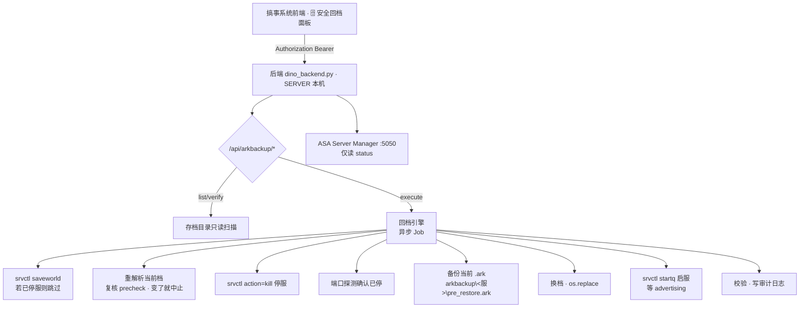

# 搞事系统 · 方舟安全回档 功能方案

> 版本：v2.2（2026-11-04）｜状态：**实施中**（P0 已上线）
> 目标：把现有「4 个 bat 手工回档」流程线上化，做成搞事系统里可审计、可撤销的安全回档功能。

---

## 1. 需求

1. 在搞事系统中实现「安全回档（方舟）」
2. 支持 **10 台**服务器（Isl / Sco / Cen / Abe / Ext / Ast / Rag / Val / Los / Gen）
   > ⛔ **不纳入 Bob（俱乐部）服**（用户 2026-11-04 指示）。实测 `DinoData` 下本来也只有 10 个 `_cryo.json.gz`（无 Bob），数量正好对齐。
3. 开发阶段远程访问、读写存档文件（允许新增、允许备份）
4. 正式部署后由后端直接操作服务器本地存档
5. **本阶段只出方案，不实施**

---

## 2. 现状实测盘点（2026-11-04 只读探查）

### 2.1 路径根

```
\\SERVER\ARK Server\Servers\<缩写>\ShooterGame\Saved\SavedArks\<地图目录>\
```
后端真身 `\\SERVER\dino_backend\dino_backend.py` **就跑在 SERVER 这台机上** → 可直接用本地路径 `D:\ARK Server\...` 读写，无需网络共享。

### 2.2 10 台服 · 地图目录映射（实测）

| 服 | 缩写 | 活跃地图目录 | 备注 |
|---|---|:--|---|
| 孤岛 | Isl | `TheIsland_WP` | 另有 LostColony_WP 残留 |
| 焦土 | Sco | `ScorchedEarth_WP` | 另有 LostColony_WP |
| 核心岛 | Cen | `TheCenter_WP` | 同上 |
| 畸变 | Abe | `Aberration_WP` | 同上 |
| 灭绝 | Ext | `Extinction_WP` | 同上 |
| 繁星 | Ast | `Astraeos_WP` | 同上 |
| 仙境 | Rag | `Ragnarok_WP` | 同上 |
| 瓦尔盖罗 | Val | `Valguero_WP` | 同上 |
| 失落地 | Los | `LostColony_WP` | — |
| 创世模拟 | Gen | `Genesis_WP` | — |

> ⚠️ **既不能按目录名硬编码，也不能只靠 `*_WP` 通配**：
> - Isl / Sco / Cen / Abe / Ext / Ast / Rag / Val 下都残留 `LostColony_WP`；若它比活跃目录更新就会**误判**
>   （而 Los 的活跃目录恰好就是 `LostColony_WP`）
>
> ⇒ 判定顺序：① 读 ASA Manager profile 配置（最权威）→ ② 退化为「该服 `SavedArks` 下**含有效 `<地图>.ark`（大小 > 10 MB）** 且 mtime 最新的目录」→ ③ 两者都失败则**报错让用户手选，绝不猜测**。

### 2.3 地图存档目录结构（以 Isl 为例）

`TheIsland_WP\` 共 **100 个文件 / 4,597.7 MB**

| 扩展名 | 数量 | 体积 | 含义 |
|---|:--:|---:|---|
| `.ark` | 23 | 3,770.4 MB | 地图主档 + 定时快照 |
| `.arkrbf` | 4 | 660.4 MB | 游戏滚动备份 |
| `.bak` | 1 | 165.7 MB | `*_AntiCorruptionBackup.bak` |
| `.arkprofile` | 32 | 0.7 MB | **历史残留备份**（最新一份停在 2026-10-12，已停更） |
| `.arktribe` | 8 | 0.2 MB | 历史残留备份 |
| `.arktributetribe` | 11 | ~0 | 官方新格式，历史残留 |
| `.tribebak` / `.profilebak` | 8 / 6 | ~0.2 MB | 历史残留备份 |
| `.bat` | 4 | ~1 KB | 现有手动回档脚本 |
| `.formertribeownerlog` | 3 | ~0 | 部落易主日志 |

> 🟢 **角色数据已内嵌 `.ark`（2026-11-04 实测确认）**
>
> ASA 官方 Store Behavior：角色档案**不再与地图存档分离保存**，仅在「角色刚传送 / 新建角色」等场景生成**临时** `.arkprofile`，并在下一次 world-save 前保留；部落数据改用 `.arktributetribe` 格式。可通过 `-BackupTransferPlayerDatas` 参数切回传统分离保存行为。
>
> 实测佐证：`TheIsland_WP.ark` 更新于 **11-04 12:31:56**（实时刷新），而全部 32 个 `.arkprofile` **最新一份停在 10-12 17:01**（23 天未更新），最旧可追到 2024-08-30。
>
> ⇒ **回档只需替换 `<地图>_WP.ark` 单文件，即可完整还原地图 + 建筑 + 恐龙 + 玩家角色。**

**命名规律**：`<地图>_WP_DD.MM.YYYY_HH.MM.SS.ark`（如 `TheIsland_WP_04.11.2026_03.33.56.ark`）
**当前活跃档**：`<地图>_WP.ark`（无时间戳后缀，修改时间 = 存档写入时刻，实测 12:31:56 仍在刷新）

### 2.4 明确不纳入范围的外部备份（本方案不涉及）

以下目录虽然存在于存档目录内，但**不作为回档源、不做任何读写**：

| 目录 | 内容 | 不纳入原因 |
|---|---|---|
| `SavedArks\Full_Serveur_Backup\` | 第三方生成的打包 zip | 用户 2026-11-04 明确排除 |
| `Full_Serveur_Backup\PlayerProfile\` | 玩家进出的角色快照 zip | 同上；且角色数据已内嵌 `.ark`，本身无法用于单角色回档 |
| `\\SERVER\ARK Server\_backup_\` | ASA 配置备份 | 与存档回档无关 |

> 本方案的备份点**全部来自目录内 `*.ark`**（游戏定时快照 + 本项目自建备份），自建备份落在本项目自己的目录（§9）。

### 2.5 现有手动回档流程（4 个 bat，已读源码）

目录：`TheIsland_WP\*.bat`

| 脚本 | 实际命令 | 作用 |
|---|---|---|
| `孤岛最新存档备份(停服前双击执行).bat` | `copy "TheIsland_WP.ark" "TheIsland_WP_new.ark"` | 停服前把当前档另存为 `_new` |
| `TheIsland__孤岛回档(...).bat`（拖入备份档） | `ren "TheIsland_WP.ark" "TheIsland_WP_now.ark"` + `copy "%~1" "TheIsland_WP.ark"` | 当前档改名 `_now` 保底，备份档覆盖为当前档 |
| `孤岛now档恢复(双击执行).bat` | `del "TheIsland_WP.ark"` + `ren "TheIsland_WP_now.ark" "TheIsland_WP.ark"` | **撤销回档**（恢复 `_now`） |
| `_孤岛存档清理(双击执行).bat` | `del "_now.ark"` + `del "_new.ark"` | 清理中间态 |

**流程即**：停服 → 备份当前 → 拖入历史档覆盖 → 启服 →（不满意）`now档恢复` 撤销 →（满意）`存档清理`

**✅ 现行「只换 `.ark`」的做法是正确的**

按 §2.3 的 ASA 官方存储行为，角色数据已内嵌 `.ark`，`.arkprofile` / `.arktribe` 只是历史残留，回档**无需**连带处理。现有 4 个 bat 的回档语义（换单文件）本身就是完整还原。

**现流程真正的缺陷**：
1. `_now.ark` 是**单文件覆盖式**保底，第二次回档会把上一次的 `_now` 冲掉 —— 本方案**沿用「单文件」思路**，但用独立目录 + `pre_restore.json` 元数据补上「不知道上次是什么、什么时候的」这一缺陷（§9.3）
2. 无时间戳、无校验、无审计，靠人肉拖拽，出错难追
3. 无回档点清单，只能翻目录按文件名猜时间

---

## 3. 技术底座与已知限制

### 3.1 已有能力（srvctl，v6023 起）

| 路由 | 能力 | 状态 |
|---|---|:--:|
| `GET /api/srvctl/status?username=&servers=` | 服务器状态 | 可用 |
| `POST /api/srvctl/rcon`（body: `servers[]`, `message`） | 任意 RCON 命令 | 可用 |
| `POST /api/srvctl/action`（body: `servers[]`, `action`） | start / stop / update | **不可靠（见下）** |
| `GET /api/srvctl/job?id=` | 异步任务查询 | 可用 |
| `GET /api/srvctl/startq?username=` | 权限探针 | 可用 |

鉴权：HMAC 无状态 Token（`Authorization: Bearer`），密钥 `srvctl_secret.txt`，有效期 30 天，无状态重启不掉线。

### 3.2 🟢 启停能力（2026-11-04 更新：**已可用，直接复用，不新写**）

> ⚠️ 本节旧版写「`action=stop/start/update` 必失败」，**结论过时**。
> 实测只有 `stop`（优雅停止）坏，**`start` / `kill` 一直是好的**；旧版把「同路径大概率同病」的**推论**当成了事实。
>
> **用户 2026-11-04 明确要求：回档的启停必须复用现有 srvctl，禁止复制一份新实现。**

| 能力 | 手段（**直接调用现有路由**） | 实测 |
|---|---|---|
| **停服** | `POST /api/srvctl/action` body `{servers:["Cen"], action:"kill"}` | **OK，2.5~4.7 s**，回执 `Server Cen has been force killed.` |
| **启服** | `POST /api/srvctl/startq`（启动队列：重压上限 2、进度百分比、超时释放槽位） | 下发 **186~256 ms**；`advertising` 才算完成（约 149 s） |
| **存盘** | `action:"saveworld"`（已改**直连 RCON** `SaveWorld`，v55） | OK，约 2~3 s，回执 `World Saved` |
| **停服判据** | **RCON 端口连不上**（`/server-status` 的 `Status` 延迟可达 10 分钟，不可用） | 已验证 |
| ~~`stop`（优雅停止）~~ | ❌ ASA Manager WinForms 跨线程 bug（**UI 手点也报同样错**） | **不使用**，用 `kill` 代替 |

**证据**（`\SERVER\dino_backend\srvctl.log`，2026-11-04）：
```
15:11:49  Cen  kill   OK  2462ms  {"message":"Server Cen has been force killed."}
15:12:22  Cen  start  OK  186ms   queued-sent
15:31:01  Cen  kill   OK  4386ms  {"message":"Server Cen has been force killed."}
15:38:05  Cen  start  OK  187ms   queued-sent
```
（11-03 22:15 ~ 22:45 还有多轮 `kill` + `start` + `saveworld` 全部 OK）

⇒ **「停服 → 换档 → 启服」直接复用 srvctl：`saveworld` → `kill` → 等端口关 → 换档 → `startq` → 等 `advertising`。
不需要新写启停逻辑，也不需要 P1 可行性验证。**

---

## 4. 设计取舍

| 取舍点 | 选择 | 理由 |
|---|---|---|
| 回档源 | **仅目录内 `*.ark`**（游戏定时快照 + 本项目自建备份） | 角色已内嵌 `.ark`，单文件即完整；`Full_Serveur_Backup` 明确不纳入 |
| 是否需要停服 | **必须停服** | `TheIsland_WP.ark` 被游戏进程持有写锁，运行中替换必定失败或损坏 |
| 停服方式 | **复用 `srvctl action=kill`**（§3.2 实测 OK） | `action=stop` 坏（ASA Manager bug），`kill` 可用且回执明确 |
| 停服判据 | **RCON 端口连续 N 次连不上** | `/server-status` 延迟 10 分钟，不可用作判据 |
| 启服方式 | **复用 `srvctl startq` 启动队列**（§3.2） | 已自带重压上限 2 / 进度 / 超时 / 重试，无需另写 |
| 回档粒度 | **整图回档**（单文件） | 角色已内嵌 `.ark`，换一个文件即完整还原，无需分粒度 |
| 撤销窗口 | 每服固定 1 份 `arkbackup\<服>\pre_restore.ark`（每次回档前**覆盖**）+ 元数据 `pre_restore.json` | 不累计（10 台恒 ≈1.7 GB）；比现有 `_now.ark` 多了时间戳/来源/哈希，可追溯 |

---

## 5. 总体架构



**分层**

| 层 | 落点 | 变更性质 |
|---|---|---|
| 前端 | `dino-import.html` 新增「🗄 安全回档」面板 | 纯新增 |
| 后端 | `dino_backend.py` 新增 `/api/arkbackup/*` + `ark_backup.py` 模块 | 纯新增路由，不动现有 |
| 存储 | `D:\dino_backend\arkbackup\`（每服 `pre_restore.ark` 备份 + `pre_restore.json` / 索引 / 审计） | 新建目录 |
| 数据源 | `D:\ARK Server\Servers\...`（只读 + 回档时写） | 现有 |

---

### 5.5 角色冲突检查（回档前置闸门）🔴 核心逻辑

> 来自用户实际回档经验：**回档前必须先比对「当前档」与「目标档」的角色在线情况**，否则会出现物品丢失或角色重复。

#### 5.5.1 机制前提

1. **正常情况下一个角色同一时刻只存在于一台服的存档里**
   角色在 A 服 → A 服 `.ark` 内有它的 `PlayerData`（含等级/背包/装备）；传送到 B 服 → A 服的该对象被移除、B 服新增。
   ⚠ **跨服传输中断/失败/回档残留时，两边可能都有** —— 这正是 🔴「重复角色」检测存在的理由，也是回档前必须过闸门的原因。
2. **物品跟着 `.ark` 走**
   背包/装备存在 `PlayerData` 的 Inventory 里，不是独立文件 → 地图档回到什么时间，物品就回到什么状态。
3. **角色档案不能替代角色数据**
   `.arkprofile` 已是历史残留（§2.3），不能用它补回物品。

#### 5.5.2 四个判定分类

设回档服为 S；`C` = 当前档 `S/<地图>_WP.ark` 的角色集合；`T` = 目标档的角色集合。

**集合键 = `pid`（角色级）** —— 用户 2026-11-04 明确：
- `pid` **跟着角色走**：角色级唯一，跨图稳定（同一角色换服 pid 不变）
- `eosId` **跟着玩家走**：玩家级唯一，一个玩家可拥有多个 `pid`（不同服/不同角色）
- ⇒ 角色级差集一律用 `pid`；需要「某玩家整体风险」时再按 `eosId` 聚合其名下所有 `pid`

| 分类 | 集合关系 | 回档后会发生什么 | 等级 |
|---|---|---|:--:|
| 🟢 安全 | `C ∩ T`（两边都有） | 角色与物品一起回到目标档时刻 | — |
| 🟡 物品丢失 | `C − T`（现在有、目标没有） | 目标档里没有它的 `PlayerData` ⇒ 玩家进服会**新建角色**：**等级 / 技能点 / 背包 / 装备 / 已驯恐龙全部重置** | 🔴 高 |
| 🔴 重复角色 | `T − C`（目标有、现在没有） | 目标档里它在本服，但现在它已在别服 → 回档后**同一角色存在两份数据**，跨服传送时互相覆盖 | 🔴 高 |
| ⚪ 无关 | 两边都没有 | 无影响 | — |

> 🟡 成因：玩家**现在**在本服，但目标档那个时间点它不在（未上线 / 在别服）。
> 🔴 成因：目标档那个时间点**它在本服**，但现在已经转到别的服了。

**verdict 两档**（用户 2026-11-04 口径：**丢物品也算 block**）：

| verdict | 触发条件 | 前端处置 |
|---|---|---|
| `clear` | 仅 🟢（无 🟡 无 🔴） | 直接放行，「执行回档」按钮可点 |
| `block` | **含 🟡 或 🔴** | `ackRisk:true` **且** 输入服务器中文名 + 二次确认 |

🟡 / 🔴 仍**分色展示、文案不同**，但**阻断强度一致**：
- 🟡 提示：「N 名玩家物品将丢失（背包/装备清空）」
- 🔴 追加：「K 名角色将出现重复，回档后请勿立即跨服」

> 🔴 仍单列为**数据损坏级**（同一角色两份数据，跨服传送互相覆盖，事后难追溯），但不额外加码确认强度。

#### 5.5.3 检测流程（必须按序执行）

```
① 选定：服 S + 目标档 T
② 【前置】保存当前进度（§15 C2）：
   · 服**在运行** → `srvctl action=saveworld`（内部直连 RCON `SaveWorld`，约 2~3 s），等 `.ark` mtime 刷新（最多 15 s）
   · 服**已停**（用户先停服再回档，很常见）→ **跳过 saveworld**，直接进入下一步，
     并在报告里标注「本次未 saveworld，当前档为上次世界保存状态」
   ⚠ 不做这步，解析到的当前档是「上一次世界保存」的状态，闸门会算错人
③ 取角色集合（键 = pid）：
   · 当前档 C_S：读 DinoData\<S>_cryo.json.gz（毫秒，按 mtime 缓存解压结果）
       ⚠ 该文件是插件定时导出的，各服时间不同（实测 Cen 13:24 / Abe 14:09 / Isl 13:31）
       ⇒ mtime 距今 > 30 分钟时，改用 exe 重解析当前档（约 5 秒），避免用过期名单（§15 C1）
   · 目标档 T_S：exe 直调 `ark_save_reader.exe "<目标档>" "<出.json>" <S> light`
       （首次约 5 秒；命中解析缓存则毫秒级，见 §15 O1）
④ 算两个差集（键 = pid）：
     lossList = C_S − T_S      （🟡 物品丢失名单）
     dupList  = T_S − C_S      （🔴 重复角色候选）
⑤ 定位 dupList 中每个角色现在在哪台服：
   **一次性把 10 台服的 players[] 汇成 {pid → [服]} 反向索引**，再查表 O(1)
   （原写法「逐个角色遍历其余 9 台服」是 O(N×10)，且每次都要重新解压 _cryo.gz —— 见 §15 O5/O6）
   找到 = 确认会双份；找不到 = 可能已删角/从未上线
⑥ 产出报告：
     🟢 安全角色 N 名（名单）
     🟡 物品将丢失 M 名（名单 + 涉及恐龙/建筑数量，见 §15 C3）
     🔴 将出现重复 K 名（名单 + 现在所在服）
⑦ 闸门判定（**两档**，见 §5.5.2 末尾）：
     clear（仅 🟢）              → 放行
     block（含 🟡 或 🔴）        → ackRisk + 输入服名 + 二次确认方可继续
```

#### 5.5.4 数据来源实测结论（决定方案形态）

| 候选数据源 | 含角色历史？ | 实测结论 |
|---|:--:|---|
| `Saved\Logs\ShooterGame.log`（8.9 KB） | 否 | 只记启动/内存/mod/结构休眠，**无玩家进出** |
| `Saved\Logs\ChatLogs\*.json`（74 个） | 否 | JSON 结构完整（SenderName / SenderSteamId / SenderTribeName / FileTimestamp），但 `SendMode` 仅 4 种聊天类型（Global/Tribe/Alliance/Local），**无 join/leave**；跨度 2023-12 ~ 2026-09 |
| `ARK Server\Profiles\` | 否 | 仅 2 个 2024-10 旧文件 |
| `Servers\<服>\Profile\*.json` | 否 | 是 ASA Server Manager 的配置，非玩家数据 |
| **`.ark` 本身** | **是** | 内含 `PlayerData` 对象（角色名 + Inventory + 等级） |
| **`DinoData\<服>_cryo.json.gz`** | **是（当前档）** | `players[]` 含 `pid/eosId/characterName/roles`、`tribes{}` 含族长与成员 —— **当前档角色集合直接可用，无需再解析** |
| **exe 直调 `ark_save_reader.exe`** | **是（任意指定档）** | 解析指定 `.ark` / `.arkrbf`，产物同构（见 §5.5.5），**历史档由此获得**（RCON 接法已回退） |

⇒ **当前档读 `DinoData\<服>_cryo.json.gz`，目标历史档走插件端离线导出 —— 两者都不需要自研二进制解析器。**

#### 5.5.5 数据获取路径（已定案：只用 exe 直调，2026-11-04 实测通过）

> ⚠️ 两次作废记录（别再回头找）：
> 1. 早期版本列出去找第三方解析器（`ArkSavegameToolkit` / Python 存档库 / ASB 导出）—— **全部作废**，插件端自带解析器。
> 2. 插件端的 **RCON 接法（`TransferIdentityFix.ExportPlayers` / `ExportStatus`）已由插件端回退** —— 本方案**只用 exe 直调**，不依赖 dll。

##### ① 唯一接法：后端 subprocess 直调 exe

```
ark_save_reader.exe "<存档绝对路径>" "<输出路径.json>" <服缩写> light
```

| 参数 | 说明 |
|---|---|
| 1 | 存档路径（`.ark` 或 `.arkrbf`） |
| 2 | 输出路径；**产物实际是 `<该路径>.gz`** |
| 3 | 服缩写（写进 `serverId`） |
| 4 | 任意值 ⇒ light 模式（只出 `players` + `tribes`，实测 ~1.5 KB） |

> 后端与 exe 同机（SERVER），用 `subprocess.run()` 本地调用，**不走网络、不需要 RCON、不需要游戏进程在运行**。

要点：

| 项 | 说明 |
|---|---|
| 指定历史档 | **直接传路径**，无需任何转义（RCON 时代要求空格写 `+` 的约束已不存在） |
| 存档格式 | `.ark` 与 `.arkrbf` **同为 SQLite**（文件头 `SQLite format 3`），exe 直接读，无需转换 |
| 结果获取 | **同步**：`rc=0` 即成功，失败看 stderr 原文 |
| 并发 | **实测可并发**（§15 O2）：`.db` / `.snap` **跟随输出路径**互不干扰，2 路并行 **5.13 s**（串行 9~10 s）。后端用 `ThreadPoolExecutor(max_workers=3)` + 每任务独立输出路径 + `creationflags=0x08000000` 免弹黑框 |
| 输出路径 | **由后端自定**（建议 `DinoData\_offline\<服>__<档名>.json`），天然不覆盖任何线上产物 |

##### ② 产物字段（闸门所需已齐）

| 字段 | 说明 |
|---|---|
| `players[].pid` | PlayerDataID —— **跟角色走**，角色级唯一、跨图稳定 ⇒ **闸门角色级比对主键** |
| `players[].eosId` | EOSID（32 hex）—— **跟玩家走**，玩家级唯一；一个 eosId 可对应多个 pid（不同角色） |
| `players[].characterName` / `name` / `roles` | 角色名 / 账号名 / 多角色映射 |
| `tribes[<id>].name / ownerPid / ownerEosId / members[]` | 部落名 / 族长 / 成员 |
| `arkPath` / `serverId` / `elapsedMs` | 档路径（防错档）/ 服缩写 / 解析耗时 |
| ~~等级~~ | 插件端明确不提供；报告少一列，不影响闸门判定 |

##### ③ 实测记录（2026-11-04，Cen 服）

| 项 | 结果 |
|---|---|
| exe 指纹 | `1,562,112 B` / md5 `21d506ef7af5260a9ce374f1206a1540`（2026-11-04 14:51:19）—— 与插件端基准逐字节一致<br>（exe 放在 `\SERVER\ARK Server\DinoData\`，**全部服共用一份，升级一次全服生效**） |
| 历史档解析 | `TheCenter_WP_01.11.2026_17.43.09.ark`（78.8 MB）→ **players=16 / tribes=5**，rc=0 |
| 历史档解析 | `TheCenter_WP_03.11.2026_17.48.03.ark`（83.7 MB）→ **players=17 / tribes=5**，rc=0 |
| **确认解析的是目标档** | 两档人数不同（16 ≠ 17）、`facilities` 76 vs 73、产物 `arkPath` 回显正确 ⇒ **排除"误读当前档"** |
| 单档耗时 | **4.5 ~ 5.1 秒**（83 MB，UNC 远程读） |
| ~~RCON 接法实测~~ | **已作废**（插件端已回退该命令）。历史记录：曾生成 `DinoData\Cen_players.json.gz` 1,493 B / `players=17`，与 `Cen_cryo.json.gz` 的 pid 集合完全一致 —— 可作「light 产物与全量导出角色一致」的旁证 |
| 闸门演示 | 目标档 11-01 → 🟢16 / 🟡**1**（`人类` pid=523099489）/ 🔴0；目标档 11-03 → 全绿 |

> 🟡 那 1 人正是 `00025a2b9cf14195b9714edd4ee38ac5`（Cen「人类」pid=523099489 ／ Ext「板板」pid=288266681）——
> 同一**玩家**在两个服各有一个**角色**（pid 不同），其中 Cen 这个角色是 11-02 之后才建的；
> 回档到 11-02 会让它从 Cen 的档里消失 ⇒ 背包清空。**闸门首次运行即命中真实风险场景**。

##### ④ 待确认（不阻塞开发）

| # | 待确认 | 影响 |
|:--:|---|---|
| 1 | ~~并发是否安全~~ → **已实测：安全**（`.db`/`.snap` 跟输出路径走，2 路并行无串档）。仅需定**并发上限** | 建议 3 路（防内存峰值） |
| 2 | exe 在 `DinoData`（全部服共用） | 升级 exe 需注意**所有服同时生效**，建议低峰期换 |

**降级预案（仅当插件端整体不可用时）**：系统展示两个时间点，由操作者手工勾选受影响玩家；其余流程（停服/换档/校验/撤销）保持自动化。

#### 5.5.6 边界情况

| 情况 | 处理 |
|---|---|
| 角色正在跨服传输中 | 检查 `ARK Server\clusters\` 与 `Servers\csbbClusters\` 是否有该角色临时数据 → 有则**禁止回档** |
| 长期未上线被服务器清理的角色 | 两边都不存在 → 落入「无关」，无风险 |
| 部落长受影响 | 报告中单独标出（部落数据也在 `.ark` 内，部落长丢失可能影响整个部落） |
| 目标档=刚生成的自动快照 | 通常 `C == T`，全绿，可快速回档 |

#### 5.5.7 block 规避指引（回档前怎么把风险清掉）

> `block` 不等于「不能回档」，而是「**必须先处理名单上的人**」。以下方法按推荐顺序排列，前端 block 弹窗会内嵌这套指引（§7）。

##### 🟡 物品丢失（现在在本服，但目标档那个时间点它不在）

| 方法 | 怎么做 | 效果 |
|:--:|---|---|
| **① 换更晚的回档点** | 挑一个「这些人已经存在」的档 | 最省事，优先试 |
| **② 让这些人先跨服传走** | 回档前让名单上的玩家传到别的服 ⇒ 本服存档里就没有他们 | 彻底消除 🟡 |
| **③ 接受重置** | 提前告知玩家：进服会回到**新建角色状态**（等级/物品/恐龙全重置） | 兜底 |

> ⚠ **整图回档下「把东西存箱子 / 收低温仓」是无效的** —— 箱子和恐龙也会一起回到目标时刻。
> 唯一有效的是让角色**本身不在本服**。

##### 🔴 重复角色（目标档里在本服，但现在已去了别服）

| 方法 | 怎么做 |
|:--:|---|
| **让这些人先传回本服** | 回档前把他们从别的服传回来 ⇒ 本服存档里就有了 ⇒ 不再是「目标有、现在没有」 |

> 传回来后，别的服那份数据会被移走（正常）；回档后他们退回目标档时刻的状态。

##### 标准操作流程

```
① 选回档点 → precheck → 出名单
② 名单不为空 ⇒ 按上表处理（换档 / 传走 / 传回 / 接受重置）
③ 【关键】处理完再跑一次 precheck（有缓存，秒回）
④ 名单清干净（clear）→ 执行回档
   仍有人 ⇒ 多半是有人没照做，**不要硬来**
```

> `precheck` 结果有缓存（§15 O1），「改完再查」成本极低 —— **务必重新检查，而不是勾选知悉后硬闯**。

---

## 6. 后端 API 契约（草案）

所有写接口均需 `Authorization: Bearer <srvctl token>` + `level >= 2`。

### 6.1 `GET /api/arkbackup/list?server=Isl`
返回该服可用回档点（按时间倒序）。

```json
{
  "ok": true,
  "server": "Isl",
  "mapDir": "TheIsland_WP",
  "activeFile": {"name":"TheIsland_WP.ark","bytes":173211648,"mtime":"2026-11-04T12:31:56"},
  "points": [
    {"id":"auto:20261104033356","kind":"auto_snapshot","ts":"2026-11-04T03:33:56",
     "bytes":173301760,"label":"游戏定时快照","path":"TheIsland_WP_04.11.2026_03.33.56.ark",
     "risk":{"green":46,"loss":0,"dup":0,"verdict":"clear","cached":true}},
    {"id":"own:pre_restore","kind":"own_backup","ts":"2026-11-04T02:00:00",
     "bytes":173211648,"label":"回档前自动备份",
     "path":"D:\\dino_backend\\arkbackup\\Isl\\pre_restore.ark"}
  ]
}
```

> `own_backup` 类型**每服最多 1 个**（固定 `pre_restore.ark`，见 §9）；该备份不存在时数组里只有 `auto_snapshot`。
> `path` 对 `auto_snapshot` 是文件名（相对 `mapDir`），对 `own_backup` 是绝对路径。

**`risk` 字段（可选，用于列表直接显示风险）**：

| 字段 | 说明 |
|---|---|
| `green` / `loss` / `dup` | 三类人数（🟢 / 🟡 / 🔴） |
| `verdict` | `clear` 或 `block`（与 `precheck` 同口径） |
| `cached` | 结果是否来自解析缓存（§15 O1） |

> · 首次加载可能为 `null`（尚未解析）⇒ 前端显示「未检查」
> · 后端可后台预热最近 N 个回档点（并发 3 路，§15 O2）
> · 有了它，操作者能**一眼挑到全绿的档**，不必走补救流程（§5.5.7）
```

### 6.2 `POST /api/arkbackup/verify`
body `{server, pointId}` → 校验 `.ark` 可读、大小合理、头部魔数、计算 sha256 并缓存。
**只读，零风险**，前端在选择后、确认前调用。

### 6.3 `POST /api/arkbackup/precheck` 🔴 回档前置闸门
body `{server, pointId, skipSaveworld:false}` → 执行 §5.5.3 全流程，返回：
```json
{
  "ok": true,
  "verdict": "block",
  "savedWorld": true,
  "reparsed": true,
  "cryoAgeSec": 42,
  "elapsedMs": 5210,
  "safe": [{"pid":2745800119,"characterName":"板板","eosId":"00025a…","tribeName":"基纽特战队"}],
  "loss": [{"pid":523099489,"characterName":"人类","eosId":"0002…","tribeName":"人类的部落",
            "cryoDinoCount":12,"structuresByTribe":35}],
  "dup":  [{"pid":288266681,"characterName":"板板","nowAt":"Ext"}],
  "notice": "1 名角色物品将丢失（含 12 只低温仓恐龙），1 名角色将出现重复"
}
```

| 字段 | 说明 |
|---|---|
| `verdict` | **`clear`**（仅 🟢）/ **`block`**（**含 🟡 或 🔴**）—— 两档见 §5.5.2（用户口径：丢物品也算 block） |
| `savedWorld` | 本次是否真的执行了 saveworld（服已停时为 `false`） |
| `reparsed` | 是否因 `_cryo` 过期而改用 exe 重解析当前档（§15 C1） |
| `cryoAgeSec` | `_cryo.json.gz` 的年龄（秒），让前端能提示数据新鲜度 |
| `safe[].pid` / `characterName` / `eosId` | **主键是 `pid`**（角色级），`eosId` 仅辅助；**无等级字段**（插件端不提供） |
| `loss[].cryoDinoCount` | 该角色名下**低温仓恐龙数**（按 `containerOwnerPid` 统计，已过滤空球）。<br>**来源 = 当前档 `_cryo.json.gz`**（插件定时全量导出），不是历史档 light 产物 |
| `loss[].structuresByTribe` | 其部落的建筑数。**同样来自当前档 `_cryo.json.gz`**；`structures`/`facilities` 只有 `tribeId` 无法精确到个人，故按部落给出 |

> 写操作说明：`precheck` **不再是纯只读** —— 它会触发一次 `saveworld`（等价于游戏正常存盘，安全但会写 `.ark`）。
> 若调用方希望严格只读，传 `skipSaveworld:true`，此时报告会标注「未 saveworld，当前档可能落后于游戏内存」。

### 6.4 `POST /api/arkbackup/plan`
body `{server, pointId}`
返回执行计划：影响文件、预计耗时、磁盘占用、**需要停服的确认语**（如要求输入服务器中文名）；包含 precheck 结论摘要。

### 6.5 `POST /api/arkbackup/execute`
body `{server, pointId, confirm:"孤岛", operator:"板板", ackRisk:false}` → 返回 `jobId`（异步）。

| verdict | 必须满足 |
|---|---|
| `clear` | 直接执行 |
| `block`（含 🟡 或 🔴） | `ackRisk:true` **且** `confirm` 与服务器中文名完全一致（如 `"孤岛"`） |

任何一项不满足 → `400`，返回 `{ok:false, verdict, missing:["ackRisk"]}`。

### 6.6 `GET /api/arkbackup/job?id=`
返回阶段进度：`saveworld → reparse → precheck → stopping → stopped → snapshot → restoring → starting → verifying → done|failed`，每步含耗时与日志。

> ⚠ `saveworld` 必须在 `precheck` 之**前**（§15 C2）：saveworld 会改 `.ark`，先检查再存盘等于白检查。
> `reparse` 阶段会用最新 `.ark` 重新解析当前档，再跑 `precheck` 复核；若期间玩家进出导致名单变化，**直接中止**（A13）。

### 6.7 `POST /api/arkbackup/rollback`
body `{server, jobId, confirm:"孤岛", force?:false}` → 用 `arkbackup\<服>\pre_restore.ark` 还原。

还原前校验：
1. `pre_restore.json` 存在且 `jobId` 匹配（防还原到别人的备份）
2. `pre_restore.ark` 的 `sha256` / 大小与 json 记录一致（防半截文件）
3. `ts` 距今 < 48 小时；超时则返回 `409 stale`，需 `force:true` 才继续

> 因每服只有 1 份备份，若期间又执行过新的回档，`jobId` 不匹配 ⇒ 提示「备份已被更新的回档覆盖，无法还原到该次」。

### 6.8 `GET /api/arkbackup/audit?server=&limit=`
返回历史回档审计记录（谁、何时、哪个点、结果、耗时）。

### 6.9 `POST /api/arkbackup/create`（P2）
body `{server, force?}` → 把当前 `.ark` 复制到 `D:\dino_backend\arkbackup\<服>\pre_restore.ark`（**固定名，覆盖上一份**）+ 写 `pre_restore.json`。
返回 `{ok, ts, sourceArk, bytes, sha256, overwrote:{ts,sourceArk}|null}`。

| 行为 | 说明 |
|---|---|
| 已存在旧备份 | 默认**会覆盖**，响应里 `overwrote` 回传被覆盖的那份的 `ts`/`sourceArk`（供前端提示） |
| 旧备份仍在回档中 | 若该服有正在运行的 job，返回 `409 busy`，不覆盖 |
| 磁盘检查 | 剩余空间 < 1.2 × 当前 `.ark` ⇒ 返回 `507`，不写 |

> 每服**恒 1 份**（§9），不做多版本累积。

### 6.10 `GET /api/arkbackup/status?server=`（C8）
**不走 `srvctl/status`**（延迟可达 10 分钟），直接探测：
```json
{ "ok":true, "server":"Isl", "running":true, "rconPort":32320, "rconReachable":true,
  "procFound":true, "activeArkMtime":"2026-11-04T12:31:56", "diskFreeBytes":123456789012 }
```
判据：RCON 端口 TCP 可连 + `ArkAscendedServer.exe` 进程存在（两者任一为真即视为在跑，并在字段里分开给出）。

---

## 7. 前端面板设计

新增标签「🗄 安全回档」（与现有「🧬 生物速查」平级）

```
[服务器图标行] Isl Sco Cen Abe Ext Ast Rag Val Los Gen
────────────────────────────────────────────
当前档：TheIsland_WP.ark  173 MB  写入于 12:31:56   ● 运行中
────────────────────────────────────────────
回档点（按时间倒序）
┌──────────────────────────────────────────┐
│ ● 回档前备份 11-04 02:00:00  165 MB  [验证] │  ← 每服最多 1 行
│   （上次回档遗留；无则此行不显示）            │
│ ○ 定时快照   11-04 03:33:56  165 MB  [验证] │
│ ○ 定时快照   11-04 00:39:55  165 MB         │
└──────────────────────────────────────────┘
[ 生成回档计划 ]        [ 执行回档 ]（需二次确认）
```

交互要点：
- **选完回档点 → 自动跑 `precheck`**，展示三类名单（🔴 红 / 🟡 黄 / 🟢 绿分区）
- 按 verdict 解锁：`clear` → 直接可执行；`block`（**含 🟡 或 🔴**）→ 勾选知悉 **+** 输入服务器中文名
- **block 弹窗必须内嵌规避指引（§5.5.7）**：
  - 🟡 区：「① 换更晚的回档点　② 让这些人先跨服传走　③ 或接受重置（会回到新建角色状态）」+ 一句「**存箱子/收低温仓无效**」
  - 🔴 区：「让这些人先传回本服」
  - 底部 **「重新检查」** 按钮 → 重跑 `precheck`，名单变干净则自动切 `clear` 并解锁「执行回档」
- 数据年龄超 30 分钟时「重新检查」按钮加提示角标（数据可能已过期）
- 顶部显示 `_cryo` 数据年龄（如「名单 42 秒前」）；超过 30 分钟会显示「已重新解析」
- 执行中显示阶段进度条（`saveworld → reparse → precheck → stopping → snapshot → restoring → starting → verifying`）+ 实时日志
- 完成页提供 **「撤销本次回档」** 按钮（48 小时窗口）
- 完成后提示：**相关玩家需重新登录**才能看到回档后的角色状态；建议不要立即跨服（防 🔴 场景被触发）

---

## 8. 安全护栏（7 层）

| # | 护栏 | 说明 |
|:--:|---|---|
| **L0** | **角色冲突检查（§5.5）** | 解析当前档/目标档角色集合，输出 🟢/🟡/🔴 三类名单 + **两档结论**：<br>· `clear`（仅🟢）→ 直接放行<br>· `block`（**含🟡或🔴**）→ 需 `ackRisk` + 输入服名 |
| L1 | 停服前 `srvctl action=saveworld`（内部直连 RCON `SaveWorld`） | 确保当前进度落盘，避免丢最后一段 |
| L2 | 停服判据 = **RCON 端口连续 3 次连不上**（间隔 5s） | 不用 `/server-status`（延迟 10 分钟）；`kill` 回执只代表已下发 |
| L3 | 回档前把当前 `.ark` 备份到 `arkbackup\<服>\pre_restore.ark` | **每服固定 1 份、覆盖式**（§9）：<br>· 复制当前 `.ark`（165~173 MB ≈ 1~2 s）<br>· 同步写 `pre_restore.json`（`ts` / `sourceArk` / `sha256` / `jobId` / `operator`）<br>· 10 台合计恒 **≈ 1.7 GB**，永不增长；无需轮转任务<br>· 覆盖前前端必须提示「上一次备份（时间 X）将被覆盖」 |
| L4 | 归档 `.ark` 可读性 + sha256 校验 | 换档前验证，损档直接中止 |
| L5 | 换档后校验 `.ark` 文件大小 & 头部魔数 | 防止半截文件 |
| L6 | 启服后等 **`startq` 的 `advertising` 标记** + RCON 端口恢复 + `.ark` mtime 更新 | 复用 srvctl 的完成判据（约 149 s），不用自己轮询日志 |
| L7 | 审计日志 + 48 小时一键撤销 | `arkbackup/audit.log`，可回滚 |

**任何一层失败 → 立即中止 + 自动用 L3 备份（`arkbackup\<服>\pre_restore.ark`）回滚 + 报错**。

---

## 9. 备份与保留策略（**每服固定 1 份，循环覆盖，绝不累计**）

> 用户 2026-11-04 明确口径：**「备份只允许备份当前待回退的存档即可，每服只保留循环一份就行」**。

### 9.1 本项目备份（唯一形态）

| 文件 | 路径 | 说明 |
|---|---|---|
| 备份本体 | `D:\dino_backend\arkbackup\<服>\pre_restore.ark` | **固定名，每次回档前覆盖上一份** |
| 元数据 | `D:\dino_backend\arkbackup\<服>\pre_restore.json` | `{ts, server, sourceArk, sourceMtime, sizeBytes, sha256, jobId, operator}` |

- **写入时机**：`execute` 进入 restoring 之前（L3 护栏）+ `POST /api/arkbackup/create` 手动触发
- **覆盖语义**：第二次回档会覆盖第一份 —— **这是有意为之**，不是缺陷（见 §9.3）
- **总量上限**：每服恒 **1 份**（165~173 MB）⇒ 10 台合计 **≈ 1.7 GB 固定，永不增长**
- **不需要轮转任务、不需要定时清理** —— 覆盖本身就是清理

### 9.2 实测现状（2026-11-04，只读探查）

| 服 | `.ark` 数量 | 体积 | 时间跨度 | 间隔中位数 |
|---|:--:|---:|---|---|
| Isl | 23 | 3,772 MB | **66 天** | 2.90 h |
| Ast | 23 | 3,644 MB | **59 天** | 2.90 h |
| 其余 8 台 | 各 22 | 1.1~2.0 GB | 46~62 h | 2.2~2.9 h |
| **合计** | **222 个** | **20.0 GB** | — | — |

**结论**：
- **游戏自己在轮转**，稳定在 22~23 个/服（22 × 2.9h ≈ 2.7 天窗口），数量不增长 ⇒ 方案对它**只读不删、只做容量告警**是安全的
  - 告警阈值：单服 `.ark` 数量 **> 25 个** 或总体积 **> 5 GB**（当前最大 Isl 3,772 MB / 23 个，已留余量）
- Isl / Ast 各多留了 **1 个 60+ 天前的老档**（其余服最旧都是 11-02）⇒ 属**手动保留**，清理逻辑必须**跳过非滚动档**（按文件名时间戳判定，非最近 2.7 天窗口的一律不动）
- `.arkrbf` 滚动备份：游戏自管理，本方案不碰

### 9.3 与现有 bat `_now.ark` 的区别（为什么同为「单文件」却更好）

| 项 | 现有 bat `_now.ark` | 本方案 `pre_restore.ark` |
|---|---|---|
| 位置 | 混在存档目录里 | 独立目录 `arkbackup\<服>\`，不污染存档目录 |
| 时间戳 | 无，**不知道是哪次回档留下的** | `pre_restore.json` 记录 `ts` / `sourceArk` / `jobId` / `operator` |
| 完整性校验 | 无 | `sha256` + 大小比对 |
| 覆盖风险 | 第二次回档静默冲掉 | 覆盖前写日志 + 前端明确提示「上一次备份将被覆盖（时间 X）」 |
| 总量 | — | 每服恒 1 份，10 台 ≈ 1.7 GB 封顶 |

> ⚠ **已知取舍**：只留 1 份 ⇒ **连续回档 2 次后，无法再退回第 1 次之前的状态**。
> 前端在「执行回档」确认框里必须显示：「本次将覆盖 X 时间点的上一份备份，覆盖后无法回退到那之前」。

### 9.4 解析缓存（**不是备份**，可随时重建）

`DinoData\_offline\<服>__<档名>.json.gz`（+ 配套 `.json.db` / `.json.snap`）

- 每个历史档一份：`.json.gz` ≈ 1.5 KB、`.json.db` ≈ 20~53 KB ⇒ 222 个档全解析也就 **约 12 MB**
- **可随时删除重建**（重新跑 exe 即可）⇒ 容量压力可忽略，不需要复杂轮转
- 仅做一件事：`list`/`precheck` 时若发现对应 `.json.gz` 的 mtime < 源档 mtime ⇒ 视为失效、重解析

---

## 10. 分阶段实施计划

| 阶段 | 内容 | 风险 | 产出 |
|:--:|---|:--:|---|
| ~~**P0a**~~ | ~~`.ark` 解析器验证~~ → **已完成（2026-11-04）**：复用插件端 `ark_save_reader.exe`，Cen 两个历史档实测 `players=16/17`、单档约 5 秒、差集计算正确（§5.5.5 ③） | 零 | **闸门可 100% 自动化** |
| **P0** | 只读能力：`list` / `verify` / `audit` + 每服地图目录动态识别<br>+ **O4**：`list` 只返回 name/size/mtime（**不算 sha256**，否则 23 档 × 165 MB 要 20~30 s）<br>+ **O1**：exe 解析结果按 `(arkPath,mtime,size)` 永久缓存（实测历史档不会变）<br>+ **O6**：`_cryo.json.gz` 解压结果按 mtime 缓存（Isl 有 699 KB）<br>+ **`list` 的 `risk` 预标注**（§6.1）：后台预热最近 N 个档，前端直接看到每个档的 🟢/🟡/🔴 人数 | 零 | 能看全部回档点，不动任何文件；列表毫秒返回且带风险提示 |
| ~~**P1**~~ | ~~启停可行性验证~~ → **已取消（2026-11-04）**：启停由 srvctl 实现并实测可用（§3.2：`kill` 2.5~4.7 s / `startq` 下发 186~256 ms），**回档直接复用，零新代码** | 零 | 无需新写 |
| **P2** | 备份能力：`POST /api/arkbackup/create` 手动触发备份（复制当前 `.ark` → `arkbackup\<服>\pre_restore.ark`，**固定名覆盖式**）<br>+ **O2**：批量解析改并发（`ThreadPoolExecutor(3)`，实测 2 路 5.13 s vs 串行 9~10 s）<br>+ **O5**：10 服玩家**反向索引** `{pid → [服]}`（替代逐个角色遍历其余 9 服）<br>+ **C7**：磁盘空间预检（不足 2× 存档大小时拒绝执行） | 零（只增文件） | 回档前可先自建备份点；批量预演秒级完成 |
| **P3** | 回档引擎：`plan` / `execute` / `job` / `rollback` + 7 层护栏<br>+ **C1**：`_cryo` 过期检测（mtime > 30 min ⇒ exe 重解当前档）<br>+ **C2**：`saveworld` → 重解析 → **复核 precheck**，变了就中止<br>+ **C3**：量化损失（用 `_cryo` 的 `cryopod` / `structures` / `facilities` 算「该玩家损失 N 只恐龙、M 个建筑」）<br>+ **C4**：verdict 三档（clear / warn / block）<br>+ **C6**：换档优先 `os.replace`（同卷 rename 毫秒级），历史档先硬链接进备份目录<br>+ **O3→§9**：备份改为每服固定 1 份 `pre_restore.ark` + `pre_restore.json`（覆盖式、无轮转任务） | **高（停服+覆盖档）** | 核心功能可用且不会因过期名单误判 |
| **P4** | 前端面板 + 二次确认 + 进度/日志/撤销 | 低 | 用户可用 |
| **P5** | 容量看板 + 告警（**自建备份恒 1 份、无需轮转**；游戏快照只告警不删；解析缓存可随时删建） | 零 | 防盘爆 |

> ✅ **原 P1（启停可行性）已不再是 gate**：srvctl 的 `kill` + `startq` 实测可用（§3.2），回档全程可自动化。
> 若某次停/启失败，按 §11 预案停在上一步并明确报错，**不自动重试**。

---

## 11. 风险预案

| 风险 | 影响 | 预案 |
|---|---|---|
| 启服失败 | 服务器起不来，玩家进不去 | **复用 `startq` 自带的重试/超时/进度**；仍失败则停在上一步并报错，不自动重试；兜底可手动跑 `start_server.bat`（仅孤岛） |
| 停服判据误判 | 以为停了实际没停 → 换档失败/损坏 | `kill` 回执 + **RCON 端口探测** + 换档前尝试独占打开 `.ark`（句柄检测）三保险 |
| `.ark` 快照撑爆磁盘 | 服务器写入失败 | P5 保留策略；P0 先加容量告警 |
| 误操作回档到错误时间点 | 数据倒退 | 二次确认 + `pre_restore.ark` 撤销（每服 1 份、48 小时内） |
| 集群（clusters）跨服不一致 | 跨服传送的龙/物品丢失 | 方案暂不处理跨服一致性，文档注明限制（D5） |
| CF 拦裸 Python 请求 | 测试脚本全 403 | 一切接口测试走浏览器内 `fetch`（已验证规律） |

---

## 12. 待确认决策项

| # | 问题 | 选项 | 影响 |
|:--:|---|---|---|
| ~~D1~~ | ~~启服用什么方式~~ | **已定案（2026-11-04）**：**直接复用 `srvctl startq`**（启动队列，实测可用）；停服用 `srvctl action=kill`。**禁止复制新实现** | — |
| ~~D2~~ | ~~启动参数从哪取~~ | **已定案**：`srvctl`/ASA Manager 已自行管理（`Servers\<服>\Profile\serverProfil.json`），回档**不需要**知道启动参数 | — |
| ~~D3~~ | ~~回档是否连带 `.arkprofile` / `.arktribe`~~ | **已定案**：不连带 —— 角色数据已内嵌 `.ark`（§2.3 实测） | — |
| **D4**（待复议） | 回档点展示来源 | 原定案「仅目录内 `*.ark`」；因插件端已确认 `.arkrbf` **同为 SQLite 可直接解析**（§15 C5），建议扩为 `*.ark` + `*.arkrbf` | 可选点从 23 个扩到 27 个 |
| **D5** | 是否需要跨服（集群）一致性回档？ | ① 暂不做 ② 需要同时间点多服一起回 | 显著增加复杂度 |
| **D6** | **游戏快照容量告警**阈值定多少？（自建备份已定案每服 1 份，无阈值可调） | ① 按 §9.2：单服 > 25 个 或 > 5 GB ② 你指定 | 决定告警时机 |
| **D7** | 谁能执行回档？ | ① 仅 `level>=2` 管理员 ② 需要额外第二道口令 | 安全等级 |

---

## 13. 验收标准

- **A1** 列出某服全部回档点，时间/大小/类型与目录实况一致（抽样 5 条核对）
- **A2** `verify` 能识别损坏的 `.ark`（人为截断一份副本测试）
- **A3** 回档后 `TheIsland_WP.ark` sha256 == 归档内文件 sha256
- **A4** 回档后服务器 RCON 端口可连、`/server-status` 最终显示运行中
- **A5** 回档后 `arkbackup\<服>\pre_restore.ark` + `pre_restore.json` 存在，`rollback` 能完整还原
- **A6** 审计日志记录完整（操作者/时间点/阶段耗时/结果）
- **A7** 全流程在 **Cen（核心岛）** 上演练通过后，才开放到其他服
- **A8** 角色闸门准确：人为构造「角色不在目标档」/「角色现已在别服」两种场景，`precheck` 能分别正确归入 🟡 / 🔴，**且两者 `verdict` 均为 `block`**
- **A9**（O1）同一目标档第二次 `precheck` **< 200 ms**（缓存命中）
- **A10**（O2）并发解析 3 个历史档，总耗时 **< 15 s**，且三者 `arkPath` 各自正确、无串档
- **A11**（§9）备份写盘 **< 3 s**；**每服恒 1 个** `pre_restore.ark`（连续回档 3 次后仍只有 1 个文件），10 台合计占用 **≤ 1.8 GB**
- **A12**（C1）人为把 `_cryo.json.gz` 的 mtime 改旧 40 分钟，`precheck` 应自动改用 exe 重解析，并在报告里标注"当前档数据已重解析"
- **A13**（C2）`saveworld` 后当前档 mtime 变化时，`execute` 内的复核 precheck 能检出差异并中止
- **A14**（O4）`list` 对 23 个回档点返回 **< 300 ms**
- **A15**（§9）连续回档 2 次后，`rollback` 对第 1 次的 `jobId` 返回「备份已被覆盖」；覆盖前 `create` 响应含 `overwrote` 字段
- **A16**（§6.1 `risk`）`list` 里某档的 `risk.loss`/`risk.dup` 与该档单独跑 `precheck` 的结果一致；预热后 `cached:true`

> 建议**全部演练只在 Cen（核心岛）做** —— 它已有完整实测数据（§5.5.5 ③）、dll 已升级到最新版、17 个角色足以覆盖 🟢/🟡/🔴 三类判定。
> ⛔ Bob（俱乐部）服不在本方案范围内。

---

## 15. 优化清单（性能 + 健壮性，2026-11-04 实测）

> 本章来自方案评审。所有标注「实测」的数字都是 2026-11-04 在 Cen 服真实测得的。

### 15.1 性能优化

| # | 优化 | 现状问题 | 优化后 | 实测依据 |
|:--:|---|---|---|---|
| **O1** | **解析结果永久缓存** | 每次 precheck 都要跑 exe，5 秒 | 首次 5 s，**第二次起 ~10 ms** | 历史档归档后不会被改写 ⇒ `(arkPath, mtime, size)` 可永久命中；缓存就是 exe 输出的 `.json.gz` |
| **O2** | **并发解析** | 原方案写「必须串行」 | 2 路并行 **5.13 s**（串行 9~10 s） | 实测同时起 2 个 exe 解析 78 MB 档，均 `rc=0`、产物各自正确、`arkPath` 无串档；`.db`/`.snap` **跟随输出路径**（1101 档 53 KB / 1748 档 20 KB，互不干扰） |
| ~~**O3**~~ | ~~快照用硬链接，不打包整目录~~ → **已不适用** | 原方案打包 `<地图>_WP` = 4,597 MB | — | 用户 2026-11-04 定案「每服只留 1 份循环备份」（§9）⇒ 只复制单个 `.ark`，**既不用打包也不用硬链接**，10 台恒 1.7 GB |
| **O4** | **`list` 不算 sha256** | 23 档 × 165 MB ≈ 3.8 GB，算 hash 要 **20~30 s** | `list` **毫秒级** | `os.scandir` 只取 name/size/mtime；sha256 只在用户点「验证」时算那一个 |
| **O5** | **10 服玩家反向索引** | 「对每个 dupList 角色遍历其余 9 台服」= O(N×10) | 一次建 `{pid → [服]}`，查询 **O(1)** | 10 台服合计仅 125 条角色，建索引毫秒级 |
| **O6** | **`_cryo.json.gz` 解压结果缓存** | 每次 precheck 重新解压 + `json.loads` | 按 mtime 缓存成 `{pid: 角色}` | Isl 的 `_cryo.json.gz` 有 **699 KB**（含 cryopod 483 / facilities 793 等无关段） |

### 15.2 正确性与健壮性

| # | 问题 | 为什么会错 | 修法 |
|:--:|---|---|---|
| **C1** 🔴 | **`_cryo.json.gz` 可能是过期数据** | 当前档名单来自插件**定时导出**，各服导出时间不同（实测 Cen 13:24 / Isl 13:31 / Abe 14:09）。导出后新建/转入的角色**不在名单里** ⇒ 漏判 🟡 | `mtime` 距今 **> 30 分钟** ⇒ 改用 exe 重解当前档（5 s），并在报告标注 |
| **C2** 🔴 | **precheck 与 saveworld 顺序冲突** | 原流程 `precheck → 停服 → 换档`，中间 L1 的 `saveworld` 会**改 `.ark`** ⇒ precheck 用的当前档当场失效 | 顺序改为 `saveworld → 重解析当前档 → precheck → 停服 → 换档`；`execute` 内**再复核一次**，变了就中止 |
| **C3** 🟡<br>（可选增强） | **闸门说不清「会丢什么」** | 只说"背包清空"，玩家无法判断严重程度 | **实测字段归属（2026-11-04）**：<br>· `cryopod`（Isl 7,189 / Cen 17 条）带 `containerOwnerPid` ⇒ **可精确到玩家**：损失 N 只恐龙<br>· `structures`（Isl 134 / Cen 35）与 `facilities`（Isl 1,442 / Cen 131）**只有 `tribeId`/`tribeName`，无 playerPid** ⇒ **只能按部落**给出 M 个建筑<br>· `geneDevices` 带 `containerOwnerPid`，可精确到玩家<br>⚠ `cryopod` 含大量「空球」（`dinoClass` 为空）⇒ 统计必须过滤 |
| ~~**C4**~~ | ~~verdict 只有两档~~ → **已按用户口径定案** | 曾提议拆三档（warn/block 分开） | **用户 2026-11-04 明确「丢物品也算 block」** ⇒ 最终仍为两档：`clear`（仅🟢）/ `block`（含🟡或🔴）；🟡/🔴 分色展示、文案不同，但**阻断强度一致** |
| **C5** 🟢 | **`.arkrbf` 未纳入回档点** | D4 定案「仅 `*.ark`」，但插件端已确认 `.arkrbf` **同为 SQLite 可直接解析** | 把 `.arkrbf` 也列进回档点（Cen 有 4 个 660 MB），快照被清理时仍可选 |
| **C6** 🟢 | **换档用 `copy` 慢** | 现有 bat 用 `copy`（165 MB ≈ 1~2 s） | 分两种情况：<br>· 目标档 = **本项目备份** `pre_restore.ark` ⇒ 可 `os.replace`（毫秒，消耗掉备份无妨）<br>· 目标档 = **游戏快照** ⇒ **必须 copy**（1~2 s）——`os.replace` 会把历史档移走，而它是最有价值的回档源 |
| **C7** 🟢 | **缺磁盘空间预检** | 回档要 2 倍空间，盘满时跑到一半失败 | `execute` 前检查剩余空间 ≥ 2 × 存档大小，不足直接拒绝 |
| **C8** 🟢 | **缺实时状态接口** | `srvctl/status` 延迟可达 10 分钟 | 后端直接探 RCON 端口 + 进程存在，新增 `/api/arkbackup/status` |

#### 15.2.1 C3 的数据来源（务必看清，两个源别混）

> 常见误解：「历史档只返回 light 版，那 C3 的 cryopod 从哪来？」—— **C3 完全不用历史档**。

| 用途 | 数据来源 | 需要 `cryopod`？ |
|---|---|:---:|
| **闸门三档判定**（🟢/🟡/🔴） | · 当前档 = `DinoData\<服>_cryo.json.gz` 的 `players[]`<br>· 目标档 = exe 直调的 **light 产物**（只有 `players` + `tribes`） | **不需要** |
| **C3 量化损失** | **只用当前档 `_cryo.json.gz`** 的 `cryopod` / `structures` / `facilities` | 需要，但当前档本来就有 |

逻辑：`🟡 名单 = 当前档有、目标档没有的角色` ⇒ 他们「会损失的东西」= **现在拥有**的东西 ⇒ 从**当前档**统计即可。
历史档只需回答「当时有谁」，不需要回答「当时有多少恐龙」。

**两个数据源对照**：

| 文件 | 谁产生 | 内容 | 体积 |
|---|---|---|:---:|
| `DinoData\<服>_cryo.json.gz` | **插件定时全量导出**（`auto_parse`） | players + tribes + **cryopod** + structures + facilities + geneDevices | Cen 11 KB / **Isl 699 KB** |
| exe **light** 产物 | 后端调 `ark_save_reader.exe … light` | 只有 players + tribes | **1,493 B** |

> ⚠ 第一个文件名字里虽有 `cryo`，但它**不是** light 产物，是插件自己的全量导出 —— 别被名字误导。

**为什么不把历史档改成全量解析**：全量产物比 light 大 **7.6 倍**（Cen 11,362 B vs 1,493 B；Isl 会到 699 KB 量级），
而闸门只需要 `players[]`。**不建议为 C3 改全量** —— C3 本身是可选增强。

### 15.3 落实顺序

| 顺序 | 项 | 理由 |
|:--:|---|---|
| 1 | **C2 + C1** | 不改会算错人，属正确性 bug |
| 2 | **O1 + O2** | 一个把重复操作降到毫秒，一个把批量降到 1/N |
| 3 | ~~O3~~ → **已被「每服 1 份」取代**（§9） | 连打包/硬链接都不需要，只复制单文件 |
| 4 | **C3 + C4** | 直接决定用户能否看懂风险 |
| 5 | **O4 / O5 / O6 / C7 / C8** | 体验与健壮性 |
| 6 | **C5 + C6** | 锦上添花 |

### 15.4 本轮方案评审顺带修正的正文

| 位置 | 原内容 | 改为 |
|---|---|---|
| §5.5.3 流程② | 残留 RCON 命令 `ExportPlayers light ark=… abbr=…` | exe 直调命令 |
| §5.5.3 流程 | 无 saveworld 前置、无过期检测、无反向索引 | 补 C2 / C1 / O5 |
| §5.5.5 要点表「并发」 | 「后端必须串行」 | 「实测可并发」（O2） |
| §5.5.5 待确认 1 | 「并发可能互相干扰 ⇒ 串行」 | 「已实测安全，只需定并发上限」 |
| §8 L3 | 「打包整个 `<地图>_WP` 目录」 | 先改「硬链接 + `.ark` 复制」（O3）；**v1.8 再改为每服固定 1 份复制**（§9） |
| §5.5.2 末尾 | 无 verdict 分级 | 新增 clear / warn / block 三档（C4） |

---

## 16. 变更记录

| 版本 | 日期 | 变更 |
|---|---|---|
| v1.0 | 2026-11-04 | 首版：现状盘点 + 角色冲突闸门 + API 契约 + 分层护栏 + 分阶段计划 |
| v1.1 | 2026-11-04 | §5.5.5 解析器路径改为「复用插件端 exe」（作废第三方库路线）；实测 Cen 两个历史档 |
| v1.2 | 2026-11-04 | 主键语义修正：`pid` 角色级 / `eosId` 玩家级（用户口径） |
| v1.3 | 2026-11-04 | 插件端回退 RCON 接法 ⇒ 方案只用 exe 直调 |
| v1.4 | 2026-11-04 | 新增 §15 优化清单（O1–O6 / C1–C8）+ 修正正文冲突（并发、快照、precheck 顺序、verdict 分级）+ 补 A9–A14 验收项 |
| v2.2 | 2026-11-04 | **本版·启停结论修正（重要）**：原 §3.2「`start/stop/update` 必失败」**过时** —— 实测只有 `stop` 坏，`kill`/`startq` 一直可用（`srvctl.log` 11-04 15:11~15:38 有成功记录）。按用户「**复用，非复制**」要求：回档启停**直接调 `srvctl action=kill` + `startq`**；§4/§5 架构图/§8 L1L2L6/§11/§12 D1D2/§5.5.3 全部同步；**P1 可行性验证取消**（不再是 gate） |
| v2.1 | 2026-11-04 | block 规避指引：新增 **§5.5.7**（🟡 三种做法：换更晚的档 / 传走 / 接受重置；🔴 传回本服；含标准操作流程与「存箱子无效」提醒）；🟡 后果由「背包装备清空」精确为「**回到新建角色状态**（等级/技能点/物品/恐龙全重置）」；§7 前端 block 弹窗内嵌指引 + **「重新检查」**按钮；§6.1 `list` 新增 **`risk` 预标注**（🟢/🟡/🔴 人数，可后台预热）；P0 纳入 risk 预标注；补 A16 |
| v2.0 | 2026-11-04 | verdict 定案：用户口径「**丢物品也算 block**」⇒ verdict 由三档回归**两档**（`clear` / `block`）；🟡 与 🔴 仍分色展示、文案不同但阻断强度一致。同步 §5.5.2 / §5.5.3 ⑦ / §6.3 / §6.5 / §7 / §8 L0 / §13 A8 / §15 C4 |
| v1.9 | 2026-11-04 | 实施前终检：同步 15 处 v1.8 残留 —— 架构图 F4、分层表存储说明、`list` 示例（`own_backup` 每服≤1）、前端进度条补 `reparse`、前端备份行注明、L3 回滚措辞、§9.2 补告警阈值、P5 去轮转、P2 固定名、风险预案、D6 重写、A5 改写、A15 编号归位、C6 区分「备份可 replace / 快照必须 copy」、§15.4 补演进说明 |
| v1.8 | 2026-11-04 | 备份策略定案：按用户口径改为**每服固定 1 份循环覆盖**（`arkbackup\<服>\pre_restore.ark` + `pre_restore.json`）—— 取消多版本累积与轮转任务，10 台恒 ≈1.7 GB；§9 整节重写（含实测 222 个 / 20.0 GB、游戏轮转确认、与 `_now.ark` 对比、只留 1 份的取舍）；§8 L3 / §4 / §6.7 / §6.9 / §15 O3 / §10 P3 / A11 全部同步；O3（硬链接）标注不适用 |
| v1.7 | 2026-11-04 | §15 新增 **15.2.1 C3 数据来源说明** —— 澄清「当前档全量 `_cryo`」vs「历史档 exe light」是两个源；C3 只用当前档、不需要历史档 cryopod；C3 标为**可选增强**；§6.3 字段表标明来源 |
| v1.6 | 2026-11-04 | 排除 Bob（俱乐部）服 ⇒ 支持范围 11 台 → **10 台**；§1/§2.2/§3.2/§5.5.3/§7/§9/§10/§15 全部同步；演练服由 Bob 改为 **Cen** |
| v1.5 | 2026-11-04 | 全文复核：修 12 处硬矛盾 + 补 8 处遗漏 —— §6.3 响应改 `pid`/三档/去 `level`、§6.6 阶段顺序、§2.2 Bob 目录判定、§5.5.3 saveworld 容错、§5 架构图、§8 L0、§7 交互、§9 缓存清理、§12 D4 待复议、§10 P1 列三方案、补 §6.9 create / §6.10 status、C3 改为「恐龙可按玩家 / 建筑只能按部落」 |

---

## 17. 附：与现有资产的关系

| 现有资产 | 本方案中的角色 |
|---|---|
| 4 个手动 bat | 被 P3/P4 取代，保留作兜底 |
| `Full_Serveur_Backup\`（含 PlayerProfile） | **明确不纳入**（用户 2026-11-04 指示，不作回档源、不读写） |
| `srvctl` RCON | 停服 + 存档 + 状态查询 |
| `srvctl` action | P1 待验证；若坏则弃用 |
| `_backup_\` 配置备份 | 本方案不涉及 |
