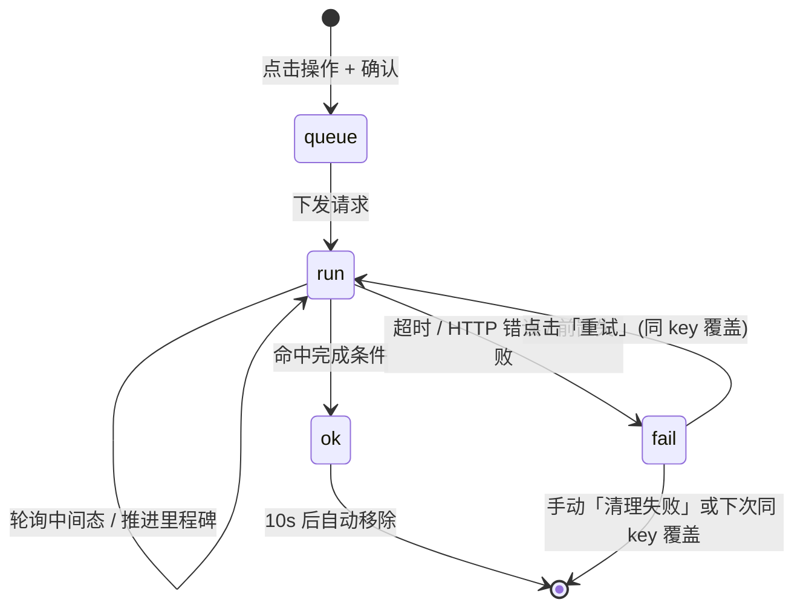

# 服务器控制 · 真实进度条重构方案 v1

> 日期：2026-11-03　｜　状态：**待评审（未实施）**
> 需求来源：用户 11 条口径（确认浮窗、结果区、真实进度条、多服多操作、10s 隐藏、失败保留、清理、重试、启动真实步骤、存档后终止、RCON 真实步骤）

---

## 一、现状与问题

| 现状 | 问题 |
|---|---|
| 点击操作 → 独立浮层（如 save→kill 的 `#lbSkProg`）展示分段进度 | 与「结果」区割裂，流程结束浮层关闭，历史不可追 |
| 后端 `/api/srvctl/action` 一次性返回 `{ok, results[]}` | 无中间态，前端只能显示"执行中…"假动画 |
| 无失败留存机制 | 失败信息一闪而过，无法重试 |
| 无按服务器区分 | 多选时只有一条汇总进度 |

**后端实测能力边界**（`dino_backend.py` L4496-4700、L7823-7876）：

- `SRVCTL_ACTIONS = ('start','stop','kill','update','saveworld','fullbackup','destroy','rcon')`
- 每条 action = 一次 `POST {asa_base}/<action>`，`profileName` 用**英文 ID**
- 同步动作：`ThreadPoolExecutor(max_workers=4)` 并发；**失败自动重试 1 轮**（间隔 1s）
- 异步动作：仅 `destroy` / `fullbackup`（job 轮询 `/api/srvctl/job?jobId=`）
- 同服同动作互斥：`_srvctl_acquire` → 重复请求返回 **409 busy**
- 审计日志：`srvctl.log`（时间 / 用户 / 服务器 / 动作 / 结果 / 耗时 / 消息）

👉 **结论**：后端只回传"最终 OK/FAIL"，要实现真实进度条，必须引入**可观测中间态**。

---

## 二、真实步骤依据（实测证据）

### 2.1 启动 —— 来自真实日志 `ShooterGame.log`

**日志路径**：`D:\ARK Server\Servers\<Profile>\ShooterGame\Saved\Logs\ShooterGame.log`
（本机可直读；远程共享 `\\SERVER\D$\ARK Server\Servers\<Profile>\...` 也可读）

**样本**：孤岛 Isl 2026-10-30 19:11:46 的一次完整启动（日志 165 行）

| # | 阶段（固化中文） | 日志标志行 | 实测时刻 | 相对耗时 | 进度权重 |
|---|---|---|---:|---:|---:|
| 1 | 启动游戏进程 | `Log file open, ...` | 19:11:46 | +0s | 2% |
| 2 | 读取游戏版本 | `ARK Version: 96.6` | 19:11:47 | +1s | 5% |
| 3 | 初始化模组框架 | `LogCFCore: InternalSettings called` | 19:11:51 | +5s | 8% |
| 4 | 校验模组文件 | `No need to update existing mod: ...` / `Mod valid: ...` | 19:11:51 | +5s | 12% |
| 5 | 加载模组资源 | `UShooterEngine::LoadGameMods with N mods` → `Loading Mod ...` | 19:11:51~53 | +5~7s | 18% |
| 6 | 启动反作弊 | `BattlEye successfully started.` | 19:11:54 | +8s | 25% |
| 7 | **加载世界存档** | `StructureHibernation: OFF on this boot...` | 19:13:39 | **+113s** | **45%** |
| 8 | 服务器启动完成 | `Server: "<名称>" has successfully started!` | 19:14:57 | **+191s** | **75%** |
| 9 | Steam / EOS 验证 | `Steam Subsystem initialized: Success` + `EOS ownership validation initialized: Success` | 19:14:57 | +191s | 82% |
| 10 | 应用启动参数 | `Commandline: "..."` + `Full Startup: 195.63 seconds` | 19:15:01 | +195s | 90% |
| 11 | **对外开放加入** | `Server has completed startup and is now advertising for join.` | 19:16:01 | **+255s** | **100%** |

**关键结论**：
- 从进程启动到"对外开放"约 **4 分 15 秒**；日志明确给出 `Full Startup: 195.63 seconds`
- **第 7 步（加载世界）占总时长 40% 以上**，是主要耗时点，必须单独成阶段
- 日志文件**按进程重建**：首行 `Log file open` = 本次启动时刻（实测 Bob 重启后首行变为 `11/03/26 02:42:55`，其余服仍是 10/30）
  ⇒ **可靠判定"是否已开始启动"与"启动进行到哪一步"**

### 2.2 保存 —— 来自存档文件 mtime（日志无标志行）

日志中**没有** `save` 相关行（已 grep 全文验证），真实保存证据是存档文件：

```
D:\ARK Server\Servers\<Profile>\ShooterGame\Saved\SavedArks\<Map>\<Map>.ark
例：Isl → ...\SavedArks\TheIsland_WP\TheIsland_WP.ark   (173,834,240 bytes, mtime 2026-11-03 14:07:09)
    Ast → ...\SavedArks\Astraeos_WP\Astraeos_WP.ark
    Bob → ...\SavedArks\BobsMissions\BobsMissions_WP.ark
```

- 主存档 `<Map>.ark` 的 mtime = 最近一次真实落盘时间
- 同目录还有自动备份 `<Map>_DD.MM.YYYY_HH.MM.SS.ark` / `.arkrbf`（约每小时一个）
- **判定方式**：下发前记录基线 mtime → 轮询直到 mtime 增大或超时

⚠️ 注意：服务器有**每小时自动保存**，可能恰好撞上。因此不能只看"mtime 变了"，要 **基线 + 时间窗**（如 60s 内变化即认为本次保存生效），并在结果文案里标注实际耗时。

### 2.3 终止 —— 状态 + 日志停止

- `/server-status` 的 `Status` 由 `Running` → `Stopped`
- ⚠️ 历史教训：该字段**刷新可能延迟数分钟**（曾实测 ~10 分钟未翻转）
  ⇒ 终止判定必须"双通道"：`Status==Stopped` **或** RCON/游戏端口不可达 **或** 日志文件 mtime 停止增长

### 2.4 RCON 快捷操作

| 操作 | 真实可观测量 |
|---|---|
| 踢出玩家（`KickPlayer`） | 回执文本 |
| 玩家位置（`GetPlayerPos`） | 回执文本（含坐标） |
| 重启提醒 / 例行维护 / 5 分钟维护（`broadcast`） | 回执文本 |
| 设置清晨 / 正午 / 傍晚（`SetTimeOfDay`） | 回执 + 游戏内时间可复查 |
| 自定义 RCON | 回执文本 |

⇒ 这些**没有多阶段**，进度条按 2 步呈现：`下发命令` → `等待回执`。

---

## 三、总体设计：任务模型

### 3.1 核心数据结构（前端）

```js
LB_TASKS = {
  seq: 0,
  items: [ /* 见下 */ ],
  timer: null
};

/* 单条任务 */
{
  id: 't17',              // 唯一
  key: 'Isl|start',       // 去重键 = 服务器 + 操作（需求 6）
  server: 'Isl',
  srvName: '孤岛',
  action: 'start',
  label: '启动',
  phase: 'run',           // queue | run | ok | fail | skipped
  steps: [ '启动游戏进程', '读取游戏版本', ... ],   // 该操作的固化步骤表
  stepIdx: 2,
  pct: 45,                // 0~100
  msg: '正在加载世界存档…',
  t0: 1699..., tEnd: 0,
  hideAt: 0,              // ok 后 = tEnd + 10000（需求 5）
  err: '',                // fail 原因
  retryOf: null           // 重试来源 id（需求 8）
}
```

### 3.2 状态机



### 3.3 去重与留存规则（需求 5 / 6）

| 情形 | 行为 |
|---|---|
| 新任务入队，已存在同 `key` 的 `ok` 条 | 直接覆盖（旧的成功条已无意义） |
| 已存在同 `key` 的 `fail` 条 | **覆盖**（需求 6：直到下次同服同操作才覆盖） |
| 已存在同 `key` 的 `run` 条 | 拒绝并提示「该服务器此操作正在执行中」（与后端 409 对齐） |
| `ok` 完成 | `hideAt = now + 10000`，定时器到点移除 |
| `fail` 完成 | 永久保留，直到被覆盖 / 清理 |

### 3.4 排序

按「操作分组 → 服务器顺序」排列，保证多服多操作时视觉稳定：
`开关控制动作` → `数据操作` → `快捷 RCON`，组内按 `LB.SERVERS` 原顺序。

失败条**跟随所属分组排序**（用户口径），不沉底，避免位置跳动。

---

## 四、UI 方案

### 4.1 结果区布局

```
结果                                              [🧹 清理失败 (3)]
┌──────────────────────────────────────────────────────────────┐
│ 孤岛 · 启动                                         45%       │  ← run
│ ▓▓▓▓▓▓░░░░░░░░░░░░░░░░░░░░░░░░░░░░░░░░░░░░░░░░░░░░            │
│ 正在加载世界存档…（第 7/11 步）                                │
└──────────────────────────────────────────────────────────────┘
┌──────────────────────────────────────────────────────────────┐
│ 焦土 · 保存世界                                    100%       │  ← ok（10s 后消失）
│ ████████████████████████████████████████████████████          │
│ 存档已更新 · 耗时 1.2s                                        │
└──────────────────────────────────────────────────────────────┘
┌──────────────────────────────────────────────────────────────┐
│ 星耀 · 启动                        [重试]             失败   │  ← fail（永久）
│ HTTP 500 调用线程无法访问此对象，因为另一个线程拥有该对象。      │
│ 已重试 1 轮 · 耗时 8.3s                                       │
└──────────────────────────────────────────────────────────────┘
┌──────────────────────────────────────────────────────────────┐
│ 俱乐部 · 存档后终止 → 终止           已跳过（存档失败）         │  ← skipped
└──────────────────────────────────────────────────────────────┘
```

- 进度条复用现有 `lbSegBarHtml/lbSegBarUpdate`（与「刷新数据」浮窗同款，符合"复用非复制"口径）
- 失败条左侧红色左边框 + 红色标题；成功条绿色；运行中紫色
- 「清理失败」仅在存在 `fail` 条时显示；点击后**清空全部失败条**（用户口径，不做二次确认）

### 4.2 MDI 图标（需求 7 / 8）

| 用途 | 图标 |
|---|---|
| 清理失败条目 | `mdi-broom`（或 `mdi-delete-sweep`） |
| 单条重试 | `mdi-refresh`（或 `mdi-replay`） |
| 运行中 | `mdi-loading mdi-spin` |
| 成功 | `mdi-check-circle` |
| 失败 | `mdi-alert-circle` |
| 跳过 | `mdi-debug-step-over` |

### 4.3 确认浮窗（需求 1）

| 操作 | 确认方式 |
|---|---|
| 启动 / 强制终止 / 保存世界 / 清理恐龙 | **最简确认**：`确认对 [孤岛、焦土] 执行「启动」？` → `[确认][取消]` |
| 快捷 RCON（踢人/broadcast/时间等） | 同上（自定义命令额外显示命令文本） |
| **刷新状态** | **不弹确认**，直接执行，结果写入结果区（**无进度条**，需求 3） |

---

## 五、后端改动清单

### 5.1 新增 `/api/srvctl/observe`（只读观测，核心）

```
GET /api/srvctl/observe?server=Isl&username=xxx
```

```json
{
  "ok": true,
  "server": "Isl",
  "status": "Running",
  "log": {
    "path": "D:\\ARK Server\\Servers\\Isl\\ShooterGame\\Saved\\Logs\\ShooterGame.log",
    "size": 26952,
    "firstLineAt": "2026-10-30 19:11:46",
    "marks": {
      "proc_open": true, "ark_version": true, "cfcore": true,
      "mods_check": true, "mods_load": true, "battleye": true,
      "world_load": true, "started": true, "steam_eos": true,
      "full_startup": true, "advertising": true
    },
    "arkVersion": "96.6",
    "fullStartupSec": 195.63
  },
  "ark": {
    "path": "...\\SavedArks\\TheIsland_WP\\TheIsland_WP.ark",
    "mtime": 1762140429,
    "size": 173834240
  }
}
```

实现要点：
- `CFG_SERVERS_DIR` 已存在（`D:\ARK Server\Servers`），直接拼路径
- 地图名来源：优先从日志 `Commandline:  "<Map>_WP"` 解析；失败则扫 `SavedArks/*` 取 mtime 最新目录
- 里程碑用固定正则匹配（见 §2.1 标志行），**按整文件扫描**（日志最大 66KB，可全读）
- 每台服一次读盘 <10ms，前端 1~2s 轮询一次可接受

### 5.2 `/api/srvctl/status` 增加 `map` 字段（可选，便于前端展示）

### 5.3 无需改动 `action` 接口

---

## 六、各操作详细流程（对照 11 条需求）

### 6.1 启动（需求 9）

1. 确认浮窗 → 对每台选中服创建 `key = srv|start` 任务
2. **前置**：调 `observe` 记录基线 `log.firstLineAt`
3. 下发 `POST /api/srvctl/action {action:'start', servers:[srv]}`
4. 每 2s 轮询 `observe`：
   - `firstLineAt` **变化** ⇒ 新进程已启动，开始推进里程碑
   - 按 §2.1 的 11 个 `marks` 命中情况推进 `pct` 与 `stepIdx`
   - 未命中新里程碑时，按经验时间做**不超过下一里程碑权重**的平滑爬升
5. 完成条件：`marks.advertising === true`（或 `status==='Running'` 且 `full_startup` 命中）
6. 超时：**15 分钟**（用户定；实测样本 4分15秒）；超时判 `fail`，附最后命中的阶段
7. 任一步骤失败（HTTP 非 2xx）⇒ `fail`，文案带后端 message

### 6.2 强制终止

1. 确认 → 任务 `srv|kill`
2. 下发 `action:'kill'`
3. 每 2s 轮询双通道（`status==='Stopped'` **或** `log.size` 停止增长 ≥10s **或** RCON 不可达）
4. 超时 180s（因 `/server-status` 可能延迟）

### 6.3 保存世界

1. 确认 → 任务 `srv|saveworld`
2. `observe` 记录基线 `ark.mtime`
3. 下发 `action:'saveworld'`
4. 每 500ms 轮询 `ark.mtime`，变大 ⇒ 成功（记录耗时）
5. 超时 60s ⇒ `fail`（附"存档文件未刷新"）

### 6.4 清理恐龙

1. 确认 → 任务 `srv|destroy`
2. 同 6.3：**destroy 会触发保存**，用 `ark.mtime` 变化作为完成证据
3. 后端走异步 job，前端同时轮询 `/api/srvctl/job`
4. 超时 600s（对齐后端）

### 6.5 刷新状态（需求 1 / 3 特例）

- **不弹确认**
- **不出进度条**
- **不写结果区**（用户口径）—— 直接 `GET /api/srvctl/status`，仅刷新顶部「状态更新于 HH:MM:SS」与各服角标，结果区保持不变

### 6.6 存档后终止（需求 10）

```
确认浮窗（一次，问是否对 N 台执行）
   ↓
每台服拆成两条任务：
  t1: srv|saveworld   （保存）
  t2: srv|kill        （终止，phase=queue，不立即下发）
   ↓
保存轮询成功 → t1=ok → 自动下发 t2
保存失败/超时 → t1=fail → t2.phase='skipped'（文案：已跳过（存档失败））
```

**要点**：
- 去掉现有"保存成功后二次确认浮窗"
- 每台独立判定，互不影响（A 台保存成功照常终止，B 台保存失败只跳过 B）

### 6.7 快捷 RCON（需求 11）

| 操作 | 步骤条（2 步） |
|---|---|
| 踢出玩家 / 玩家位置 / broadcast 类 / 设置时间 | `下发命令` → `等待回执` |
| 自定义 RCON | 同上，另显示命令原文 |

- 回执到达即 `ok`，正文显示 RCON 回执（截断 300 字）
- 广播类可加第 3 步 `确认在线玩家收到`（如后端能提供在线人数变化，可选）

---

## 七、异常与边界

| 场景 | 处理 |
|---|---|
| 后端 409 busy | 任务直接 `fail`，文案「该服务器此操作正在执行中」，可重试 |
| 多选时部分服失败 | 各条独立，不互相短路（除 6.6 的"同服保存→终止"强依赖） |
| 页面刷新 / 关闭浮窗 | 任务列表存 `localStorage`（按用户），重新打开恢复未完成条并续轮询 |
| `observe` 读盘失败（权限/路径变更） | 降级为"仅状态轮询"，进度条改为不定态（`mdi-loading`），完成判定退回 `status` |
| 日志被轮转/清空 | `firstLineAt` 变化即视为新进程；里程碑从 0 重算 |
| 服务器本就 Running 时点「启动」 | 前置检查，直接提示「已在运行」并不创建任务 |
| 10s 隐藏与重试冲突 | 若在 10s 内被重试覆盖，新任务 `hideAt=0` 重新计时 |

---

## 八、实施步骤（建议分 3 批）

| 批次 | 内容 | 影响面 |
|---|---|---|
| **P1** | 后端 `/api/srvctl/observe`（读日志 + 存档 mtime）；前端任务模型 `LB_TASKS` + 结果区渲染（进度条/失败保留/10s 隐藏/清理/重试）；确认浮窗改造 | 后端 + 前端 |
| **P2** | 启动 11 步真实里程碑接入；保存 / 清理恐龙 mtime 判定；终止双通道判定 | 前端逻辑 + 轮询 |
| **P3** | 存档后终止自动串联；快捷 RCON 真实回执展示；`localStorage` 断线恢复 | 前端 |

**风险点**：
- 后端需重启才能上 `observe`（P1 一次性）
- `observe` 只读本机 D 盘，需确认后端进程对 `D:\ARK Server\Servers` 有读权限（现况：`CFG_SERVERS_DIR` 已在用，应为可读）
- 启动进度权重基于单次样本，后续可用历史 `Full Startup` 秒数做自适应

---

## 九、已确认决策（用户拍板 2026-11-03）

| # | 议题 | 决策 |
|---|---|---|
| 1 | 「刷新状态」结果展示 | **不写结果区**：仅刷新顶部「状态更新于」时间与各服角标 |
| 2 | 失败条排序 | **跟随分组排序**（不沉底，避免位置跳动） |
| 3 | 「清理失败」范围 | **清空全部失败条**（点一下即清，不做二次确认） |
| 4 | 启动超时阈值 | **15 分钟** |
| 5 | 任务列表持久化 | **持久**（`localStorage`，按用户隔离，关浮窗/刷新后再打开仍可见失败条与未完成条） |
