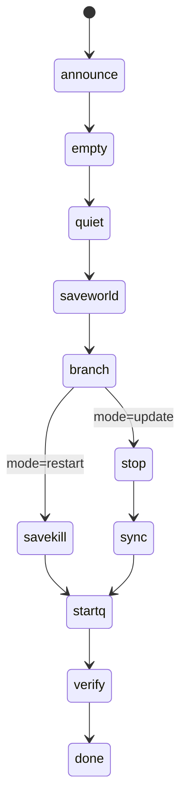

# 服务器更新 · 任务总线复用与选中服分发 —— 实施方案 v1

> 日期：2026-11-07
> 状态：**方案已复核定稿（2026-11-07，0 行代码落地）** —— 复核修正见 §10 修正项 / §13 O1~O8 / §14 门禁 / §15 约束 / §16 版本分级
> 用户三条需求：
> 1. 「服务器更新」中点「一键分发」只对**选中服**分发
> 2. 「服务器更新」中的更新任务**接入任务总线**，尽量复用（非复制）现有任务
> 3. 「服务器更新」中的更新任务**直接复用自动重启**中能用到的所有逻辑

---

## 0. 现状与差距

| 项 | 现状 | 差距 |
|---|---|---|
| 「一键分发」按钮 | 有样式、有文字，**没有 onclick**（`app_core.js` 约 L5764） | 需求 ① 完全未实现 |
| 「预演」按钮 | `lbUpdPreview()` → `lbUpdCall({servers: lbUpdSelList(), dry:true})` | ✅ **已按选中服**，可作参考 |
| 任务槽位 | `#lbUpdTasks` 已是 `.lb-task-slot`，渲染**全项目同一份**任务列表 | ✅ 前端零改动即可显示新任务行 |
| 后端真跑 | `/api/update/apply` 真跑返回 **501**（v6207b 未实装） | 需求 ②③ 后端从零 |
| 分发计划 | `_upd_make_plan()` 纯只读，3.3 秒出 11 台计划 | ✅ 可直接复用 |
| 排除清单 | `UPDATE_SKIP_DIRS` 含 `Saved/Config/Logs/ConfigBackups/Profile/Cache/steamapps/steamcmd/dumps` | ✅ `steamapps` 整体跳过 ⇒ `downloading/` 天然排除 |
| 自动重启骨架 | `_restart_start` / `_restart_tick`（7 阶段状态机，已跑通 7 项链路） | ✅ 可整体复用 |

---

## 1. 核心设计：**一条状态机跑两种模式**

不新写状态机。给 `_RESTART` 增加 `mode` 字段：

```python
_RESTART['mode'] = 'restart' | 'update'
```

### 1.1 阶段对照

| 阶段 | `restart`（现状） | `update`（新增） |
|---|---|---|
| `check` | — | **新增**：① 判 `verKind`（强制/补丁/相同，见 §16）；② 读目标 acf 与缓存比对；③ `same` ⇒ 该台直接 `skip`；④ 判定 AsaApi 缓存状态（见 §14） |
| `announce` | 公告「即将重启」 | 公告「即将更新」 |
| `empty` / `quiet` | 空置采样 + 三重静默 | **完全相同** |
| `saveworld` | 存档屏障（DinoData 稳定） | **完全相同**（更新前也要存档） |
| `savekill` | 存档 + 停服 | **只停服**（不再重复存档，因上一阶段已做） |
| **`sync`** | — | **新增**：复制差异 + 改 acf |
| `startq` | 起服队列 | **完全相同** |
| `verify` | 等 `advertising`（队列判 ok） | **完全相同** |



### 1.2 实现位置

`_restart_tick()` 的 `phase == 'savekill'` 分支内按 `mode` 分流，用现成的 `st['skStage']` 状态位：

| mode | skStage 序列 |
|---|---|
| restart | `saveworld` → `savekill` |
| update | `saveworld` → `stop` → `sync` |

- `stop`：`_srvctl_run('ipwatch',[srv],'kill',None, silent=True)`（**复用现有停服 + 终止串行闸**）
- `sync`：新增 `_restart_exec_sync(srv)`（后台线程，回填 `syncDone/syncOk/syncMsg`）

---

## 2. 需求 ①：只对选中服分发

### 2.1 后端
`_restart_start(reason, dry_override=None, force=False, **mode='restart', servers=None**)`
- `servers` 为 None ⇒ 全部（现状）；传入列表 ⇒ **只初始化这些台**
- 入口 `/api/update/apply` 真跑时：
  ```python
  _restart_start('update-apply by %s (%d台)' % (user, len(_srv_a)),
                 mode='update', servers=_srv_a)
  ```

### 2.2 前端
「一键分发」按钮补 `onclick="lbUpdApply()"`。
⚠️ **不再用 `lbAsk` 简单二选一**，改为打开 §14 的**单一分发确认浮窗**（版本类型 + AsaApi 缓存 + 范围三区块）：

```js
function lbUpdApply(){
  var sel = lbUpdSelList();
  if (!sel.length) { lbToast('请先选择服务器'); return; }
  // 打开统一浮窗：内部并行拉 update/status（verKind + needsCopyBytes + 各台 status）
  //                       与 news/api_cache（强制重抓，拿原文）
  lbUpdConfirmOpen(sel, function(){          // 用户在浮窗里点「确认分发」后回调
    lbUpdCall({ servers: sel, dry:false, confirm:'APPLY' });
  });
}
```
> `lbUpdCall` 已存在，无需改动（它就把 body 发给 `/api/update/apply`）。
> 浮窗实现见 §14.4；版本区块的数据与文案见 §16.5。

---

## 3. 需求 ②：接入任务总线（复用）

| 能力 | 复用方式 | 是否需要新代码 |
|---|---|---|
| 单台任务行 | `_restart_push(srv)` —— label 按 mode 取「重启（IP 切换）」/「**更新（分发）**」 | 仅改 label 一行 |
| 批量汇总行 | `_restart_push_batch()` —— 同样按 mode 改 label，msg 用「已更新 x/N 台」 | 改 label + msg 文案 |
| 步骤圆点 | `_restart_steps_obj(st)` —— 按 mode 选 `RESTART_STEPS` / **`UPDATE_STEPS`** | 新增一个常量元组 |
| 前端渲染 | `#lbUpdTasks` 已是 `.lb-task-slot`，`lbTaskRender()` 自动渲染 | **零改动** |
| 折叠/中止/重试 | `lbTaskAbortAll` / `lbTaskAbort` / `lbTaskRetry` 全部现成 | **零改动** |
| 清理失败 | `lbTaskClearFail` → `/api/tasks/dismiss` | **零改动** |

`UPDATE_STEPS` 草案：
```python
UPDATE_STEPS = (('ann', u'公告'), ('empty', u'等待空置'), ('quiet', u'静默校验'),
                ('saveworld', u'存档屏障'), ('savekill', u'停服'),
                ('sync', u'复制差异'), ('startq', u'起服'), ('verify', u'校验'))
```

---

## 4. 需求 ③：复用自动重启的全部可用逻辑

| # | 复用项 | 现有实现 | update 模式下的差异 |
|:--:|---|---|---|
| 1 | 主状态机 | `_restart_tick()` | 加 `sync` 分支 |
| 2 | 单台/整批启动 | `_restart_start()` | 加 `servers`/`mode` 参数 |
| 3 | 公告（中英双语） | `_restart_announce()` / `_restart_announce_done()` | 文案换「更新」 |
| 4 | 宽带期 / 玩家回归 | `RESTART_IP_GRACE` / `sawPlayer` | 完全相同 |
| 5 | 空置采样 | `_restart_sample()`（并行 RCON） | 完全相同 |
| 6 | 三重静默护栏 | `_srvctl_terminal_gate()` + `_restart_cluster_quiet_sec()` | 完全相同 |
| 7 | 选台排序 | `_cands.sort()`（Bob 最后 / 有存档优先 / 在线少优先） | 完全相同 |
| 8 | 存档屏障 | `_restart_exec_saveworld()` + `_dinodata_wait_stable()` | 完全相同 |
| 9 | 停服 | `_srvctl_run(...,'kill', silent=True)` | 完全相同（含**终止串行闸**） |
| 10 | 起服 | `_srvctl_startq_new()` | 完全相同 |
| 11 | 上线校验 | `_restart_startq_state() == 'ok'`（方案 B） | 完全相同 |
| 12 | 失败重试 | `_restart_step_fail()` + `RESTART_MAX_ATTEMPTS=2` | 完全相同 |
| 13 | 各阶段超时 | `RESTART_SAVEWORLD/SAVEKILL/STARTQ/VERIFY_TIMEOUT` | 加 `UPDATE_SYNC_TIMEOUT=900` |
| 14 | 整批总超时 | `RESTART_TOTAL_TIMEOUT=28800` | 完全相同 |
| 15 | 服务器软锁 | `_srv_lock_set(srv,'restart','restart\|srv')` | owner 改 `update\|srv`（便于区分） |
| 16 | 整体中止 | `/api/tasks/abort {all:true}` | 完全相同 |
| 17 | 状态快照 | `_restart_snapshot()` → `/api/ipwatch` | 完全相同（多带 `mode` 字段） |
| 18 | 互斥 | 同一把 `_RESTART_LOCK` | ✅ **更新期间自动重启不会抢同一批服** |

**结论**：需求 ③ 只需新增 **2 个函数**（`_restart_exec_sync` + 少量 mode 分支），其余全部复用。

---

## 5. 新增：`_restart_exec_sync(srv)` 同步实现

### 5.1 复制策略（安全优先）

| 决策 | 取值 | 理由 |
|---|---|---|
| 复制范围 | **只复制 `add` + `update`**（按 size 比对） | 幂等、可重入 |
| 目标端多余文件 | **不删**（不用 `/MIR`） | 预演已明确「多余不删」，避免误删 `local_version.txt` 等 |
| 同步范围 | **保持全量对比，不做收窄** | ⚠️ **11-07 实测修正**：根目录 7 个 Steam dll 在 11 台**全部 size 相同 ⇒ 本来就不会被复制**；`steamcmd/steamcmd.exe` 只有 Gen 缺 1 个。收窄不省任何 IO，反而增加维护成本，也与 ASAM「全量枚举源、逐个比对」不一致 |
| 排除 | 复用 `_upd_skip_set()`（含 `Saved/Config/Logs/Profile/Cache/steamapps/steamcmd/dumps`） | 保护存档 |
| acf | **单独改写**（不走复制） | `steamapps` 整体跳过 |

### 5.2 流程

```
1) 磁盘预检：D 盘剩余 < 13 GB ⇒ 该台 fail（**全盘一次判定**，见 §6 修正；不是每台各算）
2) walk 比对（复用 _upd_walk）：得 add/update 列表 + 总字节
3) 逐文件 shutil.copy2（保持 mtime）
   · **复制顺序：先 42 个小文件（快速验证路径/权限），再按大小降序复制 12 个大文件**（O8）
   · **进度不按文件数回填**：另起监控线程每 400ms 轮询目标文件 getsize()（O2）
   · pct 映射：sync 段占 55%→95%
4) 复制后复核：再 walk 一次，add/update 应为 0，否则 fail
5) 改 acf（**必须原子写：写 `.tmp` 再 `os.replace`**，见 O3）：
   - buildid         ← cache.buildId
   - InstalledDepots[depot].manifest ← cache.manifest
   - InstalledDepots[depot].size     ← cache size
   - LastUpdated     ← 当前 unix 秒
   - 保持制表符缩进（KeyValues 格式）
6) 回填 syncDone/syncOk/syncMsg
```

### 5.3 失败处理（关键）

| 失败点 | 处理 |
|---|---|
| 磁盘空间不足 | 该台 fail，**不启动** |
| 复制中途异常 | 该台 fail，**禁止起服**（半同步状态危险），保留 `update_<ID>.log` 现场 + 通知人工 |
| 复制后复核不通过 | 同上 |
| acf 改写失败 | 该台 fail，禁止起服 |
| 起服后未见 advertising | 标 fail；**不回滚文件**（文件已同步成功，多半是启动参数问题） |

> 🔁 **回滚依据**：文件已被新 build 覆盖后，旧 build 只能靠 §13 O1 预取的 `download_depot` 回滚包恢复。
> 若未预取，则**无法回滚**（`D:\Cache` 此时只有新 build）—— 这是 P0 阶段必须先做 O1 的原因。

---

## 6. 前置检查（实施前必须确认）

| # | 检查项 | 为什么 |
|:--:|---|---|
| 1 | **D 盘剩余 ≥ 13 GB**（**全服共用一块盘，一次判定即可**） | ⚠️ **11-07 实测修正**：原「每台各需 15 GB、11 台共 165 GB」前提**不成立**。分发是**顺序**的，峰值 = 单台 11.30 GB + 最大单文件 2.13 GB（临时文件机制）≈ **13.4 GB**；本机 D 盘可用 **212 GB**，充裕 |
| 2 | **是否按 O1 预取回滚包**（`+download_depot 2430930 2430931 6604340029022292600`） | 首次真跑的唯一回滚依据；需额外 ≈11.3 GB 磁盘（11 台共用一份）。~~原「是否收窄同步白名单」已作废，见 §5.1~~ |
| 3 | 先对 **Bob** 单台试点 | 玩家最少，出问题影响面小 |
| 4 | 试点前**备份**该台 acf + `local_version.txt` | 便于回滚 acf |
| 5 | 确认 ASAM 不会在我们更新期间自动动这些服 | 更新期间禁用 ASAM 的自动更新任务 |

---

## 7. 实施顺序


| 阶段 | 内容 | 风险 |
|---|---|---|
| **P0** | ~~预取回滚包~~ ⇒ **降级为可选**：改由 §18.2「按需自动预取」在首次回滚时触发，**不阻塞 P1~P4** | 低（只下载，不动服务器） |
| **P1** | 后端：`_restart_start(mode, servers)`、`_restart_tick` 加 `stop`/`sync` 分支、`_restart_exec_sync`（含 O2/O3/O8）、`UPDATE_STEPS`、label 按 mode、`apply` 真跑 | 中（只在新入口 `mode='update'` 生效，restart 路径不受影响） |
| **P1.5** | 后端：`_ver_kind()`（§16）+ `/api/update/status` 出 `verKind` 与 `asaapi`（含原文，供浮窗）；`apply` **不做拦截**、仅记录状态快照（§14.5） | 低（纯只读判定） |
| **P2** | 前端「一键分发」+ 二次确认（含 verKind 文案 + AsaApi 状态条） | 低 |
| **P2.5** | dry 演练验证状态机（不复制、不改 acf） | 低 |
| **P3** | Bob 试点（1 台） | 中 |
| **P4** | 剩余 10 台批量（按选中，串行 =1） | 中 |

---

## 8. 验证清单

| # | 场景 | 预期 |
|:--:|---|---|
| 1 | 未选服点「一键分发」 | 提示「请先选择服务器」，不发起请求 |
| 2 | 选 1 台点分发 | 二次确认 → `/api/update/apply {servers:[X], dry:false, confirm:'APPLY'}` |
| 3 | 任务总线 | 「服务器更新」页签出现 **1 条汇总行 + 1 条明细行**（label「更新（分发）」），步骤 8 个圆点 |
| 4 | 服务器控制页签 | 同一任务在两处同步显示（同一份总线）✓ |
| 5 | 复制的服 | `add/update` 归零、acf `buildId` 等于缓存、`same=true` |
| 6 | 存档完整性 | `ShooterGame/Saved/` 未被动过（比对 mtime 与文件数） |
| 7 | 更新完起服 | 队列判 `ok` → 编排 `done` |
| 8 | 中途 `abort all` | 全部停在该阶段，服务器保持原状（未同步成功的禁止起服） |
| 9 | 与自动重启互斥 | 更新进行中触发 IP 变化 → `skip start: already running` + `pendingReason` 排队 |
| 10 | **`verKind` 判定** | `96.8→96.9` 得 `forced`；`96.81→96.89` 得 `patch`；`96.9→96.9` 得 `same` |
| 11 | **AsaApi 未就绪 + patch** | 点分发先弹**确认浮窗**：显示英文原文 + 「未命中 Automated Cache Build: SUCCESS」；推荐【重新检查】/【取消】，【仍要分发】需勾选 |
| 12 | **AsaApi 未就绪 + forced** | 同一浮窗，但【仍要分发（推荐）】为默认项；确认后照常提交，`meta.asaapiBypass=true` |
| 13 | **AsaApi 判据防误判** | 对「…will be sent once completed」这类构建中消息必须判为**未就绪**（不得被 `completed` 误判） |
| 14 | **停服服快通道（O4）** | 选中服若原本停服 → 不进空置/存档/停服，直接 sync；分发后**保持停服** |
| 15 | **TMP 残留清理（O6）** | 分发后 `*~RF*.TMP` 被清；被进程占用的跳过并记日志、不中断 |
| 16 | **acf 原子性（O3）** | 人为中断写 acf ⇒ 目标 `appmanifest` 不出现半截内容 |
| 17 | **哈希判据生效** | `same` 中 ≥1MB 的 21 个文件若内容不同 ⇒ 转为 `update` 被复制 |

---

## 9. 与既有方案文档的关系

- 本文档 = **实施层细化**（怎么复用自动重启）
- `服务器更新系统_CacheManager复刻_完整方案_v1_20261107.md` = **设计层**（为什么这么做、缓存基线设计、§7 详细设计）
- 两者不冲突；本文档的「mode 复用」正是原方案 §7.4「**强烈建议：不新写一套状态机**」的具体落地

---

## 10. 与官方 ASAM 分发方法的差距（2026-11-07 追问后追加）

> 用户问：「Cache 已经分析了，能完全复制管理器的分发方法么？（管理器的方法已经成熟尽量避坑）」
> **结论：能复刻约 95%，缺的关键一环是「差异判据」。**

| 环节 | 官方 ASAM | 我们当前 | 评价 |
|---|---|---|---|
| 变更文件来源 | 自家 CDN（已校验） | 本地 `D:\Cache`（SteamCMD 刚装完） | ✅ 等价，甚至更快 |
| **差异判据** | **基于哈希比对** | **只比 `size`** | 🔴 **最大缺口** |
| 分发范围 | 只 `ShooterGame/` + `Engine/` | 会带上根目录 Steam dll + `steamcmd/`（≈88 MB） | ⚠️ 建议收窄 |
| 多余文件处理 | 增量，不删 | 不删 ✅ | ✅ 一致 |
| 存档保护 | 排除 `Saved/` | 排除 ✅（`UPDATE_SKIP_DIRS`） | ✅ 一致 |
| acf 改写 | buildid + depot manifest | 计划已有 `toBuildId/toManifest` | ✅ 需实装 |
| 停服 → 复制 → 起服 | 要求先停 | 完整 7 阶段状态机 ✅ | ✅ 一致 |
| 落盘后校验 | 哈希复核 | 只再比一次 size | ⚠️ 偏弱 |

### 10.1 最危险的坑：`same` 判等可能是假的（实测 97 个）

`_upd_make_plan()` 判「相同」只比**文件大小**。**size 相同但内容不同**的文件会被判「无需复制」，
而 acf 却已改成新 buildId ⇒ ASAM 认为「已是最新」，实际是**混版**（新 exe + 旧 dll）
⇒ 启动崩溃或行为异常，且**重跑分发也查不出来**（它仍认为 size 相同）。

本次大更新实测 `same=97`，其中 **≥1 MB 的 21 个 / 169.48 MB** 全是关键运行库（见 §10.2 风险面清单）——
正是「大小可能没变但内容变了」的高危类型。

### 10.2 必补三项（按优先级）

1. **判据改为「两段 + 阈值哈希」**（~~原「size → mtime → 哈希」三段方案作废~~）
   ```
   size 不同                => 必复制
   size 相同 且 < 1 MB      => 跳过（风险与收益不成比例）
   size 相同 且 >= 1 MB     => 采样哈希（首/中/尾各 64 KB），不同则复制
   ```
   > 🔴 **`mtime` 判据已实测证伪（11-07）**：`same` 的 97 个文件中 **mtime 相同 0 个 / 不同 97 个**。
   > 根因：`D:\Cache` 于 11-07 11:15~11:20 **全量重装**，源文件 mtime 全是「今天的下载时间」，
   > 不是 Steam 内嵌的构建时间 ⇒ **mtime 完全无参考价值**。
2. **复制后哈希复核**：对实际复制过的文件用同口径采样哈希复算一次，不匹配即判 `fail`（**禁止起服**）
3. ~~同步范围收窄~~ ⇒ **取消**（见 §5.1 修正，收窄无收益）

**实测风险面**：`same` 中 ≥1 MB 的共 **21 个文件 / 169.48 MB**，且全是「版本必须一致」的关键运行库：
`steamclient64.dll` 25.11 MB、`ShooterGame\Binaries\Win64\steamclient64.dll` 23.14 MB、
`steamclient.dll` 20.39 MB、`BattlEye\BEService_x64.exe` 19.34 MB、`RedpointEOS\EOSSDK-Win64` 17.27 MB、
`steamwebrtc64.dll` 12.43 MB、`BEClient_x64.dll` 9.84 MB、`DiscordPartnerSDK` 9.18 MB、
`LastResort.ttf` 5.15 MB、`SDL3.dll` 2.57 MB、`vstdlib_s64.dll` 2.48 MB、`tier0_s64.dll` 2.42 MB、
`msquic.dll` 2.42 MB、`Splash.bmp` 2.33 MB、`dbghelp.dll` 2.12 MB、`ArkAscended_BE.exe` 1.23 MB …
一旦漏更即**混版崩溃**。采样哈希总量 = 21 × 3 × 64 KB ≈ **4 MB 读取**，毫秒级。

### 10.3 对 `_upd_make_plan()` 的影响

- 预演阶段也要用同一套判据（否则预演说「相同」、真跑却复制更多，计划失真）
- **成本修正**：只需对 `same` 且 ≥1 MB 的文件算哈希 ⇒ 每台 **21 个**（不是 159 个），
  11 台共 231 个文件 × 3 段 = **693 次局部读**，远低于原先估算的 3,500 次
- 判据生效后计划会变化：`same` 的 97 个里可能有部分转为 `update`，
  预演输出的「需复制量」预计在 11.30 GB 基础上**上浮 ≤170 MB**


---

## 11. 官方 ASADedicatedManager 分发机制实测还原（2026-11-07 只读调研）

> 用户口径：「我用管理器分发时完全没遇到过磁盘不足的问题，查一下它怎么做到的」
> 「管理器 Cache 分发完毕后会让用户选是否清理 Cache，我们最好也复刻」
> 环境：`SERVER` = 192.168.199.3，管理器 = `D:\ASADedicatedManager`（.NET/WPF 3.8.x，带 PDB）

### 11.1 「从不磁盘不足」的原因：三个假设全部实测排除，真相是顺序分发 + 空间充裕

| 假设 | 实测数据 | 判定 |
|---|---|---|
| 硬链接共享（11 台共用一份物理数据） | Cache 与 Isl/Sco/Bob 同名文件 **同 ino = 0**；目标端 **nlink 全 = 1** | 排除 |
| junction / 符号链接 | `Servers` 下 11 个服目录**无任何重解析点** | 排除 |
| 块级增量（只传 delta 差异块） | Paks 是 `pak/ucas/utoc` **整文件**，无块级拼接机制 | 排除 |
| **顺序分发 + 空间本就充裕** | D 盘 **总 600.2 GB / 已用 388.2 / 可用 212.0 GB**；单台峰值 **≈11 GB** | **成立** |

**关键纠正**：此前担心的「每台需 15 GB、11 台共 165 GB」前提**不成立**。
分发是**一台一台顺序做**，同一时刻只有一台在复制，峰值需求永远是**单台 11 GB**。
212 GB 可用对 11 GB 峰值，永远不会不足。

### 11.2 复制量实测

| 区 | Cache | 目标(Isl) | 差异 |
|---|---|---|---|
| Paks | 35 文件 / **10.98 GB** | 38 文件 / 10.85 GB | 同名 35 个中 **25 个大小不同**（pak 只能整文件覆盖） |
| Binaries\Win64 | 31 文件 / **241 MB** | 52 文件 / **2,516.9 MB** | 差 10 倍，原因见 §11.3 |

另在 Isl 目录发现 `ArkAscendedServer.exe~RF5676b7cb.TMP` —— 管理器复制中断留下的临时文件，
**证明其策略是「先写临时文件再改名替换」**，故峰值只多一个最大单文件（≈2.1 GB），不会整体翻倍。

### 11.3 AsaApi 插件 / PDB / 白名单的处理方式（时间戳实证）

> 用户口径：「查一下管理器怎么处理的，我用管理器分发从没出过问题」

| 文件 | mtime | 结论 |
|---|---|---|
| `ArkAscendedServer.exe` | **2026-11-03 20:07:22** | 随更新被覆盖 |
| `steamclient64.dll` | **2026-11-03 20:07:22** | 同批覆盖（Cache 侧 11-07 11:17，待下次分发） |
| `vcruntime140.dll` | **2026-11-03 20:07:22** | 同批覆盖 |
| `AsaApiLoader.exe` | **2023-11-28 19:40:44** | **从未被碰过** |
| `AsaApi_1.0.zip` | **2023-11-26 19:11:38** | **从未被碰过** |
| `ArkAscendedServer.pdb`（2.05 GB） | **2026-07-04 14:20:05** | **停在 7 月，未随 11-03 更新同步** |
| `AsaApi.pdb` | 2025-06-07 | 从未被碰 |
| `Permissions.pdb` | 2024-12-19 | 从未被碰 |
| `PlayersExclusiveJoinList.txt` / `PlayersJoinNoCheckList.txt` | 2024-05-10 | 从未被碰 |

**决定性判据**：`ArkAscendedServer.pdb` 停在 2026-07-04，而 exe 已是 11-03。
若管理器做「目录镜像 / 同步删除多余文件」，这个 2 GB 的 PDB 早被删掉了。

**结论：管理器 = 严格「按源(Cache)文件清单逐个复制」，从不删除目标端任何额外文件。**
这正是我们要复刻的策略，且 **不需要额外维护白名单** —— 只要「源里没有的文件一律不动」。

**方法级交叉印证（2026-11-06 程序集字符串逆向，非反编译）：**

| ASAM 方法 | 对应按钮 | 内部行为 |
|---|---|---|
| `UpdateCacheAsync` | Update local cache from steam | SteamCMD 更新缓存 |
| `ApplyCacheToProfileAsync` | Update the selected profile from the cache（分发） | → `DirectoryCopyAsync` |
| `DirectoryCopyAsync` | — | `EnumerateFiles`（源）+ `CopyFileWithProgress`，**无任何删除调用** |
| `EnsureSteamCmdReadyAsync` | Reinstall SteamCMD | — |

- 分发后还会**改写目标 `appmanifest_2430930.acf`**：
  `-app 2430930 -depot 2430931 -manifest <id>` / `Manifest updated successfully in appmanifest_2430930.acf to:`
- 两路独立证据（今日文件时间戳 + 昨日方法名逆向）**结论一致**：只复制、不删除

### 11.4 汉化包（用户纠正，务必遵守）

`ShooterGame-Windows_P.pak/.ucas/.utoc`（63 MB + 57 MB + 28 KB）是**玩家汉化文件，不是旧版遗留**，
不得删除、不得改名。它们本就不存在于 Cache 中，属「仅目标有」，只要坚持 §11.3 的策略即自动安全。

> 位置：`D:\ARK Server\` 根目录有一份，`Servers\<srv>\ShooterGame\Content\Paks\` 各服各有一份。

### 11.5 分发完成后可选清理 Cache（语义已确认）

**ASAM 的 Clear Cache 语义（2026-11-06 程序集字符串逆向，进度步骤 232 已记录）：**

```
Note: appmanifest_2430930.acf was preserved (contains SteamCMD state)
```

⇒ **清理 = 删 `D:\Cache` 下的内容，但保留 `steamapps\appmanifest_2430930.acf`**。
acf 内含 SteamCMD 状态（buildid / depot manifest / BytesToDownload 等），删了整个缓存就失去版本记忆。

**复刻要点**
1. 分发完成后弹窗询问（默认「不清理」）
2. 清理范围：`D:\Cache` 下除 `steamapps\appmanifest_2430930.acf` 外的全部内容
3. 清理后**不要**把 `SizeOnDisk` / 记录大小当真 —— acf 保留而内容已空，`SizeOnDisk` 会保持旧值（ASAM 自身也存在这个「字段骗人」现象）
4. UI 上应分别显示「记录大小（acf 值）」与「实测大小（walk 磁盘）」，二者不一致时以实测为准（当前 `记录 11.47 GB / 实测 11.82 GB` 即此类差异）

### 11.6 状态机新增两条规则（用户明确要求）

1. **服务器更新场景 · 容纳停服态**
   - 进入时已停服的服务器：跳过 `saveworld`、跳过 terminal gate（本无玩家）、跳过 kill
   - 分发完成后**不得擅自启动**（保持停服）
2. **IP 切换自动重启场景 · 禁止拉起原本停服的服**
   - 重启前记录每台服的**原始运行状态**（running / stopped）
   - 重启后**只恢复原本在跑的**；原本停服的保持停服
   - 当前实现是「全部拉起」，此为必须修正的缺陷

---

## 12. 缓存 vs 11 台全量清单比对结果（2026-11-07 实测，只读）

> 缓存已于 2026-11-07 11:20 填满，步骤 232 卡住的待办 2 本次完成。
> **重要更正**：`D:\ARK Server` 是**当前所有游戏服务器根目录**，不是 ASE 残留
> （其中 `workshopcache_346110.json` / `Logs\ServerManager_ServerStatus.log` / `update_server.bat`
> 只是历史遗留文件，目录本身在用）。`C:\ARKCache`（appid 376030）才是废弃的 ASE 缓存。

### 12.1 服务器清单更正：真正 11 台

`D:\ARK Server\Servers\` 下有 **13 个目录**，其中 **2 个不是游戏服务器**：

| 目录 | 性质 |
|---|---|
| `_backup_` | 备份目录（无 `steamapps\appmanifest_2430930.acf`） |
| `csbbClusters` | 集群目录（无 acf） |
| Abe / Ast / Bob / Cen / Ext / Gen / Isl / Los / Rag / Sco / Val | **11 台游戏服务器** |

⇒ 实现时必须按「存在 `steamapps\appmanifest_2430930.acf`」过滤，不能简单 `listdir` 全取。

### 12.2 缓存清单（`D:\Cache`，170 文件 / 11.82 GB）

| 一级项 | 文件数 | 大小 |
|---|---|---|
| `ShooterGame` | 129 | 11,578.63 MB |
| `steamapps` | 9 | 352.71 MB |
| `Engine` | 19 | 76.41 MB |
| `Manifest_UFSFiles_Win64.txt` | 1 | 24.50 MB |
| `steamclient64.dll` / `steamclient.dll` | 2 | 45.50 MB |
| `steamwebrtc64.dll` / `steamwebrtc.dll` | 2 | 16.98 MB |
| `steamcmd` | 1 | 5.21 MB |
| `vstdlib_s64/32.dll` / `tier0_s64/32.dll` | 4 | 2.24 MB |
| `Manifest_NonUFSFiles_Win64.txt` / `Manifest_DebugFiles_Win64.txt` / `NOTICES.txt` | 3 | ≈0.01 MB |

### 12.3 逐台比对结果：11 台高度同构

| 台 | 新增 | 变更 | 相同 | 复制量（排除 steamapps） |
|---|---|---|---|---|
| Isl / Sco / Cen / Abe / Ext / Ast / Bob | 19 | 54 | 97 | **11.30 GB** |
| Rag / Val / Los | 20 | 53 | 97 | **11.30 GB** |
| Gen | 21 | 52 | 97 | **11.30 GB** |

**差异仅来自两个小文件**（其余完全相同）：

| 台 | 额外缺失 |
|---|---|
| Rag / Val / Los | `ShooterGame\Binaries\Win64\tbb12.dll`（0.316 MB） |
| Gen | `tbb12.dll` + `steamcmd\steamcmd.exe`（5.209 MB） |

⇒ **11 台复制量完全一致 = 11,572.65 MB（11.30 GB）**。

### 12.4 必须排除的垃圾：`steamapps\downloading\*.delta`

| 口径 | 文件数 | 大小 |
|---|---|---|
| 含 `steamapps` | 73 | 11,925.35 MB（**11.65 GB**） |
| 排除 `steamapps` | 65 | 11,572.65 MB（**11.30 GB**） |

- `steamapps` 下 9 个文件 = `appmanifest_2430930.acf`（1，**需要处理**）+ `downloading\*.delta`（8，**Steam 下载临时分片，必须排除**）
- 不排除则 11 台白复制 **352.71 × 11 = 3.88 GB** 垃圾
- 现有 `UPDATE_SKIP_DIRS` 已含 `steamapps`，**已正确处理**；但 acf 改写需单独处理（见 §12.6）

### 12.5 真实新增文件 11 个（排除 delta 后）

**Engine（4）**

| 文件 | 大小 |
|---|---|
| `Engine\Binaries\ThirdParty\Steamworks\Steamv164\Win64\steam_api64.dll` | 0.302 MB |
| `Engine\Binaries\Win64\D3D12\x64\D3D12Core.dll` | 4.598 MB |
| `Engine\Binaries\Win64\D3D12\x64\d3d12SDKLayers.dll` | 4.704 MB |
| `Engine\Binaries\Win64\tbb12.dll` | 0.316 MB |

**ShooterGame（6）**

| 文件 | 大小 |
|---|---|
| `ShooterGame\Binaries\Win64\D3D12\x64\D3D12Core.dll` | 4.598 MB |
| `ShooterGame\Binaries\Win64\D3D12\x64\d3d12SDKLayers.dll` | 4.704 MB |
| `ShooterGame\Binaries\Win64\DML\x64\DirectML.dll` | 17.669 MB |
| `ShooterGame\Binaries\Win64\boost_container-mt-x64.dll` | 0.052 MB |
| `ShooterGame\Binaries\Win64\boost_graph-mt-x64.dll` | 0.304 MB |
| `ShooterGame\Binaries\Win64\boost_random-mt-x64.dll` | 0.029 MB |

**根目录（1）**：`NOTICES.txt`

### 12.6 acf 差异（11 台 acf 完全一致，953 B，mtime 全为 2026-10-31 08:23）

| 字段 | Cache | 11 台现状 | 是否需改 |
|---|---|---|---|
| `buildid` | **26477280** | **26334129** | 改 |
| `LastUpdated` | 1794021600 | 1793406195 | 改 |
| `SizeOnDisk` | 12,314,761,952 | 12,227,543,642 | 改 |
| `BytesToDownload` | 9,393,232,096 | 9,269,012,400 | 改 |
| `BytesDownloaded` | 9,393,232,096 | 9,269,012,400 | 改 |
| depot 2430931 `manifest` | **1581067292353040251** | **6604340029022292600** | 改 |
| depot 2430930 `manifest` | 7604377918839582995 | 相同 | 不改 |
| `StateFlags` | 4 | 4 | 不改 |

### 12.7 与之前 dry-run 的交叉验证

| 口径 | 之前 dry-run | 本次全量实测 | 判定 |
|---|---|---|---|
| 需复制总量 | **11.30 GB/台** | **11,572.65 MB = 11.30 GB/台** | **完全一致** |
| 新增 | 11~12 | 11（排除 steamapps 后） | 一致 |
| 变更 | 52~53 | 54 | 差 1~2（dry-run skip 了 `steamcmd/` 等，其体积可忽略） |
| 相同 | 95 | 97 | 差 2（同上） |

⇒ **现有 `_upd_make_plan()` 的复制量估算正确**，可直接复用；仅需补 acf 改写与 source set 对齐。

### 12.8 对实现的三条硬要求

1. **服务器过滤**：按「存在 `steamapps\appmanifest_2430930.acf`」识别，排除 `_backup_` / `csbbClusters`
2. **源清单排除**：`steamapps\downloading\` 必须排除（352.71 MB × 11 台白复制）
3. **acf 单独改写**：6 个字段按 §12.6 表逐台写入，`StateFlags` 保持 4 不动

---

## 13. 深度复核新增优化点（2026-11-07 二次复核）

> 触发：用户「更新方案 并深入复核看看还有优化点」。以下 8 条在原方案中均未覆盖。

### O1 回滚路径 —— 原方案的最大缺口

原方案 §5.3 只写「复制失败 ⇒ 禁止起服、保留现场」，但**没写之后怎么办**。
一旦 11 台文件已被新 build 覆盖而游戏起不来，`D:\Cache` 里只有新 build，**旧 build 文件无处可取**。

> ASAM 的「8 rollback versions」是**它自身程序**的版本回滚，与游戏文件无关，不能指望。

**解法：用 SteamCMD 预取旧 build 作为回滚源**

```
steamcmd +login anonymous +download_depot 2430930 2430931 6604340029022292600
```

- `6604340029022292600` = 11 台当前 depot 2430931 的 manifest（§12.6 实测值）
- 产物落到 `steamapps/content/app_2430930/depot_2430931/`，
  **不覆盖 Cache、不影响 ASAM 的更新状态**，可随时 `+download_depot` 再取
- 成本：**11.3 GB 磁盘 + 一次下载**（11 台共用一份，不是每台一份）
- 🔴 **不阻塞代码实施**（用户口径：「回滚包不存在很正常啊，毕竟新功能，你就不能先实现功能？」）
  ⇒ 功能照常实现；回滚包改走 §18.2 的「**按需自动预取**」（用户点回滚时才下载，进度并入任务总线）

### O2 进度条与复制速度的取舍（原方案写法会显著变慢）

原方案 §5.2 写「`shutil.copy2` + 每 200 个文件回填 pct」——**两头都不讨好**：

| 问题 | 说明 |
|---|---|
| 进度失真 | 54 个变更文件里 **12 个 ≥100 MB 占 11.14 GB（98.6%）**，单个文件复制要几十秒，按文件数回填会让进度条长时间不动 |
| 若改成自写分块循环 | 🔴 **会丢失 Windows 文件系统级优化** —— `shutil.copy2` 底层是 `CopyFileExW`，可享 server-side copy / ReFS block clone；自写 `read/write` 只能逐字节搬运，慢数倍 |

**解法：复制用 `shutil.copy2`（拿速度），进度靠旁路线程轮询目标文件大小**

```
复制线程：按顺序 shutil.copy2(源, 目标)，逐个文件
监控线程：每 400ms 读取「当前正在复制的目标文件 os.path.getsize()」+ 已完成字节数
        → 回填 pct（大文件复制期间数值持续增长，不是跳跃）
```

两边互不阻塞，速度与进度兼得。

### O3 acf 写入必须原子化（原方案未提）

写 acf 时若断电/异常中断 ⇒ 半截 KeyValues 文件 ⇒ **ASAM 直接判定安装损坏**（比文件没复制更糟）。

**解法**：`写 <acf>.tmp` → `os.replace(<acf>.tmp, <acf>)`（同卷原子替换）。
复制文件同理：先写 `*.tmp` 再改名（ASAM 的 `~RF*.TMP` 就是这个机制）。

### O4 停服服务器走快速通道

若选中服**进入时已停服**，它不需要：公告 → 等空置 → 静默校验 → 存档 → 停服，可**立刻复制**。

**解法**：`check` 阶段按运行状态分成两批：
1. **停服批**：直接进 `sync`（几分钟完成）
2. **运行中批**：走完整 8 阶段

两批都完成后统一汇总。这样停服的服不会被运行中的服拖慢。

### O5 update 模式强制 `parallel=1`

`RESTART_PARALLEL=2` 是为「重启」设计的（重启瓶颈是等玩家下线/等日志，IO 很轻）。
**更新是纯磁盘 IO**，2 台并行只会争抢同一块 D 盘的带宽，反而更慢，还会让峰值空间翻倍到 26.8 GB。

> 用户告知：「我用管理器分发时确实是串行的，但是极快」⇒ 与 ASAM 行为一致，**update 模式固定顺序**。

### O6 清理 `~RF*.TMP` 残留（864.8 MB 垃圾）

实测 6 台各残留 `ArkAscendedServer.exe~RF56xxxxxx.TMP` **144.1 MB**：

| 台 | 残留 |
|---|---|
| Isl / Sco / Cen / Abe / Ext / Ast | 各 1 个 / 144.1 MB |
| Rag / Val / Bob / Los / Gen | 0 |
| **合计** | **6 个 / 864.8 MB** |

来自 ASAM 分散发时的临时文件（先写 `.TMP` 再改名，改名后没删临时文件）。

**解法**：分发结束（无论成败）后清理本台 `ShooterGame\Binaries\Win64\*~RF*.TMP`，
但**必须排除当前正在被进程占用的**（文件被锁 ⇒ `PermissionError` ⇒ 跳过并记日志，不中断流程）。

### O7 Manifest 行数减半（观察项，非缺陷）

| 文件 | Cache（新 build） | Isl（旧 build） |
|---|---|---|
| `Manifest_UFSFiles_Win64.txt` | **210,001 行** | **416,441 行** |
| `Manifest_NonUFSFiles_Win64.txt` | 120 行 | 129 行 |

资源清单条目**减半**，但平均行长一致（≈122 B）⇒ 不是截断，是新版内容整合。
按 ASAM 同策略直接覆盖即可；**列入观察项**：若起服后出现资源缺失类报错，优先怀疑此处。

### O8 分发主体极度集中 ⇒ 复制顺序应「先小后大」

| 分组 | 文件数 | 体积 | 占比 |
|---|---|---|---|
| ≥100 MB（12 个 pak/ucas/exe） | 12 | **11.14 GB** | **98.6%** |
| 其余 | 42 | ≈0.16 GB | 1.4% |

**解法**：先复制 42 个小文件（秒级，快速验证路径/权限/磁盘可写），
再按**大小降序**复制 12 个大文件 —— 中途若空间不足，能更早暴露，且失败时已完成的都是小文件。

---

## 14. 分发确认浮窗（版本类型 + AsaApi 缓存 + 分发范围，单一浮窗）

> **用户口径演进（务必按最终版实现）**
> 1. 「要**自动去看资讯广场中 API 缓存**（要有缓存生成完毕的通知才安全）」
> 2. 「**不是一次性判断，而是要做成确认浮窗形式的功能**」
> 3. 「出现**原文（非翻译）** + `Automated Cache Build: **SUCCESS**` 即表示缓存完毕」
> 4. 「回滚包不存在很正常啊，毕竟新功能，你就不能先实现功能？」

### 14.1 为什么需要确认（不是硬门禁）

11 台都装了 AsaApi 插件（`AsaApiLoader.exe` + `AsaApi_1.0.zip` + 多个 `.pdb`）。
游戏更新后 AsaApi 要按新 build 重建缓存（偏移表等）才能工作。
缓存未就绪时分发的后果：**插件加载失败 / 服务器起不来 / 玩家进不去**。

> ⚠️ **定位修正**：这不是「后端拦截」，而是**前端确认浮窗**。
> 后端不拒绝请求，是否继续由用户在浮窗里看原文后决定（见 §14.5）。

### 14.2 数据源：资讯广场 `api_cache` Tab（已实测确认）

资讯广场实际有 **7 个 Tab**（原以为 6 个），与本功能相关的两个：

| tab id | 名称 | 用途 |
|---|---|---|
| `api_ver` | API版本 | AsaApi 公告频道（`count=1`） |
| **`api_cache`** | **API缓存** | **本浮窗数据源** |

- 后端路由：`GET https://data.whiterober.ccwu.cc/api/news/api_cache`（**公开，无需 token**，已实测 200）
- 返回结构：`{ok, tab, name, updated, fetched_at, last_message_id, cards[], fetched}`
- `cards[].content`：Discord 消息转成的 markdown HTML
- **顺序：按时间正序，`cards[-1]` 为最新**
- 保留上限：`NEWS_KEEP_MSGS = 20`

### 14.3 就绪判据（**精确串，取代全部关键词猜测**）

```
1) 取 cards[-1].content（HTML）
2) 规范化：
   a. 剥离 HTML 标签        <[^>]+> -> 空格
   b. 去掉 markdown 标记    ** __ ` * _
   c. 转小写 + 压缩连续空白
3) 判定（唯一判据）：
   READY（就绪）  <=>  规范化文本包含  'automated cache build: success'
   其余           <=>  未就绪（不做任何关键词推断）
```

> 🔴 **为什么废掉旧的关键词方案**：旧版猜了 7 个 READY 词 + 7 个 RUNNING 词 + 未来时黑名单，
> 仍踩了两个坑（`once completed` 在构建中消息里；`cache-ready` 在 “cache-ready message” 里）。
> 用户给出了官方消息的**精确标志串** `Automated Cache Build: SUCCESS`，**不需要再猜**。

**实测当前状态（2026-11-07 15:34）**：最新消息为「…stay tuned for the cache-ready message」，
**不含** `Automated Cache Build: SUCCESS` ⇒ **未就绪** ✓

**参考实现**

```python
_TAG_RE = re.compile(r'<[^>]+>')
_MD_RE = re.compile(r'[*_`]+')
_WS_RE = re.compile(r'\s+')
_READY_STR = 'automated cache build: success'

def _asaapi_state(cards):
    if not cards:
        return 'unknown', ''
    raw = cards[-1].get('content') or ''
    t = _TAG_RE.sub(' ', raw)
    t = _MD_RE.sub('', t)
    t = _WS_RE.sub(' ', t).strip().lower()
    return ('ready' if _READY_STR in t else 'building'), raw
```

### 14.4 交互：确认浮窗（核心，非一次性判断）

**触发**：用户点「一键分发」后**先弹浮窗**，用户看清原文并确认，才真正发 `apply` 请求。
**每次打开浮窗强制重新拉 `api_cache`**（加 `?t=<时间戳>`，不读旧缓存）—— 这才是「不是一次性判断」。

**浮窗结构（单一浮窗，三区块整合）**

> 🔴 **关键设计（用户明确要求）**：版本类型提示、AsaApi 缓存确认、分发范围**全部整合到同一个浮窗**，
> 不拆成多个串联弹窗。用户点一次「一键分发」，只看到一个浮窗，一次确认完成全部决策。

```
+---------------------------------------------------------------+
|  服务器更新 · 分发确认                                          |
+---------------------------------------------------------------+
|                                                                |
|  【1】本次更新                                                  |
|      96.8  ->  96.9        [强制]   玩家必须更新后才能进游戏     |
|   或 96.81 ->  96.89       [补丁]   玩家不更新也可以进游戏       |
|      （无法判定时为 [未知]，提示人工确认）                       |
|                                                                |
+---------------------------------------------------------------+
|                                                                |
|  【2】AsaApi 缓存            状态：[未就绪]  [重新检查]          |
|      未命中 "Automated Cache Build: SUCCESS"                   |
|                                                                |
|      ---------- 最新消息原文（不得翻译） ----------             |
|      New ARK Survival Ascended update detected.                |
|      Cache builder is running and a followup notification      |
|      will be sent once completed.                              |
|                                                                |
|      This update's cache generation will take longer than      |
|      usual because a slow resolution pass is required. ...     |
|      ---------- 元信息 ----------                               |
|      消息时间 2026-11-07 14:35:09 · updated 14:35:49           |
|      fetched_at 15:34:15 · 共 2 条                             |
|                                                                |
+---------------------------------------------------------------+
|                                                                |
|  【3】分发范围                                                  |
|      已选 3 台：Isl、Bob、Gen                                   |
|      其中 Bob 当前停服 -> 分发后保持停服（仅 检查->复制->完成）   |
|                                                                |
|      需复制 ≈ 11.30 GB/台 · 合计 ≈ 33.9 GB · 预计 ≈ 7 分钟      |
|      流程：公告 -> 空置 -> 静默 -> 存档 -> 停服 -> 复制 -> 起服  |
|            -> 校验                                             |
|                                                                |
+---------------------------------------------------------------+
|   [ 取消 ]                       [ 确认分发 ]                   |
|   （未就绪时此格变为 [仍未就绪，仍要分发] 并需勾选确认）          |
+---------------------------------------------------------------+
```

**三区块的数据来源**

| 区块 | 数据来源 | 刷新时机 |
|---|---|---|
| 【1】本次更新 | `/api/update/status` 的 `verKind{kind, from, to}`（§16） | 打开浮窗时 |
| 【2】AsaApi 缓存 | `GET /api/news/api_cache`（**每次打开强制重抓**，加 `?t=<时间戳>`） | 打开时 + 点【重新检查】时 |
| 【3】分发范围 | 前端已选服 `lbUpdSelList()` + `/api/update/status` 的 `needsCopyBytes` + `status`（判断停服） | 打开时 |

**为什么要整合成一个浮窗**（用户口径）
> 「包括刚才的版本号 强制更新什么的我语气都是确认浮窗式的，但都整合到一个浮窗内」

- 三个信息互相关联：**版本类型决定"该不该急"**，**AsaApi 状态决定"敢不敢上"**，**范围决定"影响多大"**
- 拆成三个弹窗 = 用户要点三次、且看完后面的会忘前面的
- 一个浮窗 = 一次决策、一眼看全、一次确认


**按钮矩阵（状态 x 版本类型，版本类型见 §16）**

| 状态 | `patch`（补丁） | `forced`（强制） |
|---|---|---|
| 就绪 | 【确认分发】 | 【确认分发】 |
| 未就绪 | 【重新检查】/【仍要分发（需勾选“我已知悉插件可能失效”）】/【取消】 | 【重新检查】/【仍要分发（推荐）】/【取消】 |
| 未知 | 同「未就绪」 | 同「未就绪」 |

**硬性视觉要求**

| # | 要求 | 理由 |
|:--:|---|---|
| 1 | **原文必须是英文原文**，不得翻译、不得改写、不得只显示摘要 | 用户明确要求「出现原文（非翻译）」 |
| 2 | 原文用等宽字体、可滚动、最多展示最近 3 条 | 便于肉眼核对关键字串 |
| 3 | 显示判定依据文本：`已命中 / 未命中 "Automated Cache Build: SUCCESS"` | 让用户知道系统怎么判的 |
| 4 | 状态用 [徽章 + 文字] 双表达，不只靠颜色 | 色盲友好 |
| 5 | 界面禁用 `✓`/`✗`，改用 MDI 图标（项目既有规范） | 规范 |
| 6 | 每次打开都重新抓取，并显示抓取时间 | 避免拿 2 小时前的旧消息做判断 |

### 14.5 不做后端硬拦截（与 §14.4 配套）

| 层 | 行为 |
|---|---|
| `/api/update/status` | 输出 `asaapi{state, ready, raw, msgTime, updated, fetchedAt, total}` 供浮窗渲染 |
| `/api/update/apply` | **不返回 409、不拒绝执行**（用户已在浮窗确认过）；只把提交时刻的 `asaapi` 状态快照写进任务 `meta`，便于事后追溯 |
| 审计 | 若因「仍要分发」而继续，任务 meta 记 `asaapiBypass: true`，任务列表行加注「缓存未就绪时放行」 |

### 14.6 实现位置

| 层 | 改动 |
|---|---|
| 后端 | `/api/update/status` 增 `asaapi`（含 `raw` 原文）与 `verKind`（§16） |
| 后端 | `_asaapi_state(cards)` 规范化判定；`apply` 不拦截，仅记录快照 |
| 前端 | 新增 `lbAsaApiConfirm(cb)`：拉 `api_cache` -> 渲染浮窗（原文 + 判定 + 按钮矩阵）-> 用户确认后执行 `cb()` |
| 前端 | `lbUpdApply()` 改为：`lbAsaApiConfirm(function(){ ...二次确认... lbUpdCall(...) })` |
| 前端 | 「服务器更新」浮窗顶部常驻一行状态（就绪/未就绪 + 抓取时间），点击可再开浮窗 |

---

## 15. 「串行但极快」的实现约束（用户实测反馈）

> 用户口径：「我用管理器分发时确实是**串行**的，但是**极快**」

### 15.1 为什么必须串行

| 理由 | 说明 |
|---|---|
| 磁盘带宽 | 分布式与源都在 D 盘，并行只会让磁头/通道争抢，总耗时反而变长 |
| 峰值空间 | 串行峰值 13.4 GB；2 台并行则 26.8 GB，没有必要 |
| 与 ASAM 一致 | 用户确认 ASAM 就是串行，这是被验证过的做法 |
| 失败影响面 | 串行时第 1 台出问题可立即停手，不会连累其他台 |

⇒ **`mode='update'` 强制 `parallel=1`，忽略 `RESTART_PARALLEL`**（见 O5）。

### 15.2 为什么能极快

| 因素 | 效果 |
|---|---|
| **同盘复制**（`D:\Cache` → `D:\ARK Server\Servers`） | 不出网卡，纯本地 IO |
| **`shutil.copy2` → `CopyFileExW`** | 可享 Windows 文件系统级优化（server-side copy / ReFS block clone）；若 D 盘为 ReFS 且触发 block clone，几乎瞬时完成 |
| 文件数少 | 只有 65 个文件（12 个大文件占 98.6%），元数据开销可忽略 |

### 15.3 三条硬约束

1. 🔴 **禁止自写分块 `read/write` 循环做复制** —— 会丢失上述文件系统级优化，慢数倍
2. 🔴 **进度必须靠旁路线程轮询目标文件大小**（O2），不得为了进度牺牲速度
3. 🔴 **不得为「看起来快」而跳过复制后哈希复核**（§10.2 第 2 条）

### 15.4 预期耗时（用于状态机超时配置）

| 场景 | 单台复制耗时 | 11 台总耗时 |
|---|---|---|
| SSD 顺序写 ≈500 MB/s | ≈23 秒 | ≈4.2 分钟 |
| HDD ≈120 MB/s | ≈96 秒 | ≈17.6 分钟 |
| ReFS block clone | 秒级 | 秒级 |

⇒ `UPDATE_SYNC_TIMEOUT` 取 **900 秒**（覆盖最慢的 HDD 场景 + 3 倍余量）。

---

## 16. 版本变化类型判定与紧迫性分级（用户口径，2026-11-07）

> 用户口径：「游戏版本比如 **96.8 升到 96.9** 这种**不更新无法进入游戏**；
> 但是 **96.81 升到 96.89** 这种**不更新服务端，客户端仍然可以进入游戏**」

### 16.1 语义：版本号是「档位」不是「小数」

ARK ASA 的版本号形如 `v96.6` / `v96.9` / `v96.81`。**不能当浮点数比较**，
而应把 `96.` 之后的部分看成「**档位字符 + 后续序号**」：

| 版本 | 档位字符 | 后续序号 | 含义 |
|---|---|---|---|
| `96.8` | `8` | （空） | 次版本 96.8 |
| `96.81` | `8` | `1` | 96.8 的第 1 个 hotfix |
| `96.89` | `8` | `9` | 96.8 的第 9 个 hotfix |
| `96.9` | `9` | （空） | 次版本 96.9 |

### 16.2 判据（与用户例子逐条对齐）

```
取 old / new 两版本（剥掉 v 前缀），拆成 (主版本号, 小数点后字符串)
主版本号不同                         => forced（强制）
小数点后字符串完全相同               => same（无需更新）
小数点后字符串「首字符」不同         => forced（强制）
小数点后字符串首字符相同、仅后续不同 => patch（非强制）
无法解析                             => unknown
```

**验证表**

| old → new | 首字符 | 判定 | 与用户口径 |
|---|---|---|---|
| `96.8` → `96.9` | `8` vs `9` | **forced** | ✅ 不更新无法进游戏 |
| `96.81` → `96.89` | `8` vs `8` | **patch** | ✅ 不更新客户端仍可进 |
| `96.81` → `96.9` | `8` vs `9` | **forced** | ✅ 跨档必然强制 |
| `96.8` → `96.81` | `8` vs `8` | **patch** | ✅ 只是 hotfix |
| `96.9` → `97.1` | 主版本 `96` vs `97` | **forced** | ✅ 跨境更新 |
| `96.9` → `96.9` | — | **same** | 无需分发 |

参考实现：

```python
_VER_RE = re.compile(r'^(\d+)\.(\d+)$')

def _ver_seg(v):
    v = str(v or '').strip().lstrip('vV')
    m = _VER_RE.match(v)
    return (int(m.group(1)), m.group(2)) if m else None

def _ver_kind(old, new):
    a, b = _ver_seg(old), _ver_seg(new)
    if not a or not b:
        return 'unknown'
    if a[0] != b[0]:
        return 'forced'
    if a[1] == b[1]:
        return 'same'
    return 'forced' if a[1][0] != b[1][0] else 'patch'
```

### 16.3 版本号来源（复用现有链路，无需新接口）

| 角色 | 来源 | 说明 |
|---|---|---|
| **新版本**（→） | `OfficialServerVersion`（ASAM `/server-status`，经后端 `/api/srvctl/status` 透传） | 与现有 `needs_update` 判据同源 |
| **旧版本**（←） | 各服 `version` 字段（`/api/srvctl/status` 每台） | 11 台一般同值；若不一致，取**待分发台中最低/最旧**的作为基准并提示 |
| 兜底 | 若 `OfficialServerVersion` 与各服 `version` 相同（ASAM 尚未探测到新版），但 acf `buildId` 已变 ⇒ 用 `api_cache` 最近 `update detected` 消息 + buildId 变化判为 `forced`（**保守取强制**） | 避免误判为 patch 而延误 |

> ⚠️ **`/api/srvctl/status` 的 `version` 可能不是干净数字**（ASAM 原始串形如
> `Official Server Network Status: Online (v96.6)`）。判定前必须先用
> `re.search(r'(\d+\.\d+)', s)` 抽出数字段，再交给 `_ver_seg()`；抽不到直接判 `unknown`。
>
> 抗噪：统计 `OfficialServerVersion` 时跳过非 `Online` 样本（沿用 HA 时期算法，见 repo 记忆 `asa-official-version-source.md`）。

### 16.4 紧迫性分级（直接影响 UI 与门禁）

| kind | 玩家影响 | 分发策略 | AsaApi 未就绪时 |
|---|---|---|---|
| **forced**（强制） | 不更新 **玩家进不来**，服务器等于瘫痪 | **尽快分发**，可跨低峰期直接执行 | 🔴 **推荐仍然分发**（不分发损失更大）；插件失效是可接受代价 |
| **patch**（非强制） | 不更新玩家**仍可正常游戏** | **可等**：等 AsaApi 缓存就绪、等低峰期、等玩家下线 | 🟠 **建议等待**，不推荐硬上 |
| **same** | 无 | 该台直接 `skip`，不必进状态机 | — |
| **unknown** | 未知 | 人工判断 | 🟡 警告 + 人工确认 |

### 16.5 UI 呈现要求（**整合进 §14 的单一分发确认浮窗**）

> ⚠️ **不单独弹版本提示框**。版本类型作为 §14「分发确认浮窗」的 **【1】本次更新** 区块呈现，
> 与 AsaApi 缓存、分发范围同窗展示、一次确认。

| 位置 | 内容 |
|---|---|
| **分发确认浮窗 ·【1】本次更新** | `96.8 -> 96.9  [强制]  玩家必须更新后才能进游戏` 或 `96.81 -> 96.89  [补丁]  玩家不更新也可以进游戏` |
| 颜色语义 | **forced = 红/橙**（强调紧迫）；**patch = 蓝/灰**（提示可选）；unknown = 灰 |
| 按钮联动（同窗） | forced + 缓存未就绪 ⇒ 默认项是【仍要分发】；patch + 缓存未就绪 ⇒ 默认项是【取消/重新检查】 |
| 「服务器更新」浮窗顶部 | 常驻一行摘要：`96.8 -> 96.9 · 强制 · 缓存未就绪`，点击打开分发确认浮窗 |
| 任务总线 label | forced 行加后缀 `（强制）`；patch 行加 `（补丁）`，便于事后区分历次分发性质 |

> 界面禁止使用 `✓` / `✗` 符号，一律 MDI 图标或纯文字（项目既有规范）。

### 16.6 与自动重启（IP 切换）的关系 —— 不得混用

- `verKind` **只影响「服务器更新」的评价与门禁**，**不改变** IP 切换自动重启的任何行为
- 但若「强制型更新尚未分发」且此时发生 IP 变化触发自动重启：
  - 自动重启仍按原逻辑执行（把服务器拉起来）
  - 但**任务列表应同时提示**「存在未分发的强制更新，玩家仍进不来」——避免运维误以为重启完就好了

### 16.7 实现位置

| 层 | 改动 |
|---|---|
| 后端 | 新增 `_ver_seg()` / `_ver_kind()`；`/api/update/status` 输出 `verKind`；`apply` **不拦截**，把 `verKind` 一并写入任务 meta 供浮窗与任务行使用 |
| 后端 | 分发计划每台的 `skip` 判据以 **acf `buildId` 相同**为准。⚠️ **不得用 `verKind == 'same'` 作为 skip 条件** —— 同一版本号可能对应不同 buildId（官方静默重打包/hotfix 未改版本号），只用版本号会漏分发 |
| 前端 | 浮窗状态条 + 二次确认文案按 `verKind` 分支；任务标签加 `（强制）`/`（补丁）` |

---

## 17. 实施细节补遗（2026-11-07 末轮复核发现的 3 项）

> 这三项不改变架构，但**不处理会导致实现走弯路或半途卡住**，实施前必须先明确。

### 17.1 停服批不能共用 8 步圆点（否则状态机走不通）

§1.1 的 phase 是**线性推进**（announce → empty → quiet → saveworld → savekill → sync → startq → verify），
但 §13 O4 要求停服批跳过前 5 个阶段直奔 `sync`，且 §11.6 要求分发后**不启动**（走不到 `startq/verify`）。
**两套需求直接冲突，必须为停服批单独定义步骤集与推进路径。**

**解法**

1. `_restart_start()` 初始化每台时记录 `st['wasRunning']`（进入时是否正在运行）
2. 步骤集按 `wasRunning` 二选一：

```python
# 运行中的服：完整 8 步
UPDATE_STEPS = (('ann', u'公告'), ('empty', u'等待空置'), ('quiet', u'静默校验'),
                ('saveworld', u'存档屏障'), ('savekill', u'停服'),
                ('sync', u'复制差异'), ('startq', u'起服'), ('verify', u'校验'))

# 原本停服的服：只 3 步
UPDATE_STEPS_STOPPED = (('check', u'检查'), ('sync', u'复制差异'), ('done', u'完成'))
```

3. `_restart_tick()` 中，`wasRunning == False` 的台：
   - `check` 完成 → **直接进 `sync`**（跳过 announce/empty/quiet/saveworld/savekill）
   - `sync` 完成 → **直接 `done`**（不起服，`finalStatus = 'stopped'` 而非 `'ok'`）
4. `_restart_steps_obj(st)` 内部按 `st['wasRunning']` 选常量，前端零改动
5. 汇总行文案区分：`已更新 8/11 台（其中 3 台保持停服）`

### 17.2 `local_version.txt` 位置未定（§6 第 4 条前置）

§6 第 4 条要求「试点前备份该台 acf + `local_version.txt`」，但：

- 该文件**不在 `D:\Cache` 中**（步骤 232 已确认），是**游戏启动时自写**的
- 已知内容形如 `ark_4958235743716005320`
- **实际路径未定位**

**✅ 已于 2026-11-07 Go/No-Go 核查定位完成**：

| 候选路径（相对 `D:\ARK Server\Servers\Isl\`） | 结果 |
|---|---|
| `local_version.txt`（**根目录**） | **存在** ✅ |
| `ShooterGame\Binaries\Win64\local_version.txt` | 不存在 |
| `ShooterGame\local_version.txt` | 不存在 |
| `ShooterGame\Saved\local_version.txt` | 不存在 |
| `D:\Cache` 内任何位置 | 无（确认由游戏自写） |

⇒ **纳入 P0 备份清单**：`\servers\<srv>\local_version.txt` + `\servers\<srv>\steamapps\appmanifest_2430930.acf`
⇒ 该文件只有几百字节，备份成本可忽略

### 17.3 §16.2 参考实现已逐例验证（可直接照抄）

| 调用 | 期望 | 结果 |
|---|---|---|
| `_ver_kind('96.8', '96.9')` | `forced` | ✓ |
| `_ver_kind('96.81', '96.89')` | `patch` | ✓ |
| `_ver_kind('96.81', '96.9')` | `forced` | ✓ |
| `_ver_kind('96.8', '96.81')` | `patch` | ✓ |
| `_ver_kind('96.9', '97.1')` | `forced`（主版本不同） | ✓ |
| `_ver_kind('96.9', '96.9')` | `same` | ✓ |

另确认：**改完 acf 后 buildId = 26477280，ASAM 会判定「已是最新」，不会重下**，与方案假设一致。

### 17.4 接口鉴权现状（Go/No-Go 实测，实施时必须处理）

2026-11-07 15:34 无 token 探测结果：

| 接口 | 结果 | 说明 |
|---|---|---|
| `GET /api/news/api_cache` | 200 ✅ | 公开，门禁判定可直接用 |
| `GET /api/update/status` | **401 Unauthorized** | 需 token（v6206 时曾可匿名访问，后已收紧） |
| `GET /api/srvctl/status` | **401 Unauthorized** | 需 token |

**影响**
- 后端**内部**调用（`_upd_make_plan` / `_ver_kind`）不经过 HTTP，无鉴权问题
- 后端需要**自己**从 ASAM 取 `OfficialServerVersion` 时走内部函数，不走自己的 HTTP 路由
- 前端调用上述两个接口**必须带现有 token**（`LB_TOKEN` 机制已存在，`srvctl` 系列早已在用）

**结论**：不构成阻塞，但写代码时别用「无 token HTTP 自调」的方式取数据。

---

## 18. 回滚分发（非强制型更新专属，2026-11-07 用户新增）

> 用户口径：「**在非强制型更新中允许回滚分发**」

### 18.1 设计依据：为什么只有 patch 型才值得做回滚

| kind | 回滚到旧版后玩家能否进入 | 回滚价值 |
|---|---|---|
| **forced**（`96.8→96.9`） | **不能** —— 客户端已是新版协议，旧服务端照样连不上 | ❌ 回滚无意义，只会让服务器更糟 |
| **patch**（`96.81→96.89`） | **能** —— 新旧协议兼容 | ✅ **回滚有价值**：新版出问题可退回，玩家照样能玩 |
| **same** | — | 不涉及 |

⇒ **强制型更新不提供回滚**；**补丁型更新提供回滚分发**。

### 18.2 前置条件（硬性）

| # | 条件 | 不满足时 |
|:--:|---|---|
| 1 | ~~必须已预取回滚包~~ ⇒ **改为「按需自动预取」**：回滚包不存在时，点「回滚」**先自动执行** `download_depot 2430930 2430931 6604340029022292600`（进度并入任务总线），下载完成后再回滚。**不阻塞功能实现**（新功能首次使用时回滚包必然不存在，属正常） | 下载失败 ⇒ 报错并保留现场，可重试；**不进入停服流程** |
| 2 | 目标服 acf 的 `buildId` ≠ 回滚包的旧 buildId（说明确实已分发过） | 提示「该台尚未分发，无需回滚」 |
| 3 | `verKind == 'patch'` | 强制型直接隐藏回滚入口 |

### 18.3 流程（复用同一条状态机，新增 `mode='rollback'`）

```
check      : 校验回滚包存在 + 对比目标 acf buildId
announce   : 公告「服务器将回滚版本」（中英双语，复用 _restart_announce）
empty/quiet: 与 restart 完全相同（等玩家下线）
saveworld  : 与 restart 完全相同（回滚前也存档，防丢档）
stop       : 停服（复用 _srvctl_run kill + 终止串行闸）
sync       : 用回滚包文件覆盖差异（同一 _restart_exec_sync，只是源换成回滚包）
acf        : 改回旧 buildId / depot manifest / SizeOnDisk / BytesToDownload
startq     : 起服（仅 wasRunning == True 的台）
verify     : 等 advertising
```

**关键复用**：`_restart_exec_sync(srv, src_root=...)` 增加 `src_root` 参数即可，
默认 `D:\Cache`，回滚时传回滚包目录 —— **不新写第二套复制逻辑**。

### 18.4 acf 回滚字段（对应 §12.6 的反向）

| 字段 | 回滚目标值 |
|---|---|
| `buildid` | `26334129`（旧） |
| depot 2430931 `manifest` | `6604340029022292600`（旧） |
| `SizeOnDisk` | `12,227,543,642`（旧） |
| `BytesToDownload` / `BytesDownloaded` | `9,269,012,400`（旧） |
| `LastUpdated` | 当前 unix 秒 |
| `StateFlags` | 保持 `4` 不动 |

### 18.5 与 AsaApi 门禁的联动（patch 型的「先上后撤」策略）

补丁型 + AsaApi 未就绪时，门禁给出**第三条路**（原 §14.4 只有「等待/仍然分发」两个选项）：

| 选项 | 含义 |
|---|---|
| 等待缓存就绪 | 最稳，玩家仍能进，不急 |
| **先分发，异常则回滚**（新增） | 尽快吃上补丁；若起服失败或玩家反馈异常，一键退回旧版（玩家仍可进） |
| 取消 | 什么都不做 |

⇒ 前提仍是 §18.2 的三条硬性条件，尤其**回滚包必须先预取**。

### 18.6 UI

| 位置 | 内容 |
|---|---|
| 「服务器更新」浮窗 | 每台行增加「回滚」入口，仅当 `verKind=='patch'` 且 `buildId != 旧值` 且回滚包存在时可用 |
| 二次确认 | 明文列出：将回滚到 `26334129`、会停服、预计耗时、无法回滚强制型更新 |
| 任务总线 | label = `回滚（分发）`，步骤集同 `UPDATE_STEPS`（停服批用 `UPDATE_STEPS_STOPPED`） |
| 界面规范 | 禁用 `✓`/`✗`，用 MDI 图标或纯文字 |

### 18.7 与「IP 切换自动重启」的互斥

回滚走同一把 `_RESTART_LOCK`，与 restart / update 天然互斥；
回滚进行中触发 IP 变化 ⇒ 按 §4 第 18 项排队（`pendingReason`），不会抢同一批服。

### 18.8 状态：待用户确认

> 本节按「非强制型允许回滚」的口径写成。若语义应为「patch 型允许**把已升级的服降级**」以外
> 的其他含义（例如「允许回滚**任意历史版本**」），需再校正。
