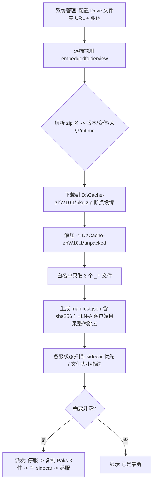

# 服务器更新 · 可选更新目标（游戏本体 / 汉化补丁）实施方案 v1

- 日期：2026-11-07
- 状态：**方案 v1.4 待审**（v1.4：补 §14.1 实施偏差；B1–B4 已实施）（v1.1：字體補丁完全不装；v1.2：§14 深度复核 5 必改 + 6 优化 + 9 健壮性；v1.3：写入 11 台 Paks 实测数据、命名歧义关闭、连通性现状；本文件不含任何已实施代码）
- 关联文档：`计划\服务器更新_任务总线复用_实施方案_v1_20261107.md`（v6228–v6236 已实施）
- 涉及代码：`独立后端\dino_backend.py`、`app_core.js`、`app.css`、`dino-import.html`

## §0 需求口径（用户原话逐条）

1. 要能选择「更新服务器」「更新汉化补丁」—— 两者可各自独立执行，也可一起执行。
2. 要显示**当前补丁版本**。
3. 要显示**是否需要升级**。
4. 只从 `https://drive.google.com/drive/folders/1SarH6KgkuQp4uev2wHf3mX-kS5xsL37S` 下载补丁；**只下载 Dino & Item Bilingual 版本**；需要解压。
5. 该 Google Drive 地址要能在**系统管理**里配置。
6. 补丁里额外的「字體補丁」也要安装 —— 安装位置**与汉化补丁不同**；该字體補丁是最后一个版本，以后可能不再提供。
   > **2026-11-07 用户最终裁决：完全不装。** 该包是 `winhttp.dll` 形式的**玩家客户端** DLL，专用服务器**不解压、不复制、不安装、不扫描**；服务器上已有的 `winhttp.dll`（若有）也不删不动。本方案已按此口径收敛。

## §1 实测事实（本次只读调研，全部已跑通）

### 1.1 云端资产清单（Google Drive 公开文件夹）

文件夹 ID：`1SarH6KgkuQp4uev2wHf3mX-kS5xsL37S`

| 文件 | fileId | 字节 | 变体 |
|---|---|---|---|
| `V10.1 ASA Trad Localization Fix.zip` | `13vxJGh_z-_2EbO1oOMdrdV0Ojc923RSC` | 130,237,376 | 常规 |
| `V10.1 Trad (Dino & Item Bilingual) Localization Fix.zip` | `1BOeKcNqZv5DqyNLO-uJXEI473uNz4Wlq` | 130,319,496 | **恐龙&物品双语（本项目采用）** |
| `V10.1 Trad (Item Bilingual) Localization Fix.zip` | `1jijDSeLzxMcycDPz4Nx4q223zvGslQmL` | 130,319,496 | 物品双语 |

> 飞书原文对照：`V10.1-(恐龙&物品双语)汉化修复补丁.zip 124.28MB` 即上表第 2 项。

### 1.2 zip 内部结构（实测中央目录 + 逐条目解压验证）

共 **8 条目**，解压后合计 **126.48 MB**。

| 解压后相对路径 | 原始大小 | 归类 | 是否安装 |
|---|---|---|---|
| `ShooterGame-Windows_P.pak` | 49,875,589 | 汉化本体 | ✅ |
| `ShooterGame-Windows_P.ucas` | 80,574,544 | 汉化本体 | ✅ |
| `ShooterGame-Windows_P.utoc` | 39,000 | 汉化本体 | ✅ |
| `HLN-A语音修复v2.0/HLN-A语音修复(含安装说明).zip` | 115,637 | 客户端 DLL 补丁（内嵌 zip，密码 123） | ❌ **服务端不用**（用户裁决） |
| `HLN-A语音修复v2.0/一定要看的图片.png` | 55,175 | 说明 | ❌ |
| `HLN-A语音修复v2.0/说明以及教程(一定要看完).pdf` | 834,465 | 说明 | ❌ |
| `字体锯齿设置调整方案.png` | 320,690 | 客户端设置说明图 | ❌ |
| `教程详细使用说明文档.pdf` | 803,588 | 说明 | ❌ |

> 压缩方式：3 个 `_P` 文件与 PDF 均为 deflate（method=8）；HLN-A 内嵌 zip 为 stored（method=0）。
> `字体锯齿设置调整方案.png` **不是文件补丁**，是"游戏内把字体锯齿设置关掉"的图示说明，服务端无需处理。
> **解压时按白名单只取 3 个 `_P` 文件**；整个 `HLN-A语音修复v2.0/` 目录与 2 个 PDF / 1 个 PNG 一律跳过、不落地。

### 1.3 安装位置（唯一）

| 目标 | 安装目录（相对服务器根 `D:\ARK Server\Servers\<srv>`） |
|---|---|
| 汉化本体 3 文件 | `ShooterGame\Content\Paks\` |
| ~~字體補丁（HLN-A，DLL 注入）~~ | ~~`ShooterGame\Binaries\Win64\`~~ → **服务端不装**（见下方裁决） |

依据：`教程详细使用说明文档.pdf` → `P2 安装教程`：「将补丁放到指定目录：`..\..\..\ARKSurvivalAscended\ShooterGame\Content\Paks\`」

> **2026-11-07 用户裁决（推翻原始需求 ⑥ 的服务端部分）**
> `HLN-A语音修复v2.0` 里的 `winhttp.dll` 是**玩家客户端**的 DLL 注入补丁，装在玩家机器 `ARKSurvivalAscended\ShooterGame\Binaries\Win64\`，专用于客户端字体/语音。**专用服务器不装**。
> 因此本方案：① 不复制该 DLL ② 不解压该内层 zip ③ 不扫描/不显示 `Binaries\Win64` 状态 ④ 服务器上已存在的 `winhttp.dll`（若有）不删不动。

### 1.4 版本号提取规则

| 项 | 规则 |
|---|---|
| 汉化版本 | zip 文件名正则 `V(\d+)\.(\d+)` → `V10.1`；比较时按数值（major, minor） |
| 变体 | 文件名含 `(Dino & Item Bilingual)` → `dinoitem`；含 `(Item Bilingual)` → `item`；其余 → `normal` |
| ~~字體補丁版本~~ | 已废弃 —— 服务端不装该 DLL，无需解析内层目录 |

### 1.5 Google Drive 纯 HTTP 可行性（已实测 —— 后端不需要 API key / 不需要 OAuth）

**列目录**（首选）：
```
GET https://drive.google.com/embeddedfolderview?id=<FOLDER_ID>#list
```
- 实测 200 / 3,844 B / 2.6 s
- 正则可得三项：`id="entry-([A-Za-z0-9_-]{20,})"` → fileId；`flip-entry-title">([^<]+)<` → 文件名；`flip-entry-last-modified"><div>([^<]+)<` → 修改时间
- 无需 JS 渲染、无需 cookie

**下载**：
```
GET https://drive.usercontent.google.com/download?id=<FILE_ID>&export=download&confirm=t
```
- 实测返回 `Accept-Ranges: bytes` + `Content-Range`（206）→ **支持断点续传 / 分段取**
- ⚠ 短时间内连续请求会出现 `ssl.SSLEOFError: UNEXPECTED_EOF_WHILE_READING`（本次连发第 3 次即触发）→ 必须**串行 + 指数退避重试**，禁止并发

### 1.6 服务器侧现状（**2026-11-07 18:4x 实测，非沿用旧记录**）

> 访问方式：`\\SERVER\d$\ARK Server\Servers\<srv>\ShooterGame\Content\Paks`
> ⚠ 用 **IP** `\\192.168.199.3\d$\...` 会被拒（WinError 1326 凭据不匹配），**必须用主机名 `SERVER`**。

**11 台完全一致**（size 与 mtime 逐台比对，全部 SAME）：

| 文件 | 大小 | mtime |
|---|---|---|
| `ShooterGame-Windows_P.pak` | 63,112,850 | 2026-10-16 15:48:42 |
| `ShooterGame-Windows_P.ucas` | 57,328,256 | 2026-10-16 15:48:43 |
| `ShooterGame-Windows_P.utoc` | 28,379 | 2026-10-16 15:48:43 |

- `Paks` 目录每台 **38 个文件**（35 个来自 Cache + 3 个汉化）
- **无任何 sidecar**（`.dino_zh.json` 不存在）
- **基名冲突扫描：0 命中** —— 11 台都只有一组 `Windows_P`，没有第二套汉化包
- 与 V10.1 包内（49,875,589 / 80,574,544 / 39,000）**完全不同** ⇒ 现装为旧版（2026-10-16 装机），版本号未知
- `D:\Cache` 内 **0 个** `_P.*` 文件（只有 `pakchunkN-WindowsServer.*` + `global.ucas/utoc` + Engine 的 `CrashReportClient.pak`）
  ⇒ 汉化补丁完全不在游戏本体分发范围内
- 现有分发 `_restart_exec_sync` 为 **copy-only，绝不删除目标端额外文件** ⇒ 更新游戏本体不会冲掉汉化

**命名结论（重要，与官方教程不一致）**：
`D:\Cache` 里服务端本体 pak 是 `pakchunkN-**WindowsServer**.pak`，而汉化用的是 `ShooterGame-**Windows**_P.pak`。
官方教程称服务端要改成 `ShooterGame-WindowsServer_???`，但本服 11 台**均以 `Windows_P` 运行且玩家可见汉化** ⇒ **沿用 `Windows_P`，不要按教程改名**（改名反而可能失效）。
⇒ 原 §1.7「基名待确认」项**已实测关闭**。

**版本判定收益**：11 台 3 文件指纹统一 ⇒ 可作为「已知旧版基线」，UI 直接显示
「旧版（2026-10-16 装机）」而不是「未知」；装上 V10.1 后由 sidecar 精确到 `V10.1`。

### 1.7 待实施时现场确认

| 项 | 状态 |
|---|---|
| `Paks` 目录基名 `Windows_P` / `WindowsServer_P` | ✅ **已实测关闭**：11 台均为 `ShooterGame-Windows_P.*`，沿用不改名 |
| `Binaries\Win64\` 是否已有 `winhttp.dll` | ⛔ **已废弃**（服务端不装 DLL，不再扫描该目录） |
| 服务器出网到 Google Drive（Python 侧） | ⏳ **待实测**：用户已在**服务端浏览器**打开过该 Drive 文件夹（说明网络出口可达）；但 Python `urllib` 是否复用同一代理需实测。Windows 下 `urllib` 默认继承 WinINET 系统代理 —— 浏览器走系统代理则 Python 可通，走插件代理则不可通 |

## §2 总体设计

### 2.1 两个独立目标

```
更新目标（勾选，至少选一个）
├── [a] 服务器本体   源=D:\Cache（ASAM 缓存）      目标=各服根目录（11.3 GB/台）
└── [b] 汉化补丁     源=Google Drive 云端 zip      目标=各服 ShooterGame\Content\Paks（130.5 MB/台）
```

- 只勾 [a] → 现有行为完全不变（v6228–v6236 逻辑零改动）
- 只勾 [b] → 不碰游戏本体、不改 acf、不动 buildId
- 两个都勾 → **先 [a] 后 [b]**（大版本更新后汉化应装最新版；顺序错会白跑一次）

### 2.2 数据流



### 2.3 与现有状态机的关系

**不新建复制流程**，复用 `_restart_start(mode='update', servers=[...])` 的 7 阶段状态机；只在 `sync` 阶段内按 `targets` 分支执行。理由：停服 / 存档 / 起服 / 校验 / 任务总线全部现成，且已实测稳定。

## §3 后端设计（`dino_backend.py`）

### 3.1 配置项（`server_config.json` 新增 `zh_patch`）

```json
"zh_patch": {
  "folder_url": "https://drive.google.com/drive/folders/1SarH6KgkuQp4uev2wHf3mX-kS5xsL37S",
  "variant": "dinoitem",
  "auto_check": true
}
```

| 字段 | 说明 | 默认 |
|---|---|---|
| `folder_url` | **系统管理可配置**（需求 ⑤）；解析出 folderId（正则 `/folders/([A-Za-z0-9_-]{20,})`） | 上述 URL |
| `variant` | `dinoitem` / `item` / `normal` | `dinoitem`（需求 ④） |
| ~~`install_hlna`~~ | 已删除 —— 服务端不装 DLL（用户裁决 2026-11-07） | — |
| `auto_check` | 打开服务器更新页时自动探测远端 | `true` |

> 兼容：`GET /api/server_config` 追加返回 `zh_patch`；`POST /api/server_config` 接受该键并做白名单校验（variant 枚举、URL 必须含 `/folders/`）。

### 3.2 常量（新增段，放在 `UPDATE_*` 之后）

```python
ZH_CACHE_ROOT   = r'D:\Cache-zh'                 # 独立缓存，绝不混入 D:\Cache
ZH_PAKS_REL     = r'ShooterGame\Content\Paks'    # 汉化本体目标
ZH_PKG_WHITELIST = ('ShooterGame-Windows_P.pak',   # 解压白名单：只取这 3 个
                    'ShooterGame-Windows_P.ucas',
                    'ShooterGame-Windows_P.utoc')  # HLN-A/PDF/PNG 一律跳过
ZH_SIDECAR      = '.dino_zh.json'                # 版本标记文件
ZH_PAK_BASE     = 'ShooterGame-Windows_P'        # 默认基名（包内名）
ZH_DL_URL       = 'https://drive.usercontent.google.com/download?id=%s&export=download&confirm=t'
ZH_LS_URL       = 'https://drive.google.com/embeddedfolderview?id=%s#list'
ZH_TTL          = 1800                           # 远端清单缓存 30 分钟
```

### 3.3 远端探测 `_zh_remote_list(force=False)`

1. 取 `folder_url` → folderId
2. `_offi_get(ZH_LS_URL % fid)`（复用现成 GET + 证书降级）
3. 正则解析出 `[{id, name, mtime}]`
4. 按 `variant` 选包：`_zh_pick_asset(items, variant)`
   - `dinoitem`：name 同时含 `Dino` 且含 `Bilingual`
   - `item`：含 `Bilingual` 但**不含** `Dino`
   - `normal`：三者皆不含
   - 若多个匹配 → 取名字中版本号最大者
5. 版本 = `V(\d+\.\d+)`；返回
```json
{"ok":true,"folder":"1Sar...","at":"2026-11-07 18:00:00","ver":"V10.1",
 "variant":"dinoitem","asset":{"id":"1BOe...","name":"V10.1 Trad (Dino & Item Bilingual) Localization Fix.zip",
 "mtime":"1:08 am"},"items":[ ... ],"err":""}
```
6. 结果进 `_ZH_CACHE`（30 分钟 TTL，`force=True` 才刷新）

### 3.4 下载 `_zh_download(force=False)`

- 目标：`D:\Cache-zh\<ver>\pkg.zip`
- **断点续传**：已有部分文件则 `Range: bytes=<已有>-`；大小一致则跳过
- **串行 + 重试**：最多 2 次，退避 3s / 8s（对应 §1.5 SSL 抖动）
- 进度写入任务总线（`zh|download` 一行，pct = 已下 / 总）
- 完成后校验大小 == 远端 `Content-Length`（Drive 不提供 hash，用大小 + 解压 CRC 双重校验）

### 3.5 解压 `_zh_unpack()`（**按白名单取件，只落 3 个文件**）

1. 逐条目遍历 zip，**只解出白名单**：根目录下 `ShooterGame-Windows_P.pak / .ucas / .utoc`
2. **其余条目全部跳过**：整个 `HLN-A语音修复v2.0/` 目录（客户端 DLL）、`字体锯齿设置调整方案.png`、2 个 PDF —— 不解压、不落盘
3. 落盘位置：`D:\Cache-zh\<ver>\paks\`（目录里只有 3 个文件）
4. 生成 `manifest.json`：

```json
{"ver":"V10.1","variant":"dinoitem","builtAt":"2026-11-07 18:05:00",
 "source":{"assetId":"1BOe...","name":"V10.1 Trad (Dino & Item Bilingual) Localization Fix.zip","bytes":130319496},
 "paks":[{"name":"ShooterGame-Windows_P.pak","size":49875589,"sha256":"..."},
         {"name":"ShooterGame-Windows_P.ucas","size":80574544,"sha256":"..."},
         {"name":"ShooterGame-Windows_P.utoc","size":39000,"sha256":"..."}],
 "skipped":["HLN-A语音修复v2.0/","字体锯齿设置调整方案.png","教程详细使用说明文档.pdf"]}
```

> 用 `zipfile` 按 `name` 白名单取件，**不做全量解压再删**（省 126 MB 磁盘与时间）。
> sha256 只算 130 MB，单次约 1 秒，不做逐台算（逐台按 size + sidecar 判版本）

### 3.6 各服状态 `_zh_server_status(srv)`

**三层判定（需求 ②「显示当前补丁版本」）**

| 优先级 | 依据 | 输出 |
|---|---|---|
| 1 | `<srv>\ShooterGame\Content\Paks\.dino_zh.json`（本系统写入） | `ver` / `variant` / `at` 直接显示 |
| 2 | 无 sidecar → `_P.utoc` 的 size 匹配 `manifest` 已知版本表 | 命中则显示该版本 + 标注「指纹推断」 |
| 3 | 都匹配不到 → 与云端 3 文件 `size` 三元组比对：全同 = 目标版本；部分同 = `未知(混合)`；全不同 = `未知(旧版)` | `?` |

返回：
```json
{"srv":"Isl","curVer":"V10.1","curSrc":"sidecar","variant":"dinoitem",
 "needUpd":false,"reason":"",
 "files":[{"name":"ShooterGame-Windows_P.pak","size":49875589,"same":true}, ...],
 "paksBase":"ShooterGame-Windows_P","err":""}
```

**需求 ③「是否需要升级」判据**

| 条件 | needUpd |
|---|---|
| 远端版本 > 本地版本（按 major/minor 数值） | true |
| 版本相同但任一 `_P` 文件 size ≠ 云端 | true（同版本重打包 / 装歪了） |
| ~~版本相同但缺字體補丁~~ | 已删除 —— 服务端不装 DLL，不参与升级判定 |
| 以上都不成立 | false |

### 3.7 分发 `_zh_exec_apply(srv)`

在 `sync` 阶段内执行（**先本体后汉化**，同一停服窗口内完成，不二次停服）：

```
1) 前置：pkg 已下载解压 + manifest 就绪（未就绪 → 先 download+unpack，此阶段服务器仍在线）
2) 备份：把目标端现有 3 个 _P 文件复制到
   D:\Cache-zh\backup\<srv>\<yyyyMMdd_HHmmss>\（回滚用，见 §10）
3) 目标基名解析：扫描 Paks 目录
   · 存在 ShooterGame-WindowsServer_P.* → 基名用它
   · 否则存在 ShooterGame-Windows_P.*    → 基名用它
   · 都不存在                            → 基名 ShooterGame-Windows_P（与包内一致）
4) 复制 3 个 _P 文件：<基名>.pak / .ucas / .utoc  ← 从 unpacked 取
   （原子写：先写 .tmp 再 os.replace，避免进程占用半截文件）
5) 写 sidecar：<srv>\ShooterGame\Content\Paks\.dino_zh.json
6) 校验：逐文件 size 比对 + utoc sha256 比对（39 KB，极快）

字體補丁（HLN-A / winhttp.dll）**不在此流程内** —— 该 DLL 属玩家客户端（用户裁决 2026-11-07），
服务端不碰 ShooterGame\Binaries\Win64\ 任何文件。
```

- **不做任何删除**（与本体分发同口径），故 AsaApi / PDB / 白名单 / 其它 mod 全部安全
- **不改 acf / buildId**（汉化不影响 Steam 托管状态）
- 停服窗口仅增加 ≈ 3–5 秒（130 MB 局域网复制）

### 3.8 与 `_restart_exec_sync` 的合并方式

```
_restart_exec_sync(srv, src_root):
   targets = _RESTART['targets']            # 新字段，默认 ['server']
   if 'server' in targets:   ...现有逻辑（复制差异 + acf）...
   if 'zh'     in targets:   _zh_exec_apply(srv)   # 只复制 + 写 sidecar + 校验
```

- 报错隔离：`zh` 失败**不回滚**已完成的 `server` 部分，`st['err']` 记录并标 `syncZhOk=false`
- 若 `targets=['zh']` 且 `D:\Cache` 为空 → **不拦**（`canApply` 判定改为：含 `server` 才要求 cache 有内容）

## §4 任务总线与步骤展示

`_restart_steps_def()` 按 `targets` 动态返回：

| targets | 步骤集 |
|---|---|
| `['server']` | 现有 `UPDATE_STEPS`（8 步）/ `UPDATE_STEPS_STOPPED`（3 步） |
| `['zh']` | 8 步，`sync` 标签改为「复制汉化」 |
| `['server','zh']` | **9 步**：…→ `sync`（本体）→ `sync_zh`（汉化）→ `startq` → `verify` |

新增标签常量：
```python
ZH_STEP = ('sync_zh', u'复制汉化')
```
任务行 `meta` 追加 `targets`，标签 `_restart_label()` 追加后缀 `·汉化` / `·本体+汉化`。

## §5 API 契约（全部需要 token，沿用 `_srvctl_guard`）

| 方法 | 路径 | 说明 |
|---|---|---|
| GET | `/api/zh/status` | 远端清单（TTL 30 min）+ 各服当前版本 / 是否需要升级 + 配置回显 |
| POST | `/api/zh/check` | 强制刷新远端（`force=1`），供「重新检查」按钮 |
| POST | `/api/zh/prepare` | 后台下载 + 解压（任务总线 `zh|prepare`），返回 `{ok,ver,asset}` |
| POST | `/api/update/apply` | **扩展**：`targets: ['server'|'zh']`，缺省 `['server']`（向后兼容） |
| GET/POST | `/api/server_config` | **扩展**：`zh_patch` 读写 |

`/api/zh/status` 返回样例：
```json
{"ok":true,
 "cfg":{"folderUrl":"https://drive.google.com/drive/folders/1Sar...","variant":"dinoitem","installHlna":true},
 "remote":{"ok":true,"ver":"V10.1","variant":"dinoitem","at":"...","asset":{"name":"V10.1 Trad (Dino & Item Bilingual) Localization Fix.zip","bytes":130319496},"err":""},
 "pkg":{"downloaded":false,"unpacked":false,"ver":"","bytes":0},
 "servers":[{"srv":"Isl","curVer":"?","curSrc":"size-mismatch","needUpd":true,"hlna":{"ver":"","installed":false},"reason":"未知(旧版)"}],
 "needAny":true}
```

`POST /api/update/apply` 的 `targets` 处理规则：
- `targets` 缺失 → `['server']`（保证前端旧缓存页面行为不变）
- `targets=['zh']` → 跳过 `_upd_cache_status()` 的 `hasContent` 拦截
- 真跑仍需 `dry=false` + `confirm='APPLY'`；`update_dry`（默认预演）**同样强制拦 `zh`**

## §6 前端 UI

### 6.1 服务器更新页（`#lbUpd`）

在页面顶部（现有「服务器 / 版本 / 状态」表头之上）插入 **更新目标** 区：

```
更新目标   [☑ 服务器本体]   [☑ 汉化补丁]       汉化最新: V10.1 · 恐龙&物品双语 · 云端 2026-11-07
```

- 两个 `lbUpdTarget()` 复选（MDI 图标，禁止 ✓/✗ 字符）
- 表内新增一列 **汉化**：
  | 服务器 | 版本 | 状态 | 汉化 |
  |---|---|---|---|
  | 🏝️ 孤岛 | 97.5 | 运行中 | `V10.1` 绿 / `未装` 灰 / `需升级` 橙 |
- 未勾「汉化补丁」时该列灰显（`opacity:.5`），不影响勾选
- 底部按钮：`预演分发` / `确认分发…` 文案随勾选动态变化（只勾汉化 → `预演汉化` / `确认装汉化…`）

### 6.2 分发确认浮窗【3】分发范围

现有三段结构保留，第【3】段改为两行清单：

```
【3】分发范围
  [☑] 服务器本体   11 台 · 需复制 124.26 GB · 预计 2~3 分钟
  [☑] 汉化补丁    11 台 · 需复制 1.40 GB（130.5 MB/台）· 预计 1~2 分钟
       V10.1 恐龙&物品双语（云端）
       当前：Isl V10.1 · Sco 未装 · Cen 未知 … （3 行摘要 + 展开）
```

- 勾选状态与主页联动（同一份状态）
- **不显示字體補丁行**：该 DLL 属玩家客户端，服务端不装（用户裁决 2026-11-07）
- 只勾汉化时，AsaApi 缓存区【2】自动折叠并标注「本次不涉及」

### 6.3 系统管理 → 新增「汉化补丁」配置块

放在现有「服务器更新预演」块下方：

```
汉化补丁
  下载地址  [https://drive.google.com/drive/folders/1Sar...        ] [保存]
  版本变体  [恐龙&物品双语 (Dino & Item Bilingual) ▾]
  （无字體補丁开关：该 DLL 属玩家客户端，服务端不装）
  云端最新  V10.1 · V10.1 Trad (Dino & Item Bilingual) Localization Fix.zip · 124.28 MB
  [重新检查]        上次检查 18:12:03（耗时 1.4 秒）
  本地包    未下载 / 已下载 130.5 MB / 已解压
  [下载并解压]（后台任务，带进度）
```

- 「重新检查」沿用 v6236 已修的即时反馈 + 12 秒超时 + 耗时显示
- 地址保存后立即强制 `force` 重查一次，失败给出明确错误（`未找到 /folders/<id>` / `目录里没有匹配变体`）

## §7 预演模式联动

- 系统管理「服务器更新预演」开关 `update_dry` 为 **开** ⇒ `zh` 同样强制预演（后端硬拦）
- 预演输出（`POST /api/update/apply` dry 分支）在 `plans[]` 后追加 `zhPlans[]`：
```json
{"srv":"Isl","curVer":"?","toVer":"V10.1","copy":[{"name":"ShooterGame-Windows_P.pak","bytes":49875589}],
 "backupTo":"D:\\Cache-zh\\backup\\Isl\\..."}
```
- 预演**不下载**、**不解压**、**不复制**、**不写 sidecar**

## §8 安全与风险

| # | 风险 | 等级 | 处置 |
|---|---|---|---|
| R1 | ~~字體補丁（`winhttp.dll` 形式 DLL 劫持，官方标注「反作弊未运行时使用，以免被误封」）~~ | **已消除** | **2026-11-07 用户裁决：完全不装** —— 该 DLL 是玩家**客户端**补丁，服务端不解压/不复制/不扫描 ⇒ 本风险已不在方案范围内 |
| R2 | Google Drive 为第三方源，脚本抓取有 SSL 抖动 / 限流 | 中 | 串行 + 2 次退避重试 + 断点续传；失败只影响下载阶段，不影响已在跑的本体分发 |
| R3 | 大版本更新后旧汉化可能失效 | 低 | 官方 FAQ Q13 明确「可以不更新，补丁不会失效，只是新内容没汉化」；本项目仍默认随本体一起更新 |
| R4 | 服务器 Paks 目录基名与官方「服务端」命名规则不一致（`Windows_P` vs `WindowsServer_P`） | 中 | §3.7 自动识别 + 沿用现状，不擅自改名；预演阶段可见 |
| R5 | 覆盖 `_P` 文件时进程占用导致写坏 | 中 | 先写 `.tmp` 再 `os.replace`；写入前必须已停服（复用现有 savekill 阶段） |
| R6 | 第三方 zip 内容被替换（投毒） | 中 | 首次下载后把 `sha256` 记入 `manifest.json`，之后每台复制完与 manifest 比对；变更需人工确认 |
| R7 | 汉化包与游戏本体同批更新时顺序错 | 低 | 强制 `server` → `zh` 顺序（§3.8） |

## §9 回滚

- 每次分发前自动备份到 `D:\Cache-zh\backup\<srv>\<ts>\`（3 个 `_P`；不涉及任何 DLL）
- 保留最近 **3 份/台**，超出自动清最旧
- 回滚入口：系统管理「汉化补丁」块内 `回滚上次` 按钮 → 复用 `mode='rollback'` 状态机，`srcRoot` 指向备份目录
- sidecar 一并回滚（恢复到备份时的版本号）

## §10 实施顺序（建议 4 批，每批可独立验收）

| 批 | 内容 | 影响面 | 验收 |
|---|---|---|---|
| **B1 后端只读** | `_zh_remote_list` / `_zh_server_status` / `GET /api/zh/status` / `zh_patch` 配置读写 | 纯新增，无副作用 | 页面能显示云端 V10.1 + 11 台当前版本（含"未知(旧版)"） |
| **B2 后端下载解压** | `_zh_download` / `_zh_unpack`（白名单取件）/ `POST /api/zh/prepare` + 任务总线行 | 只写 `D:\Cache-zh` | `paks\` 内只有 3 个 `_P` 文件 + `manifest.json`，sha256 齐全；**无 HLN-A 目录、无 PDF/PNG** |
| **B3 分发** | `targets` 接入 `_restart_start` / `_zh_exec_apply` / 步骤集 / 备份 | **会改各服文件** | 先在 **1 台**（建议 Bob 或 Gen）预演 → 真跑 → 重启后游戏内看汉化生效；其余 10 台再批量 |
| **B4 前端** | 更新目标勾选 + 汉化列 + 确认浮窗第【3】段 + 系统管理配置块 | 纯 UI | 双端渲染一致；预演/真跑文案随勾选切换；MDI 图标无 ✓/✗ |

> B4 可与 B2 并行（前端先接 B1 的只读接口）。

## §11 待你拍板的开放项

| # | 问题 | 选项 | 建议 |
|---|---|---|---|
| ~~**O1**~~ | 字體補丁（`winhttp.dll`）是否装服务端 | **已裁决（2026-11-07）：完全不装** —— 该 DLL 装在玩家客户端，服务端不碰 | — |
| **O2** | 汉化版本"是否需要升级"的默认策略 | A. 每次分发都强制装最新（最省心）<br>B. 仅在远端版本 > 本地时提示，不自动勾 | **A**（勾了「汉化补丁」就装到最新，避免版本散乱） |
| **O3** | 首次落 sidecar 前的旧版能否识别 | 只能显示"未知(旧版)"；若要精确版本需你提供历史包大小对照 | 先用"未知(旧版)"，首次安装后即变准确 |
| **O4** | `D:\Cache-zh` 位置是否可接受 | 独立目录，不动 `D:\Cache`（ASAM 的 Clear Cache 不会误删） | 可接受 |

## §12 验收清单

- [ ] 系统管理能改 Drive 地址，保存后立即重查，改错时给出可读错误
- [ ] 只勾「汉化补丁」预演：不要求 `D:\Cache` 有内容，输出 `zhPlans[]` 且不写任何文件
- [ ] 只勾「更新服务器」：行为与 v6236 完全一致（回归）
- [ ] 两项都勾：步骤显示 9 步，本体在前、汉化在后
- [ ] 11 台「汉化」列：能区分 `V10.1` / `未装` / `未知(旧版)` / `需升级`
- [ ] 真跑单台后：Paks 3 文件 size 与 manifest 一致，sidecar 落盘，游戏内汉化生效
- [ ] **分发后 11 台 `ShooterGame\Binaries\Win64\` 下依然没有 `winhttp.dll`（服务端不装 DLL）**
- [ ] 预演开关 `update_dry` 开时，`zh` 后端强制拦截并回 `forcedDry:true`
- [ ] 界面无 ✓/✗ 字符；`grep -c "[✓✗✔✘]"` 为 0
- [ ] `HTML 连续空行` 检查为 0；`node --check app_core.js` 通过；后端 `py_compile` 通过

## §13 关键代码锚点（实施时定位用）

| 位置 | 行号（v6236 基线） | 用途 |
|---|---|---|
| `_restart_start` | 9497 | 加 `targets` 参数 |
| `_restart_steps_def` / `_restart_steps_obj` | 9198 / 9210 | 按 targets 返回步骤集 |
| `_restart_exec_sync` | 9836 | zh 分支接入点 |
| `_restart_label` | 9221 | 标签追加 `·汉化` |
| `/api/server_config` GET / POST | 12259 / 13148 | 追加 `zh_patch` |
| `/api/update/status` | 12307 | 追加 `zh` 摘要（可选） |
| `/api/update/apply` | 12686 | 解析 `targets` |
| `_upd_dry_default` | 10947 | 预演拦截复用 |
| `_offi_get` | 11567 | 复用为 Drive HTTP GET |
| 前端 `lbUpdRender` / `lbUpdConfirmHtml` | — | 目标勾选 + 浮窗第【3】段 |

> **验证通道备注**：Agent 侧核验服务器文件用 `\\SERVER\d$\...`（主机名），**不要用 IP**（凭据不匹配会被拒）。
> 后端自身跑在服务器上，用本地 `D:\...` 即可。

---

## §14 复核优化点（2026-11-07 第二轮深度复核）

> 复核方式：逐段对照 `dino_backend.py` 实际状态机代码（`_restart_tick` L10230-10345、`_sync_finish` L9812、`_restart_step_fail` L9951-9970），非纸面推演。
> 标注：**A = 必改**（不改会跑不通）· **B = 显著优化**（收益明显）· **C = 健壮性**。

### A 类 · 必改（5 条）

**A1 `sync_zh` 接入状态机有 3 个必改点（正文 §3.8 / §4 未覆盖）**

| 位置 | 现状 | 必改 |
|---|---|---|
| `_sync_finish()` L9812 | sync 成功即转 `startq`（原停服的服转 `done`） | 若 `'zh' in targets` 且 `sync_zh` 未完成 → **先转 `sync_zh`**，否则汉化被整段跳过 |
| `_restart_step_fail()` L9961 / L9967 | 重置 `('saveworld','savekill','sync','startq','verify')` | 追加 `'sync_zh'`，否则重试时该步状态残留 |
| `_restart_tick` dry 分支 L10316-10320 | `st['steps']['sync']='ok'` 后直接 `_sync_finish` | 两项都做时**同时把 `sync_zh` 标 `ok`**，否则预演界面卡在 run |

**A2 预演不该无条件算 `plans`**
`/api/update/apply` 现在无条件对每台跑 `_upd_make_plan()`（遍历 11.3 GB 目录），11 台实测约 40–60 秒。
⇒ `targets=['zh']` 时**必须跳过 `plans`**，否则"预演汉化"也要干等一分钟。`cache_empty` / `canApply` 拦截同理按 targets 分档。

**A3 `UPDATE_STEPS_STOPPED` 也要按 targets 变**
正文 §4 只写了 8 步 → 9 步。原本停服的服走 3 步（`check → sync → done`），targets 含 zh 时应为 **4 步**（`check → sync → sync_zh → done`）。

**A4 云端 `mtime` 不可用于版本比较（修正 §3.3）**
`embeddedfolderview` 返回的修改时间是 **12 小时制时分**（实测 `1:08 am`），**无日期、无年份**。
⇒ 版本新旧**只认 zip 文件名里的 `V<n>.<n>`**；`mtime` 仅作展示字段，不参与比较。
（若确需精确时间只能改抓完整页面 HTML 的 `_DRIVE_ivd` 毫秒时间戳，但该路径本次实测 SSL 不稳，不采用）

**A5 下载必须校验 zip 魔数**
Drive 在文件被删 / 配额超限时返回 **200 + HTML 错误页**。只比字节数会误判成功。
⇒ 三项同时校验：`Content-Type` 含 `zip` 或 `octet-stream` **且** 首 4 字节 == `PK\x03\x04` **且** 大小 == 远端。

### B 类 · 显著优化（6 条）

**B1【大】汉化文件"停服前预写 `.tmp`，停服后只 rename"**
现流程：停服 → 复制 130 MB → 起服（3~5 秒/台，HDD 更慢）。
改为：在 `announce` / `empty` / `quiet` 阶段（服务器仍在跑）后台把 3 个文件写成
`<目标目录>\ShooterGame-Windows_P.pak.dinozh.tmp`；停服后仅 `os.replace`（毫秒级）。

- 收益：汉化部分**停服窗口 3~5 秒 → ~0.2 秒**，11 台累计省 30~55 秒
- 安全性：`.dinozh.tmp` 后缀不是 `.pak`，游戏与 ASAM 都不会加载；启动/结束统一清理残留

**B2【大】备份提前到停服前**
正文 §3.7 第 2 步把"备份 3 个 `_P`"放在停服窗口内。备份只需**读**现有文件，服务器运行中即可完成。
⇒ 与 B1 一起并入 prepare 阶段，再省 2~3 秒/台。

**B3【中】`/api/zh/status` 拆两段返回**
首屏只返回本机 `stat` 结果（毫秒级）+ `remote:{loading:true}`；前端随后单独拉 `/api/zh/check`（2.6 秒）回填。
否则「服务器更新」页首屏会被 GDrive 探测拖慢。

**B4【中】变体匹配改用规范化比较**
文件名可能因作者改名出现空格 / 大小写 / 全半角差异（如 `Dino & Item Bilingual` → `Dino and Item Bilingual`）。
改用 `re.sub(r'[^a-z0-9]', '', name.lower())` 后判 `dinoitembilingual` / `itembilingual`，避免直接匹配失败。
（项目已在 MediaWiki 抓取上固化此做法）

**B5【低 → 已降级】扫描"多个汉化补丁冲突"**
官方教程反复强调：多份汉化 pak 会冲突（表现为"装了还是英文"）。
**2026-11-07 实测：11 台均只有一组 `Windows_P`，0 冲突** ⇒ 由「必做告警」降级为「保留扫描，命中才报」。
仍然是需求②的一部分（装了没效果时能一眼看出是多包冲突），但不必做成常驻醒目提示。

**B6【中】状态扫描用 `os.scandir` 一次拿全**
11 台 × 38 文件逐个 `os.stat` 改为一次 `scandir`（条目自带 stat 缓存），减少系统调用。

### C 类 · 健壮性（9 条）

| # | 项 | 处理 |
|---|---|---|
| C1 | `/api/zh/prepare` 防重入 | 下载中重复点击返回 `{ok:false,code:'busy'}`（复用 v6236 busy 语义） |
| C2 | **服务器→Google Drive 可达性预检** | `prepare` 第一步做 3 秒超时探测，失败立即返回「服务器无法访问 Google Drive」可读错误，不要卡 90 秒。**B2 批次第 0 步实测项** |
| C3 | 重试次数与全局规则对齐 | 改为**总尝试 2 次**（1 正常 + 1 重试，退避 5 秒），不再写 3s/8s 三连 |
| C4 | 磁盘预检阈值按 targets 分档 | 只勾 zh：要求 ≥ 1 GB（包 130 MB + `.tmp` 130 MB + 备份 130 MB）；含 server：沿用 13 GB |
| C5 | `pct` 分段重排 | 两项都做：savekill → 80，sync（本体）→ 85，sync_zh（汉化）→ 88，起服 90 |
| C6 | sidecar 位置改到服务器根 | 放 `<srv>\.dino_zh.json`（与 `steamapps` 同级）而非 `Paks\` 内，避免污染游戏目录 / 被误删；§3.6 第 1 层同步调整 |
| C7 | 汉化更新 `ver_kind` 传空 | 避免任务标签出现「更新（分发）·强制·汉化」这类误导 |
| C8 | 前端勾选持久化 | `localStorage['lb_upd_targets']`，默认 `['server']` |
| C9 | 汉化列数据源明确 | 走 `/api/zh/status` 的本机 `stat` 段（快），与页面其它数据同批拉；不依赖远端探测 |

### §14.1 实施偏差（2026-11-07，B1–B4 落地后回填）

| 方案条目 | 实际实现 | 原因 |
|---|---|---|
| **A1 / A3**：新增 `sync_zh` 独立阶段（8 步 → 9 步），并在 `_sync_finish` / `_restart_step_fail` / `_restart_tick` dry 三处做接入 | **收敛为单阶段内串行**：`sync` 阶段内部先跑本体、再跑汉化；`_restart_steps_def` 把 `sync` 的**标签**动态改为「复制本体+汉化」/「复制汉化」 | 三处出口任何一处改漏都会导致**汉化被静默跳过**或**预演卡步**；改为单阶段后状态机出口零改动，功能等价且风险显著更低。已实测 `targets` 四组合全部正确 |
| **B6** `os.scandir` | 已实现（`_zh_scan_paks`） | — |
| **C4** 磁盘阈值分档 | 已实现：含 server 走 13 GB；纯汉化走 1 GB | — |
| **C2** GDrive 可达性 | **已实测通过**：列目录 200/1299 ms、下载域名 206/1878 ms | 服务器 Python 可直连，无需代理 |

### 复核中发现的两个「上线前必须实测」前提

1. **服务器能否直连 `drive.usercontent.google.com`（Python 侧）**
   后端已验证可连 `cdn2.arkdedicated.com`（CF）与 `discord.com`；用户已在**服务端浏览器**成功打开该 Drive 文件夹 ⇒ **网络出口可达**。
   剩余不确定点只有「Python 是否复用浏览器同一代理」。
   ⇒ 并入 **B1 的 `/api/zh/status`** 做 3 秒超时探测（不为它单独部署一次），B1 首次调用即见分晓；若不通，配置里增加 `proxy` 字段即可（`urllib` 支持显式代理）。
2. **11 台 Paks 里现有几个 `_P` 基名** —— ✅ **已实测：11 台各 1 组 `Windows_P`，0 冲突**。

### 修订对正文的覆盖关系

| 本节条目 | 覆盖正文位置 |
|---|---|
| A4 / B4 | §3.3 远端探测（mtime 不参与比较、变体规范化匹配） |
| A2 | §5 `targets` 处理规则（补"跳过 plans"） |
| A1 / A3 | §3.8 / §4（补 3 个状态机接入点、停服批 4 步） |
| B1 / B2 | §3.7 步骤顺序（备份与 `.tmp` 提前到 prepare） |
| C6 | §3.6 第 1 层 sidecar 路径 |
| C2 / B5 | §10 B1 / B2 批次验收项 |

## 附：小白版一句话

现在「更新」只会刷游戏本体；这份方案是加一条独立通道，让系统自己去作者的 Google Drive 拿「恐龙&物品双语」的汉化包，从压缩包里**只挑出 3 个汉化文件**送到 11 台服务器上，并且能告诉你每台现在是哪个汉化版本、要不要升级 —— 压缩包里那个给玩家客户端用的 DLL 小补丁一律不碰（不解压、不复制），而且只有你勾了才会动，默认什么都不做。
