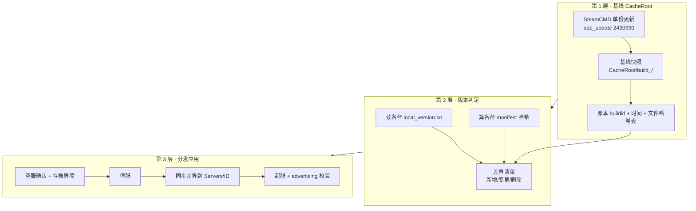
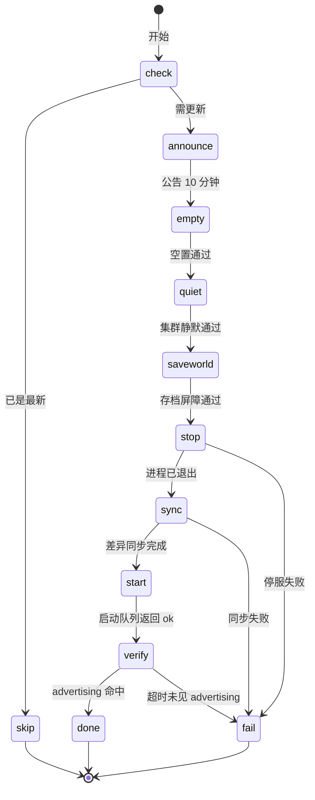

# 服务器更新系统（Cache Manager 复刻）—— 完整方案 v1

> 日期：2026-11-07
> 状态：**方案定稿待实施**（0 行代码落地）
> 范围：`dino_backend.py`（独立后端）+ 前端「系统管理 / 服务器控制」+ `\\SERVER\ARK Server\` 磁盘布局 + ASAM（**只调用，不修改**）
> 依据：ASAM 3.8.x 官方 Discord 说明原文 + 2026-11-07 磁盘实测 + 既有进度研究记录
> 关联文档：`IP切换自动重启与共享进度_落地方案.md`（自动重启编排）、`035_复核_全项目待优化点盘点.md` §Q2（本方案的研究起点）

---

## 0. 一页速览

| 项 | 内容 |
|---|---|
| **要解决什么** | 每次 ASA 大版本更新，11 台服务器都要各自跑一遍 SteamCMD，而 SteamCMD 在本机**频繁崩溃**（历史遗留 23 个 `assert_steamcmd.exe_*.dmp`），导致更新失败、长时间离线、甚至存档损坏风险 |
| **现状一句话** | 后端 `update` 动作**没有任何实现**，纯透传给 ASAM；ASAM 内部用 SteamCMD 逐台更新 ⇒ 崩溃面 = 11 倍 |
| **方案三句话** | ① 用 SteamCMD **只更新一份基线**（`CacheRoot`）；② 用**哈希/manifest 比对**算出与各台 profile 的差异；③ 停服后**同步差异到各 profile**，绕开「每台都跑 SteamCMD」 |
| **对标官方** | ASAM 的 `Cache Server Updates` 付费功能做的正是这件事（CDN + 哈希比对 + 本地缓存），我们把 CDN 环节换成本机基线 |
| **不做什么** | 不改 ASAM、不改游戏参数、不引入 Steam 之外的第三方依赖、不做付费功能复刻中的"系统消息缓存/Steam 缓存路径展示" |

---

## 1. 问题背景

### 1.1 现在点「更新」到底发生了什么

后端只在两个地方出现 `update`：

| 位置 | 内容 |
|---|---|
| `SRVCTL_ACTIONS`（`dino_backend.py` L5329） | 把 `update` 列为合法动作 |
| `_UTASK_ACT_LABEL`（L10092） | 把 `update` 映射为文案「更新」 |

**`_srvctl_one()` 里没有任何 `action == 'update'` 分支** ⇒ 走默认分支，原样透传给 ASAM：

```python
code, text = _asa_http('POST', cfg['base'] + '/' + action, cfg['token'], payload, ...)
```

即：**「更新」= 请求 ASAM 自己对这一台跑更新**。ASAM 内部的实现方式就是调用 SteamCMD（`app_update 2430930`）。

### 1.2 SteamCMD 为什么会崩（现场证据链）

| 证据 | 说明 |
|---|---|
| `SteamCMD/dumps/` 历史 23 个 `assert_steamcmd.exe_*.dmp`（2025-12 ~ 2026-10） | 进度记录在案；**当前已被清理（0 个）**，但 `SteamCMD/` 下留有 `steamcmd.exe.old`、`crashhandler.dll.old`、`tier0_s.dll.old` 等一堆 `.old` 备份 —— 典型的"反复崩溃后手工回滚 DLL"痕迹 |
| `SteamCMD/steamapps/` 里**没有 `appmanifest_2430930.acf`** | 只有 `228980`(Steamworks) 与 `2394010`(Palworld) ⇒ **ARK 的 SteamCMD 安装从未正常走完**（否则 manifest 一定会落盘） |
| 顶层 `update_server.bat` 仅 194 B，写死 `+force_install_dir ..\Servers\Isl\` | 早期人工救火脚本，只服务 Isl 一台，早已与现状脱节 |
| `Servers/<ID>/Cache/` **11 台全部为空** | 说明"本地缓存"这条路我们从来没走过 |

### 1.3 后果

1. **更新窗口不可控**：11 台各自跑 SteamCMD，任一台崩溃就要人工介入
2. **反复全量下载**：没有共享基线，每台都要从 Steam 拉一遍大版本（数十 GB 级）
3. **与自动重启编排冲突**：更新期间 IP 若变化，重启编排会和更新抢同一批服务器
4. **无版本账本**：现在只有 `local_version.txt`（且 3 台缺失），无法回答"哪台落后了"

---

## 2. 官方怎么做（ASAM `Cache Server Updates`）

### 2.1 官方说明原文（Discord，已翻译）

> ## 📌 提醒 – CDN 与更新系统
> **CDN** 基于 **Cloudflare R2 存储桶**，用于存储**最近两个大版本更新**。
>
> ### ⚙️ 工作原理
> - 我的 **Linux 后端服务器**每 **10 分钟**检查一次更新
> - 当 **WC 更新**发布时：
>   - 当前版本被上传至 CDN
>   - 上一版本被归档
>   - 这样在需要时可以**轻松、安全地回滚**
>
> ### 🧠 智能更新处理
> - **管理器**包含所有逻辑，用于：
>   - 从 CDN 下载更新
>   - 将其复制到您的**本地缓存**
> - 一切自动处理，无需手动操作
>
> ### ⏱️ 短暂延迟，大幅提升稳定性
> - 更新检测最多需要 **10 分钟**
> - 再加上从后端上传至 CDN 的时间
> - 这可能会使可用性延迟 **约 30 分钟**，但**完全避免了 SteamCMD 问题**
>
> ### 🚀 优化的文件分发
> - 管理器使用**基于哈希的文件比对系统**
> - **仅下载 WC 修改过的文件**
> - 减少带宽占用 / 更快的更新 / 无需完整重新下载
>
> ### 🌍 由 Cloudflare 驱动
> 您可充分受益于 Cloudflare 的全球基础设施
>
> ### ✅ 为什么使用 CDN？
> 如果您想**彻底摆脱所有 SteamCMD 相关问题**，CDN 就是解决方案。

### 2.2 机制拆解


### 2.3 提炼出的 4 个关键设计点

| # | 设计点 | 作用 |
|:--:|---|---|
| 1 | **单份基线 + 差异分发** | 全世界只跑一次 SteamCMD，其余靠文件复制 |
| 2 | **基于哈希的文件比对** | 只传变更文件，不做全量重下 |
| 3 | **保留最近两个大版本** | 新版出问题可秒回滚上一版 |
| 4 | **接受 ~30 分钟延迟** | 用"晚一点但稳"换掉 SteamCMD 崩溃风险 |

### 2.4 我们的差异化

官方靠 **公网 CDN** 分发（面向上万用户）。我们自己用**只有 11 台**，公网 CDN 完全没必要 ——
**把 R2 换成本地磁盘上的 `CacheRoot`**，其余三个设计点原样保留，就得到本方案。

---

## 3. 现场事实盘点（2026-11-07 磁盘实测）

### 3.1 `\\SERVER\ARK Server\` 顶层

```
DinoData/  Logs/  Profiles/  Servers/  ShooterGame/  SteamCMD/  _backup_/
clusters/  jre/  libs/  log/
ShooterGame-Windows_P.pak / .ucas / .utoc      ← 顶层还留着一份"孤零零"的 Paks
start_server.bat      (188 B，写死 Isl + `?listen ?Port=7777`，早期脚本)
update_server.bat     (194 B，写死 `+force_install_dir ..\Servers\Isl\`)
workshopcache_346110.json   (25.6 MB)
```

`Profiles/` 只有 **1 个** `.profile` 文件 ⇒ ASAM 侧是一个 profile 管 11 台（靠 `Servers/<ID>` 区分安装目录）。

### 3.2 11 台安装现状

| 服务器 | `local_version.txt` | `appmanifest_2430930` | `Cache/` | 顶层项数 | Paks |
|---|:--:|:--:|:--:|:--:|:--:|
| Isl / Sco / Cen / Abe / Ext / Ast / Rag | ✅ `ark_4958235743716005320` | ❌ 无 | 空 | 20 | 38 |
| **Gen** | ❌ **缺失** | ❌ 无 | 空 | **18**（还缺 `steamcmd/`） | 38 |
| **Los** | ❌ **缺失** | ❌ 无 | 空 | 19 | 38 |
| **Val** | ❌ **缺失** | ❌ 无 | 空 | 19 | 38 |
| Bob | ✅ `ark_4958235743716005320` | ❌ 无 | 空 | 20 | 38 |

### 3.3 三个必须正视的异常

| # | 异常 | 影响 | 应对 |
|:--:|---|---|---|
| 1 | **`appmanifest_2430930.acf` 全局不存在** | 无法用 Steam 官方 buildid 做版本基准 | 改用 `local_version.txt` + **manifest 文件哈希**双依据 |
| 2 | **Gen/Los/Val 缺 `local_version.txt`**（Gen 还缺 `steamcmd/`） | 这 3 台无法自报版本 | 用 manifest 哈希反查；首次体检时**补齐**该文件 |
| 3 | **`Cache/` 11 台全空** | 缓存机制从未启用，等于零基础起步 | 见 §7.1，新建独立 `CacheRoot`（不动现有 `Cache/`） |

> ⚠️ **但内容其实是完整的**：抽查 5 台 `ShooterGame/Content/Paks` 均为 **38 个 pak/ucas/utoc**，说明缺的只是**版本标记文件**，不是安装损坏。

---

## 4. 目标与非目标

### 4.1 目标

| # | 目标 | 验收标准 |
|---|---|---|
| U1 | **单份基线**：全机器只跑一次 SteamCMD 更新 | 一次版本更新只出现 1 次 SteamCMD 进程 |
| U2 | **差异分发**：每台只同步变更文件 | 更新日志列出「变更 N 个文件 / 跳过 M 个文件」，N ≪ M |
| U3 | **零 SteamCMD 崩溃面** | 更新全过程（除基线那一次）不启动 SteamCMD |
| U4 | **版本账本**：随时能答"哪台落后" | `/api/update/status` 返回 11 台的版本 + 与基线差异数 |
| U5 | **可回滚**：新版出问题能退回上一版 | 保留最近 2 个基线快照，一键回滚 |
| U6 | **与现有护栏一致**：更新也必须「空服 → 存档 → 停服」 | 复用 `_srvctl_terminal_gate` + savekill 链路 |
| U7 | **全流程可观测**：任务总线 + 审计日志 | 每台一条 `[更新]` 来源标签的任务与 `srvctl.log` 记录 |

### 4.2 非目标

- ❌ **不改 ASAM**（沿用既有原则）
- ❌ **不改游戏参数语义**
- ❌ **不做 `Cache Server Updates Premium` 的付费项复刻**（`Cache Server Updates Premium` 本身不复刻）
- ❌ **不做公网 CDN/R2**（阶段 P3 可选，见 §13）
- ❌ **不接管 ASAM 的启动**（与「自接管进程启停」方案解耦，见 §12-R4）

---

## 5. 总体方案

### 5.1 核心思路

> **一句话**：把「每台各跑一次 SteamCMD」变成「跑一次 SteamCMD 出基线，再往 11 台复制差异」。

### 5.2 三层架构



### 5.3 与官方 CDN 方案对比

| 维度 | 官方 Cache Server Updates | 本方案 |
|---|---|---|
| 更新源 | Valve/CurseForge → 官方 Linux 后端（10 分钟检查） | **本机 SteamCMD**（手动触发或定时） |
| 分发介质 | Cloudflare R2 公网 CDN | **本机磁盘 `CacheRoot`** |
| 比对方式 | 基于哈希的文件比对 | **manifest 行集 + 文件大小/mtime**（见 §7.2） |
| 本地缓存 | 管理器下载到用户本地缓存 | `CacheRoot/build_<id>/` 即本地缓存 |
| 版本保留 | 最近 2 个大版本 | **最近 2 个基线快照** |
| 延迟 | ~30 分钟（检测 10 + 上传） | **0**（本机生成即用）；定时模式下同理有检测间隔 |
| SteamCMD 暴露 | 仅官方后端一次 | **仅本机一次** |

---

## 6. 子功能取舍（原 §Q2 六项 → 结论）

| # | 子功能 | 结论 | 说明 |
|:--:|---|:--:|---|
| ① | **SteamCMD 文件缓存**（基准安装 + manifest 校验 + 复制到 profile，复制前先停服） | ✅ **本次核心** | 本方案主体，见 §7 |
| ② | 配置变更缓存（`ApplyCacheToIni`、启动前统一应用） | 🟡 **P2 可做** | 后端已有 ini 读写能力（`CFG_SERVER_SECTIONS`），可复用；与更新解耦 |
| ③ | DNS 缓存兜底 60 min | ➖ **无需** | 我们自己的 DDNS TTL=1s，且 IP 权威已在 ipwatch 手里 |
| ④ | CDN / Steam 缓存路径展示 | ➖ **不做** | 本方案直接展示 `CacheRoot` 与差异清单，更有用 |
| ⑤ | 系统消息缓存 | ➖ **无关** | 与本项目业务无关 |
| ⑥ | `Cache Server Updates Premium` | ❌ **不复刻** | 付费功能；我们只复刻"技术机制"，不复刻其商业模式 |

---

## 7. 详细设计

### 7.1 基线 CacheRoot

**位置**：`\\SERVER\ARK Server\CacheRoot\`（新建，**不动** 各台现有的空 `Cache/`）

```
CacheRoot/
├── current/                     ← 当前基线（SteamCMD 更新目标）
│   ├── ShooterGame/ Engine/ steamapps/ ...
│   └── _manifest.json           ← 生成的文件清单（path/size/mtime/sha1）
├── build_<buildid>/             ← 已固化快照（只读，供分发与回滚）
└── ledger.json                  ← 版本账本
```

**`ledger.json` 结构**：

```json
{
  "baselineVersion": "ark_4958235743716005320",
  "buildAt": "2026-11-07 03:00:00",
  "source": "steamcmd",
  "snapshots": [
    {"version": "ark_4958235743716005320", "dir": "build_4958235743716005320",
     "at": "2026-11-07 03:00:00", "files": 4321, "bytes": 68231000000},
    {"version": "ark_<上一个>", "dir": "build_<上一个>", "at": "..."}
  ],
  "applied": {"Isl": {"version": "...", "at": "...", "ok": true}, "...": {}}
}
```

**保留策略**：`snapshots` 只留最近 **2** 个（对齐官方"最近两个大版本"），第 3 个自动删。

**基线生成流程**：

```
1. 停掉所有正在跑的更新/重启（互斥，见 §7.6）
2. SteamCMD: +force_install_dir ..\CacheRoot\current\ +login anonymous +app_update 2430930 validate +quit
3. 读 CacheRoot/current/local_version.txt → 得 version
4. 扫 current → 生成 _manifest.json（path/size/mtime/sha1，sha1 大文件可只对 size 变化项算）
5. 硬链/复制成 build_<version>/（同盘优先硬链，省空间与时间）
6. 更新 ledger.json
```

> ⚠️ **风险 R1**：SteamCMD 在本机有崩溃史。若基线这一步崩了 —— **只影响基线，不碰 11 台生产**，比现状（11 台各自崩）好得多。可在 P1 增加"SteamCMD 失败自动重试 2 次 + 换 `steamcmd.exe.old` 回退"。

### 7.2 版本判定算法

因为 **`appmanifest_2430930.acf` 不存在**，不能只靠 Steam buildid。改用三级判定：

| 级别 | 依据 | 可靠度 | 何时用 |
|:--:|---|:--:|---|
| **L1** | `Servers/<ID>/local_version.txt` 内容 | 高（若存在） | 8 台有该文件 |
| **L2** | `Manifest_UFSFiles_Win64.txt` 的**行集哈希**（sha1 of sorted lines） | 中高 | L1 缺失时（Gen/Los/Val） |
| **L3** | `ShooterGame/Content/Paks` 的 38 个文件 size 集合指纹 | 中 | L1/L2 都不可用时兜底 |

**判定伪码**：

```python
def probe_version(server_dir):
    lv = read('local_version.txt')                       # L1
    if lv: return {'version': lv, 'by': 'local_version'}
    h = sha1(sorted(readlines('Manifest_UFSFiles_Win64.txt')))   # L2
    if h: return {'version': None, 'by': 'manifest', 'manifestHash': h}
    return {'version': None, 'by': 'paks', 'paksFp': paks_fingerprint(server_dir)}  # L3
```

**一致性判据**：`local_version == baseline.version` **或** `manifestHash == baseline.manifestHash` ⇒ 视为最新。

> 实测基线：8 台 `local_version` **完全相同**（`ark_4958235743716005320`）⇒ 当前 11 台内容应基本一致，首次体检预计差异很小。

### 7.3 完整性校验（分发前 + 分发后）

| 时机 | 校验项 |
|---|---|
| 基线生成后 | `local_version.txt` 存在；`ShooterGame/Content/Paks` 文件数 > 0；关键 exe 存在（`ShooterGame/Binaries/Win64/ArkAscendedServer.exe`） |
| 每台分发前 | `Servers/<ID>/ShooterGame/Saved` 与 `Config` 目录存在（防误删） |
| 每台分发后 | 文件数/总字节与基线 `_manifest.json` 对齐；抽查 3 个关键文件 sha1 |
| 起服后 | 复用自动重启编排的 `advertising for join` 日志判据 |

### 7.4 分发流程（复用自动重启的 7 阶段状态机）



**与自动重启编排的关系**：**同一套状态机骨架**，只把 `savekill` 换成「停服（不存档，因为 saveworld 已单独做过）」、把 `startq` 后的步骤换成「同步」。

> ✅ **强烈建议**：不新写一套状态机，而是给现编排加一个 `mode='update'` 参数，
> 复用 `_restart_tick` 的串行门、超时、重试、`_restart_push`、公告体系。
> 这样自动重启和更新**共用一把锁**，天然不会打架。

### 7.5 同步排除清单（`robocopy` /MIR 的 `/XD` `/XF`）

**绝对不能覆盖的**：

| 路径 | 原因 |
|---|---|
| `ShooterGame/Saved/` | **主存档 + DinoData + 玩家数据** |
| `ShooterGame/Saved/Config/` | 各服独立配置（端口 / SessionName / 规则） |
| `ShooterGame/Saved/Logs/` | 运行日志 |
| `ConfigBackups/` | ASAM 的配置备份 |
| `Profile/` | ASAM profile（含 `ServerIpstring`） |
| `clusters/`（在 `ARK Server` 层，不在 profile 内） | **跨服集群数据，11 台共享** |
| `Cache/` | 各台自有缓存目录（空但保留） |
| `steamapps/` `steamcmd/` | Steam 自管目录 |

**同步命令形态（示意）**：

```
robocopy "CacheRoot\build_<v>\ShooterGame" "Servers\<ID>\ShooterGame" /MIR ^
  /XD "Saved" "Config" "Logs" "ConfigBackups" "Cache" "steamapps" "steamcmd" ^
  /XF "*.log" "*.ini" "serverProfil.json" ^
  /R:2 /W:3 /NP /NFL /NDL /LOG+:"Logs\update_<ID>.log"
```

> ⚠️ **风险 R2**：`/MIR` 会**删除**目标端多余文件。必须先在 P1 用 `/L`（只列出）跑一遍**预演**，人工核对删除清单后才允许真跑。这条是硬性要求。

### 7.6 并发与限流

| 环节 | 策略 |
|---|---|
| 基线更新 | **全机独占**（与自动重启编排互斥，同一把 `_RESTART_LOCK` 思路） |
| 分发 | 最多 **2 台并发**（对齐现有启动队列 `heavyMax=2`） |
| 单台停服窗口 | 沿用 `RESTART_SAVEKILL_TIMEOUT = 300s` |
| 分发超时 | 建议 `UPDATE_SYNC_TIMEOUT = 900s`（40+GB 同盘复制，视磁盘而定） |
| 整批超时 | 沿用 `RESTART_TOTAL_TIMEOUT = 21600s`（6 小时） |

### 7.7 回滚

**触发方式**：管理界面「回滚到上一版本」→ 对指定服（或全部）应用 `build_<上一版>`。

**流程**：与分发完全一致（空服 → 存档 → 停服 → 从旧快照 `/MIR` → 起服 → 校验），
只是源目录换成 `CacheRoot/build_<prev>/`。

**前提**：旧快照未被清理（保留 2 份策略）。

### 7.8 失败处理与重试

| 失败点 | 处理 |
|---|---|
| 基线 SteamCMD 崩 | 重试 2 次；仍失败 ⇒ 中止整批，**不碰任何生产服**，任务条标 fail 并通知 |
| 单台停服失败 | 沿用 `RESTART_MAX_ATTEMPTS = 2` 回队重试，超限该台 fail，其余继续 |
| 同步中途失败 | **不自动回滚**（半同步状态危险）⇒ 该台标 fail + 禁止起服 + 通知人工，保留 `update_<ID>.log` 现场 |
| 起服后未见 advertising | 标 fail，保留旧日志；**不回滚文件**（文件已同步成功，多半是启动参数问题） |

---

## 8. 与现有系统的复用关系

| 现有能力 | 位置 | 复用方式 |
|---|---|---|
| 自动重启 7 阶段状态机 | `_restart_tick()` / `_restart_step_fail()` | 加 `mode='update'` 分支，共用串行门与超时 |
| 三重静默 / 终止护栏 | `_srvctl_terminal_gate()` | 停服前原样调用 |
| 存档屏障 | `_srvctl_check_ark_after_dd()` + `_dinodata_wait_stable()` | 同步前先确认存档落盘 |
| 启动队列（重压 ≤2） | `_srvctl_startq_new()` | 起服走同一队列 |
| 任务总线 | `_utask_put()` / `_restart_push()` | 每台一条 `action='update'` 任务 |
| 审计日志 | `_srvctl_log()` + `_srvctl_src_tag()` | 新增来源标签 `[更新]`（`src='update'`） |
| 公告体系 | `_restart_ann_text()` + 动态 ETA | 复用文案骨架，ETA 常量换成更新场景 |
| 一键止损 | `tmp/_v6199_stop.py` 形态 | 新增停止更新的入口 |

---

## 9. 接口设计（草案）

| 方法 | 路径 | 说明 |
|---|---|---|
| `GET` | `/api/update/status` | 返回 `{baseline:{version,buildAt}, servers:[{srv,version,by,behind,files}]}` |
| `POST` | `/api/update/baseline` | 生成/刷新基线（独占锁）；`{dry:true}` 只体检不更新 |
| `POST` | `/api/update/apply` | 应用到指定服 `{servers:[...], mode:'update'|'rollback', snapshot:'<ver>'}` |
| `GET` | `/api/update/task?jobId=` | 轮询分发进度（复用 `/api/tasks` 亦可，建议直接复用） |
| `POST` | `/api/update/abort` | 中止（`{server}` 或 `{all:true}`） |

权限：与 `/api/srvctl/*` 同级（二级管理员 + token）。

---

## 10. 前端设计（草案）

**入口**：系统管理浮窗 → 新增「🔄 服务器更新」区块（与「🔌 后端服务」同级）。

| 区块 | 内容 |
|---|---|
| 顶部状态条 | `基线版本 ark_xxx · 生成于 MM-DD HH:mm · 领先 N 台` |
| 服务器表格 | 11 行：服务器 / 当前版本 / 判定依据（`local_version`｜`manifest`｜`paks`）/ 差异文件数 / 操作 |
| 批量操作 | 「生成基线」「应用到落后台」「预演（只列出不执行）」「回滚上一版」 |
| 进度 | 直接复用任务条（`action='update'`，含 7 步圆点） |

**交互约束**（沿用现有规范）：
- 危险动作（真跑同步）必须二次确认，且确认框里**明确列出将被删除的文件数**
- 图标一律 MDI（`mdi-update` / `mdi-cloud-download`），**不用 ✓/✗ 符号**

---

## 11. 常量与配置项（草案）

```python
# --- 更新系统 ---
UPDATE_ROOT            = r'D:\ARK Server\CacheRoot'
UPDATE_APPID           = '2430930'
UPDATE_KEEP_SNAPSHOTS  = 2          # 保留最近 N 个基线（对齐官方）
UPDATE_SYNC_MAX_WORKERS = 2         # 分发并发上限（对齐 heavyMax）
UPDATE_SYNC_TIMEOUT    = 900        # 单台分发超时（秒）
UPDATE_BASELINE_TIMEOUT = 3600      # 基线 SteamCMD 超时（大版本可能 30+ 分钟）
UPDATE_HASH_MODE       = 'manifest' # local_version | manifest | paks
UPDATE_DRY_DEFAULT     = True       # 默认只预演（安全）
```

配置写入 `server_config.json`（与 `ipwatch_*` 同级），支持热读。

---

## 12. 风险与对策

| # | 风险 | 等级 | 对策 |
|:--:|---|:--:|---|
| R1 | **SteamCMD 生成基线时崩溃** | 🟡 | 只影响基线；失败不碰生产；P1 加自动重试 + `.old` DLL 回退 |
| R2 | **`/MIR` 误删生产文件** | 🔴 | 硬性要求：先 `/L` 预演 → 人工核对 → 才真跑；排除清单见 §7.5 |
| R3 | **ASAM 自行校验 manifest**，私改安装目录可能被判"损坏"并重下 | 🔴 | 见 R4；P0 阶段先在**一台非关键服（Bob）**上做端到端验证 |
| R4 | ASAM 与我们的启动/更新打架 | 🟡 | 更新期间用 soft 锁占住该服（`SRV_LOCK_SOFT` 已有 `restart/queue/refresh`，新增 `update`） |
| R5 | 磁盘空间不足（2 份快照 × 数十 GB） | 🟡 | 生成前检查剩余空间；空间不足拒绝生成并提示 |
| R6 | 版本判定失误（3 台缺 `local_version`） | 🟡 | 三级判定 + 首次体检补齐 `local_version.txt` |
| R7 | 更新与 IP 变更重启编排撞车 | 🟡 | 共用编排锁，二者互斥；或更新期间暂停 ipwatch 重启 |
| R8 | 同步耗时过长导致玩家长时间不能进 | 🟡 | 公告给出动态 ETA（沿用 v6201 机制）；优先更新人少的服 |

---

## 13. 实施阶段

### P0 · 只读体检（零风险，先做这个）

- 新增 `GET /api/update/status`：11 台版本 + 判定依据 + 与基线差异数
- 生成 `CacheRoot` 目录骨架（不下载）
- **产出**：一份"哪台落后、差多少文件"的真实报告

> ✅ 建议第一步就做 P0 —— 它不改任何生产文件，却能立刻回答"我们到底处在什么状态"。

### P1 · 基线 + 预演

- `POST /api/update/baseline` 跑 SteamCMD 生成基线（先 `dry` 只检查）
- `POST /api/update/apply` 带 `dry:true` 时只跑 `/L` 预演，输出「将新增/变更/删除」清单
- **验证**：在 **Bob** 上做端到端（Bob 不落盘、影响最小）

### P2 · 真跑分发

- 接入自动重启编排状态机（`mode='update'`）
- 前端「服务器更新」区块
- **验证**：1 台 → 2 台 → 全量

### P3 · 可选增强

- 配置变更缓存（子功能 ②）
- CDN/R2 分发（若将来有多机房）
- 定时自动检查更新

---

## 14. 验收清单

| # | 验收项 | 判据 |
|:--:|---|---|
| 1 | 一次更新只跑 1 次 SteamCMD | 进程监控 / `update.log` 只有 1 条 baseline 记录 |
| 2 | 差异分发生效 | 单台日志「变更 N / 跳过 M」，N 远小于 M |
| 3 | 存档零丢失 | 更新前后 `.ark` 大小与 `DinoData` 文件数一致 |
| 4 | 11 台全部起服 | `advertising for join` 全部命中 |
| 5 | 版本账本准确 | `/api/update/status` 11 台版本 == 基线 |
| 6 | 回滚可用 | 从 `build_<prev>` 回滚后版本回到旧值且能起服 |
| 7 | 审计可查 | `srvctl.log` 出现 `[更新]` 标签记录 |
| 8 | 与自动重启互斥 | 更新期间 IP 变化不会触发第二套编排 |
| 9 | 预演保护生效 | `dry:true` 时 `robocopy` 只输出清单、零文件改动 |
| 10 | 磁盘安全 | 生成快照前检查空间，不足则拒绝 |

---

## 15. 待确认项（需实测/用户决策）

| # | 事项 | 为什么重要 |
|:--:|---|---|
| Q1 | **ASAM 是否会因我们改动安装目录而判定"文件损坏"并强制重下** | 这是 R3，决定 P2 能否落地；建议先在 Bob 上试一台 |
| Q2 | 基线生成用**独立 SteamCMD 副本**还是复用 `SteamCMD/` 现有那份？ | 复用会共享 `steamapps` 和崩溃风险；副本更干净但多占一份 bin |
| Q3 | `CacheRoot` 放哪个盘？剩余空间多少？ | 2 份快照 × 数十 GB |
| Q4 | 更新窗口政策：**自动定时** 还是 **只在人手点**？ | 决定是否需要 `UPDATE_AUTO_CHECK` 开关与公告策略 |
| Q5 | 是否允许更新期间**暂停 ipwatch 自动重启**？（R7） | 二者互斥方案二选一：共用锁 or 暂停开关 |
| Q6 | Gen/Los/Val 的 `local_version.txt` 缺失是历史遗留还是 ASAM 删的？ | 决定首次体检要不要补齐、以及是否会再次丢失 |

---

## 16. 附录

### A. 关键路径速查

| 用途 | 路径 |
|---|---|
| 服务器根 | `\\SERVER\ARK Server\` |
| 各台安装 | `\\SERVER\ARK Server\Servers\<ID>\` |
| 集群共享 | `\\SERVER\ARK Server\clusters\9102\` |
| 各台存档 | `Servers/<ID>/ShooterGame/Saved/SavedArks/` |
| SteamCMD | `\\SERVER\ARK Server\SteamCMD\steamcmd.exe` |
| 旧更新脚本 | `\\SERVER\ARK Server\update_server.bat`（194 B，仅 Isl） |
| 后端 | `\\SERVER\dino_backend\dino_backend.py` |
| 任务总线 | `/api/tasks` |
| 审计日志 | `\\SERVER\dino_backend\srvctl.log` |

### B. 代码位置索引（现有能力）

| 能力 | 函数 | 行号（v6204 时） |
|---|---|---|
| 动作白名单 | `SRVCTL_ACTIONS` | L5329 |
| 单台执行 | `_srvctl_one()` | L5540+ |
| 批量执行 | `_srvctl_run()` | L5798 |
| 终止护栏 | `_srvctl_terminal_gate()` | L5513 |
| 存档校验 | `_srvctl_check_ark_after_dd()` | — |
| DinoData 屏障 | `_dinodata_wait_stable()` | — |
| 启动队列 | `_srvctl_startq_new()` | L6507+ |
| 编排状态机 | `_restart_tick()` | L9646+ |
| 任务总线 | `_utask_put()` | — |
| 审计来源标签 | `_srvctl_src_tag()` | — |

### C. 本方案的依据来源

| 内容 | 来源 |
|---|---|
| 官方 CDN/更新系统机制 | ASAM Discord 公告中文翻译（`bak\v5937_zh_cache_before\adm_zh.json`，消息 id `1452592595434868929`） |
| 11 台目录与版本实况 | 2026-11-07 01:0x 磁盘只读探测（`tmp/_upd_probe.txt` / `_upd_probe2.txt`） |
| 子功能取舍 6 项 | 进度文件 `035_复核_全项目待优化点盘点.md` §Q2 |
| SteamCMD 崩溃史 | 同上（历史 23 个 dmp，现已清理） |
| 编排/队列/护栏能力 | `dino_backend.py` v6204 实际代码 |
