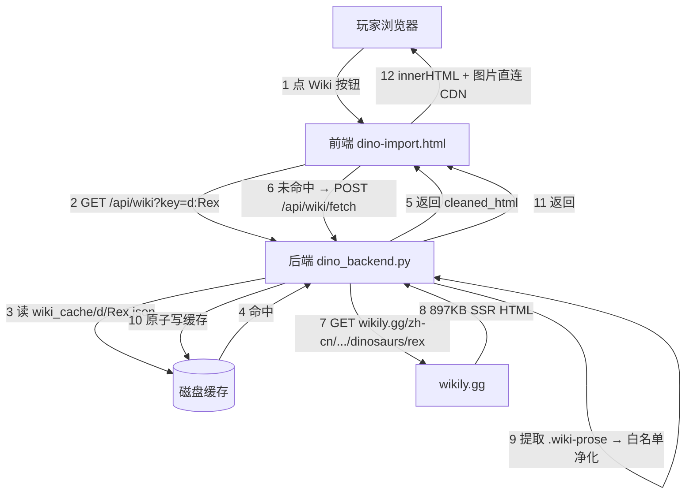

# 物种 / 物品 Wiki 查看 — 实施方案 v2（wikily.gg 抓取 + 自渲染）

| 项 | 内容 |
|---|---|
| 文档版本 | **v2**（2026-10-28 定案，取代 v1） |
| 状态 | 待开工（P0 可直接排期） |
| 需求来源 | 用户 2026-10-28 需求 6 条 + 当日追加「直接嵌入 wikily 页面」思路 |
| 涉及 | 后端 `独立后端\dino_backend.py`＋前端 `dino-import.html` |
| 关键变化 | **不消耗任何 DeepSeek 额度**（抓取由我们自己的后端完成）；**取消翻译**（源站本来就是中文） |

## 修订记录

| 版本 | 日期 | 变化 |
|---|---|---|
| v1 | 2026-10-28 | 原方案：DeepSeek `tools/fetch` 抓 `ark.wiki.gg` 英文原文 + AI 翻译 + 缓存共享 |
| **v2** | 2026-10-28 | 实测否掉 v1 前提：① DS Fetch 抓 `ark.wiki.gg`/`dododex` 一律 404（被目标站 CF 拦）② `wikily.gg` 明确禁止 iframe 嵌入。改为：**后端直抓 `wikily.gg` 中文页 → 提取正文 HTML → 白名单净化 → 缓存共享 → 前端自渲染**；翻译按钮取消（内容已中文） |

---

## 1. 需求 → v2 落实方式

| # | 用户需求 | v2 落实 |
|---|---|---|
| 1 | 每个物种/物品都有 Wiki 入口，样式同「操作」 | `#lbWikiBtn`，35×35 圆角方框、只图标（`mdi-book-open-page-variant`） |
| 2 | 显示对应条目 Wiki 页内容 | 抓 `wikily.gg/zh-cn/ark-survival-ascended/...`，**已是中文**（原「翻译」需求自然消失） |
| 3 | 数据最大化重用、全体共用 | 后端 `wiki_cache/` 落盘，一条目一文件；所有玩家公开只读 |
| 4 | 打开即自动抓取，抓过就不必再抓 | 首次打开 miss → 自动 `POST /api/wiki/fetch`；命中直接秒开 |
| 5 | 翻译按钮 | **取消**（用户 2026-10-28 确认"都不要"） |
| 6 | 更新按钮（同级） | `更新` 按钮 → `POST /api/wiki/fetch {force:true}`；同级并排显示 |

新增（v2 追加）：

| # | 追加需求 | 落实 |
|---|---|---|
| A | 尽量保留多媒体 | 白名单 HTML 保留 `/<table>/<video>/<source>` 与白名单域 `iframe`；实测图片 `ACAO:*` 可直连 |
| B | 交互组件 | 无法保留交互（React widget）→ 面板底部给「在 Wiki 打开」外链 |

---

## 2. 实测证据（2026-10-28，全部为本机真测）

### 2.1 DeepSeek 抓取能力边界

| 目标 | 结果 |
|---|---|
| `https://ark.wiki.gg/wiki/Rex` | ❌ 404 `failed to fetch URL`（15.4s） |
| `https://ark.wiki.gg/wiki/Rex?action=raw` | ❌ 404（13.9s） |
| `https://dododex.com/taming/rex` | ❌ 404（3.8s） |
| `https://example.com`（对照） | ✅ 200（0.2s，931 字符） |
| `https://wikily.gg/zh-cn/.../dinosaurs/rex` | ✅ 200（8.0s，2858 字符中文） |
| `https://wikily.gg/zh-cn/.../dinosaurs/baryonyx` | ✅ 200（16.9s，2994 字符中文） |

⇒ DS Fetch 只对"允许被抓"的站点生效；`ark.wiki.gg` 反爬挡死。**DS 通道不作为主链路。**

### 2.2 wikily.gg 是否允许 iframe 嵌入

```
X-Frame-Options: SAMEORIGIN
Content-Security-Policy: frame-ancestors 'self'
```

三个 URL（`/zh-cn` 生物页、`/zh-cn` 首页、`/en` 生物页）**全部相同** ⇒ **iframe 直嵌不可行**。

### 2.3 wikily.gg 服务端直连能力（★ 关键）

| 项 | 实测值 |
|---|---|
| HTTP 状态 | **200**（服务器直连，未被 CF 拦，UA 用普通浏览器 UA） |
| 耗时 | 2.34s（897 KB HTML） |
| 渲染方式 | **Next.js App Router SSR**（`self.__next_f`，正文在 HTML 里） |
| 正文选择器 | `<article>` 内 **`div.wiki-prose`**（本页 `wiki-prose` ×32）、段落 `p.wiki-prose-p`；外层 `section[data-widget-type="field-text"]`、`.ark-panel-body` |
| 正文体量 | 去标签后 **≈11.7 KB**（714 KB 是 JS，纯正文很小） |
| 结构元素 | `<h1>`×1、`<h2>`×17、`<h3>`×15、`<table>`×2、`<ul>`×14、`<li>`×48、`<p>`×37 |
| 中文版路径 | `/zh-cn/ark-survival-ascended/dinosaurs/<slug>`（`rex`、`baryonyx`；变体 `enraged-corrupted-rex`） |
| 英文版路径 | `/en/ark-survival-ascended/dinosaurs/<slug>`（存在） |

### 2.4 媒体可保留性

| 类型 | 本页数量 | 结论 |
|---|---|---|
| `` | 39 | ✅ 保留；正文图为 `/api/media/...webp?w=640`（相对路径） |
| `<video>` / `<iframe>` | 0 / 0 | ✅ 若有则白名单放行 |
| `<table>` | 2 | ✅ 保留 |
| `<svg>` | 52 | 多为图标；白名单可丢弃（省体积） |

图片跨域直连实测（三种 referer 场景）：

```
no-referer / our-referer / wiki-referer → 全部 200
Access-Control-Allow-Origin: *
Cache-Control: public, max-age=31536000   (1 年)
Content-Type: image/avif（服务端按 Accept 转码）
```

⇒ **图片可直连，不需要后端代理**；仅需把相对路径补全为 `https://wikily.gg/api/media/...`。

### 2.5 页面里的 widget 类型（决定"能保留什么"）

```
ark:sky-*（页面骨架：hero/body/rail/toc/stats/quick-info/tabs/settings…）
field-text（正文段落，★ 要提取）
conditional / component / cta-button
ark:creature-spawn-commands   ← 生成指令器（交互）
ark:sky-breeding              ← 繁育计算（交互）
ark:creature-combat / -xp / -harvest-matrix / -overview-map / -ability-strip（数据表，多为静态）
game-wiki-essentials:card-list / fold / bound-image
ark:nitrado-banner（广告）     ← 丢弃
comments                      ← 评论（交互/动态）← 丢弃或外链
```

⇒ 可提取：正文、数据表、图片；**不可提取**：生成指令器、繁育计算、评论区等 React 交互组件。

### 2.6 为什么不走「后端反代整站 + iframe」

技术上可去掉 `X-Frame-Options`/CSP 后 iframe，但它是 Next.js SPA：

- `/_next/` 资源 195 处、页内 `/api/wikis/...` 与 `/api/media/...` 调用、站内链接全为相对路径
- 要让页面"能用"，必须代理**全部路径**（等价于整站反代），897 KB/次
- 稳定性和站点 ToS 风险高，收益（多几个交互组件）与成本不匹配

⇒ **不采用**。

---

## 3. 架构



特点：

- **无第三方 API 费用**（不调 DeepSeek）
- **无玩家 Key 依赖**（不需要 AI 配置也能用）
- 只有"缓存缺失/点更新"才产生一次外网抓取（2~3s）

---

## 4. 数据模型

### 4.1 目录

```
<后端程序目录>\wiki_cache\
  index.json              ← 轻量索引（可 rebuild）
  d\<KeyHash>.json        ← 物种
  i\<KeyHash>.json        ← 物品
  _tmp\                   ← 原子写临时目录
```

### 4.2 条目文档

```json
{
  "ver": 2,
  "key": "d:Rex",
  "kind": "dino",
  "lang": "zh-cn",
  "slug": "rex",
  "source_url": "https://wikily.gg/zh-cn/ark-survival-ascended/dinosaurs/rex",
  "page_title": "霸王龙 动物 | ARK: Survival Ascended Wiki",
  "html": "<h1>霸王龙</h1><p>霸王龙是一种…</p><table>…</table>",
  "text_len": 11700,
  "html_len": 18240,
  "img_count": 6,
  "src_hash": "sha1:ab12…",
  "fetched_at": 1761600000,
  "fetched_by": "whiterober",
  "fetch_ms": 2340,
  "http_status": 200,
  "fail_count": 0,
  "errors": []
}
```

要点：

- 只存**净化后的 HTML**（不存 897KB 原始页），单条目 ~15~25KB
- `src_hash` = `sha1(html)`，用于"更新后是否变化"的判断（可选展示）
- 无 `trans` 字段（不再翻译）

### 4.3 键与 slug

| 类型 | key | slug 推导 | URL |
|---|---|---|---|
| 物种 | `d:<ASB 类名去 _Character_BP>` | ASB 英文名小写、空格→`-`、去变体修饰例外规则 | `/zh-cn/ark-survival-ascended/dinosaurs/<slug>` |
| 物品/器械 | `i:<lbCanonBase>` | 图标名/英文名小写、`_`→`-` | **待验证**（推测 `/zh-cn/ark-survival-ascended/items/<slug>`） |

> slug 实测样本：`rex`、`baryonyx`、`enraged-corrupted-rex`。变体规则（`aberrant-rex`？`tek-rex`？）列为 P0 必验项。

---

## 5. 后端接口（全部免 Key）

| 方法 | 路径 | 说明 |
|---|---|---|
| GET | `/api/wiki?key=d:Rex` | 读缓存；200 命中 / 404 `not_cached`；带 ETag(`"w<fetched_at>-<html_len>"`) 支持 304 |
| POST | `/api/wiki/fetch` | `{key, kind, slug?, lang?, force?}`；未命中自动抓，`force=true` 强制重抓；**无需 token** |
| POST | `/api/wiki/slug_probe` | （可选，管理员）批量探测 slug 是否 200，用于建别名表 |
| GET | `/api/wiki/stats` | 条目数/总字节/最近抓取/失败榜 |

错误码：

| code | 含义 | 前端表现 |
|---|---|---|
| 400 | key/kind 缺失 | 提示参数错误 |
| 404 | 未缓存（GET） | 触发自动抓取 |
| **502** | wikily 返回非 200 / 网络失败 | 「抓取失败，可点更新重试」 |
| **503** | 提取不到正文（选择器失效，站点改版） | 「Wiki 结构变更，暂时无法解析」+ 外链 |
| 409 | 同 key 正在抓取 | 1.5s 后重试（最多 3 次） |
| 429 | 触发限流 | 「操作太频繁」 |

---

## 6. 抓取器（后端 `_wiki_fetch_one`）

```
1. 校验 key/kind；查缓存（!force 且存在 → 直接返回）
2. per-key 锁；拿不到 → 409
3. GET <source_url>：
   - headers: 普通浏览器 UA + Accept: text/html
   - timeout 25s
4. status != 200 → 记 errors（含 status）+ fail_count++ → 502
5. 提取：见 §6.1
6. 净化：见 §6.2
7. 若 html 为空 / text_len < 200 → 503（选择器失效）
8. 原子写缓存（_tmp → os.replace）；更新 index.json（加锁）
9. 返回 doc
```

### 6.1 提取规则（多选择器兜底，防站点改版）

按顺序尝试，取**第一个非空**：

1. `re.search(r'<article[^>]*>(.*?)</article>', html, re.S)` 内部所有 `class="wiki-prose"` 块
2. `class="wiki-prose"` 全局收集（本页 32 处，覆盖多个 field-text widget）
3. `class="ark-panel-body"` 全局收集
4. `data-widget-type="field-text"` 内部
5. 最后兜底：`<main>` 全文

提取后按页面顺序拼接（保留 `<h1>/<h2>/<h3>` 作为节标题）。

### 6.2 白名单净化（服务端执行，返回干净 HTML）

**保留标签**：

```
h1 h2 h3 h4 p br hr ul ol li table thead tbody tr td th
strong b em i u code pre blockquote
img a video source figure figcaption
iframe（仅白名单域）
```

**保留属性**：

```
img   : src alt title width height loading(强制 lazy)
a     : href title（http/https 或站内 /wiki/… → 补全为绝对）
video : src poster controls
iframe: src（域白名单：youtube.com/youtu.be/vimeo.com/bilibili.com）
td/th : colspan rowspan
通用  : class（仅保留 wiki-prose* 前缀，其余丢弃）
```

**移除**：

- `<script> <style> <svg> <form> <button> <input>`
- 所有 `on*` 事件属性、`style` 属性（防样式污染）
- 文本广告块：`wikily-auto-ad-break`、`ark:nitrado-banner`、`cta-button`
- 交互 widget 容器（`ark:creature-spawn-commands`、`ark:sky-breeding`、`comments`）→ 替换为一行占位：
  `<div class="lb-wiki-ext">（此处为交互功能，可在 Wiki 中查看）</div>`
- 页首噪声：`跳转到内容` / `全部游戏 27 个 Wiki · 选择你的游戏` / `在 Wikily App 中查看`

**URL 补全**：

- `src="/api/media/..."` → `https://wikily.gg/api/media/...`
- `src="//img.wikily.gg/..."` → `https:...`
- `href="/zh-cn/..."` → `https://wikily.gg/zh-cn/...`

### 6.3 失败与冷却

- `fail_count >= 3` → 冷却 6 小时（期间 GET 返回 `cooldown_until`，前端不自动抓）
- 任一次成功 → `fail_count = 0`、清 `errors`

### 6.4 限流

- 单玩家：5 分钟内 ≤ 8 次 fetch（前端传 `by`，后端内存计数）
- 全局并发：≤ 3
- 同 key 重复：1.5s 内直接回缓存

---

## 7. 前端设计

### 7.1 入口按钮（需求 1）

- 位置：`lbRenderBreedBar()` 内，`#lbSpeciesOpsBtn` 右侧插 `#lbWikiBtn`
- 样式：**与操作按钮同款**——35×35、`border-radius:8px`、只图标、无文字
- 图标：`mdi-book-open-page-variant`
- 三态：
  - 有缓存 → **实心**（青绿 `#22c55e`，与操作橙区分）
  - 无缓存 → **虚线**（同操作按钮虚线语义，任何玩家都可点，点后自动抓取，免费）
  - 未选中物种/器械 → 隐藏

### 7.2 面板

```
.lb-picker-overlay
  .lb-picker-panel (max-width:860px)
    header : [图标] 霸王龙 · Wiki                 [更新] [关闭]
    meta   : 来源 wikily.gg · 抓取于 3 天前 · 12 KB · 6 图
    body#lbWikiBody (overflow-y:auto)
            净化后的 HTML（图片 lazy、表格自适应横向滚动）
    footer : 「在 Wiki 打开完整页面」外链
```

- 按钮层级按需求 6：`更新` 与（原`翻译`位）同级；翻译已取消
- 「更新」：`POST /api/wiki/fetch {force:true}`，抓完局部刷新 body（不关面板）
- 加载态：首次显示 ⏳「正在抓取 Wiki（首次约 2~3 秒）」
- 失败态：按 §5 错误码给文案 + 「重试」+ 「在 Wiki 打开」

### 7.3 渲染与安全

- 后端已白名单净化 → 前端 `body.innerHTML = doc.html`（**不再二次信任**：前端只做 `` 与 `target=_blank` 补强）
- 图片：直连 `wikily.gg`（实测 `ACAO:*`、1 年缓存）；失败时显示占位灰块（`onerror`）
- 表格：`overflow-x:auto` 包裹，移动端可横滑
- 深色主题兼容：不给 wiki 内联样式（已剥离 `style`），用本页 CSS 覆盖（`#lbWikiBody h2{font-size:15px;color:#e2e8f0}` 等约 15 条）

### 7.4 缓存优先策略

1. 打开 → `GET /api/wiki?key`（<100ms）
2. 命中 → 渲染（显示"抓取于 X 天前"，>90 天标 ⚠️）
3. 未命中 → 自动 `POST /fetch`（显示进度）
4. 用户点「更新」→ `force=true`

---

## 8. 成本与资源

| 项 | 成本 |
|---|---|
| DeepSeek 调用 | **0 元**（不再使用） |
| 外部抓取 | 每次 897 KB 下载（内网出口）→ 提取后只存 ~20 KB |
| 磁盘 | 若 300 条目全缓存 ≈ **6 MB** |
| 抓取次数 | 每条目首次 1 次 + 手动更新；无自动轮询 |
| 图片 | 由玩家浏览器直连 wikily CDN（不占我们带宽） |

---

## 9. 分期

### P0 — 物种 Wiki 可看（≈1 版）
- 后端：`WIKI_DIR` / `_wiki_read` / `_wiki_write` / `_wiki_fetch_one` / `_wiki_extract` / `_wiki_clean` / `GET /api/wiki` / `POST /api/wiki/fetch` / `GET /api/wiki/stats`
- 前端：`#lbWikiBtn` + `lbWikiOpen/lbWikiRender` + 面板 + 深色覆盖 CSS
- 前置验证：10 个代表物种 slug 探测（rex / baryonyx / dodo / wyvern / tek-rex / aberrant-rex / corrupted-rex / giga / mosa / troodon）

### P1 — 物品/器械 + 稳健性
- 物品页路径验证与 slug 规则、`wiki_alias.json`
- per-key 锁/409、冷却、ETag/304、index rebuild、审计日志
- 表格横滑、图片 onerror 占位、失败分型文案

### P2 — 增强
- 「在 Wiki 打开」外链 + 90 天过期提示
- 局部刷新（只换 body，不重建面板）
- 图片懒加载优化（`loading=lazy` + 首屏 2 张预取）
- 可选：英文版切换（`/en/` 路径，同一套提取）

---

## 10. 风险与对策

| 风险 | 影响 | 对策 |
|---|---|---|
| wikily 改版导致 `.wiki-prose` 失效 | 抓不到正文 | 5 级选择器兜底（§6.1）+ 503 明确提示 + 失败冷却；改版时只改一处 `SELECTORS` 常量 |
| wikily 对服务器 IP 加反爬（现状未拦） | 全线抓不到 | 已实测 200；加普通 UA；如被拦，退 DS Fetch（v1 通道，仅备用）或改图片/文案缓存不全量 |
| slug 规则猜错 | 404 抓不到 | P0 强制先跑 10 条 dry-run；未命中给「在 Wiki 搜该词」链接 |
| 交互组件缺失（生成指令/繁育） | 功能不如原站 | 面板底部外链；后续如需要，**我们自己已有生成指令/繁育实现**可复用，不必抄 wiki |
| 图片 2~3s 首加载慢 | 观感 | `loading=lazy`；已 1 年 CDN 缓存 |
| 抓取被当成爬虫刷站 | 站点风险 | 每 key 只抓一次 + 手动更新 + 限流；不并发批量抓（预热需人工按需） |
| 版权 | 合规 | 面板固定标注来源与链接，仅作本服玩家查阅，不二次分发全站 |

---

## 11. 开放问题（P0 前确认）

1. 物品/器械页的真实路径（`/items/<slug>`? 还是 `/items/armor/<slug>`?）——需 1 次探测
2. 变体 slug 规则（`aberrant-rex` / `tek-rex` / `x-rex` 是否都按连字符）
3. 是否在面板里同时显示英文原站入口（`/en` 同页）
4. 面板宽度/深色样式是否要贴到「操作键位」面板同宽（现方案 860px）

---

## 附录：与 v1 的差异一览

| 项 | v1 | v2 |
|---|---|---|
| 抓取 | DeepSeek `tools/fetch` 抓 ark.wiki.gg | **后端直抓 wikily.gg（免费）** |
| Token | 玩家 DeepSeek Key | **完全不需要** |
| 内容语言 | 英文 + AI 翻译 | **中文（源站 zh-cn）** |
| 翻译按钮 | 有 | **取消** |
| iframe | 未涉及 | **实测禁嵌，明确不做** |
| 多媒体 | 未考虑 | **白名单保留图片/表格/视频；实测可直连** |
| 成本 | 0.005 元/次 + 翻译费 | **0 元** |
| 速度 | 8~17s（DS Fetch） | **2~3s（直连）**，缓存后 <100ms |
