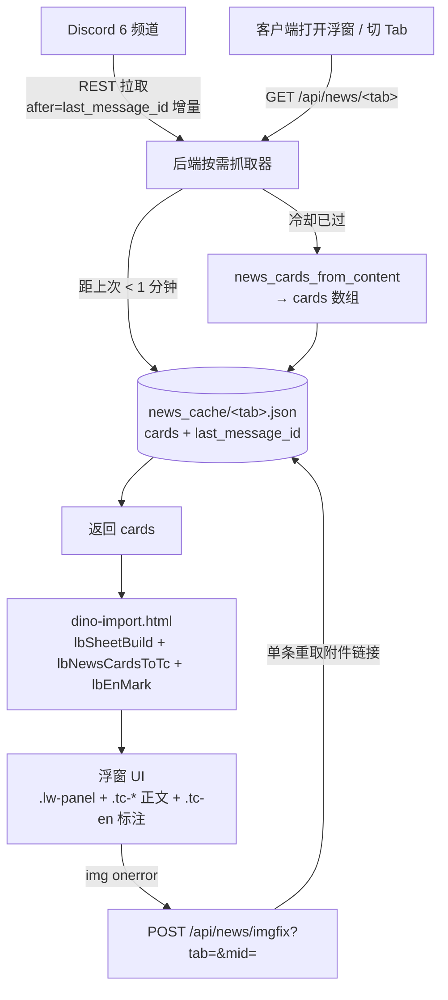

# 计划：资讯广场迁入搞事系统（复用 wiki 浮窗）v1

- 制定日期：2026-11-02
- 目标产品：粑粑服搞事系统（dino-import，CF 部署 `dino.whiterober.ccwu.cc`）
- 迁出方：HA「方舟」视图 → 资讯广场（`/lovelace/ark_patch`）
- 用户口径：**复用（非复制）搞事系统 wiki 浮窗的结构样式与功能方法**

---

## 0. 结论摘要（TL;DR）

1. HA 的「资讯广场」本质是 **6 个 Tab + 6 份 `cards` 数组**（`markdown` / `iframe` / `picture` 三种卡片），数据由 AppDaemon 从 Discord 抓取后写入 HA sensor。
   - 翻译环节迁移后**不用 Coze**，改用项目已有的「大肥鱼 AI 模块 DeepSeek token + 回写共享缓存」范式（详见 §4.5）
2. 迁移后目标形态：**「生存者」浮窗 header 增「📰 资讯广场」入口**（联盟成员位置左侧）→ 打开浮窗（复用 wiki 骨架 `.lw-*`）→ 6 个 Tab 切换 → 后端 `/api/news/*` 供数据。
3. **复用而非复制**的落点是三处：
   - 浮窗骨架：抽 `lbSheet*` 通用层，物种 Wiki / 物品 Wiki / 资讯浮窗三者共用同一套 DOM 结构与 CSS
   - 内容排版：复用 `.tc-sec/.tc-h/.tc-intro`；**含 HTML 的 content 剥标签转换（不能直接喂 `lbMdRender`，会被转义）**；中英小字复用 `lbEnMark()`；说明气泡复用 `tcSyncNotes()`
   - 数据构造：`create_cards_from_content()` 整体搬到 `dino_backend.py`，缓存复用 `WIKI_CACHE_DIR`
4. 抓取侧**一步到位、对 HA 零依赖**：后端直接 REST 拉 Discord，**不起任何定时器**，只在客户端打开浮窗/切 Tab 时按需拉取（全局 **1 分钟冷却** + `after=last_message_id` **增量**）；图片不转存，靠「新消息新链接 + 过期按需修复」保鲜。

---

## 1. 需求与口径

| 项 | 内容 |
|---|---|
| 迁移对象 | HA 方舟视图 → 资讯广场（path `ark_patch`） |
| 迁入目标 | 搞事系统（dino-import.html + dino_backend.py） |
| 硬性要求 | 展示层**复用**现有 wiki 浮窗的结构样式与功能方法，不另起一套 |
| 隐含要求 | 迁移后 HA 侧可下线该视图（配合 `进度\033` 的 Phase 2 收口） |
| 不在本次范围 | 方舟视图的服务器管理功能（保留区，见 `/memories/repo/asa-admin-archive-scope.md`） |

---

## 2. 现状调研（实测）

### 2.1 HA 侧视图结构

```
sections(资讯广场, theme=Material You)
└─ grid (24 列)
   └─ vertical-stack
      ├─ custom:mod-card
      │  └─ horizontal-stack
      │     └─ custom:button-card × 6      ← Tab 按钮，点按 call-service: input_select.select_option(info_square_tab)
      ├─ conditional × 6                    ← 条件：input_select.info_square_tab == <Tab名>
      │  └─ custom:mod-card
      │     └─ custom:tailwindcss-template-card   ← Jinja2 + Tailwind + daisyUI 渲染 cards
      └─ button                              ← input_button.refresh_server_status（刷新）
```

### 2.2 六个 Tab 与数据源

| # | Tab 名（`info_square_tab`） | cards 来源 | 摘要 sensor（Tab 角标） |
|---|---|---|---|
| 1 | `ASA PC版本` | `sensor.patch_description_full`.cards | `sensor.patch_description` |
| 2 | `方舟新闻` | `sensor.news_patch_channel_info`.cards | `sensor.news_patch_description` |
| 3 | `ADM版本` | `sensor.patch_channel_patch_info`.cards | `sensor.patch_description_patch` |
| 4 | `ADM预告` | `sensor.adm_preview_full`.cards | `sensor.adm_preview_summary` |
| 5 | `汉化版本` | `sensor.tieba_lz_full`.cards | `sensor.tieba_lz_summary` |
| 6 | `ASB版本` | `sensor.asb_full`.cards | `sensor.asb_summary` |

> ⚠️ 命名历史遗留错位：`ADM版本` 实际取 Patch 频道数据，`汉化版本` 实际取贴吧数据。迁移时**保留 Tab 显示名不变**，但内部 id 按真实语义命名（见 §5）。

### 2.3 cards 数据结构

```json
[
  { "type": "markdown", "content": "<h3>标题</h3>\n正文…" },
  { "type": "picture", "image": "https://…png", "tap_action": { "action": "url", "url_path": "https://…" }, "aspect_ratio": "16:9" },
  { "type": "iframe",  "url": "https://www.youtube.com/embed/…" }
]
```

> ⚠️ `content` 里含 **HTML**（后端拼了 `<h3>`），不是纯 markdown —— 详见 §4.2「数据格式关键」。

### 2.4 数据生产链（HA 侧，两个 AppDaemon app）

```
Discord 6 个频道
   ↓ (discord.py, 常驻)
discord_patch_bot.py            ← 抓取 + 提取图片/embed + **Coze API 翻译（现役，迁移后废弃）** + strip_markdown
   ↓ set_state(sensor.*_cache)
sensor.patch_cache / patch_channel_cache / news_cache / tieba_cache / adm_cache / asb_cache
   ↓
asa_server_monitor_reliable.py  ← create_cards_from_content()（L1515）→ cards
   ↓ set_state(attributes={"cards": cards, "full_content": …, "last_update": …})
sensor.patch_description_full / patch_channel_patch_info / news_patch_channel_info /
sensor.tieba_lz_full / adm_preview_full / asb_full
   ↓
lovelace ark_patch（Jinja2 模板读 .cards）
```

关键代码位置：
- `create_cards_from_content()` → `asa_server_monitor_reliable.py:1515`
- 六个 `set_state(...cards...)` → 同文件 L1979 / 2054 / 2078 / 2110 / 2120 / 2172 / 2235 / 2298 附近
- 频道 ID 配置 → `apps.yaml`（主频道 1400811187872202762 / patch 1401151679600263209 / news 1401223989543702641 / tieba / adm / asb）

### 2.5 搞事系统可复用资产（实测位置）

| 资产 | 位置 | 说明 |
|---|---|---|
| 浮窗骨架 HTML | `dino-import.html:49906` `#lbWikiOverlay`、`49919` `#lbWikiItemOverlay` | `.lw-panel > .lw-head(.lw-title/.lw-help/.lw-x) + .lw-tabs + .lw-meta + .lw-body` |
| 浮窗骨架 CSS | `dino-import.html:1674-1675` 及后续 `.lw-*` / `#lbWikiOverlay`、`#lbWikiItemOverlay` 双前缀规则 | `position:fixed;inset:0;z-index:9998;` + `.show{display:flex}` |
| 打开/关闭方法 | `lbWikiItemOpen()` 55588 / `lbWikiItemClose()` / `lbWikiOpen()` / `lbWikiClose()` | 统一 `classList.add/remove('show')` |
| 布局修正 | `lbWikiItemLayoutFix()` 57029 / `lbWikiItemLayoutWatch()` 57045 / `lbWikiLayoutWatch()` | 隐藏无序号小标题、徽章归位 |
| 说明气泡 | `tcSyncNotes(bodyId, helpId)` / `tcSyncNotesAll()` | `.tc-note` → 标题栏问号 `data-tip` |
| 提示气泡桥 | `tcTipBridge`（$`window.__tcTipBridge`） | `.tc-tip` → `#lbTipBox`，移动端钳制 |
| Markdown 渲染 | `lbMdEsc` 6462 / `lbMdInline` 6465 / `lbMdRender` 6486 | 前端现成的 md → HTML |
| 正文排版体系 | `.tc-sec` / `.tc-h` / `.tc-intro` / `.tc-tb` / `.tc-cmds` / `.tc-cmd` / `.tc-note`（CSS L1774-2044） | wiki 正文的全套结构化样式，双前缀绑定 `#lbWikiOverlay,#lbWikiItemOverlay` |
| 正文标题生成器 | `tcHStr(n, t, em)` L50798 | 输出 `<div class="tc-h">① 标题<em>副标题</em></div>` |
| 中英标注 | `lbEnMarkText` L53578 / `lbEnMark` L53604 / `lbEnMarkWatch(id)` / `lbEnRevMap` | 作用域白名单：`.tc-ai` / `.tc-auth-i` / `.tc-tipd-p` / `.tc-tipd-t` / `.abil-desc` |
| 「生存者」浮窗 | `lbOpenRolePicker()` L8279 | header 图标按钮组：系统管理 / 联盟成员位置 / 键位配置 / 自助配置 / 服务器规则 / 注销登录 |
| 后端缓存根 | `dino_backend.py:55` `WIKI_CACHE_DIR` | 已有 `wiki_cache/`、`wiki_cache/items/` |
| 后端索引扫描 | `_wk_index_scan(cache_dir, zh_of, field)` L268 | 通用缓存目录清单 |
| 后端 HTTP 框架 | 标准库 `BaseHTTPRequestHandler + ThreadingHTTPServer` | **无 Flask**，路由在 `do_GET`/`do_POST` 分支 |

---

## 3. 目标架构



---

## 4. 复用（非复制）设计 ★核心

### 4.1 抽通用浮窗层 `lbSheet*`（一次性重构，三处共用）

现有两个 Wiki 浮窗的 DOM 与逻辑几乎同构，再照抄第三份会形成三套复制代码。做法：

```js
/* → 新增到 dino-import.html（放在 lbWikiItemOpen 之前的公共区） */
// 取得/构建浮窗骨架；已存在则直接复用
function lbSheetBuild(id, opts){
  var ov = document.getElementById(id);
  if (!ov){
    ov = document.createElement('div');
    ov.id = id;                       // ⚠️ 项目无 `.lw-overlay` 类；定位/显隐全靠 `#<id>` 的 id 规则（见 §6 第 3 行）
    ov.innerHTML =
      '<div class="lw-panel">' +
        '<div class="lw-head">' +
          '<span class="lw-title" id="' + id + 'Title"></span>' +
          '<span class="lw-help" id="' + id + 'Help" hidden aria-label="本页说明">' +
            '<i class="mdi mdi-help-circle-outline"></i></span>' +
          opts.extraHeadHtml || '' +
          '<button class="lw-x" onclick="' + (opts.onClose || 'lbSheetClose(\'' + id + '\')') + '" title="关闭">' +
            '<i class="mdi mdi-close"></i></button>' +
        '</div>' +
        '<div class="lw-tabs" id="' + id + 'Tabs"></div>' +
        '<div class="lw-meta" id="' + id + 'Meta"></div>' +
        '<div class="lw-body" id="' + id + 'Body"></div>' +
      '</div>';
    document.body.appendChild(ov);
  }
  return {
    ov: ov,
    title: document.getElementById(id + 'Title'),
    help:  document.getElementById(id + 'Help'),
    tabs:  document.getElementById(id + 'Tabs'),
    meta:  document.getElementById(id + 'Meta'),
    body:  document.getElementById(id + 'Body')
  };
}
function lbSheetOpen(id){ var o = document.getElementById(id); if (o) o.classList.add('show'); }
function lbSheetClose(id){ var o = document.getElementById(id); if (o) o.classList.remove('show'); }
// 通用布局修正：把现有 lbWikiItemLayoutFix 主体搬进来，参数化为 (bodyEl)
function lbSheetLayoutFix(bodyEl){ /* 隐藏无序号小标题 / 徽章归位，主体照搬 lbWikiItemLayoutFix */ }
function lbSheetLayoutWatch(bodyEl){ /* MutationObserver 版本，照搬 lbWikiItemLayoutWatch */ }
```

约束：
- **不新增任何 `.lw-*` CSS**，全部复用 `#lbWikiOverlay` / `#lbWikiItemOverlay` 已有的规则；新浮窗只需在 CSS 里把选择器组从双前缀扩到三前缀（`#lbNewsOverlay`），**只加选择器、不复制属性块**。
- 现有两个 Wiki 浮窗**保持静态 HTML 不动**（避免破坏已验证行为），仅把 `lbWikiItemLayoutFix/Watch` 内部主体改为调用 `lbSheetLayoutFix/Watch`。
- 资讯浮窗 DOM 由 `lbSheetBuild('lbNews', …)` 动态生成 —— 因为它没有静态声明，天然只能走通用层。

### 4.2 正文排版：复用 wiki 的 `.tc-*` 结构化样式（用户口径 2026-11-02）

> 用户明确：「资讯 TAB 里的内容也要复用 wiki 样式」——不是普通 `<h3>/<p>/<ul>`，而是 wiki 同款 `.tc-*` 结构。

wiki 正文的实际结构（前端渲染函数拼出来的，`dino-import.html:50896` 起大量样例）：

```html
<div class="tc-sec">
  <div class="tc-h">① 概述<em>副标题</em></div>     <!-- tcHStr(n, t, em)，L50798 -->
  <div class="tc-intro">…</div>                <!-- 紫边渐变介绍块 -->
  <table class="tc-tb">…</table>               <!-- 表格 -->
  <div class="tc-cmds"><div class="tc-cmd">…</div></div>   <!-- 命令块 -->
  <div class="tc-note">…</div>                 <!-- 备注（走标题栏问号） -->
</div>
```

映射表：

| cards 类型 | 目标 `.tc-*` 结构 | 复用实现 |
|---|---|---|
| `markdown` | `<div class="tc-sec"><div class="tc-h">标题</div><div class="tc-intro">正文</div></div>` | 标题 `tcHStr('', t)`；正文见下方「数据格式关键」 |
| `picture` | `<div class="tc-sec"><div class="tc-pic">…</div></div>` | 图片规则沿用 `.lw-body img` |
| `iframe` | `<div class="tc-sec"><iframe class="tc-frame">…</iframe></div>` | 新增 1 条 `.tc-frame` 规则（唯一新增样式） |

#### ⚠️ 数据格式关键（复核发现，致命）

HA 侧 `create_cards_from_content()`（`asa_server_monitor_reliable.py:1515`）产出的 `content`
**不是纯 markdown，而是 HTML 混合片段**：

```python
first_line = f'<h3>{lines[0]}</h3>'      # 标题是 HTML
body = "\n".join(body_lines)             # 正文可能含 <a> / <br>
cards.append({"type": "markdown", "content": body.strip()})
```

而项目 `lbMdRender()` 第一道工序就是 `lbMdInline() → lbMdEsc()`，会把 `<` 转成 `&lt;`
⇒ **直接拿 `content` 喂 `lbMdRender`，页面上会显示成 `<h3>标题</h3>` 这样的源码文本**。

正确做法：

| 内容形态 | 处理 |
|---|---|
| 含 HTML 标签（HA 现役数据） | **取 `<h3>` 作标题 → `tcHStr()`；其余剥标签转结构化段落**，**不走 `lbMdRender`** |
| 纯 markdown 文本（后续 AI 产出） | 才走 `lbMdRender()` |

工具函数（新增，放在 `lbNewsRender` 上方）：

```js
// cards → .tc-* 段落；含 HTML 的走剥标签，纯 md 的才走 lbMdRender
function lbNewsCardsToTc(cards){
  var out = [];
  (cards || []).forEach(function(c){
    if (c.type === 'markdown'){
      var raw = String(c.content || '');
      var m = raw.match(/^\s*<h3[^>]*>([\s\S]*?)<\/h3>/i);        // 首行 <h3> 作标题
      var title = m ? m[1].replace(/<[^>]+>/g, '').trim() : '';
      var rest  = m ? raw.slice(m[0].length) : raw;
      var body  = /<[a-z][^>]*>/i.test(rest)
        ? lbNewsHtmlToText(rest)     // 含 HTML：剥标签 → 段落（保留链接文本）
        : lbMdRender(rest);          // 纯 md：走既有渲染器
      out.push('<div class="tc-sec">'
        + (title ? tcHStr('', lbEsc(title)) : '')
        + (body ? '<div class="tc-intro">' + body + '</div>' : '')
        + '</div>');
    } else if (c.type === 'picture'){
      out.push('<div class="tc-sec"><div class="tc-pic"></div></div>');
    } else if (c.type === 'iframe'){
      out.push('<div class="tc-sec"><iframe class="tc-frame" src="' + lbEsc(lbNewsFrameUrl(c.url)) + '" loading="lazy" allowfullscreen frameborder="0"></iframe></div>');
    }
  });
  return out.join('');
}
```

> `lbNewsHtmlToText()`：白名单式清洗（先剥 `<script>/<style>/on*=`，再把块级标签转段落），**禁止直接 innerHTML 未清洗内容**（XSS）。
> `lbNewsFrameUrl()`：`youtube.com/watch?v=ID` → `youtube.com/embed/ID`，否则 YouTube 拒绘。

> 标题序号：资讯没有固定章节编号 → 调 `tcHStr('', t, em)` 只出标题 + 副标题。
> 中英标注：正文容器加 `.tc-ai`（`lbEnMark` 作用域白名单，见 §4.5）+ 调 `lbEnMark()`。
> 说明气泡：渲染后调 `tcSyncNotes('lbNewsBody', 'lbNewsHelp')`（既有函数），正文 `.tc-note` 自动汇总到标题栏问号。

#### 实施修正（v20261102-5925，实测发现）

1. **标题会被布局修正误伤**：`lbSheetLayoutFix` 会把「无序号 `.tc-h` 紧跟 `.tc-intro`」的标题隐藏（wiki 既定行为），
   而资讯每条消息的标题正好是这个结构 ⇒ 标题全部消失（实测 `hiddenH=2`）。
   - 修法：`lbSheetLayoutFix` 增加 `data-keep="1"` 显式保留；资讯标题输出 `<div class="tc-h" data-keep="1">`
2. **资讯专属 CSS 微调（只作用于 `#lbNews`，wiki 零影响）**：
   ```css
   #lbNews .lw-body .tc-en{margin-bottom:0}        /* 中文下小英文的负底边距在列表里会重叠 */
   #lbNews .lw-body .tc-intro p{margin:0 0 8px}   /* 段落之间留白 */
   #lbNews .lw-body .tc-pic img{display:block;margin:6px auto}
   #lbNews .lw-body .tc-h[data-keep="1"]{margin:2px 0 8px}
   ```

**禁止**：为资讯另写一套排版 CSS（必须落进 `.tc-*` 体系）。

### 4.3 数据构造复用

`asa_server_monitor_reliable.py` 的 `create_cards_from_content(content_list, content_type)`（L1515）是纯逻辑，依赖仅为 `self.process_news_links / process_tieba_links / process_patch_links`。

搬迁做法：
1. 在 `dino_backend.py` 新增模块级函数 `news_cards_from_content(content_list, content_type)`，函数体**原样搬**（不重写）
2. 把三个 `process_*_links` 一并搬为模块级函数（它们只做正则清洗 + 提取链接）
3. `self.log(...)` 改为 `print(...)` 或复用后端既有日志方式
4. **不重复实现** `strip_markdown` / 图片提取 / YouTube 识别 —— 全部原样搬

### 4.4 缓存复用

```
WIKI_CACHE_DIR/
├── wiki_cache/…            （现有：物种 wiki）
├── wiki_cache/items/…      （现有：物品 wiki）
└── news_cache/             （新增）
    ├── patch_pc.json
    ├── news.json
    ├── patch_channel.json
    ├── adm.json
    ├── tieba.json
    └── asb.json
```
每个 JSON：`{ "ok": true, "tab": "patch_pc", "updated": "2026-11-02 14:30:00", "summary": "…", "cards": [ … ] }`
索引复用 `_wk_index_scan(WIKI_CACHE_DIR + '/news_cache', …, 'news')` 的写法。

### 4.5 翻译：复用「大肥鱼 AI 模块 + DeepSeek token」（禁止另写）

> 用户口径（2026-11-02）：「Coze 翻译改成用粑粑系统里的 ds token 翻译并标注（已经实现，只允许你复用）」

现状：HA 侧由 `discord_patch_bot.py` 调 **Coze API** 翻译。迁移后**不使用 Coze**，改走项目已有的
「技巧 TAB（v5740）」同款范式：

| 环节 | 复用对象（已实现位置） | 迁移时怎么用 |
|---|---|---|
| token / 模型 | `lbAiCfgGet()`（`dino-import.html:8818`）读 `lb_ai_cfg_v1`；端点 `LB_AI_BASE='https://api.deepseek.com'`（8844）；模型 `deepseek-flash`（默认）/ `deepseek-v4-pro` | 前端直接调，**不新增 token 存储** |
| 批量翻译 | 技巧 TAB 的「一次 5 条批量翻」流程（v5740） | 逐条调同一流程，不写第二份翻译请求 |
| 共享回写 | 后端 `GET/POST /api/dino/tips/zh` 范式（`dino_backend.py:6837` 附近，按 id 合并、已存在不覆盖） | 新增 `GET/POST /api/news/zh`，**沿用同一合并策略** |
| 术语校验 | `LB_WT_TERMS`（方舟术语对照表、模糊匹配）+ `ZH_MAP` / `LB_ITEM_ZH` / `LB_FACILITY_ZH` 官方汉化表 | 翻译前后都过一遍，**禁止 AI 自由意译方舟专有词** |
| AI 外壳 | `lbTipsAiBoxHtml()`（大肥鱼水印 + 模型/token + ⚙配置 + 主按钮） | 资讯浮窗的「AI 翻译」按钮组直接复用它 |

**流程**：

```mermaid
sequenceDiagram
  participant U as 用户
  participant F as dino-import 前端
  participant B as dino_backend
  participant D as api.deepseek.com
  U->>F: 打开资讯浮窗 / 切 Tab
  F->>B: GET /api/news/&lt;tab&gt;
  B-->>F: cards（原文，可能含英文）
  F->>B: GET /api/news/zh?tab=&lt;tab&gt;
  B-->>F: {id: 中文} 已翻译映射
  alt 有未翻译条目 且 用户已配置 token
    F->>D: 批量翻译（lbAiCfgGet 的 token，每次 5 条）
    D-->>F: 中文
    F->>F: 过 LB_WT_TERMS 术语表校正
    F->>B: POST /api/news/zh（合并写回，已存在不覆盖）
  end
  F->>U: 渲染（译文 + lbEnMark 中英对照小字）
```

**「标注」= 术语中英对照小字**（用户 2026-11-02 澄清：不是 AI 徽章）

复现方式（**全部复用现有实现，零新增样式**）：

| 环节 | 复用对象 | 说明 |
|---|---|---|
| 标注结构 | `<span class="tc-en" data-enm="1"><i>「中文」</i><sub>English</sub></span>` | 中文为主行、`sub` 为 `.62em` 灰色等宽小英文 |
| 标注样式 | `.tc-en`（`dino-import.html:1961-1970`，`inline-flex` 纵排、`margin:0 1px -0.42em`、`sub{font-size:.62em;color:#8b93a7}`） | **只给选择器组追加 `#lbNewsBody`**，不复制属性块 |
| 标注函数 | `lbEnMarkText(txt)` L53578 / `lbEnMark(rootEl)` L53604 / `lbEnRevMap()` L53540 附近 | 渲染后对正文容器调一次 |
| 词表来源 | `ZH_MAP`（icon_zh_map.json）、`LB_ITEM_ZH`（item_zh.json）、`LB_FACILITY_ZH`（facility_zh.json）、`LB_WT_TERMS` | 纯渲染层、**零 token** |

接入点：`lbNewsRender()` 写完 `S.body.innerHTML` 之后，紧接一行：

```js
lbEnMark(S.body);   // 命中术语的中文自动变「中文 + 下小英文」
```

> 与 wiki 浮窗完全同一调用方式，不为资讯另写标注逻辑。

**不做的**：
- 不加 AI 徽章 / 不加「术语校正」标签（用户要的是中英小字）
- 不在后端做标注（标注是渲染层职责，后端只出原文）

**禁止**：
- 引入 Coze API（后端与 HA 侧都不用）
- 在后端做翻译（后端只存原文与共享译文缓存）
- 新建第二套 token 配置项（一律读 `lbAiCfgGet()`）
- 把 AI 译文写回覆盖用户已有手工修订（合并策略固定为「已存在不覆盖」）

---

## 5. 数据接口设计（dino_backend.py，标准库 HTTP）

| 方法 | 路径 | 说明 | 返回 |
|---|---|---|---|
| GET | `/api/news/index` | 6 个 Tab 元数据 | `{ok, tabs:[{id,name,updated,count,last_fetch}]}` |
| GET | `/api/news/<tab>?t=<ts>` | 单个 Tab 的 cards。**后端内部按 1 分钟冷却决定是否增量抓取** | `{ok, tab, name, updated, summary, cards:[…], fetched:0|1}` |
| POST | `/api/news/imgfix?tab=<tab>&mid=<msgId>` | 图片链接过期按需修复：只重取该条消息的附件 URL 并回写缓存（每条消息 10 分钟冷却） | `{ok, images:[…]}` |
| GET | `/api/news/zh?tab=<tab>` | 已翻译共享缓存（复用 `/api/dino/tips/zh` 范式） | `{ok, map:{cardId: 中文}, count}` |
| POST | `/api/news/zh?tab=<tab>` | 前端翻完整批回写（按 id 合并、已存在不覆盖） | `{ok, merged}` |

> **没有** `refresh`、**没有** `ingest`：刷新由 GET 隐式触发；数据只由后端自己抓，不接受外部推送（对 HA 零依赖）。

Tab id ↔ 显示名映射（保留 HA 显示名）：
| id | 显示名 | 数据源 subtype |
|---|---|---|
| `patch_pc` | ASA PC版本 | patch（Discord 主频道） |
| `news` | 方舟新闻 | news |
| `patch_channel` | ADM版本 | channel（Patch 频道） |
| `adm` | ADM预告 | adm |
| `tieba` | 汉化版本 | tieba（贴吧） |
| `asb` | ASB版本 | asb |

CORS：沿用后端现有 `ALLOW_ORIGIN`（`https://dino.whiterober.ccwu.cc`）。

---

## 6. 前端改动清单（dino-import.html）

| # | 位置 | 改动 | 复用来源 |
|---|---|---|---|
| 1 | 公共区（`lbWikiItemOpen` 之前，约 L55500） | 新增 `lbSheetBuild / lbSheetOpen / lbSheetClose / lbSheetLayoutFix / lbSheetLayoutWatch` | 主体搬自 `lbWikiItemLayoutFix/Watch`（57029 / 57045） |
| 2 | `lbWikiItemLayoutFix/Watch` 内部 | 改为调用 `lbSheetLayoutFix(document.getElementById('lbWikiItemBody'))` | 同上 |
| 3 | CSS 段（`#lbWikiItemOverlay` 规则处，L1674+） | 选择器组追加 `#lbNewsOverlay`（**只加选择器，不复制属性**） | 现有 `.lw-*` |
| 4 | **「生存者」浮窗 header**（`lbOpenRolePicker()` L8279 的图标按钮组） | 在「**联盟成员位置**」**左侧**插入「📰 资讯广场」按钮 → `lbNewsOpen()`（先关生存者浮窗再开）；锚点：`lbOpenAlliancePos()` 那个 `<button>` 之前 | 复用 `.lb-tipb.lb-picker-close` 样式 + `mdi mdi-newspaper-variant-outline` |
| 5 | 新增区块（放在 `lbWikiItemRender` 之后） | `lbNewsOpen / lbNewsClose / lbNewsRender / lbNewsFetch / lbNewsTab / lbNewsCardsHtml` | 骨架走 `lbSheet*`；**正文走 `.tc-sec/.tc-h/.tc-intro` 结构**（`tcHStr` + `lbMdRender`） |
| 6 | 定时器 | 打开浮窗才 fetch（**禁止轮询**，与 wiki 同范式） | 现有 `lbWikiEnsure` 按需抓取范式 |
| 7 | 版本号 | `LB_VERSION` 递增；`pwa/sw.js` 的 `VER` 同步 | 部署固定流程 |

`lbNewsRender()` 关键伪代码：

```js
function lbNewsRender(){
  var S = lbSheetBuild('lbNews', { onClose: 'lbNewsClose()' });
  S.title.innerHTML = '📰 资讯广场';
  S.body.classList.add('tc-ai');                 // 让 lbEnMark 的作用域白名单命中
  S.tabs.innerHTML = LB_NEWS_TABS.map(function(t, i){
    return '<button class="lw-tab' + (i === LB_NEWS.tab ? ' on' : '') + '" title="' + lbEsc(t.name) + '">'
         + lbEsc(t.short || t.name) + '</button>';   // 短名上屏、全名走 title（移动端友好）
  }).join('');
  var d = LB_NEWS.data || {};
  S.body.innerHTML = lbNewsCardsToTc(d.cards) || '<div class="tc-hintb">暂无内容</div>';   // 见 §4.2
  S.meta.innerHTML = d.updated ? ('更新于 ' + lbEsc(d.updated)) : '';
  lbEnMarkWatch('lbNewsBody');                   // 中英小字（自动首标 + MutationObserver，自带 BUSY 重试）
  tcSyncNotes('lbNewsBody', 'lbNewsHelp');       // 说明气泡 → 标题栏问号
  lbSheetLayoutFix(S.body);
}
```

---

## 7. 抓取策略：按需拉取 + 1 分钟冷却 + 增量（已定稿）

> 用户口径（2026-11-02）：「不用轮询，纯靠客户端打开时拉取，全局 10 分钟冷却」→ 后修正为「**检查增量，有才增量拉；冷却改成 1 分钟**」

### 7.1 为什么是「拉」不是「推」

| 方式 | 原理 | 能否用纯标准库 |
|---|---|---|
| Bot Gateway（WebSocket） | 连上后 Discord **主动推**事件，新消息秒到 | ❌ 需 `discord.py` |
| **REST 拉取** | 自己去 `GET /channels/{id}/messages` **拉** | ✅ `urllib` 足够 |

`dino_backend.py` 刻意保持「纯标准库」，所以走 REST 拉取。

### 7.2 完整模型

1. **后端不起任何定时器**（零轮询、零空转）
2. 客户端打开浮窗 / 切 Tab → `GET /api/news/<tab>`
3. 后端检查**全局冷却（1 分钟）**：
   - 距上次抓取 < 1 分钟 → **直接返回缓存**（`fetched:0`，秒开）
   - 冷却已过 → 进入增量检查
4. **增量拉取**：按频道记录 `last_message_id`，请求 `GET /channels/{cid}/messages?after=<last_id>&limit=50`
   - 有新增消息 → 重建该 Tab 的 cards，更新 `last_message_id`，顺带拿到**新的图片签名链接**
   - 无新增 → **不重建**，直接返回缓存（`fetched:1` 但内容未变）
5. **图片保鲜（不转存）**：cards 里每条保留 `message_id`；前端 `` → `POST /api/news/imgfix?tab=&mid=` → 后端只对该消息调 `GET /channels/{cid}/messages/{mid}` 拿新附件 URL → 回写缓存；每条消息 10 分钟冷却防反复打
6. **无刷新按钮**：打开就是最新（1 分钟内）

### 7.3 并发与限流

- 同一 Tab 并发请求 → **同键合并**（沿用 `_CFG_CACHE` 的「同键并发合并」范式），只抓一次
- Discord REST 限流 → 遇 429 读取 `retry_after` 并熔断该频道 60s，不影响其它 Tab
- 首次打开（无缓存）→ 同步抓取，前端显示 loading（`.lb-hf-ai*` 已有 loading 态可复用）

### 7.4 对 HA 零依赖（硬约束）

- 不读 HA REST / sensor
- 不依赖 HA 抓取、不依赖 HA 推送
- `discord_patch_bot.py` / `asa_server_monitor_reliable.py` 在迁移完成后可独立下线（属方舟侧收口，不在本计划内）

### 7.5 凭据存放：后端本地配置文件（明确不读环境变量）

`dino_backend.py` **新增**一个只读配置源（不改动现有 `os.environ` 配置项）：

```json
// 文件：<后端目录>/dino_backend.config.json （不进 Git、不打进前端包）
{
  "discord": {
    "bot_token": "MTQw...",
    "channels": {
      "patch_pc": "1400811187872202762",
      "patch_channel": "1401151679600263209",
      "news": "1401223989543702641",
      "tieba": "…",
      "adm": "…",
      "asb": "…"
    }
  }
}
```

读取逻辑：
- `_news_cfg()` 读该文件（按 mtime 缓存），**不读环境变量、不做任何兜底**
- 文件缺失或 `bot_token` 为空 → `/api/news/*` 返回 `{ok:false, error:'news 未配置（缺 dino_backend.config.json）'}`，**其他接口不受影响**
- Token **永不下发前端**：任何接口返回值都不含 token，前端代码里也不出现 token 字样

> 用户口径（2026-11-02）：「不用环境变量兜底」「discord token 应该是放在后端，不在前端暴露」

---

## 8. 分阶段实施与验收

### 阶段 1（前端骨架 + 假数据）
- 抽 `lbSheet*`，资讯浮窗能打开/关闭、Tab 能切
- 数据用本地假 cards 验证 `lbNewsCardsToTc`（markdown / picture / iframe 三种）+ `lbEnMark` 标注
- 验收：wiki 浮窗（物种/物品）行为零变化；资讯浮窗视觉与 wiki 一致

### 阶段 2（后端接口 + 按需抓取，一步到位）
- `dino_backend.py` 新增 `news_cards_from_content`（搬自 L1515）+ 4 个接口 + `news_cache/`
- 后端 REST 拉 Discord（`urllib` + bot token **读后端本地配置文件** `dino_backend.config.json`），**无定时器**，1 分钟冷却 + `after=` 增量
- 前端接真数据；`message_id` 写入 cards，`img onerror` 接 `imgfix`
- 验收（**零 HA 依赖验证**）：HA 上 `discord_patch_bot` 停掉后，6 个 Tab 仍能更新；图片过期后能自愈

### 阶段 3（HA 侧收口）
- 删除 lovelace `ark_patch` 视图与相关 template sensor（并入 `进度\033` 的 Phase 2 清单）
- 验收：方舟视图不再有资讯入口，服务器管理功能（保留区）无变化

---

## 9. 风险与回滚

| 风险 | 影响 | 缓解 |
|---|---|---|
| 抽 `lbSheet*` 改动现有 Wiki 浮窗 | 物种/物品 Wiki 浮窗可能布局回归 | 阶段 1 先做「只搬布局修正函数」的最小改动，Wiki 三端回归（物种/物品/移动端）后再加资讯浮窗 |
| CSS 三前缀追加误改现有规则 | 现有浮窗样式漂移 | 只允许「追加选择器」，禁止修改既有属性值；改动前后截图对比 |
| `.tc-*` 规则几十条，手改易漏 | 正文部分排版不生效 | 用脚本正则批量把 `#lbWikiOverlay X, #lbWikiItemOverlay X` 扩成三前缀，改完 grep 校验命中数 |
| `lbEnMark()` 作用域白名单 | 中文下小英文不出现（实测首次注入 `tc-en=0`） | 正文容器必须带 `.tc-ai` 类，否则标记器直接 continue |
| **cards.content 是 HTML 混合，不是纯 md** | 直接喂 `lbMdRender` 会被转义，页面显示 `<h3>标题</h3>` 源码 | 先取 `<h3>` 转 `tcHStr`，其余剥标签转段落（见 §4.2） |
| Discord CDN 图片带签名过期（`?ex=&is=&hm=`） | 几小时后封面图 404 | **不转存**：新消息增量拉取自带新链接（阶段 2）+ `img onerror → /api/news/imgfix` 单条按需修复（每条 10 分钟冷却） |
| 后端 content 直插 innerHTML | XSS（抓取内容不可信） | `lbNewsHtmlToText()` 白名单清洗（剥 `script`/`style`/`on*=`）后再插 |
| `LB_ENM_BUSY` 全局锁 | wiki 与资讯同时渲染时一方被跳过 | 收敛到 `lbEnMarkWatch('lbNewsBody')`（自带 90ms 重试），不在渲染函数里硬调 |
| 首次打开无缓存 | 等待一次抓取（几秒） | 前端 loading 态（复用 `.lb-hf-ai*`）+ 后端同步抓；失败返回错误文案而非空白 |
| YouTube 链接为 watch 形式 | iframe 拒绘 | `lbNewsFrameUrl()` 归一为 `/embed/` |
| 资讯浮窗与 `.lb-picker-overlay` 同为 `z-index:9998` | 叠层顺序不定 | 入口处先关 picker 再开资讯；必要时资讯用 `9997` |
| Discord Token / 凭据落入源码或前端 | 凭据泄漏 | Token **只存后端本地配置文件** `dino_backend.config.json`（不进 Git、不打前端包）；不读环境变量、不写源码常量；前端只调 `/api/news/*` |
| AI 翻译把方舟专有词译错 | 内容失真 | 强制过 `LB_WT_TERMS` + 官方汉化表；`lbEnMark()` 输出中英对照小字供玩家核对原文 |
| 玩家未配置 token | 看不到译文 | 降级为原文渲染 + 提示「配置大肥鱼 token 可自动翻译」，**不阻断阅读** |
| 抓取频率 / Discord 限流 | 429 或封禁 | 全局 **1 分钟冷却** + 同键并发合并 + `after=` 增量（不拉全量）+ 429 读 `retry_after` 单频道熔断 60s |
| 历史命名错位导致数据串台 | Tab 显示内容错 | id ↔ 数据源固定映射表（§5），并写单测式校验 |
| CF 缓存导致 Tab 内容不更新 | 用户看到旧数据 | fetch 带 `?t=Date.now()`（项目既有做法） |

回滚：
- 前端：`LB_VERSION` 回退上一版（部署脚本保留最近版本）
- 后端：新增代码为纯增量（新函数 + 新路由分支），删除即回滚
- HA 侧在**阶段 3** 之前**不改动**，随时可继续用原资讯广场

---

## 10. 不做什么（边界）

- 不迁移「方舟」视图的服务器管理功能（保留区）
- 不改动 HA 的 `discord_patch_bot.py` / `asa_server_monitor_reliable.py`（阶段 3 之后才考虑停用）
- 不复制一份 `.lw-*` CSS 或复制 `lbWiki*` 函数另起一套
- 不在前端做 markdown → HTML 的第二种实现（只允许 `lbMdRender`）
- 不引入轮询：资讯浮窗只在打开/切 Tab/点刷新时请求

---

## 11. 决策记录（原待确认项，已全部拍板）

| # | 项 | 决定 |
|---|---|---|
| 1 | 入口位置 | **「生存者」浮窗 header**，在「联盟成员位置」**左侧**（`lbOpenRolePicker()` L8279） |
| 2 | 抓取路线 | **一步到位**：后端直接 REST 拉 Discord，HA 推送过渡方案取消 |
| 3 | 翻译/凭据 | 翻译一律复用「大肥鱼 AI 模块」DeepSeek token（`lbAiCfgGet`），**不用 Coze**；Discord Bot Token **只存后端本地配置文件** `dino_backend.config.json`（用户 2026-11-02：不用环境变量、不设兜底、不在前端暴露） |
| 4 | Tab 命名 | **全部保留原名**（ADM版本 / 汉化版本 等错位名字不改，界面零变化） |
| 5 | 刷新按钮 | **不要按钮**：客户端打开/切 Tab 隐式触发，全局 1 分钟冷却，冷却中直接用缓存 |
| 6 | 图片转存 | **不转存**：增量拉取自带新链接 + `img onerror` 单条按需修复 |
| 7 | ingest 鉴权 | **不适用**（ingest 接口取消，不接受外部推送） |
| 8 | HA 推送方式 | **不适用**（总原则：迁移后 **对 HA 零依赖**） |

### 仍需实现时确认的小细节
- Tab 短名展示（「PC版本」）与全名的取舍 → 阶段 1 看实际效果定
- `news_cache` 的独立 TTL / 版本戳（**严禁复用 `_WIKI_PARSE_VER`**）
