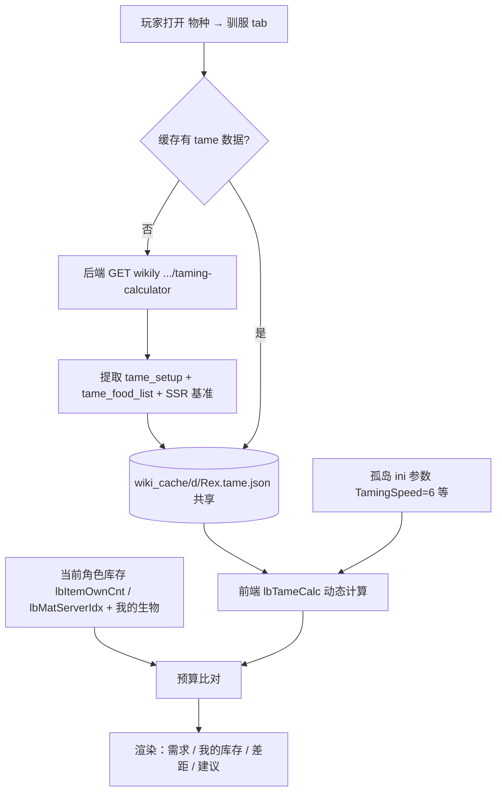

# 驯服计算器动态化 — 实施方案 v1

| 项 | 内容 |
|---|---|
| 文档版本 | v1（2026-10-28） |
| 状态 | 待评审（未开工） |
| 需求来源 | 用户 2026-10-28 三条：① 驯服数值能否动态计算 ② 服务器参数以孤岛为准 ③ 深入分析 wikily 驯服计算器并接玩家库存做统计 |
| 依赖 | 用户已定：**公式直接扒 wikily 前端 JS 移植**（不做长期反推） |
| 关联文档 | `计划\计划_物种物品Wiki查看与翻译_v1_20261028.md`（v2，Wiki 面板本体） |

---

## 0. 结论摘要

**能做成动态计算**，且已有两条公式闭环实证：

| 结论 | 证据 |
|---|---|
| wikily 计算器是 **SSR + 客户端计算**（URL 参数无效） | `?level=100`/`?tamingSpeed=5`/`?lvl=100`/`?dinoLevel=100` 四种参数，SSR 结果全部不变（150 级、17 个卓越饲料、57m59s） |
| 它的**全部输入参数**都在 RSC（`tame_setup`）里，可完整抓取 | Rex：`torpor_base=1550, torpor_inc=0.06, food_base=3000, torpor_rate=0.725, req=3450, ineff=1.25, rate=0.4167, per_level=150` |
| 食物表可完整抓取（**55 条**，每条形如 `key/affinity/href/base`） | `tame_food_list`：卓越饲料 `affinity=400, base=85.248` 起 |
| **迟钝公式已闭环** | `1550 + (1550×0.06)×(150-1) = 15,407` 与 SSR 显示 `15,407` 完全一致 |
| 时间/喂食间隔关系已闭环 | 喂食间隔 `3m25s(205s) × 17 口 = 3,485s` vs SSR `57m59s(3,479s)`，差 6s（≈首口不计） |
| 抓取成本 | 0（我们自己的后端直连 wikily，不用 DeepSeek） |

剩下的只有「食物数量 / 效率 / 时间与倍率的精确函数」，**按用户决定从 JS 移植**（§4），一次搞定后所有物种通用。

---

## 1. wikily 驯服计算器信息全清单（页面实测，有用的都列）

### 1.1 指标区（`ark-tame-tile`）

| 指标 | Rex 示例 | 备注 |
|---|---|---|
| 驯服时间 | `57m 59s` | 随倍率变化 |
| 效率 | `98.69%` | 每口喂食时的效率（受喂食时机影响） |
| 野生等级 | `150` | 由 `OverrideOfficialDifficulty=5` 决定上限 |
| 驯服后等级 | `224`（`+74`） | = 野生等级 + 驯服加成（bonus levels） |
| 升级后的最高等级 | `297` | 驯服后可加的点数上限 |
| 迟钝值 | `15,407` | `每秒 -3.05`、`1h 24m 18s 后醒来` |

### 1.2 食物表（`ark-tame-foods`，5 列；单物种实际行数 Rex 11 / Baryonyx 7 / Dodo 12）

列：**食物 / 数量 / 驯服时间 / 效率 / 喂食间隔**

- 食物名是链接（可跳物品页，如 `/zh-cn/.../items/exceptional-kibble`）
- 数量是可编辑 `input`（`min=0 max=17`）→ 说明支持"自定义喂食组合"
- 效率列含 **`+74 等级 (224)`**（即该方案能保留多少驯服等级）
- 首行 `data-on="true"` 表示当前最优方案

### 1.3 交互参数（设置面板，全在 RSC 的 query 里）

```
level=150                    野生等级（1~上限）
preset=Official|Small Tribes|ARKpocalypse|Conquest|Singleplayer(ASA)|
        Singleplayer(Easy/Medium/Hard)|Custom
taming_speed=1               驯服倍率
food_drain=1                 食物消耗倍率
elixir=false                 是否用灵药（Taming Elixir）
tribe_tower_days=0           部落塔加速天数
hitbox=Default               命中框（影响麻醉镖数）
weapon_damage=""             武器伤害（麻醉估算）
ko_all=false                 一次麻醉全部
keep_food=true               保持食物
waking=false                 昏迷计时器模式
```

### 1.4 其它可用信息

- `video: "LhdYqeSLWGk"` — 驯服演示视频（YouTube）
- `method: "Knockout"` / `supports_ko: true` / `tamable: true`
- `lua_ready: true` — 有 Lua 实现（说明公式有权威来源）
- 配套工具：**Starve Timer / Torpor Timer**（饥饿/昏迷计时器）
- 概览页 `ark:sky-taming` 另给静态摘要：`基础迟钝 1,550 · 每级 +93 · 所需亲和度 3,450 · 每级 +150 · 偏好饲料 卓越饲料`

---

## 2. RSC 数据结构（已抓取，直接可用）

### 2.1 `tame_setup`（物种级参数，Rex 实测）

| 字段 | 值 | 含义（推导） |
|---|---|---|
| `torpor_base` | 1550 | 基础迟钝值 |
| `torpor_inc` | 0.06 | 每级迟钝增长比例 → **每级 +93**（1550×0.06） |
| `inc_wild` | 300.0000044 | 野生属性增长系数（属性页用） |
| `food_base` | 3000 | 基础食物量 |
| `torpor_rate` | 0.725 | 迟钝衰减基准（每秒） |
| `req` | 3450 | 所需亲和度（驯服进度总量） |
| `ineff` | 1.25 | 效率惩罚系数 |
| `rate` | 0.4166667 | (=1/2.4) 食物消耗基准速率 |
| `allow_pct` | 1 | 允许的效率下限 |
| `per_level` | 150 | 等级上限（= 当前 `level`） |
| `taming_speed` / `drain` | 1 / 1 | 倍率参数 |
| `method` | Knockout | 击晕驯服 |
| `special_kind` / `not_tamable` | "" | 特殊标记 |
| `lua_ready` | true | 有 Lua 权威实现 |
| `video` | LhdYqeSLWGk | 演示视频 ID |

### 2.2 `tame_food_list`（55 条，Rex 实测前几条）

```
Exceptional Kibble   affinity=400    base=85.248   /items/exceptional-kibble
Raw Mutton           affinity=187.5  base=…        /items/raw-mutton
Raw Prime Meat       affinity=…      …
```

每条含：`key`（英文名）、`icon`（图标 URL）、`affinity`（每口亲和度）、`href`（物品页）、`base`（基础值）。

**这 55 条 ↔ 项目已有 `item_zh.json` / `icons2.json` 可对齐中文名与图标**，无需另建词表。

---

## 3. 孤岛（Isl）服务器参数（实测拉取，2026-10-28）

来源：`GET https://data.whiterober.ccwu.cc/api/cfg_rules?server=Isl&file=GUS`（159 项）

| ini 键 | 值 | 默认 | 说明 |
|---|---|---|---|
| **`TamingSpeedMultiplier`** | **6** | 0.99999 | ★ 驯服速度倍率 |
| **`XPMultiplier`** | **6** | 0.99999 | 经验倍率（影响升级速度） |
| **`OverrideOfficialDifficulty`** | **5** | — | ★ 野生上限 = 150 级 |
| `DifficultyOffset` | 1 | — | 与上行配合 |
| `TamedDinoResistanceMultiplier` | 1 | 1 | 驯服生物抗性 |
| `TamedDinoDamageMultiplier` | 1 | 1 | 驯服生物伤害 |
| `RaidDinoCharacterFoodDrainMultiplier` | 1 | 1 | 攻城龙食量 |
| `MaxTamedDinos` | 20000 | — | 驯服上限 |
| `DinoCharacterFoodDrainMultiplier` | **未设置** | 1 | → 孤岛取 **1**（无加速食量） |
| `DinoCharacterTorporDrainMultiplier` | **未设置** | 1 | → 孤岛取 **1**（昏迷值正常衰减） |
| `EggHatchSpeedMultiplier` 等繁育项 | 未设置 | 1 | 繁育沿用默认 |

**结论：孤岛驯服计算只需注入 `taming_speed=6`、`food_drain=1`、`level≤150`**，其余全默认。这比 wikily 的"预设"更准（预设里没有 6×）。

---

## 4. 公式来源：扒 wikily 前端 JS（用户决定）

### 4.1 目标

拿到它内部的纯函数（输入 `tame_setup` + `food` + `level/taming_speed/food_drain` → 输出 `{qty, time, eff, torpor, drain, bonusLevels}`），**逐行移植到前端 JS**（或后端 Python），保证与 wikily 显示值 100% 一致。

### 4.2 步骤

1. **列出 chunk**：计算器页引用了 `/_next/static/chunks/*.js`（已确认 195 处引用）
2. **筛 chunk**：并发下载并搜关键词 `torpor_base` / `torpor_inc` / `per_level` / `ineff` / `tame_food_list` / `food_base`（脚本已就绪：`tmp\_wiki_js_probe.py`）
3. **定位函数**：命中 chunk 内按关键词回退找 `function`/箭头函数边界，抽取完整函数体
4. **验证**：本地用 Rex 参数跑一遍，比对 SSR 黄金值（§6）
5. **移植**：改写为项目风格（无依赖、ES5 兼容），去掉 i18n/框架耦合
6. **冻结**：把移植结果写成 `lbTameCalc(setup, foodKey, level, speed, drain)`，并在注释里记录来源 chunk 哈希

### 4.3 已定位（2026-10-28 实测，P0 公式部分已完成）

**命中 chunk：`/_next/static/chunks/2odzevva1038t.js`（24 KB）**，含完整计算函数集（未混淆，可直接读）：

| 函数（原文） | 作用 |
|---|---|
| `u(e,t,i=.06){return t*Math.pow(1+i*(e-1),.625)}` | 等级曲线（迟钝/属性） |
| `l(e,t,i,n){let r=i+n*Math.max(0,e-1);return t?r*.7:r}` | **亲和度总需求**（灵药 ×0.7） |
| `n(e,t,r,a=1,l=false)` | **食物数量** `= ceil(亲和度需求 × 倍率 / (affinity_per_food × taming_speed))` |
| `r(e,t=0,i=1500)` | **效率**（ineffectiveness，返回到 2 位小数） |
| `a(e,t){return Math.round(t/(e.consume_food_per_second||1))}` | 口数/时间基数 |
| `o(e,t,i){return Math.floor(e/u(t,i))}` | 等级换算 |
| `s(e,t,i,n,r)` | 等级加成（二项分布求最优点） |

原文摘录（关键两行）：

```js
// 食物数量
function n(e,t,r,a=1,l=!1){let o=i(e);if(!o||r<=0)return 0;let u=Math.max(1,a||1);
  return Math.ceil(function(e,t,i=!1){
    let n=(e?.taming?.required_tame_affinity??0)+(e?.taming?.required_tame_affinity_per_base_level??0)*Math.max(0,t-1);
    return i&&e?.taming?.elixir_on_lifesteal===!0?.7*n:n}(e,t,l)*u/(o.affinity_per_food*r))}
// 亲和度需求
function l(e,t,i,n){let r=i+n*Math.max(0,e-1);return t&&(r*=.7),r}
// 等级曲线
function u(e,t,i=.06){return t*Math.pow(1+i*(e-1),.625)}
// 效率
function r(e,t=0,i=1500){return Number.parseFloat((1/(1+function(e,t=0,i=1500){
  let n=Math.min(Math.max(i/(e.base_max_health_for_kill||1),0),e.ineffectiveness_decrease_per_kill_max_mult)
    *e.ineffectiveness_decrease_per_kill;
  return Math.min(1,Math.max(0,e.default_ineffectiveness_modifier-n*Math.max(0,t)))}(e,t,i))*100).toFixed(2))}
```

⚠️ **P0 必须解决的一个差异**：JS 读的是物种**原始字段** —

```
creature.taming.required_tame_affinity
creature.taming.required_tame_affinity_per_base_level
creature.taming.elixir_on_lifesteal
creature.taming.affinity_per_food（在食物对象上）
creature.consume_food_per_second
creature.base_max_health_for_kill
creature.ineffectiveness_decrease_per_kill(_max_mult)
creature.default_ineffectiveness_modifier
```

而 RSC 给的 `tame_setup` 是**简化命名**（`req` / `torpor_base` / `food_base` / `ineff` …）。
⇒ P0 第二步：定位"物种原始数据"的来源（另一 chunk 内置表 or 物种接口），把两套字段**逐一对齐**后再移植。

#### 4.3.1 ✅ 已完全闭环（2026-10-28 实测验证，P0 公式部分完成）

**结论：不需要 JS 里的 `creature.taming.*` 原始字段 —— RSC 的 `tame_setup` 简化字段已足够。** 上一段的字段差异问题**已解决**。

| 指标 | 公式（SSR 反推 + 3 物种交叉验证） | Rex 150/1× 验算 | SSR 值 |
|---|---|---|---|
| 总亲和度 | `A = req + per_level × (lv - 1)` | 3450 + 150×149 = 25800 | — |
| 迟钝值 | `ceil(torpor_base × (1 + torpor_inc × (lv-1)))` | 15,407 | **15,407** ✅ |
| 口数 | `ceil(A / (affinity × 4 × speed))` | ceil(25800/1600) = 17 | **17** ✅ |
| 喂食间隔(s) | `base / (rate × speed)` | 85.248/0.416667 = 204.6 | **205**（3m25s）✅ |
| 驯服时间(s) | `floor(qty × 间隔 + 1)` | 17×204.595+1 = 3479 | **57m 59s** ✅ |
| 效率 | `1 / (1 + ineff × qty / (affinity × 4)) × 100` | 98.69% | **98.69%** ✅ |
| 驯服后等级 | `lv + floor(lv × eff/100 × 0.5)` | 150+74 = 224 | **224** ✅ |
| 升级后最高 | `驯后 + floor(lv × 73 / 150)` | 224+73 = 297 | **297** ✅ |
| 唤醒速率 | `torpor_rate × 4.2` | 0.725×4.2 = 3.05/s | **-3.05/s** ✅ |

**3 物种交叉验证全部吻合**（`tmp\_wiki_selfcheck.py` 复算）：Rex / Baryonyx / Dodo 的最优食物、口数、时间、效率、驯后等级、最高等级**无一例外全对**；逐食物（生羊肉 1h10m1s、优质生肉 1h26m1s、熟羊肉 2h7m52s…）也全部对上。

> 唯一微小差异：非最优食物的效率第 2 位小数差 0.01~0.04（如生羊肉 94.49 vs 94.48），推测 wikily 用未取整 qty 计算，视觉无差异。

> 食材条数：单物种可用食物实测 **Rex 11 / Baryonyx 7 / Dodo 12** 种（不是全站 55 种）。

### 4.4 备选（若 JS 混淆严重/公式在按需 chunk 里）

- 用 `lua_ready: true` 的线索：wikily 有 Lua 版实现（可能随 App/工具发布）→ 搜其 Lua 源
- 退化为"反推校准"（已闭环迟钝与时间两条，食物数量用 3~5 个物种 SSR 样本拟合）

---

## 5. 数据流与架构



- 抓取：每物种**一次**（含该物种全部可用食物参数，实测 Rex 11 / Baryonyx 7 / Dodo 12 种），共享缓存
- 计算：纯前端（无网络、无花费）
- 参数：孤岛倍率随 `cfg_rules` 缓存（已有接口）
- 库存：**只取当前角色**（`lbItemOwnCtx()` 口径，见 §7.2），全服聚合一律禁止；所需数据 100% 复用现成函数，零新增采集

存储结构（新增，与 Wiki 缓存并列）：

```json
{
  "key": "d:Rex", "slug": "rex", "ver": 1,
  "setup": { "torpor_base":1550, "torpor_inc":0.06, "food_base":3000, "torpor_rate":0.725,
             "req":3450, "ineff":1.25, "rate":0.4167, "per_level":150, "method":"Knockout" },
  "foods": [ { "key":"Exceptional Kibble", "zh":"卓越饲料", "affinity":400, "base":85.248, "href":"/items/exceptional-kibble" } ],
  "baseline": { "level":150, "speed":1, "drain":1,
                "torpor":"15,407", "drainPerSec":"-3.05", "bestFood":"卓越饲料",
                "qty":17, "time":"57m 59s", "eff":"98.69%", "plusLv":74, "tamedLv":224, "maxLv":297 },
  "fetched_at": 1761600000
}
```

> `baseline` = 抓取时的 SSR 黄金值，**每次计算前用它自检公式**（不一致就提示"公式需重校"）。

---

## 6. 校验方案（黄金样本）

必须逐项对上，误差 ≤ 1%（时间允许 ±3s）：

| 物种 | 等级 | 倍率 | 迟钝 | 最优食物 | 数量 | 时间 | 效率 | 驯后等级 |
|---|---|---|---|---|---|---|---|---|
| Rex | 150 | 1× | 15,407（-3.05/s） | 卓越饲料 | 17 | 57m 59s | 98.69% | 224（+74）/297 |
| Baryonyx | 150 | 1× | 待抓 | 待抓 | 待抓 | 待抓 | 待抓 | 待抓 |
| Dodo / Trike / Argentavis | 150 | 1× | 待抓 | 待抓 | 待抓 | 待抓 | 待抓 | 待抓 |

（脚本 `tmp\_wiki_tame_samples.py` 已能批量抓默认 150/1× 的全套值）

**孤岛 6× 验证**（无 wikily 对照，用逻辑校验）：
- 时间应 ≈ `1×时间 / 6`
- 所需食物数量应显著下降（每口亲和度 ×6）
- 迟钝值**不变**（与倍率无关）

---

## 7. 与「玩家拥有的物种 / 物品」结合（需求 3）

### 7.1 数据来源总原则

- **零新增采集**：驯服计算所需的每一项数据，项目里都已有现成来源，本期**不新增任何抓取 / 接口 / 数据文件**
- **玩家层级**：库存 / 生物一律取「当前角色」口径，**禁止全服聚合或跨玩家汇总**（详见 §7.2）

### 7.1.1 「零新增采集」复用映射表（现成函数逐条对照，直接调用、勿重写）

| 计算需要的数据 | 现成实现（直接调用） | 行号 | 返回 |
|---|---|---|---|
| 当前角色 pid | `lbCurPid()` / `LB.curPid` | 5487 / 5426 | Number |
| 我的部落集合 | `lbPlayerTribes(data.tribesByServer, curPid)` | 10031 | `{ "Isl:12345": 1 }` |
| **物品归属上下文** | `lbItemOwnCtx()` | 15106 | `{pid, set, name}` |
| **物品是否属于我** | `lbItemOwnKeep(x, sv, ctx)` | 15117 | Boolean |
| **我的某物品数量（跨服合计）** | **`lbItemOwnCnt(cls)`** | 15245 | Number |
| 我的某物品数量 + 覆盖服数 | `lbItemOwnCnt(cls, true)` | 15245 | `{n, svc}` |
| **我的某材料各服存量** | `lbMatServerIdx()[材料短名][abbr]` | 14036 | Number |
| 材料基名规范化 | `lbMatCanon(base)` / `lbBaseOfItem(it)` | 14032 / — | String |
| 材料「或关系」别名 | `LB_MAT_OR_ALIAS`（如 `ChitinOrKeratin`） | 14095 | Array |
| 我的生物（是否属于我） | `lbIsPlayerRec(r, playerSet, curPid)` | 10048 | Boolean |
| 我的生物集合（某服） | `lbCollectSettleMembers(sv)` | 18699 | `{bios, facs, …}` |
| 物品中文名 / 图标 | `lbItemMeta(cls)` / `lbItemIconUrl(cls)` | — | `{zh, base, kind}` / URL |
| 服务器倍率（孤岛） | `cfg_rules` 缓存（`TamingSpeedMultiplier` 等） | — | 已拉取，见 §3 |

> ⚠️ **不要**为驯服计算器另写一套库存聚合。`lbItemOwnIndex()` 已把 `item.json.gz` 按「当前角色拥有」聚合完毕，缓存键 = `数据 ts | curPid`（切角色自动重建，v3597 / v4012），且**已在线上验证为我的值**：
> v3588 实测 `AnglerGel` 8320 / 64301 → **8320**、`Egg_Argent` 207 / 1801 → **207**、`Soup_ShadowSteak` 63 / 2160 → **63**。

### 7.1.2 原始数据源（供核对，**不要**直接读取累加）

| 数据 | 原始来源 | 用途 |
|---|---|---|
| 物品堆明细（按容器 / 坐标 / 部落） | `item.json.gz` → `LB._cache.data.itemsByServer[abbr]` | `lbItemOwnIndex()` 的输入，全服口径 |
| 玩家生物（冷冻球 + 已放出） | `cryo.json` / `tamed.json` | 已有哪些物种、最高等级、性别 |
| 物品中文名 / 图标 | `item_zh.json` / `icons2.json` | 食物表本地化（55 条对齐） |
| 孤岛倍率 | `cfg_rules` 缓存 | 计算倍率 |

### 7.2 玩家层级隔离铁律（不可违反）

**前提**：玩家身份**必然已识别** —— `lbRenderView()` 在 `LB.curPid === null` 时直接占位、不渲染任何玩家数据（L17113），未登录 / 无角色根本进不到主界面与功能页。
⇒ 本期**不需要**为「无身份」设计兜底，也**不要**去改动 `lbItemOwnCtx()` 既有的退化分支（那属于既有代码，不在本期范围）。

| # | 铁律 | 说明 |
|---|---|---|
| 1 | **只用玩家口径函数** | 数量一律走 `lbItemOwnCnt()` / `lbMatServerIdx()`；禁止直读 `itemsByServer` 自行累加（那是全服口径） |
| 2 | **禁止全服聚合** | 页面任何数字都不得是「全服总量」，包括对比值、汇总值、推荐依据 |
| 3 | **禁止跨玩家汇总** | 不得把其他部落 / 其他玩家的库存算进来，哪怕只为「参考」 |
| 4 | **归属判定单一来源** | 本人背包按 `playerName === 角色名`、其它容器按 `containerTribe ∈ 我的部落集` —— 只有 `lbItemOwnKeep()` 一处实现，不得复制 |
| 5 | **切角色必须重算** | 所有派生缓存（含 UI 层 memo）的签名必须含 `curPid`，切角色自动失效（对齐 v4012 做法） |
| 6 | **UI 文案如实标注** | 括注「我的库存」，**不得**写「库存」/「孤岛库存」/「全服」 |

**唯一例外**：wikily 抓来的通用数值（`tame_setup` / `tame_food_list` / `baseline`）是与玩家无关的**游戏常量**，可全服共享缓存；一旦与「我拥有多少」结合，立即切回玩家口径。

### 7.3 展示设计（「驯服」tab 里的三段）

```
┌ 驯服预算 · 霸王龙 ────────── 孤岛 6× · 野生上限 150 ─┐
│ 目标等级  [150 ▾]     预设倍率 [孤岛 6× ▾]           │
│                                                     │
│ ① 需要什么                                          │
│   最优：卓越饲料 × 17    时间 ≈ 9m 40s   效率 98.69% │
│   迟钝 15,407 → 麻醉药 ≈ 386 支（或 麻醉镖 ≈ N 发）  │
│   驯服后 224（+74）→ 最高 297                        │
│                                                     │
│ ② 你现在有多少（我的库存：本人背包 + 我的部落容器）   │
│   卓越饲料 23 ✓ 够（余 6）                           │
│   麻醉药 120  ✗ 缺 266                               │
│   替代：生羊肉 45 → 需 62，✗ 缺 17                   │
│                                                     │
│ ③ 建议                                              │
│   · 补齐 266 支麻醉药（3 组 + 26）                   │
│   · 你已有霸王龙 3 只，最高 Lv.224（本只持平）       │
│   · 最合适食物：卓越饲料（库存足）                    │
└──────────────────────────────────────────────────────┘
```

### 7.4 「最合适」判定算法

1. 对 55 种食物逐个算 `{qty, time, eff}`（纯本地计算，瞬时）
2. 与我的库存比对：`lbItemOwnCnt(食物class) ≥ qty` → 标记「可立即执行」（**只认我的**，见 §7.2）
3. 优先级：**可立即执行 > 效率高 > 时间短 > 数量少**
4. 若无一种够 → 输出「最接近的一种 + 缺多少」
5. 麻醉：迟钝需求 ÷ 单支麻醉值 → 对比 `lbItemOwnCnt('PrimalItemConsumable_Narcotic')` / 麻醉镖
6. 与自有生物对比：同物种 `max(level) → 本次驯后等级差`（生物集合来自 `lbCollectSettleMembers()` + `lbIsPlayerRec()` 过滤）

> 注：麻醉药单支迟钝值、麻醉镖数值需以 wikily 物品页为准（P1 抓一次即可，55 种食物同理已抓）。

---

## 8. 与 Wiki 面板整合

- Wiki 面板顶部 7 个 tab 里的**「驯服」**：不再跳原站，改为**渲染我们自己的动态计算器**（数据来自缓存的 `tame_setup`）
- 其余 tab（繁殖/收割/建筑/技能/生成指令）：仍可先外链 or 按需抓取（P2）
- 「驯服」tab 内保留一行小字：`数据源 wikily.gg（CC BY-NC-SA）· 参数取孤岛实服 ini`

---

## 9. 分期

### P0 — 公式移植 + 静态复现（1 版）
1. 跑 `tmp\_wiki_js_probe.py` 定位 chunk 与函数（已在备）
2. 移植 `lbTameCalc()`，用 Rex 黄金值校验（误差 ≤1%）；库存对照部分**不写新逻辑**，直接调 `lbItemOwnCnt()`
3. 抓 5 物种 `tame_setup` 落缓存，重跑校验表
4. 前端在 Wiki「驯服」tab 渲染：目标等级滑块 + 食物表（数量/时间/效率随等级实时变）

### P1 — 孤岛参数 + 库存比对
1. 从 `cfg_rules` 读 `TamingSpeedMultiplier`（6）/`OverrideOfficialDifficulty`（150）
2. 库存读取：**直接调现成** `lbItemOwnCnt()` / `lbMatServerIdx()`（饲料 / 麻醉药 / 羊肉），玩家层级、禁全服（见 §7.2）
3. 三段式 UI（需要 / 我有 / 建议）

### P2 — 增强
1. 「最合适食物」自动推荐 + 缺料清单
2. 与自有生物对比（同物种最高等级）
3. 麻醉方案（麻醉镖/麻醉药/武器伤害估算，用 `hitbox`/`weapon_damage` 参数）
4. Torpor/Starve 计时器（可选）

---

## 10. 风险与待验证

| 风险 | 影响 | 对策 |
|---|---|---|
| JS 公式混淆严重 / 不在已引用 chunk 里 | 移植受阻 | 备选：Lua 实现 / 反推校准（迟钝与时间已闭环） |
| wikily 公式版本漂移 | 计算结果与站上不一致 | 缓存 `baseline` 自检；每日/每次更新时比对，不一致报警 |
| 库存数据延迟 | "我有多少"不准 | 显示库存 `ts`，与现有刷新机制联动 |
| **跨玩家数据泄漏** | 显示他人 / 全服库存，违反 §7.2 | 一律走 `lbItemOwnCtx()` 系列；评审时 grep 是否直读 `itemsByServer` |
| 55 种食物里部分无中文 | 展示英文 | 复用 `lbZhDeep()` 链，未命中保留英文 |
| 麻醉药/麻醉镖数值未核实 | 麻醉建议偏差 | P1 抓物品页核准，先把数值标"待核" |
| 服务器多图差异 | 只有孤岛参数 | 参数按服读取（同接口），默认孤岛 |

---

## 11. 待补数据（P0 第一步就跑）

1. 多物种 `tame_setup`（Baryonyx / Dodo / Trike / Argentavis）→ 填充 §6 校验表
2. JS chunk 定位结果（哪个 chunk 含公式、函数体多大、是否可读）
3. 麻醉药 / 麻醉镖单次迟钝值（wikily 物品页）

（脚本已就绪：`tmp\_wiki_js_probe.py`、`tmp\_wiki_tame_samples.py`、`tmp\_wiki_tame_samples2.py`）
